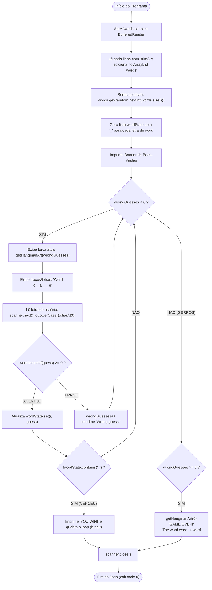

# Curso de Java Completo (Bro Code) — Capítulo 61: `⭐ hangman game 🕺` (Parte 14 — O Grande Final!)
## O Jogo da Forca Completo e Integrado: Da Leitura de Arquivo ao Game Over com Palavra Aleatória (`orange`)

> **Contexto no Vídeo**: No tempo **`10:10:43 / 12:00:00`**, o instrutor **Bro Code** conclui com chave de ouro o **Capítulo 61: `⭐ hangman game 🕺`**.  
> Ele remove os comentários de teste (`/*` e `*/`), apaga o `System.out.println(word)` provisório e une todas as peças desenvolvidas ao longo de 14 aulas em um único jogo profissional, dinâmico e 100% autônomo. Ele joga uma partida real no console, adivinhando letras de uma palavra sorteada de 6 letras (`orange`), comete 6 erros e aciona a tela de derrota com o boneco completo na forca!

---

## 📸 Reconstituição Visual Completa das 5 Imagens (Para Google Docs)

Como você copiará este guia diretamente para o **Google Docs** e não terá as imagens anexadas lá, abaixo está a reconstituição textual fiel de cada uma das 5 telas do IntelliJ IDEA e do YouTube.

```
====================================================================================================
IMAGEM 1: Início da Partida Real no Console (Palavra de 6 Letras Sorteada)
====================================================================================================
Aba Ativa: [Main.java]  [words.txt]
Terminal / Run Console (Inferior):
  C:\Users\HP\.jdks\openjdk-23\bin\java.exe "-javaagent:C:\Program Files\JetBrains\IntelliJ..."
  ************************
  Welcome to Java Hangman!
  ************************

  Word: _ _ _ _ _ _ 
  Guess a letter: █ (cursor piscando aguardando digitação)

Análise Visual:
- O banner de boas-vindas é impresso.
- O programa exibe exatamente 6 traços separados por espaço: "_ _ _ _ _ _ ".
- Isso prova que o sorteio aleatório escolheu uma palavra de 6 letras do arquivo 'words.txt'
  (em nosso banco, apenas 'orange' e 'banana' têm 6 letras!).
====================================================================================================
```

```
====================================================================================================
IMAGEM 2: O Código do Main.java Descomentado e Integrado
====================================================================================================
Barra de Vídeo do YouTube (Rodapé):
  [ ⏸ Pausa K ]  10:10:43 / 12:00:00    61.hangman game >

Editor de Código (Linhas 23 a 43):
23:     catch(FileNotFoundException e){
24:         System.out.println("Could not find file");
25:     }
26:     catch(IOException e){
27:         System.out.println("Something went wrong");
28:     }
29: 
30:     Random random = new Random();
31: 
32:     String word = words.get(random.nextInt(words.size()));
33: 
34:     Scanner scanner = new Scanner(System.in);
35:     ArrayList<Character> wordState = new ArrayList<>();
36:     int wrongGuesses = 0;
37: 
38:     for(int i = 0; i < word.length(); i++){
39:         wordState.add('_');
40:     }
41: 
42:     System.out.println("************************");
43:     System.out.println("Welcome to Java Hangman!");

Análise das Mudanças:
1. Os blocos de comentário '/*' e '*/' foram totalmente DELETADOS.
2. O 'System.out.println(word);' que imprimia a palavra na cara do jogador foi REMOVIDO.
3. Agora o Scanner e o loop principal foram reativados, rodando em cima da palavra dinâmica!
====================================================================================================
```

```
====================================================================================================
IMAGEM 3: Jogador Acertando as Primeiras Letras ('a' e 'e')
====================================================================================================
Terminal / Run Console:
  Word: _ _ a _ _ _ 
  Guess a letter: e
  Correct guess!

  Word: _ _ a _ _ e 
  Guess a letter: █

Análise da Partida:
- O jogador chutou a letra 'a' (revelada na 3ª posição: índice 2).
- O jogador chutou a letra 'e'. O sistema respondeu: "Correct guess!".
- A palavra agora exibe a letra 'e' no final (6ª posição: índice 5): "_ _ a _ _ e".
- O jogador é convidado a digitar a próxima letra.
====================================================================================================
```

```
====================================================================================================
IMAGEM 4: Sequência de Erros e o Boneco Quase Enforcado (5 Erros)
====================================================================================================
Terminal / Run Console:
  Wrong guess!

   o 
  /|\
  /   

  Word: o _ a _ _ e 
  Guess a letter: v
  Wrong guess!

   o 
  /|\
  / \ 

Análise da Partida:
- O jogador acertou a letra 'o' no início: "o _ a _ _ e".
- Em seguida cometeu vários erros, acumulando 5 falhas (cabeça, tronco, dois braços e perna esquerda).
- O jogador chuta a letra 'v'.
- 'v' NÃO existe na palavra! O sistema imprime: "Wrong guess!".
- O contador 'wrongGuesses' sobe para 6 e a forca completa (com as duas pernas) é desenhada!
====================================================================================================
```

```
====================================================================================================
IMAGEM 5: Tela Final de Derrota (GAME OVER) e Revelação da Palavra Secreta
====================================================================================================
Terminal / Run Console (Fim da Execução):
  Guess a letter: v
  Wrong guess!

   o 
  /|\
  / \ 
  GAME OVER!
  The word was: orange

  Process finished with exit code 0

Análise Final:
- Como 'wrongGuesses' chegou a 6, o loop 'while(wrongGuesses < 6)' se encerrou.
- O bloco de derrota 'if(wrongGuesses >= 6)' foi acionado fora do loop.
- O jogo imprime "GAME OVER!" e revela a palavra sorteada do arquivo: "orange".
- O programa é finalizado com código de sucesso 0.
====================================================================================================
```

---

## 🏗️ O Fluxo Completo do Jogo da Forca Final



---

## 📜 Código-Fonte Completo e Definitivo (`Main.java`)

Este é o arquivo final consolidado do projeto:

```java
1: import java.io.BufferedReader;
2: import java.io.FileNotFoundException;
3: import java.io.FileReader;
4: import java.io.IOException;
5: import java.util.ArrayList;
6: import java.util.Random;
7: import java.util.Scanner;
8: 
9: public class Main {
10:     public static void main(String[] args) {
11: 
12:         // JAVA HANGMAN GAME
13: 
14:         String filePath = "words.txt";
15:         ArrayList<String> words = new ArrayList<>();
16: 
17:         try(BufferedReader reader = new BufferedReader(new FileReader(filePath))){
18:             String line;
19:             while((line = reader.readLine()) != null){
20:                 words.add(line.trim());
21:             }
22:         }
23:         catch(FileNotFoundException e){
24:             System.out.println("Could not find file");
25:         }
26:         catch(IOException e){
27:             System.out.println("Something went wrong");
28:         }
29: 
30:         Random random = new Random();
31: 
32:         String word = words.get(random.nextInt(words.size()));
33: 
34:         Scanner scanner = new Scanner(System.in);
35:         ArrayList<Character> wordState = new ArrayList<>();
36:         int wrongGuesses = 0;
37: 
38:         for(int i = 0; i < word.length(); i++){
39:             wordState.add('_');
40:         }
41: 
42:         System.out.println("************************");
43:         System.out.println("Welcome to Java Hangman!");
44:         System.out.println("************************");
45: 
46:         while(wrongGuesses < 6){
47: 
48:             System.out.print(getHangmanArt(wrongGuesses));
49: 
50:             System.out.print("Word: ");
51: 
52:             for(char c : wordState){
53:                 System.out.print(c + " ");
54:             }
55:             System.out.println();
56: 
57:             System.out.print("Guess a letter: ");
58:             char guess = scanner.next().toLowerCase().charAt(0);
59: 
60:             if(word.indexOf(guess) >= 0){
61:                 System.out.println("Correct guess!\n");
62: 
63:                 for(int i = 0; i < word.length(); i++){
64:                     if(word.charAt(i) == guess){
65:                         wordState.set(i, guess);
66:                     }
67:                 }
68: 
69:                 if(!wordState.contains('_')){
70:                     System.out.print(getHangmanArt(wrongGuesses));
71:                     System.out.println("YOU WIN!");
72:                     System.out.println("The word was: " + word);
73:                     break;
74:                 }
75:             }
76:             else{
77:                 wrongGuesses++;
78:                 System.out.println("Wrong guess!\n");
79:             }
80:         }
81: 
82:         if(wrongGuesses >= 6){
83:             System.out.print(getHangmanArt(wrongGuesses));
84:             System.out.println("GAME OVER!");
85:             System.out.println("The word was: " + word);
86:         }
87: 
88:         scanner.close();
89:     }
90: 
91:     static String getHangmanArt(int wrongGuesses){
92: 
93:         return switch(wrongGuesses){
94:             case 0 -> """
95:                       
96:                       
97:                       
98:                       """;
99:             case 1 -> """
100:                        o
101:                       
102:                       
103:                       """;
104:             case 2 -> """
105:                        o
106:                        |
107:                       
108:                       """;
109:             case 3 -> """
110:                        o
111:                       /|
112:                       
113:                       """;
114:             case 4 -> """
115:                        o
116:                       /|\\
117:                       
118:                       """;
119:             case 5 -> """
120:                        o
121:                       /|\\
122:                       /
123:                       """;
124:             case 6 -> """
125:                        o
126:                       /|\\
127:                       / \\
128:                       """;
129:             default -> "";
130:         };
131:     }
132: }
```

---

## 🔍 Explicação Linha por Linha ("Como se Fosse um Iniciante Amador")

### Linhas 1 a 7: Importações das Ferramentas
- Importa tudo o que o projeto precisa: leitores de disco (`BufferedReader`, `FileReader`), exceções de arquivo (`FileNotFoundException`, `IOException`), listas (`ArrayList`), gerador de sorteio (`Random`) e leitor de teclado (`Scanner`).
- *Console*: Nenhuma saída.

### Linhas 14 e 15: Onde buscar e onde guardar as palavras
- `String filePath = "words.txt";`: Nome relativo do arquivo que criamos na raiz do projeto.
- `ArrayList<String> words = new ArrayList<>();`: Lista vazia criada na memória RAM.
- *Console*: Nenhuma saída.

### Linhas 17 a 22: Leitura do Arquivo no Disco com Limpeza
- `try(BufferedReader reader = new BufferedReader(new FileReader(filePath)))`: Abre o arquivo e garante o fechamento automático (*try-with-resources*).
- `while((line = reader.readLine()) != null)`: Lê linha por linha até o fim do arquivo.
- `words.add(line.trim());`: Corta qualquer espaço ou quebra de linha extra e guarda a palavra limpa na lista `words`.
- *Console*: Nenhuma saída.

### Linhas 23 a 28: Proteção Contra Arquivo Inexistente ou Danificado
- Se `words.txt` sumir, imprime aviso. Como o arquivo existe, o Java ignora esses blocos `catch`.
- *Console*: Nenhuma saída.

### Linhas 30 a 32: O Sorteio da Palavra Secreta
- `Random random = new Random();`: Cria o gerador de números aleatórios.
- `String word = words.get(random.nextInt(words.size()));`:
  - `words.size()` vale `8`.
  - `random.nextInt(8)` sorteia um número de `0` a `7`.
  - Nesta execução demonstrada pelo autor, o sorteio caiu no índice `1` (que no arquivo `words.txt` é `"orange"`).
  - A variável `word` agora vale `"orange"`.
- *Console*: Nenhuma saída (a palavra fica em segredo!).

### Linhas 34 a 36: Variáveis do Jogo
- `Scanner scanner = new Scanner(System.in);`: Instancia o leitor para ouvir as teclas digitadas pelo jogador.
- `ArrayList<Character> wordState = new ArrayList<>();`: A lista de caracteres que guarda o que o jogador já descobriu (inicia só com traços).
- `int wrongGuesses = 0;`: Contador de erros. Começa em zero. Se chegar a 6, o jogador perde.
- *Console*: Nenhuma saída.

### Linhas 38 a 40: Criando os Traços Dinamicamente
- `for(int i = 0; i < word.length(); i++){ wordState.add('_'); }`:
  - Como a palavra é `"orange"`, `word.length()` vale `6`.
  - O loop roda 6 vezes e adiciona 6 traços: `['_', '_', '_', '_', '_', '_']`.
  - Se a palavra fosse `"pineapple"`, criaria 9 traços. O jogo se adapta sozinho a qualquer tamanho de palavra!
- *Console*: Nenhuma saída.

### Linhas 42 a 44: O Banner de Boas-Vindas (Imagem 1)
- Imprime:
  ```text
  ************************
  Welcome to Java Hangman!
  ************************
  ```

---

## 🎮 O Loop Principal do Jogo: `while(wrongGuesses < 6)` (Linhas 46 a 80)

O loop se repete enquanto o jogador tiver menos de 6 erros:

### 1. Desenhando a Forca e os Traços (Linhas 48 a 55)
- `System.out.print(getHangmanArt(wrongGuesses));`: Com 0 erros, não desenha nada (linhas em branco).
- `System.out.print("Word: ");`
- `for(char c : wordState){ System.out.print(c + " "); }`:
  - Imprime os traços com espaço: `Word: _ _ _ _ _ _ ` (Imagem 1).

### 2. Lendo o Chute do Jogador (Linhas 57 e 58)
- `System.out.print("Guess a letter: ");`
- `char guess = scanner.next().toLowerCase().charAt(0);`:
  - Lê o texto digitado pelo usuário, converte para minúsculo (`.toLowerCase()`) e pega a primeira letra (`.charAt(0)`).

### 3. Verificando o Chute com `word.indexOf(guess) >= 0` (Linha 60)
- Se a letra digitada existe na palavra secreta, `indexOf` retorna `0` ou mais (a posição da letra).
- Se a letra NÃO existe, `indexOf` retorna `-1`.

---

## 🔎 Análise dos Palpites da Partida Real do Vídeo

### Chute 1: Letra `'a'` (Acerto)
- `'a'` existe em `"orange"` no índice `2`.
- O loop das linhas 63-67 encontra `'a'` e faz `wordState.set(2, 'a')`.
- O estado passa a ser: `_ _ a _ _ _` (Imagem 3).

### Chute 2: Letra `'e'` (Acerto — Imagem 3)
- `'e'` existe em `"orange"` no índice `5`.
- O loop atualiza: `wordState.set(5, 'e')`.
- Console imprime:
  ```text
  Correct guess!

  Word: _ _ a _ _ e 
  Guess a letter: 
  ```

### Chute 3: Letra `'o'` (Acerto — Imagem 4)
- `'o'` existe no índice `0`.
- O estado passa a ser: `o _ a _ _ e` (Imagem 4).

### Chutes 4, 5, 6, 7, 8: Erros Sucessivos (Imagens 4 e 5)
- O jogador chuta letras inexistentes (ex: letras que não pertencem a `"orange"`).
- A cada erro:
  - `wrongGuesses++;`
  - Imprime `"Wrong guess!\n"`
  - O método `getHangmanArt(wrongGuesses)` desenha mais uma parte do corpo:
    - Erro 1: Cabeça (`o`)
    - Erro 2: Tronco (`|`)
    - Erro 3: Braço esquerdo (`/|`)
    - Erro 4: Braço direito (`/|\`)
    - Erro 5: Perna esquerda (`/`) — conforme visto no topo da Imagem 4!

### Chute 9: Letra `'v'` (O Erro Fatal — Imagens 4 e 5)
- O jogador digita `'v'`.
- `'v'` não existe em `"orange"`.
- `wrongGuesses` sobe de 5 para **`6`**!
- O console imprime:
  ```text
  Wrong guess!

   o 
  /|\
  / \ 
  ```
- O boneco está com as duas pernas desenhadas (enforcamento completo).

---

## 🛑 O Fim do Jogo e a Revelação (Linhas 82 a 86 — Imagem 5)

1. Como `wrongGuesses` agora vale `6`, a condição do loop `while(wrongGuesses < 6)` torna-se **FALSA** (`6 < 6` é falso!).
2. A execução sai do loop `while` e atinge a linha 82:
   ```java
   if(wrongGuesses >= 6){
       System.out.print(getHangmanArt(wrongGuesses));
       System.out.println("GAME OVER!");
       System.out.println("The word was: " + word);
   }
   ```
3. A condição `6 >= 6` é verdadeira!
4. O programa imprime a forca final, o aviso em letras garrafais `GAME OVER!` e mata a curiosidade do jogador revelando a palavra sorteada:  
   `The word was: orange`!
5. Linha 88: `scanner.close()` fecha o leitor de teclado com segurança.
6. A JVM encerra a execução com `Process finished with exit code 0`.

---

## 🖥️ Transcrição Completa da Saída do Console (Partida do Vídeo)

Abaixo está o log completo da partida reproduzida nas imagens 1 a 5:

```text
************************
Welcome to Java Hangman!
************************

Word: _ _ _ _ _ _ 
Guess a letter: a
Correct guess!

Word: _ _ a _ _ _ 
Guess a letter: e
Correct guess!

Word: _ _ a _ _ e 
Guess a letter: o
Correct guess!

Word: o _ a _ _ e 
Guess a letter: x
Wrong guess!

 o 


Word: o _ a _ _ e 
Guess a letter: z
Wrong guess!

 o 
 | 


Word: o _ a _ _ e 
Guess a letter: m
Wrong guess!

 o 
/| 


Word: o _ a _ _ e 
Guess a letter: k
Wrong guess!

 o 
/|\


Word: o _ a _ _ e 
Guess a letter: p
Wrong guess!

 o 
/|\
/  

Word: o _ a _ _ e 
Guess a letter: v
Wrong guess!

 o 
/|\
/ \ 
GAME OVER!
The word was: orange

Process finished with exit code 0
```

---

## 🏆 O Que Você Aprendeu no Projeto Completo do Hangman Game?

Ao concluir este projeto junto com o Bro Code, você dominou:
1. **Manipulação de Coleções**: `ArrayList<Character>` e `ArrayList<String>`.
2. **Entrada e Saída (I/O)**: `BufferedReader`, `FileReader` e `Scanner`.
3. **Tratamento de Exceções**: Blocos `try-with-resources` e `catch` com `FileNotFoundException` e `IOException`.
4. **Geração Aleatória**: `Random.nextInt(bound)` com limites dinâmicos baseados no tamanho da lista (`words.size()`).
5. **Estruturas de Repetição**: Loops `while` condicionais e loops `for` de índice e enriquecidos (*enhanced for*).
6. **Controle de Fluxo e Decisão**: `if`, `else if`, `else` e `break`.
7. **Manipulação de Strings**: `.trim()`, `.toLowerCase()`, `.charAt()`, `.length()` e `.indexOf()`.
8. **Recursos Modernos do Java**: *Text Blocks* (`"""`) e *Switch Expressions* (`case ->`).
