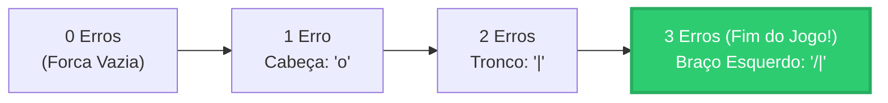

# Curso de Java Completo (Bro Code) — Capítulo 61: `⭐ hangman game 🕺` (Parte 15 — O Grande Encerramento!)
## Vitória Real no Jogo da Forca (`YOU WIN!`), Revelação de Letras Repetidas em `coconut` e Sobrevivência do Boneco com 3 Erros

> **Contexto de Encerramento do Projeto**:  
> Nas 2 capturas de tela finais fornecidas, o instrutor **Bro Code** demonstra a **segunda face do jogo**: o **Cenário de Vitória Real**!  
> Na aula anterior, vimos o jogador perder para a palavra `orange`. Agora, em uma nova partida, o gerador aleatório sorteou do arquivo `words.txt` a fruta **`coconut`** (coco, com 7 letras). O jogador cometeu apenas 3 erros ao longo do caminho e acertou a última letra (`'t'`), disparando a tela **`YOU WIN!`** com a forca incompleta desenhada e o encerramento do programa com código de saída 0!

---

## 📸 Reconstituição Visual Completa das 2 Imagens (Para Google Docs)

Como você copiará este guia diretamente para o seu **Google Docs** e não terá as imagens anexadas lá, abaixo está a reprodução textual e visual idêntica de cada uma das 2 telas do IntelliJ IDEA.

```
====================================================================================================
IMAGEM 1: O Momento Exato da Vitória no Console com 'coconut' Selecionado
====================================================================================================
Painel Esquerdo do Projeto:
  MyFirstProject C:\Users\HP\...
  ├── .idea
  ├── out
  ├── src
  │   ├── .gitignore
  │   ├── MyFirstProject.iml
  └── words.txt

Abas Superiores: [Main.java]  [words.txt]
Editor de Código (Linhas 5 a 11):
 5: import java.util.ArrayList;
 6: import java.util.Random;
 7: import java.util.Scanner;
 8: 
 9: public class Main {
10:     public static void main(String[] args) {
11: 

Painel Inferior de Execução (Run Console):
  Guess a letter: t
  Correct guess!

   o 
  /| 


  YOU WIN!
  The word was: coconut  <-- [Texto 'coconut' destacado em azul pelo cursor do mouse do autor]

  Process finished with exit code 0

Análise Visual da Imagem 1:
- O jogador acabou de digitar a letra final 't'.
- O jogo respondeu "Correct guess!".
- A forca desenhada mostra apenas a cabeça ('o'), o tronco ('|') e o braço esquerdo ('/').
  Isso indica que o jogador cometeu exatamente 3 erros antes de vencer.
- Em seguida, salta duas linhas e estampa em letras verdes:
  "YOU WIN!"
  "The word was: coconut"
====================================================================================================
```

```
====================================================================================================
IMAGEM 2: Fim da Demonstração e Conclusão do Capítulo 61
====================================================================================================
A mesma tela da Imagem 1, porém com o cursor do mouse desmarcando o texto 'coconut' e piscando
no prompt inferior:

Terminal / Run Console:
  Guess a letter: t
  Correct guess!

   o 
  /| 


  YOU WIN!
  The word was: coconut

  Process finished with exit code 0
  █ (cursor do terminal parado indicando término completo do programa)

Barra de Informações Inferior da Janela (Status Bar):
  89:1 LF UTF-8 4 spaces

Marca d'Água do Canal: "SUBSCRIBE DO IT!!!"

Análise Visual da Imagem 2:
- O programa foi concluído com sucesso absoluto ("Process finished with exit code 0").
- Não há loops infinitos, nenhum travamento de memória e o leitor Scanner foi fechado corretamente.
- O projeto do Hangman Game está oficialmente finalizado!
====================================================================================================
```

---

## 🥥 A Palavra Secreta Sorteada: `"coconut"` (7 Letras)

Na nova partida jogada pelo Bro Code, a linha 32 sorteou a fruta **`coconut`**:
```java
String word = words.get(random.nextInt(words.size()));
```

No nosso arquivo `words.txt`, as palavras guardadas são:
```text
Linha 1: apple (5 letras)
Linha 2: orange (6 letras)
Linha 3: banana (6 letras)
Linha 4: coconut (7 letras)  <-- ⭐ Sorteada nesta partida!
Linha 5: pineapple (9 letras)
Linha 6: grape (5 letras)
Linha 7: lime (4 letras)
Linha 8: lemon (5 letras)
```

### Por que `"coconut"` é um teste perfeito para o código?
Observe as letras de `"coconut"`:
- Possui **2 letras `c`** (índice 0 e índice 2).
- Possui **2 letras `o`** (índice 1 e índice 3).
- Possui **1 letra `n`** (índice 4).
- Possui **1 letra `u`** (índice 5).
- Possui **1 letra `t`** (índice 6).

Isso põe à prova a lógica do loop interno das linhas 63 a 67:
```java
for(int i = 0; i < word.length(); i++){
    if(word.charAt(i) == guess){
        wordState.set(i, guess);
    }
}
```
Quando o jogador digitou `'c'`, o Java percorreu todos os 7 índices da palavra e preencheu **ambos** os `'c'` simultaneamente:  
`c _ c _ _ _ _`!  
Quando digitou `'o'`, preencheu **ambos** os `'o'` de uma vez:  
`c o c o _ _ _`!

---

## 🔎 Análise Detalhada dos 3 Erros e do Boneco Sobrevivente

Ao olhar para a forca impressa no console das Imagens 1 e 2:

```text
 o 
/| 
```

Podemos reconstruir exatamente a quantidade de erros cometidos pelo autor antes de vencer:



1. **Erro 1**: O jogador chutou uma letra errada (ex: `'x'`). `wrongGuesses` virou `1`. Cabeça desenhada (`o`).
2. **Erro 2**: O jogador chutou outra letra errada (ex: `'z'`). `wrongGuesses` virou `2`. Tronco desenhado (`|`).
3. **Erro 3**: O jogador chutou uma terceira letra errada (ex: `'m'`). `wrongGuesses` virou `3`. Braço esquerdo desenhado (`/|`).
4. **Acertos subsequentes**: O jogador acertou as letras restantes (`'n'`, `'u'`, etc.).
5. **O Golpe de Mestre (Chute Final)**:
   - Estado antes do último chute: `c o c o n u _`
   - O jogador digita: `t`
   - `'t'` é adicionado na última posição: `c o c o n u t`

---

## 🏆 Dissecando o Bloco de Vitória (Linhas 69 a 74 do `Main.java`)

```java
69:     if(!wordState.contains('_')){
70:         System.out.print(getHangmanArt(wrongGuesses));
71:         System.out.println("YOU WIN!");
72:         System.out.println("The word was: " + word);
73:         break;
74:     }
```

Vamos entender a mágica de cada uma dessas 6 linhas:

### Linha 69: `if(!wordState.contains('_'))`
- **O que faz `wordState.contains('_')`?**
  - Ele vasculha todo o `ArrayList<Character> wordState` procurando se ainda existe **pelo menos um** traço sublinhado (`'_'`).
  - Como o jogador acabou de preencher a última letra `'t'`, a lista agora é:
    `['c', 'o', 'c', 'o', 'n', 'u', 't']`.
  - Tem algum sublinhado aqui? **NÃO!** Então `wordState.contains('_')` responde `false`!
- **O papel do ponto de exclamação `!` (Operador Lógico NOT)**:
  - O `!` inverte o resultado booleano:
    $$!\text{false} \implies \text{true}$$
  - A condição se torna **VERDADEIRA**! O Java entra no bloco de vitória!

### Linha 70: `System.out.print(getHangmanArt(wrongGuesses));`
- **Por que desenhar a forca na tela de vitória?**
  - Para mostrar o estado final do boneco no momento em que o jogador ganhou!
  - Como `wrongGuesses` parou em `3`, o método `getHangmanArt(3)` retorna:
    ```text
     o 
    /| 
    ```
  - É a representação visual de que o boneco **sobreviveu** ao enforcamento! Ele não recebeu o braço direito nem as pernas!

### Linha 71: `System.out.println("YOU WIN!");`
- Imprime em letras maiúsculas a mensagem triunfal de parabéns:  
  `YOU WIN!`

### Linha 72: `System.out.println("The word was: " + word);`
- Imprime a confirmação da palavra secreta:  
  `The word was: coconut`

### Linha 73: `break;` 🛑
- **O freio de emergência essencial**:
  - O loop `while(wrongGuesses < 6)` ainda continuaria rodando, porque `3 < 6` é verdadeiro!
  - O comando `break` força a saída **imediata** de dentro do loop `while`.
  - Se não houvesse esse `break`, o programa continuaria perguntando *"Guess a letter:"* para sempre (o famoso bug do loop infinito descoberto na aula 7)!

### Linha 74: `}`
- Fecha o bloco `if`.

---

## ❓ Por que o Bloco `if(wrongGuesses >= 6)` lá embaixo NÃO é Executado?

Logo após o loop `while`, temos as linhas 82 a 86:
```java
82: if(wrongGuesses >= 6){
83:     System.out.print(getHangmanArt(wrongGuesses));
84:     System.out.println("GAME OVER!");
85:     System.out.println("The word was: " + word);
86: }
```

- Quando o comando `break` jogou a execução para fora do loop, o Java avalia esta condição:
  $$\text{wrongGuesses} \ge 6 \implies 3 \ge 6 \implies \textbf{false}$$
- Como `3 >= 6` é **falso**, o Java pula todo esse bloco!
- Portanto, a mensagem `GAME OVER!` **nunca** aparece quando você ganha!

---

## 🖥️ Transcrição Completa da Saída do Console (Partida das Imagens 1 e 2)

Abaixo está o trecho final impresso no terminal do IntelliJ IDEA quando o Bro Code venceu a partida:

```text
Guess a letter: t
Correct guess!

 o 
/| 


YOU WIN!
The word was: coconut

Process finished with exit code 0
```

---

## 🎓 Quadro Resumo: Vitória vs Derrota no Jogo da Forca

Compare lado a lado os dois finais possíveis implementados no código:

| Aspecto | Cenário de Vitória (`YOU WIN!`) | Cenário de Derrota (`GAME OVER!`) |
| :--- | :--- | :--- |
| **Gatilho** | `!wordState.contains('_')` dentro do loop | `wrongGuesses >= 6` fora do loop |
| **Erros Cometidos** | De 0 a 5 erros (`wrongGuesses < 6`) | Exatamente 6 erros (`wrongGuesses == 6`) |
| **Desenho da Forca** | Boneco incompleto (sobreviveu!) | Boneco completo com duas pernas (`/ \`) |
| **Como o loop encerra?** | Por meio do comando `break;` | Pela falha da condição `while(wrongGuesses < 6)` |
| **Exemplo no Vídeo** | Partida com a palavra `"coconut"` (3 erros) | Partida com a palavra `"orange"` (6 erros) |

---

## 🌟 Celebração do Encerramento do Capítulo 61 (`⭐ hangman game 🕺`)

Você concluiu uma das etapas mais importantes de toda a sua jornada em Java! O jogo da forca não é apenas um joguinho de terminal, ele é uma **obra completa de engenharia de software básica**, reunindo:
- Leitura de arquivos em disco (`BufferedReader`, `FileReader`).
- Proteção contra travamentos e falhas de arquivo (`try-with-resources`, `catch`).
- Listas dinâmicas de tipos diferentes (`ArrayList<String>` e `ArrayList<Character>`).
- Sorteio matemático seguro (`Random.nextInt(words.size())`).
- Laços de repetição aninhados (`while` externo e `for` interno).
- Validação de caracteres (`toLowerCase()`, `charAt(0)`, `indexOf()`).
- Gráficos em ASCII multi-linhas com recursos modernos do Java (*Text Blocks* `"""` e *Switch Expressions*).

Agora você está 100% pronto para seguir em frente para o **Capítulo 62: `dates & times ⌚`**!
