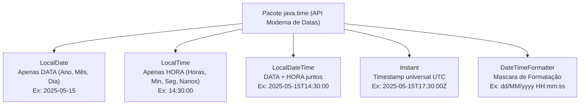

# Curso de Java Completo (Bro Code) — Capítulo 62: `dates & times ⌚` (Parte 1)
## Manipulando e Comparando Datas e Horas com `LocalDateTime`, `.isBefore()`, `.isAfter()` e `.isEqual()`

> **Contexto da Transição de Capítulos**:  
> Nas 5 capturas de tela fornecidas (vídeo no tempo `10:20:19 / 12:00:00`), o instrutor **Bro Code** inicia oficialmente o **Capítulo 62: `dates & times`**!  
> Ele limpa o método `main` do projeto `MyFirstProject` e começa a ensinar a **API moderna de datas e horas do Java** (introduzida no Java 8 dentro do pacote `java.time`), substituindo as antigas e problemáticas classes `java.util.Date` e `java.util.Calendar`.

---

## 📸 Reconstituição Visual Completa das 5 Imagens (Para Google Docs)

Como você irá copiar este conteúdo para o **Google Docs** e não terá as imagens físicas anexadas, abaixo está a reprodução textual e estrutural exata de cada uma das 5 telas do IntelliJ IDEA e do YouTube.

```
====================================================================================================
IMAGEM 1: Configuração Inicial do Teste de Datas e Comparação (Horário de Execução)
====================================================================================================
Painel de Projetos (Esquerda):
  MyFirstProject C:\Users\HP\...
  ├── .idea
  ├── out
  └── src
      ├── A Caring Friend.wav
      ├── Main
      ├── .gitignore
      └── MyFirstProject.iml

Aba Ativa no Editor: Main.java
Linhas visíveis:
10:         // How to work with DATES & TIMES using Java
11:         // (LocalDate, LocalTime, LocalDateTime, UTC timestamp)
12: 
13:         LocalDateTime date1 = LocalDateTime.of(2025, 1, 2, 12, 0, 0);
14:         LocalDateTime date2 = LocalDateTime.of(2025, 1, 1, 0, 0, 0);
15: 
16:         if(date1.isBefore(date2)){
17:             System.out.println(date1 + " is earlier than " + date2);
18:         }
19:         else if(date1.isAfter(date2)){
20:             System.out.println(date1 + " is later than " + date2);
21:         }
22: 
23:     }

Cursor do mouse: Posicionado sobre o botão verde de "Run" (Play) na barra superior.
====================================================================================================
```

```
====================================================================================================
IMAGEM 2: Primeira Execução no Console do IntelliJ IDEA
====================================================================================================
O programa foi executado. O console inferior do IntelliJ foi aberto:

[Terminal / Console Run]:
C:\Users\HP\.jdks\openjdk-23\bin\java.exe "-javaagent:C:\Program Files\JetBrains\IntelliJ..."
2025-01-02T12:00 is later than 2025-01-01T00:00

Process finished with exit code 0

Análise:
- date1 (02 de Janeiro de 2025 às 12:00) foi comparado com date2 (01 de Janeiro de 2025 às 00:00).
- Como date1 é posterior a date2, o bloco 'else if(date1.isAfter(date2))' foi disparado com sucesso!
- No editor, a linha 13 exibe uma pequena lâmpada amarela de aviso/dica da IDE.
====================================================================================================
```

```
====================================================================================================
IMAGEM 3: Autor Digitando a Terceira Condição (Igualdade)
====================================================================================================
Linhas visíveis:
16:         if(date1.isBefore(date2)){
17:             System.out.println(date1 + " is earlier than " + date2);
18:         }
19:         else if(date1.isAfter(date2)){
20:             System.out.println(date1 + " is later than " + date2);
21:         }
22:         else if(date1.isEqual(date2)){
23: 
24:         }
25:     }
26: }

Análise:
- O autor percebe que duas datas podem não ser apenas "antes" ou "depois", mas também exatamente IGUAIS!
- Ele começa a digitar 'else if(date1.isEqual(date2)){' na linha 22.
====================================================================================================
```

```
====================================================================================================
IMAGEM 4: Alteração dos Dados para Testar a Condição de Igualdade
====================================================================================================
Linhas visíveis:
 7: public class Main {
 8:     public static void main(String[] args) {
 9: 
10:         // How to work with DATES & TIMES using Java
11:         // (LocalDate, LocalTime, LocalDateTime, UTC timestamp)
12: 
13:         LocalDateTime date1 = LocalDateTime.of(2025, 1, 1, 0, 0, 0);
14:         LocalDateTime date2 = LocalDateTime.of(2025, 1, 1, 0, 0, 0);
15: 
16:         if(date1.isBefore(date2)){
17:             System.out.println(date1 + " is earlier than " + date2);
18:         }
19:         else if(date1.isAfter(date2)){
20:             System.out.println(date1 + " is later than " + date2);
21:         }
22:         else if(date1.isEqual(date2)){

Análise:
- Na linha 13, o autor alterou o dia de '2' para '1' e a hora de '12' para '0'.
- Agora 'date1' e 'date2' apontam para o mesmo segundo: 01/01/2025 às 00:00:00!
====================================================================================================
```

```
====================================================================================================
IMAGEM 5: Visão do Topo do Arquivo (Imports) e Barra do Player do YouTube
====================================================================================================
Linhas visíveis (1 a 17):
 1: import java.time.Instant;
 2: import java.time.LocalDate;
 3: import java.time.LocalDateTime;
 4: import java.time.LocalTime;
 5: import java.time.format.DateTimeFormatter;
 6: 
 7: public class Main {
 8:     public static void main(String[] args) {
 9: 
10:         // How to work with DATES & TIMES using Java
11:         // (LocalDate, LocalTime, LocalDateTime, UTC timestamp)
12: 
13:         LocalDateTime date1 = LocalDateTime.of(2025, 1, 1, 0, 0, 0);
14:         LocalDateTime date2 = LocalDateTime.of(2025, 1, 1, 0, 0, 0);
15: 
16:         if(date1.isBefore(date2)){
17:             System.out.println(date1 + " is earlier than " + date2);

Barra de Reprodução do YouTube (Rodapé):
- Tempo do vídeo: 10:20:19 / 12:00:00
- Título do Capítulo: "62. dates & times"
- Marca d'água do canal: "SUBSCRIBE DO IT!!!"
====================================================================================================
```

---

## 🧠 Entendendo o Conceito: Por Que Datas em Java Eram Difíceis e Como Ficou Moderno?

Imagine que antes do Java 8 (em versões antigas lançadas há muitos anos), para trabalhar com datas usava-se `java.util.Date` e `java.util.Calendar`. Essas classes tinham problemas graves:
1. **Meses com base zero**: Janeiro era o mês `0` e Dezembro era o mês `11` (o que causava confusões infinitas!).
2. **Mutabilidade perigosa**: Se você passasse uma data para um método, ele podia alterar a sua data sem você saber.
3. **Não eram seguras para múltiplas threads** (*Thread-unsafe*).

Por isso, o Java introduziu a **Time API moderna** dentro do pacote `java.time`. Tudo agora é:
- **Imutável**: Uma vez criada a data, ela nunca mais é alterada; se você modificar algo, um novo objeto é gerado.
- **Intuitiva**: Janeiro é o mês `1`, Fevereiro é `2` e Dezembro é `12`.
- **Especializada**: Cada classe tem um propósito cirúrgico e direto.

---

## 📦 O Pacote `java.time`: Explicando Cada Import (Linhas 1 a 5)

Na **Imagem 5**, o Bro Code importou as 5 ferramentas fundamentais desse capítulo:



| Import | O que representa? | Analogia da Vida Real | Exemplo de Valor |
| :--- | :--- | :--- | :--- |
| `import java.time.LocalDate;` | **Apenas Data**: guarda Ano, Mês e Dia. Não sabe que horas são e não tem fuso horário. | Uma folhinha do calendário de parede da sua cozinha. | `2025-10-09` |
| `import java.time.LocalTime;` | **Apenas Hora**: guarda Horas, Minutos, Segundos e Frações de segundo. Não sabe o dia nem o ano. | Um cronômetro digital ou o relógio de pulso sem data. | `15:45:30` |
| `import java.time.LocalDateTime;` | **Data e Hora Juntos**: une calendário + relógio de pulso. Não possui fuso horário específico. | O convite de um aniversário: *"Dia 10/10 às 19:00"*. | `2025-01-02T12:00:00` |
| `import java.time.Instant;` | **Momento Exato Universal (UTC)**: uma contagem contínua de nanossegundos desde 01/01/1970 UTC. | Uma câmera de satélite registrando um evento mundial no meridiano de Greenwich. | `2025-10-09T21:40:00.123Z` |
| `import java.time.format.DateTimeFormatter;` | **Formatador / Embelezador**: transforma as datas do padrão ISO americano para o padrão que você quiser (ex: brasileiro). | Uma régua com estêncil para escrever a data bonita num documento oficial. | Transforma `2025-01-01` em `01/01/2025`. |

---

## 🔬 Código Completo Consolidado

Abaixo está o código consolidado montado nas imagens 1 a 5, com a adição do corpo do terceiro bloco de teste (`else if` de igualdade):

```java
1: import java.time.Instant;
2: import java.time.LocalDate;
3: import java.time.LocalDateTime;
4: import java.time.LocalTime;
5: import java.time.format.DateTimeFormatter;
6: 
7: public class Main {
8:     public static void main(String[] args) {
9: 
10:         // How to work with DATES & TIMES using Java
11:         // (LocalDate, LocalTime, LocalDateTime, UTC timestamp)
12: 
13:         LocalDateTime date1 = LocalDateTime.of(2025, 1, 2, 12, 0, 0);
14:         LocalDateTime date2 = LocalDateTime.of(2025, 1, 1, 0, 0, 0);
15: 
16:         if(date1.isBefore(date2)){
17:             System.out.println(date1 + " is earlier than " + date2);
18:         }
19:         else if(date1.isAfter(date2)){
20:             System.out.println(date1 + " is later than " + date2);
21:         }
22:         else if(date1.isEqual(date2)){
23:             System.out.println(date1 + " is equal to " + date2);
24:         }
25:     }
26: }
```

---

## 🔍 Explicação Linha por Linha ("Como se Fosse um Iniciante Amador")

### Linha 1: `import java.time.Instant;`
- **O que faz**: Traz a classe `Instant` da biblioteca oficial do Java para a memória.
- **Por que está aí?**: O Bro Code já importou no início do arquivo porque usará nos próximos minutos da aula para demonstrar marcas de tempo globais (timestamps UTC).
- **Console**: Nenhuma saída no console.

### Linha 2: `import java.time.LocalDate;`
- **O que faz**: Traz a classe `LocalDate` (que guarda apenas o dia, mês e ano, sem horário).
- **Console**: Nenhuma saída no console.

### Linha 3: `import java.time.LocalDateTime;`
- **O que faz**: Traz a classe `LocalDateTime` (que combina data completa + relógio de horas, minutos e segundos).
- **Importância crucial**: É a classe que está sendo ativamente instanciada e comparada nas linhas 13 e 14!
- **Console**: Nenhuma saída no console.

### Linha 4: `import java.time.LocalTime;`
- **O que faz**: Traz a classe `LocalTime` (que armazena somente horas, minutos, segundos e nanossegundos).
- **Console**: Nenhuma saída no console.

### Linha 5: `import java.time.format.DateTimeFormatter;`
- **O que faz**: Traz o formatador de datas para podermos exibir no padrão que preferirmos (como `dd/MM/yyyy`).
- **Console**: Nenhuma saída no console.

### Linha 6: Linha em branco
- Organização visual.

### Linha 7: `public class Main {`
- Declara a classe pública `Main`, que é o molde do nosso programa.

### Linha 8: `public static void main(String[] args) {`
- O ponto de partida de qualquer programa Java executável. Quando você clica no botão verde Play, a Máquina Virtual Java (JVM) entra exatamente aqui.

### Linha 9: Linha em branco

### Linha 10: `// How to work with DATES & TIMES using Java`
- Comentário explicativo do autor em inglês: *"Como trabalhar com DATAS & HORAS usando Java"*.

### Linha 11: `// (LocalDate, LocalTime, LocalDateTime, UTC timestamp)`
- Comentário listando os quatro conceitos principais que o capítulo 62 abordará.

### Linha 12: Linha em branco

### Linha 13: `LocalDateTime date1 = LocalDateTime.of(2025, 1, 2, 12, 0, 0);`
- **O que acontece aqui?**
  1. `LocalDateTime date1`: Cria uma variável de referência chamada `date1` do tipo `LocalDateTime`.
  2. `LocalDateTime.of(...)`: Chama um **método estático de fábrica** (*static factory method*). 
     > [!NOTE]
     > **Por que NÃO usamos `new LocalDateTime(...)`?**  
     > Os criadores do Java tornaram o construtor do `LocalDateTime` **privado**! Você não pode fazer `new LocalDateTime()`. Em vez disso, você é obrigado a usar métodos de fábrica claros e elegantes como `.of(...)` ou `.now()`.
  3. **Os 6 parâmetros numéricos passados dentro dos parênteses**:
     - `2025`: O Ano (*Year*).
     - `1`: O Mês (*Month* = Janeiro). Diferente do Java antigo, aqui `1` é Janeiro de verdade!
     - `2`: O Dia do Mês (*Day* = dia 2).
     - `12`: A Hora (*Hour* = meio-dia, formato 24 horas, ou seja, 12h).
     - `0`: O Minuto (*Minute* = zero minutos).
     - `0`: O Segundo (*Second* = zero segundos).
  - **Resultado na Memória**: Cria um objeto cronológico representando **02 de Janeiro de 2025 às 12:00:00**.

### Linha 14: `LocalDateTime date2 = LocalDateTime.of(2025, 1, 1, 0, 0, 0);`
- **O que acontece aqui?**
  - Cria o segundo objeto de data e hora:
    - Ano: `2025`
    - Mês: `1` (Janeiro)
    - Dia: `1` (dia primeiro)
    - Hora: `0` (meia-noite / início do dia)
    - Minuto: `0`
    - Segundo: `0`
  - **Resultado na Memória**: Cria um objeto cronológico representando **01 de Janeiro de 2025 às 00:00:00**.

### Linha 15: Linha em branco

### Linha 16: `if(date1.isBefore(date2)){`
- **O que é `.isBefore(...)`?**
  - É um método pronto da classe `LocalDateTime` que responde à pergunta:  
    *"A data guardada em `date1` veio ANTES no tempo em relação à data `date2`?"*
  - Retorna um valor booleano: `true` (verdadeiro) ou `false` (falso).
- **Avaliação no Teste 1 (Imagens 1 e 2)**:
  - `date1` = 02/01/2025 às 12:00.
  - `date2` = 01/01/2025 às 00:00.
  - O dia 2 veio antes do dia 1? **NÃO!** Portanto, retorna `false`.
  - O Java pula a linha 17 e não executa o bloco.

### Linha 17: `System.out.println(date1 + " is earlier than " + date2);`
- Se a condição da linha 16 fosse verdadeira, imprimiria:
  `[date1] is earlier than [date2]` (ex: "é mais cedo que / veio antes de").

### Linha 18: `}`
- Fecha o bloco do primeiro `if`.

### Linha 19: `else if(date1.isAfter(date2)){`
- **O que é `.isAfter(...)`?**
  - É outro método pronto que responde à pergunta:  
    *"A data guardada em `date1` veio DEPOIS no tempo em relação à data `date2`?"*
- **Avaliação no Teste 1 (Imagens 1 e 2)**:
  - O dia 02/01/2025 às 12:00 é posterior a 01/01/2025 às 00:00? **SIM! Com certeza!**
  - O método retorna `true`.
  - O Java **entra** neste bloco e executa a linha 20!

### Linha 20: `System.out.println(date1 + " is later than " + date2);`
- **O que faz**: Imprime a mensagem de que `date1` é mais tarde que `date2`.
- **Como o Java converte `date1` em texto?**  
  Quando você concatena `date1 + " texto"`, o Java chama automaticamente o método `.toString()` do objeto `date1`.
- **Formato ISO-8601 Padrão**:
  - `date1.toString()` vira: `"2025-01-02T12:00"`
  - `date2.toString()` vira: `"2025-01-01T00:00"`
  > [!NOTE]
  > **O que significa a letra `T` no meio?**  
  > É o padrão internacional **ISO-8601**. A letra `T` significa **Time** (Hora), servindo como separador visual fixo entre a parte da Data (`2025-01-02`) e a parte da Hora (`12:00`).
- **Saída Real no Console (Imagem 2)**:
  ```text
  2025-01-02T12:00 is later than 2025-01-01T00:00
  ```

### Linha 21: `}`
- Fecha o bloco do `else if`.

### Linha 22: `else if(date1.isEqual(date2)){` (Digitado nas Imagens 3 e 4)
- **O que é `.isEqual(...)`?**
  - É o método de comparação cronológica que avalia se dois objetos de data representam **exatamente o mesmo instante temporal**.
  - No Teste 1 (Imagens 1 e 2): como o bloco anterior já deu `true`, esta linha nem chega a ser testada.
  - No Teste 2 (Imagens 4 e 5): onde `date1` foi alterado para `(2025, 1, 1, 0, 0, 0)`, as duas primeiras condições dão `false` e esta aqui dá `true`!

### Linha 23: `System.out.println(date1 + " is equal to " + date2);`
- Imprime que as duas datas são iguais.
- **Saída no Console no Teste 2**:
  ```text
  2025-01-01T00:00 is equal to 2025-01-01T00:00
  ```

### Linha 24: `}`
- Fecha o bloco do `else if(date1.isEqual(date2))`.

### Linha 25: `}`
- Fecha o método `main`.

### Linha 26: `}`
- Fecha a classe `Main`.

---

## ⚠️ Armadilha Mortal de Iniciante: Por Que NÃO Usar `<` , `>` ou `==` com Datas?

Muitos programadores que vêm de outras linguagens (como Python) tentam escrever:

```java
// ❌ ISTO NÃO COMPILA EM JAVA! ERRO DE SINTAXE!
if (date1 < date2) { ... } 
if (date1 > date2) { ... }
```

### Por que isso não funciona?
No Java, os operadores relacionais `<`, `>`, `<=`, `>=` funcionam **apenas para tipos primitivos numéricos** (`int`, `double`, `float`, `long`, `char`).  
`LocalDateTime` **não é um número primitivo**, é uma **classe/objeto complexo** que vive na memória Heap!

### E o operador `==`?
```java
// ⚠️ PERIGO GRAVE! NÃO FAÇA ISSO!
if (date1 == date2) { ... }
```
Se você fizer `date1 == date2`, o Java **não vai comparar as datas**! Ele vai comparar se as duas variáveis apontam para o **mesmo endereço de memória física**.  
Mesmo que as duas datas tenham o mesmo dia, mês, ano e hora, se forem dois objetos diferentes instanciados separadamente, `date1 == date2` retornará `false`!

> [!TIP]
> **A Regra de Ouro do Java Moderno para Datas**:  
> Sempre use os métodos com nomes em inglês autodidatas:
> - Para saber se veio antes: `.isBefore(outraData)`
> - Para saber se veio depois: `.isAfter(outraData)`
> - Para saber se é igual: `.isEqual(outraData)`

---

## 📊 Tabela Comparativa de Métodos de Comparação

| Método | Pergunta em Português | Retorno Booleano | Exemplo Prático |
| :--- | :--- | :--- | :--- |
| `date1.isBefore(date2)` | *"A data 1 aconteceu antes da data 2?"* | `boolean` (`true`/`false`) | `01/01` antes de `02/01` ➔ `true` |
| `date1.isAfter(date2)` | *"A data 1 aconteceu depois da data 2?"* | `boolean` (`true`/`false`) | `02/01` depois de `01/01` ➔ `true` |
| `date1.isEqual(date2)` | *"A data 1 é exatamente o mesmo instante da data 2?"* | `boolean` (`true`/`false`) | `01/01 00:00` igual a `01/01 00:00` ➔ `true` |

---

## 🖥️ Resumo das Saídas do Console Previstas

### 1. Cenário 1 (Imagens 1 e 2 - `date1` em 02/01/2025 e `date2` em 01/01/2025):
```text
2025-01-02T12:00 is later than 2025-01-01T00:00
Process finished with exit code 0
```

### 2. Cenário 2 (Imagens 4 e 5 - Ambas as datas em 01/01/2025 às 00:00):
```text
2025-01-01T00:00 is equal to 2025-01-01T00:00
Process finished with exit code 0
```

---

## 🎯 Conclusão e Próximos Passos no Capítulo 62
O Bro Code acabou de demonstrar o núcleo de **comparação de datas e horas**.  
Nos próximos passos deste capítulo (como os imports das linhas 1 a 5 já denunciam), veremos:
1. `LocalDate.now()` e `LocalTime.now()` para pegar o horário atual do sistema do usuário.
2. `Instant.now()` para pegar o instante universal GMT/UTC.
3. `DateTimeFormatter.ofPattern("dd/MM/yyyy HH:mm:ss")` para formatar a saída sem o feio `T` do padrão ISO.
