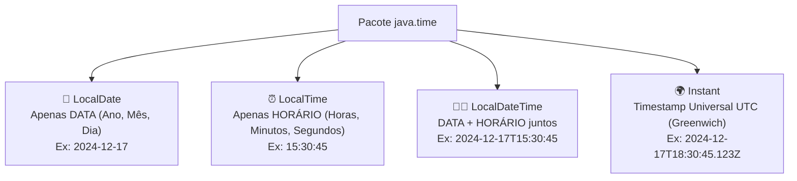

# Curso de Java Completo (Bro Code) — Capítulo 62: `dates & times 📆` (Parte 1)
## Introdução ao `java.time` e Captura da Data Atual do Sistema com `LocalDate.now()`

> **Contexto no Vídeo**: No tempo **`10:11:48 / 12:00:00`**, o instrutor **Bro Code** inicia oficialmente o **Capítulo 62: `dates & times`**!  
> Ele limpa o projeto `MyFirstProject`, adiciona os imports do pacote moderno `java.time` e começa pelo conceito mais fundamental: como capturar **apenas a data de hoje** do sistema operacional usando a classe `LocalDate` e o método `.now()`, exibindo o resultado no formato padrão internacional **ISO-8601** (`AAAA-MM-DD`).

---

## 📸 Reconstituição Visual Completa das 3 Imagens (Para Google Docs)

Como você copiará este guia diretamente para o seu **Google Docs** e não terá as imagens anexadas lá, abaixo está a reconstituição textual exata de cada uma das 3 telas do IntelliJ IDEA e do YouTube.

```
====================================================================================================
IMAGEM 1: Abertura do Capítulo 62 no YouTube (Tempo 10:11:48) e Configuração Inicial
====================================================================================================
Barra de Vídeo do YouTube (Rodapé):
  [ ⏸ Pausa K ]  10:11:48 / 12:00:00    62.dates & times >

Painel Esquerdo de Projetos:
  MyFirstProject C:\Users\HP\...
  ├── .idea
  ├── out
  └── src
      ├── A Caring Friend.wav
      ├── Main
      ├── .gitignore
      └── MyFirstProject.iml

Editor de Código (Main.java):
 5: import java.time.format.DateTimeFormatter;   <-- (Imports 1 a 4 recolhidos/dobrados pela IDE)
 6: 
 7: public class Main {
 8:     public static void main(String[] args) {
 9: 
10:         // How to work with DATES & TIMES using Java
11:         // (LocalDate, LocalTime, LocalDateTime, UTC timestamp)
12: 
13: 
14: 
15:     }
16: }

Análise Visual da Imagem 1:
- O autor limpou o método main após concluir o jogo da forca.
- Ele escreveu comentários de cabeçalho listando os 4 tópicos que serão abordados:
  LocalDate, LocalTime, LocalDateTime e UTC timestamp.
- No lado direito da linha 11, o IntelliJ mostra "+ 5 >" indicando blocos dobrados.
====================================================================================================
```

```
====================================================================================================
IMAGEM 2: Criação do Objeto 'LocalDate date = LocalDate.now()' e Preparação para Rodar
====================================================================================================
Editor de Código (Main.java):
 5: import java.time.format.DateTimeFormatter;
 6: 
 7: public class Main {
 8:     public static void main(String[] args) {
 9: 
10:         // How to work with DATES & TIMES using Java
11:         // (LocalDate, LocalTime, LocalDateTime, UTC timestamp)
12: 
13:         LocalDate date = LocalDate.now();
14: 
15:         System.out.println(date);
16: 
17:     }
18: }

Barra Superior Direita da Janela:
- O cursor do mouse está posicionado sobre o botão verde triangular de "Run" (Play).

Análise Visual da Imagem 2:
- O autor instancia a variável 'date' chamando o método de fábrica 'LocalDate.now()'.
- Em seguida, passa a variável diretamente para 'System.out.println(date)'.
====================================================================================================
```

```
====================================================================================================
IMAGEM 3: Execução no Console Exibindo a Data do Sistema (2024-12-17)
====================================================================================================
Painel Inferior de Execução (Run Console):
  C:\Users\HP\.jdks\openjdk-23\bin\java.exe "-javaagent:C:\Program Files\JetBrains\IntelliJ..."
  2024-12-17   <-- [O número '17' está selecionado/destacado com cursor do mouse]

  Process finished with exit code 0

Análise Visual da Imagem 3:
- O programa foi executado com sucesso e imprimiu: "2024-12-17".
- Essa foi a data exata em que o instrutor Bro Code estava gravando a videoaula (17 de dezembro de 2024).
- O formato gerado é o padrão internacional ISO-8601: Ano-Mês-Dia (AAAA-MM-DD).
====================================================================================================
```

---

## 🧠 A Grande Mudança: Por Que Existe o Pacote `java.time`?

Antes do Java 8, lidar com datas em Java era considerado um pesadelo pelos programadores. Usava-se uma classe chamada `java.util.Date` e outra chamada `java.util.Calendar`.

### Os 3 Grandes Problemas do Passado:
1. **Janeiro era o mês Zero (`0`)**:  
   Se você quisesse representar Dezembro, tinha que escrever mês `11`! Isso causava bugs terríveis.
2. **Eram mutáveis (*Mutable*)**:  
   Se você criava uma data de nascimento e passava para uma função de cálculo de aposentadoria, essa função podia acidentalmente alterar o ano da sua data original!
3. **Mistura confusa de Data e Hora**:  
   Mesmo quando você só queria salvar a data do aniversário de alguém, o Java te forçava a guardar horas, minutos, segundos e fuso horário.

### A Revolução da API Moderna (`java.time`):
A partir do Java 8, o Java ganhou uma biblioteca totalmente reformulada, baseada no famoso projeto *Joda-Time*. Agora:
- **Tudo é Imutável**: Um objeto de data nunca muda depois de criado. Se você somar 5 dias, ele cria um novo objeto e mantém o original intacto.
- **Janeiro é `1`**: Mês 1 é Janeiro, Mês 12 é Dezembro. Sem pegadinhas!
- **Separação Cirúrgica**: Se você quer apenas data, usa `LocalDate`. Se quer apenas horário, usa `LocalTime`. Se quer os dois, usa `LocalDateTime`.

---

## 📦 As Quatro Classes Principais Deste Capítulo



---

## 🔬 O Código-Fonte do `Main.java` Nesta Etapa

```java
1: import java.time.Instant;
2: import java.time.LocalDate;
3: import java.time.LocalDateTime;
4: import java.time.LocalTime;
5: import java.time.format.DateTimeFormatter;
6: 
7: public class Main {
8:     public static void main(String[] args) {
9: 
10:         // How to work with DATES & TIMES using Java
11:         // (LocalDate, LocalTime, LocalDateTime, UTC timestamp)
12: 
13:         LocalDate date = LocalDate.now();
14: 
15:         System.out.println(date);
16: 
17:     }
18: }
```

> [!NOTE]
> **Por que na Imagem 1 e 2 só aparece a linha 5?**  
> O IntelliJ IDEA possui um recurso inteligente chamado *Code Folding* (dobradura de código). Quando há muitos `import`s consecutivos no topo do arquivo, a IDE os encolhe em uma única linha com `...` para economizar espaço de tela. Ao clicar no sinal de `+`, todas as linhas 1 a 5 se expandem!

---

## 🔍 Explicação Linha por Linha ("Como se Fosse um Iniciante Amador")

### Linhas 1 a 5: Os `imports` do `java.time`
- `import java.time.LocalDate;` (Linha 2): Avisa ao compilador Java que usaremos a classe especializada em **datas do calendário**.
- `import java.time.LocalTime;` (Linha 4): Usada para horas, minutos e segundos (será demonstrada nos próximos minutos).
- `import java.time.LocalDateTime;` (Linha 3): Combina data e hora.
- `import java.time.Instant;` (Linha 1): Marca de tempo mundial UTC.
- `import java.time.format.DateTimeFormatter;` (Linha 5): Ferramenta para formatar a data (ex: mudar de `2024-12-17` para `17/12/2024`).
- *Console*: Nenhuma saída.

### Linha 7: `public class Main {`
- Declaração da classe principal do nosso projeto.

### Linha 8: `public static void main(String[] args) {`
- A porta de entrada do programa. Quando o botão verde *Run* é clicado, a Máquina Virtual Java (JVM) começa a executar a partir daqui.

### Linhas 10 e 11: Comentários do Autor
- `// How to work with DATES & TIMES using Java`
- `// (LocalDate, LocalTime, LocalDateTime, UTC timestamp)`
- Linhas que começam com `//` são comentários ignorados pelo compilador. Servem como anotações explicativas no código.

### Linha 12: Linha em branco
- Espaçamento para manter o código limpo e organizado.

### Linha 13: `LocalDate date = LocalDate.now();` ⭐ (A Grande Estrela!)
Vamos desmontar essa instrução pedaço por pedaço:

1. **`LocalDate`**: É o tipo de dado da variável. Diz que essa variável só aceita guardar uma data (sem horário).
2. **`date`**: O nome que demos para a nossa caixinha na memória.
3. **`=`**: Operador de atribuição. Guarda o valor da direita dentro da caixinha da esquerda.
4. **`LocalDate.now()`**:
   - É uma chamada a um **método estático de fábrica** (*static factory method*).
   - "Now" em inglês significa **AGORA**.
   - O método `.now()` vai até o relógio interno do sistema operacional do seu computador e pergunta: *"Que dia é hoje?"*.
   - Ele captura o Ano, o Mês e o Dia daquele exato momento e empacota dentro de um novo objeto `LocalDate`.

> [!IMPORTANT]
> **Por que NÃO fazemos `new LocalDate()`?**  
> Se você tentar escrever `LocalDate date = new LocalDate();`, o Java dará **erro de compilação imediato**!  
> Os arquitetos do Java projetaram os construtores de `LocalDate`, `LocalTime` e `LocalDateTime` como **privados** (`private`). Eles fizeram isso propositalmente para forçar os programadores a usarem métodos com nomes expressivos e claros, como:
> - `LocalDate.now()`: Para pegar a data atual de hoje.
> - `LocalDate.of(2025, 1, 1)`: Para fabricar uma data específica do passado ou futuro.

### Linha 14: Linha em branco

### Linha 15: `System.out.println(date);`
- **O que acontece por baixo dos panos?**
  - O método `println` precisa de um texto (`String`) para exibir na tela do console.
  - Como passamos um objeto `date` (do tipo `LocalDate`), o Java chama automaticamente o método `.toString()` desse objeto.
  - A classe `LocalDate` foi programada para devolver a data no padrão internacional **ISO-8601**:
  $$\text{Formato Padrão} = \textbf{AAAA-MM-DD}$$
  - Onde:
    - `AAAA` = Ano com 4 dígitos (ex: `2024` ou `2026`).
    - `-` = Hífen separador.
    - `MM` = Mês com 2 dígitos com zero à esquerda (ex: `12` para Dezembro, `10` para Outubro).
    - `-` = Hífen separador.
    - `DD` = Dia do mês com 2 dígitos (ex: `17` ou `09`).

### Linhas 17 e 18: Fechamento das Chaves `}`
- Fecham o método `main` e a classe `Main`.

---

## 🖥️ Comparativo de Saídas do Console

### 1. Na Tela do Vídeo do Bro Code (Imagem 3):
```text
2024-12-17

Process finished with exit code 0
```
*Por que saiu `2024-12-17`?*  
Porque quando o Bro Code apertou o botão *Play* no vídeo, o relógio do computador dele marcava **17 de dezembro de 2024**.

### 2. No Seu Computador ao Executar Hoje:
```text
2026-10-09

Process finished with exit code 0
```
*Por que sai diferente?*  
Porque o método `.now()` é **vivo e dinâmico**! Se você rodar o programa amanhã, ele imprimirá o dia de amanhã. Se rodar daqui a 10 anos, imprimirá a data daqui a 10 anos!

---

## 🌍 O Padrão ISO-8601: Por Que Ano Primeiro (`AAAA-MM-DD`)?

Muitos brasileiros estranham ver o ano primeiro em vez do formato tradicional brasileiro (`DD/MM/AAAA`).  
O formato `AAAA-MM-DD` foi padronizado pela organização internacional **ISO** (*International Organization for Standardization*) pelos seguintes motivos:

1. **Ordenação Perfeita**: Se você tiver uma lista de arquivos ou datas em formato texto, a ordem alfabética coincide exatamente com a ordem cronológica!
   - `2024-01-01`
   - `2024-06-15`
   - `2024-12-17`
   - `2025-01-01`
2. **Universalidade**: Elimina a confusão entre o padrão americano (Mês/Dia/Ano) e o padrão brasileiro/europeu (Dia/Mês/Ano).

> [!TIP]
> **E se eu quiser exibir no padrão brasileiro `17/12/2024`?**  
> É exatamente para isso que serve a classe que o Bro Code importou na linha 5: `DateTimeFormatter`! Veremos como usá-la nas próximas etapas deste capítulo.

---

## 📋 Resumo Didático para Fixação

| Termo / Código | O que significa? | Para que serve? |
| :--- | :--- | :--- |
| `java.time` | Pacote de tempo moderno do Java | Conjunto de ferramentas criado no Java 8 para manipular datas e horas de forma segura e elegante. |
| `LocalDate` | Classe de Data Local | Representa uma folha do calendário civil (ano, mês e dia). Não armazena horas nem fuso. |
| `LocalDate.now()` | Método estático "Agora" | Consulta o relógio do computador e retorna a data de hoje. |
| `new LocalDate()` | ❌ Erro de compilação | Construtor é privado; use sempre métodos de fábrica estáticos como `.now()`. |
| `ISO-8601` | Padrão `AAAA-MM-DD` | Formato padrão de texto retornado pelo Java ao imprimir uma data. |
