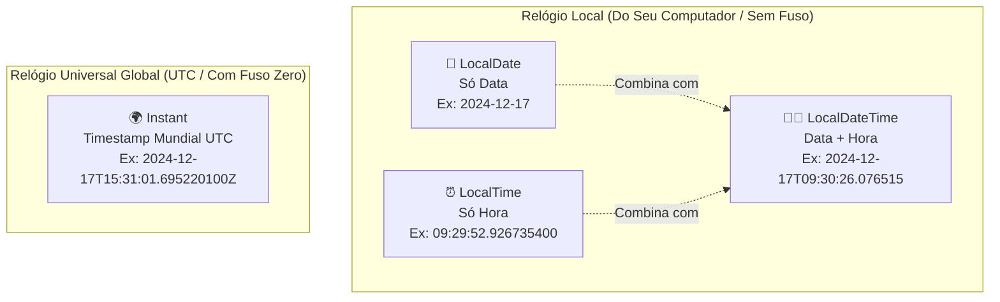

# Curso de Java Completo (Bro Code) — Capítulo 62: `dates & times 📆` (Parte 2)
## Dominando `LocalTime`, `LocalDateTime` e `Instant` (UTC Timestamp)

> **Contexto no Vídeo**: Entre os tempos **`10:12:42`** e **`10:14:00`**, o instrutor **Bro Code** apresenta as outras três classes essenciais do pacote `java.time`:
> 1. **`LocalTime.now()`**: Captura **apenas o horário** do computador (horas, minutos, segundos e nanossegundos).
> 2. **`LocalDateTime.now()`**: Une data e hora em um único objeto, introduzindo o separador internacional **`T`**.
> 3. **`Instant.now()`**: O poderoso **timestamp global UTC**, que consulta o relógio universal de Greenwich e adiciona o sufixo militar/aeronáutico **`Z`** (*Zulu Time*), revelando a diferença de fusos horários.

---

## 📸 Reconstituição Visual Completa das 5 Imagens (Para Google Docs)

Como você copiará este guia diretamente para o seu **Google Docs** e não terá as imagens anexadas lá, abaixo está a reprodução textual e estrutural idêntica de cada uma das 5 telas do IntelliJ IDEA e do YouTube.

```
====================================================================================================
IMAGEM 1: Testando 'LocalTime.now()' (Tempo do Vídeo: 10:12:42)
====================================================================================================
Barra de Vídeo do YouTube (Rodapé):
  [ ⏸ Pausa K ]  10:12:42 / 12:00:00    62.dates & times >

Editor de Código (Main.java):
13:         LocalTime time = LocalTime.now();
14: 
15:         System.out.println(time);
16: 
17:     }

Terminal / Run Console (Inferior):
  C:\Users\HP\.jdks\openjdk-23\bin\java.exe "-javaagent:C:\Program Files\JetBrains\IntelliJ..."
  09:29:52.926735400

  Process finished with exit code 0

Análise Visual da Imagem 1:
- A variável 'time' foi instanciada com 'LocalTime.now()'.
- O console imprimiu apenas o horário local: 9 horas, 29 minutos, 52 segundos e nanossegundos.
- Nenhuma informação de ano, mês ou dia aparece aqui.
====================================================================================================
```

```
====================================================================================================
IMAGEM 2: Digitando 'LocalDateTime.now()' (Tempo do Vídeo: 10:13:05)
====================================================================================================
Barra de Vídeo do YouTube (Rodapé):
  [ ⏸ Pausa K ]  10:13:05 / 12:00:00    62.dates & times >

Editor de Código (Main.java):
 7: public class Main {
 8:     public static void main(String[] args) {
 9: 
10:         // How to work with DATES & TIMES using Java
11:         // (LocalDate, LocalTime, LocalDateTime, UTC timestamp)
12: 
13:         LocalDateTime dateTime = LocalDateTime.now();
14: 
15:         System.out.println(dateTime);
16: 
17:     }
18: }

Barra Superior Direita da Janela:
- O cursor do mouse está sobre o botão triangular verde de "Run" (Play), pronto para disparar a execução.
====================================================================================================
```

```
====================================================================================================
IMAGEM 3: Saída do 'LocalDateTime' no Console com o Separador 'T'
====================================================================================================
Barra de Vídeo do YouTube (Rodapé):
  [ ⏸ Pausa K ]  10:13:08 / 12:00:00    62.dates & times >

Terminal / Run Console (Inferior):
  C:\Users\HP\.jdks\openjdk-23\bin\java.exe "-javaagent:C:\Program Files\JetBrains\IntelliJ..."
  2024-12-17T09:30:26.076515

  Process finished with exit code 0

Análise Visual da Imagem 3:
- O programa imprimiu data E hora juntos: "2024-12-17T09:30:26.076515".
- Note a presença da letra maiúscula 'T' separando a data da hora (padrão ISO-8601).
- Passaram-se cerca de 34 segundos desde a Imagem 1 (o relógio saltou de 09:29:52 para 09:30:26).
====================================================================================================
```

```
====================================================================================================
IMAGEM 4: Primeira Execução de 'Instant.now()' com Sufixo 'Z' (UTC Global)
====================================================================================================
Editor de Código (Main.java):
13:         Instant instant = Instant.now();
14: 
15:         System.out.println(instant);
16: 
17:     }

Terminal / Run Console (Inferior):
  C:\Users\HP\.jdks\openjdk-23\bin\java.exe "-javaagent:C:\Program Files\JetBrains\IntelliJ..."
  2024-12-17T15:31:01.695220100Z

  Process finished with exit code 0

Análise Visual da Imagem 4:
- O autor substituiu o código por 'Instant.now()'.
- O console imprimiu: "2024-12-17T15:31:01.695220100Z".
- Duas grandes novidades visuais:
  1. A letra 'Z' no final da linha (indicando fuso zero / UTC).
  2. A hora pulou de 09h para 15h (+6 horas de diferença em relação ao horário local do Bro Code!).
====================================================================================================
```

```
====================================================================================================
IMAGEM 5: Segunda Execução de 'Instant.now()' com Texto Selecionado pelo Mouse
====================================================================================================
Barra de Vídeo do YouTube (Rodapé):
  Tempo do Vídeo: 10:14 / 12:00:00

Terminal / Run Console (Inferior):
  C:\Users\HP\.jdks\openjdk-23\bin\java.exe "-javaagent:C:\Program Files\JetBrains\IntelliJ..."
  2024-12-17T15:31:40.475033900Z  <-- [Linha inteira destacada em azul pelo cursor do mouse]

  Process finished with exit code 0

Análise Visual da Imagem 5:
- O autor rodou o código uma segunda vez para mostrar a precisão em nanossegundos avançando.
- O relógio avançou de 15:31:01 para 15:31:40 (39 segundos depois).
- O autor selecionou a linha com o mouse para enfatizar a estrutura completa do timestamp UTC.
====================================================================================================
```

---

## 🧭 O Mapa Completo das 4 Classes Fundamentais de Tempo

Imagine que você está organizando sua vida digital. O Java preparou uma ferramenta cirúrgica para cada necessidade:



---

## 🔍 Explicação Detalhada de Cada Trecho de Código

---

### 1️⃣ Parte 1: `LocalTime.now()` (Imagem 1)

```java
13: LocalTime time = LocalTime.now();
15: System.out.println(time);
```

- **O que é `LocalTime`?**
  - É a classe que representa **somente o relógio**.
  - Ela armazena: **Horas, Minutos, Segundos e Frações de Segundo (Nanossegundos)**.
  - Ela **NÃO** sabe que dia é hoje, em que ano estamos, e não se importa com fuso horário.
- **Analogia da Vida Real**:
  - Um alarme no seu celular programado para tocar às `07:00 da manhã`. Não importa se é segunda-feira ou natal, quando o relógio bater 07:00, ele toca!
- **Como o Java imprime a saída?**
  ```text
  09:29:52.926735400
  ```
  - `09`: Horas (formato 24h, de `00` a `23`).
  - `29`: Minutos (de `00` a `59`).
  - `52`: Segundos (de `00` a `59`).
  - `.926735400`: Nanossegundos! O Java divide 1 segundo em até **1 bilhão de partes** (9 dígitos após o ponto).

---

### 2️⃣ Parte 2: `LocalDateTime.now()` (Imagens 2 e 3)

```java
13: LocalDateTime dateTime = LocalDateTime.now();
15: System.out.println(dateTime);
```

- **O que é `LocalDateTime`?**
  - É a **fusão perfeita** entre o `LocalDate` (calendário) e o `LocalTime` (relógio).
  - Guarda Ano, Mês, Dia, Hora, Minuto, Segundo e Nanossegundo juntos em um único objeto.
- **Analogia da Vida Real**:
  - A data de uma consulta médica agendada: *"Dia 17/12/2024 às 09:30"*.
- **Como o Java imprime a saída?**
  ```text
  2024-12-17T09:30:26.076515
  ```

> [!NOTE]
> **O Mistério da Letra `T`**:  
> No meio da impressão existe uma letra maiúscula **`T`** grudando o dia `17` com a hora `09`.  
> Ela vem da norma internacional **ISO-8601**. A letra `T` significa **Time** (Horário). Ela serve exatamente para que computadores e programas ao redor do mundo saibam onde termina a Data e onde começa a Hora!

---

### 3️⃣ Parte 3: `Instant.now()` (Imagens 4 e 5) — O Timestamp UTC

```java
13: Instant instant = Instant.now();
15: System.out.println(instant);
```

Esta é uma das classes mais importantes de toda a engenharia de software corporativa!

- **O que é `Instant`?**
  - Representa um **ponto único e absoluto na linha do tempo do universo**, medido a partir da contagem contínua de segundos desde a meia-noite de 1º de Janeiro de 1970 (conhecida como a *Era Unix* / *Epoch*).
  - O `Instant` **sempre** é expresso no fuso horário **UTC** (*Coordinated Universal Time*), que é o fuso de referência mundial baseado no Meridiano de Greenwich (Londres, Inglaterra).

- **Como o Java imprime a saída?**
  ```text
  2024-12-17T15:31:01.695220100Z
  ```

---

## 🕵️‍♂️ Desvendando os Dois Segredos do `Instant`: A Letra `Z` e o Pulo de 6 Horas!

Compare a saída do `LocalDateTime` (Imagem 3) com a saída do `Instant` (Imagem 4):

| Objeto | Código Executado | Saída no Console | Fuso Horário |
| :--- | :--- | :--- | :--- |
| **`LocalDateTime`** | `LocalDateTime.now()` | `2024-12-17T09:30:26...` | **Local** (Computador do Bro Code) |
| **`Instant`** | `Instant.now()` | `2024-12-17T15:31:01...Z` | **Universal UTC** (Meridiano de Greenwich) |

### 1. O Que Significa a Letra `Z` no Final?
A letra `Z` vem da aviação e das telecomunicações militares e significa **Zulu Time**.  
Na tabela de fusos horários da OTAN, o meridiano de Greenwich (fuso zero) é designado pela letra **Z** (*Zulu*).  
Em computação, ver um `Z` no fim de uma data significa: **"Esta data e hora estão no fuso zero (UTC), sem acréscimo nem desconto de horas"**!

### 2. Por Que a Hora Pulou de 09:30 para 15:31 (+6 Horas)?
- O instrutor Bro Code reside na região central dos Estados Unidos (*Central Standard Time* - CST).
- O fuso horário CST fica **6 horas atrás** do fuso UTC:
  $$\text{Fuso CST} = \text{UTC} - 6$$
- Logo, quando no relógio de parede do Bro Code marcava **09:31 da manhã**, na linha de referência mundial (em Greenwich) já eram **15:31 da tarde**!
  $$09:31 + 6\text{ horas} = 15:31\text{ UTC}$$

> [!TIP]
> **E no Brasil (Horário de Brasília)?**  
> O horário oficial de Brasília é **UTC - 3** (3 horas atrás de Greenwich).  
> Se você rodar `LocalTime.now()` e der `19:00`, ao rodar `Instant.now()` dará `22:00...Z` (+3 horas)!

---

## 🏢 Por Que o `Instant` é Obrigatório em Grandes Sistemas?

Imagine que você está criando o sistema de um banco internacional ou de uma loja virtual como a Amazon:
- Um cliente em Tóquio compra um produto às `10:00 da manhã` no horário do Japão.
- Um cliente em Nova York compra outro produto às `10:00 da manhã` no horário de Nova York.

Se o banco guardasse apenas `LocalDateTime` (`10:00`), pareceria que os dois compraram ao mesmo tempo! Mas Nova York está 14 horas atrás de Tóquio!  
Para evitar fraudes e ordens incorretas de transações:
- Os servidores guardam no banco de dados tudo em **`Instant` (UTC)**.
- Assim, todos os eventos do planeta inteiro são enfileirados em uma única régua do tempo neutra e universal!

---

## 📊 Tabela Comparativa de Sintaxe e Propósito

| Classe | Criação com `.now()` | O que armazena? | Exemplo Real no Vídeo |
| :--- | :--- | :--- | :--- |
| **`LocalDate`** | `LocalDate.now()` | Ano, Mês, Dia | `2024-12-17` |
| **`LocalTime`** | `LocalTime.now()` | Hora, Minuto, Segundo, Nanos | `09:29:52.926735400` |
| **`LocalDateTime`** | `LocalDateTime.now()` | Data + Hora local | `2024-12-17T09:30:26.076515` |
| **`Instant`** | `Instant.now()` | Ponto universal no tempo (UTC) | `2024-12-17T15:31:01.695220100Z` |

---

## 🖥️ Resumo das Saídas do Console (Imagens 1 a 5)

### 1. `LocalTime` (Imagem 1):
```text
09:29:52.926735400
Process finished with exit code 0
```

### 2. `LocalDateTime` (Imagem 3):
```text
2024-12-17T09:30:26.076515
Process finished with exit code 0
```

### 3. `Instant` 1ª Rodada (Imagem 4):
```text
2024-12-17T15:31:01.695220100Z
Process finished with exit code 0
```

### 4. `Instant` 2ª Rodada (Imagem 5):
```text
2024-12-17T15:31:40.475033900Z
Process finished with exit code 0
```
*(Repare como entre a imagem 4 e a imagem 5 passaram-se exatamente 39 segundos: de `01` para `40` segundos).*
