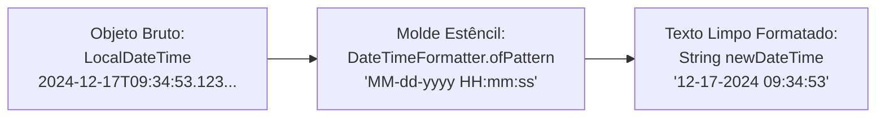

# Curso de Java Completo (Bro Code) — Capítulo 62: `dates & times 📆` (Parte 3)
## Formatando Datas e Horas Customizadas com `DateTimeFormatter.ofPattern()` e `.format()`

> **Contexto no Vídeo**: Entre os tempos **`10:14:37`** e **`10:16:07`**, o instrutor **Bro Code** ensina como se livrar do formato padrão feio e cheio de letras como o `T` (ex: `2024-12-17T09:30:26...`) e exibir datas e horas elegantes, legíveis para humanos normais, usando a classe **`DateTimeFormatter`** e o método **`.ofPattern()`**.

---

## 📸 Reconstituição Visual Completa das 4 Imagens (Para Google Docs)

Como você copiará este guia diretamente para o seu **Google Docs** e não terá as imagens anexadas lá, abaixo está a reprodução textual e estrutural idêntica de cada uma das 4 telas do IntelliJ IDEA e do YouTube.

```
====================================================================================================
IMAGEM 1: Introdução ao Formato Customizado (Tempo do Vídeo: 10:14:37)
====================================================================================================
Barra de Vídeo do YouTube (Rodapé):
  [ ⏸ Pausa K ]  10:14:37 / 12:00:00    62.dates & times >

Editor de Código (Main.java):
 7: public class Main {
 8:     public static void main(String[] args) {
 9: 
10:         // How to work with DATES & TIMES using Java
11:         // (LocalDate, LocalTime, LocalDateTime, UTC timestamp)
12: 
13:         // Custom format
14: 
15:         LocalDateTime dateTime = LocalDateTime.now();
16: 
17:         DateTimeFormatter formatter = DateTimeFormatter.ofPattern("");  <-- Cursor entre as aspas
18: 
19: 
20: 

Análise Visual da Imagem 1:
- O autor cria a data/hora atual com 'LocalDateTime dateTime = LocalDateTime.now()'.
- Em seguida, declara a variável 'formatter' chamando 'DateTimeFormatter.ofPattern("")'.
- O cursor está piscando no meio das aspas duplas, onde ele começará a definir a máscara visual.
====================================================================================================
```

```
====================================================================================================
IMAGEM 2: O Autor Digitando as Primeiras Letras da Máscara de Formatação
====================================================================================================
Editor de Código (Main.java):
13:         // Custom format
14: 
15:         LocalDateTime dateTime = LocalDateTime.now();
16: 
17:         DateTimeFormatter formatter = DateTimeFormatter.ofPattern("dd-MM-");  <-- Digitador
18: 
19: 
20: 

Análise Visual da Imagem 2:
- O autor demonstra a digitação de padrões:
  'dd' para dia com 2 dígitos, seguido por '-' e 'MM' para mês com 2 dígitos.
====================================================================================================
```

```
====================================================================================================
IMAGEM 3: Chamando 'dateTime.format(formatter)' (Tempo do Vídeo: 10:15:58)
====================================================================================================
Barra de Vídeo do YouTube (Rodapé):
  [ ⏸ Pausa K ]  10:15:58 / 12:00:00    62.dates & times >

Editor de Código (Main.java):
13:         // Custom format
14: 
15:         LocalDateTime dateTime = LocalDateTime.now();
16: 
17:         DateTimeFormatter formatter = DateTimeFormatter.ofPattern("MM-dd-yyyy HH:mm:ss");
18:         String newDateTime = dateTime.format(formatter);  <-- ['newDateTime' selecionado em azul]
19: 
20:     }
21: }

Análise Visual da Imagem 3:
- O padrão completo foi configurado para o padrão americano com horas: "MM-dd-yyyy HH:mm:ss".
- Na linha 18, o autor aplica o formatador chamando 'dateTime.format(formatter)' e guarda o texto
  resultante em uma nova variável 'String newDateTime'.
====================================================================================================
```

```
====================================================================================================
IMAGEM 4: Execução no Console Exibindo o Texto Formatado (Tempo do Vídeo: 10:16:07)
====================================================================================================
Barra de Vídeo do YouTube (Rodapé):
  [ ⏸ Pausa K ]  10:16:07 / 12:00:00    62.dates & times >

Editor de Código (Linhas 17 a 19):
17:         DateTimeFormatter formatter = DateTimeFormatter.ofPattern("MM-dd-yyyy HH:mm:ss");
18:         String newDateTime = dateTime.format(formatter);
19:         System.out.println(newDateTime);

Terminal / Run Console (Inferior):
  C:\Users\HP\.jdks\openjdk-23\bin\java.exe "-javaagent:C:\Program Files\JetBrains\IntelliJ..."
  12-17-2024 09:34:53

  Process finished with exit code 0

Análise Visual da Imagem 4:
- O programa foi executado e imprimiu exatamente: "12-17-2024 09:34:53".
- O 'T' sumiu e foi substituído por um belo espaço em branco!
- Os nanossegundos feios sumiram, ficando apenas hora, minuto e segundo limpos!
====================================================================================================
```

---

## 🎨 O Que é um Formatador e Por Que Ele é Necessário?

Quando criamos uma data no Java com `LocalDateTime.now()`, o Java guarda um **objeto binário complexo** na memória. Ao imprimir direto na tela, ele devolve a representação ISO-8601 crua:
```text
2024-12-17T09:34:53.123456789   <-- Difícil e feio para um usuário comum ler!
```

Para transformar essa informação em algo agradável e legível:
1. Usamos a classe **`DateTimeFormatter`** como um **molde / estêncil**.
2. Definimos um **padrão de texto (*Pattern*)**.
3. Passamos a data crua por esse molde através do método **`.format()`**.
4. O resultado é uma simples e elegante **`String`** pronta para ser exibida na tela!



---

## 🔬 O Código-Fonte Consolidado do `Main.java`

```java
1: import java.time.Instant;
2: import java.time.LocalDate;
3: import java.time.LocalDateTime;
4: import java.time.LocalTime;
5: import java.time.format.DateTimeFormatter;
6: 
7: public class Main {
8:     public static void main(String[] args) {
9: 
10:         // How to work with DATES & TIMES using Java
11:         // (LocalDate, LocalTime, LocalDateTime, UTC timestamp)
12: 
13:         // Custom format
14: 
15:         LocalDateTime dateTime = LocalDateTime.now();
16: 
17:         DateTimeFormatter formatter = DateTimeFormatter.ofPattern("MM-dd-yyyy HH:mm:ss");
18:         String newDateTime = dateTime.format(formatter);
19: 
20:         System.out.println(newDateTime);
21:     }
22: }
```

---

## 🔍 Explicação Linha por Linha ("Como se Fosse um Iniciante Amador")

### Linha 5: `import java.time.format.DateTimeFormatter;`
- **O que faz**: Importa a classe especializada em formatar e analisar datas e horários em texto.
- Observe que ela fica dentro do subpacote `.format` (`java.time.format`).
- *Console*: Nenhuma saída.

### Linha 13: `// Custom format`
- Comentário explicativo do autor: *"Formato customizado / personalizado"*.

### Linha 15: `LocalDateTime dateTime = LocalDateTime.now();`
- Captura a data e hora atual do computador e guarda na variável `dateTime`.
- *Console*: Nenhuma saída.

---

### Linha 17: `DateTimeFormatter formatter = DateTimeFormatter.ofPattern("MM-dd-yyyy HH:mm:ss");` ⭐ (O Coração da Aula!)

Aqui está a criação do molde estêncil. Vamos dissecar cada letra mágica dentro das aspas:

```text
"MM - dd - yyyy   HH : mm : ss"
 │    │     │      │    │    │
 │    │     │      │    │    └─► Segundos (ss): 00 a 59
 │    │     │      │    └──────► Minutos (mm minúsculo!): 00 a 59
 │    │     │      └───────────► Horas em formato 24h (HH maiúsculo!): 00 a 23
 │    │     └──────────────────► Ano com 4 dígitos (yyyy): ex. 2024
 │    └────────────────────────► Dia do mês com 2 dígitos (dd): 01 a 31
 └─────────────────────────────► Mês do ano (MM maiúsculo!): 01 a 12
```

---

## ⚠️ A Armadilha Mortal das Letras Maiúsculas e Minúsculas!

No Java, o padrão do formatador é **estritamente sensível a maiúsculas e minúsculas (*case-sensitive*)**. Este é o erro número 1 que iniciantes cometem:

| Letra | Significado | Cuidado Vital / Explicação |
| :---: | :--- | :--- |
| **`MM`** (Maiúsculo) | **Month** (Mês do ano) | Gera de `01` a `12`. Se você colocar `mm` aqui, o Java imprimirá os **minutos** no lugar do mês! |
| **`mm`** (Minúsculo) | **Minute** (Minutos da hora) | Gera de `00` a `59`. Se colocar `MM` aqui, você imprimirá o **mês** no lugar dos minutos! |
| **`HH`** (Maiúsculo) | **Hour** (Horas no formato 24h) | Gera de `00` a `23` (ex: `19h` para 7 da noite). |
| **`hh`** (Minúsculo) | **Hour** (Horas no formato 12h AM/PM) | Gera de `01` a `12`. |
| **`dd`** (Minúsculo) | **Day of Month** (Dia do mês) | Gera de `01` a `31`. |
| **`DD`** (Maiúsculo) | ⚠️ **Day of Year** (Dia do ano!) | Cuidado! `DD` maiúsculo dá o dia de `001` a `365`! Em 17 de dezembro daria `352`! Use sempre `dd` minúsculo para o dia do mês. |
| **`yyyy`** (Minúsculo) | **Year** (Ano com 4 dígitos) | Ex: `2024` ou `2026`. |
| **`yy`** (Minúsculo) | **Year** (Ano abreviado com 2 dígitos) | Ex: `24` ou `26`. |
| **`ss`** (Minúsculo) | **Seconds** (Segundos) | Gera de `00` a `59`. |

---

### Linha 18: `String newDateTime = dateTime.format(formatter);`
- **O que faz**: Chama o método `.format()` do objeto `dateTime`, entregando a régua do `formatter`.
- O Java lê o dia, mês, ano, hora, minuto e segundo do `dateTime` e encaixa perfeitamente nos espaços da máscara `"MM-dd-yyyy HH:mm:ss"`.
- O retorno é uma nova variável do tipo **`String`** chamada `newDateTime`.
- *Console*: Nenhuma saída.

### Linha 19: `System.out.println(newDateTime);`
- Imprime o texto formatado no console.
- **Saída no Vídeo do Bro Code (Imagem 4)**:
  ```text
  12-17-2024 09:34:53
  ```
- **Saída no Seu Computador Hoje**:
  ```text
  10-09-2026 19:06:23
  ```

---

## 🇧🇷 Como Adaptar para o Padrão Brasileiro?

No vídeo, o Bro Code usou o padrão norte-americano, onde o **Mês vem antes do Dia** (`MM-dd-yyyy`).  
No Brasil e na maioria dos países lusófonos, usamos **Dia antes do Mês**, e usamos **barras (`/`)** em vez de hifens (`-`).

Veja como é fácil customizar:

### 1. Formato Brasileiro Completo (Data com Barras + Hora):
```java
DateTimeFormatter formatter = DateTimeFormatter.ofPattern("dd/MM/yyyy HH:mm:ss");
// Saída: 17/12/2024 09:34:53 (ou 09/10/2026 19:06:23)
```

### 2. Apenas a Data Brasileira (Sem Horário):
```java
DateTimeFormatter formatter = DateTimeFormatter.ofPattern("dd/MM/yyyy");
// Saída: 17/12/2024 (ou 09/10/2026)
```

### 3. Apenas a Hora Brasileira (Sem Data):
```java
DateTimeFormatter formatter = DateTimeFormatter.ofPattern("HH:mm:ss");
// Saída: 09:34:53 (ou 19:06:23)
```

### 4. Formato Extenso com Texto Literal:
```java
DateTimeFormatter formatter = DateTimeFormatter.ofPattern("dd 'de' MMMM 'de' yyyy");
// Saída: 17 de dezembro de 2024
```
*(Nota: palavras literais fixas como "de" devem ficar entre aspas simples `'de'` dentro da máscara).*

---

## 🖥️ Comparativo de Saídas no Console

### 1. Antes da Formatação (Padrão ISO-8601 Cru):
```text
2024-12-17T09:34:53.076515
```
*(Confuso, com a letra `T` e frações de segundo invisíveis aos olhos humanos).*

### 2. Depois da Formatação com `DateTimeFormatter` (Imagem 4):
```text
12-17-2024 09:34:53
Process finished with exit code 0
```
*(Limpo, elegante, sem o `T`, com separadores claros e fácil de ler).*

---

## 📋 Resumo Didático para Fixação

1. **`DateTimeFormatter`**: A ferramenta do pacote `java.time.format` para desenhar máscaras de formatação.
2. **`DateTimeFormatter.ofPattern("...")`**: Método que constrói a máscara com letras especiais.
3. **`dateTime.format(formatter)`**: Método que aplica a máscara ao objeto de data/hora e devolve uma `String`.
4. **`MM` vs `mm`**: `MM` maiúsculo é Mês, `mm` minúsculo é Minuto.
5. **`HH` vs `hh`**: `HH` maiúsculo é formato 24h, `hh` minúsculo é formato 12h.
