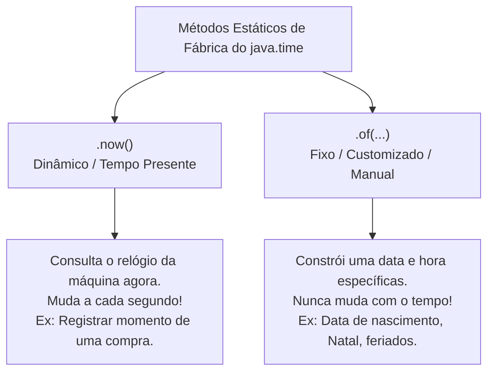

# Curso de Java Completo (Bro Code) — Capítulo 62: `dates & times 📆` (Parte 4)
## Fabricando Datas Específicas com o Método `.of()` em `LocalDate` e `LocalDateTime`

> **Contexto no Vídeo**: Entre os tempos **`10:16:55`** e **`10:17:25`**, o instrutor **Bro Code** aborda a segunda forma de instanciar datas:  
> Até agora usamos `.now()` (que pega a data/hora atual do sistema operacional). Mas e quando você precisa salvar uma **data de aniversário**, a **data de lançamento de um filme** ou o **dia de Natal**?  
> Para isso usamos o método estático de fábrica **`.of(...)`**! O autor demonstra primeiro com `LocalDate.of(2024, 12, 25)` e em seguida mostra o erro comum ao tentar passar apenas 3 parâmetros para o `LocalDateTime.of()`, inserindo a legenda explicativa na tela: **`"Hours, Minutes, Seconds"`**!

---

## 📸 Reconstituição Visual Completa das 5 Imagens (Para Google Docs)

Como você copiará este guia diretamente para o seu **Google Docs** e não terá as imagens anexadas lá, abaixo está a reprodução textual e estrutural fiel de cada uma das 5 telas do IntelliJ IDEA e do YouTube.

```
====================================================================================================
IMAGEM 1: Criando uma Data Específica com 'LocalDate.of()' (Tempo do Vídeo: 10:16:55)
====================================================================================================
Barra de Vídeo do YouTube (Rodapé):
  [ ⏸ Pausa K ]  10:16:55 / 12:00:00    62.dates & times >

Editor de Código (Main.java):
 7: public class Main {
 8:     public static void main(String[] args) {
 9: 
10:         // How to work with DATES & TIMES using Java
11:         // (LocalDate, LocalTime, LocalDateTime, UTC timestamp)
12: 
13:         LocalDate date = LocalDate.of(2024, 12, 25);  <-- [O número '25' destacado em azul]
14: 
15: 
16:     }
17: }

Análise Visual da Imagem 1:
- O autor substitui 'LocalDate.now()' por 'LocalDate.of(2024, 12, 25)'.
- O cursor destaca o número 25 (dia do Natal).
====================================================================================================
```

```
====================================================================================================
IMAGEM 2: Preparando para Executar o 'LocalDate.of()' (Tempo do Vídeo: 10:17:02)
====================================================================================================
Barra de Vídeo do YouTube (Rodapé):
  [ ⏸ Pausa K ]  10:17:02 / 12:00:00    62.dates & times >

Editor de Código (Main.java):
13:         LocalDate date = LocalDate.of(2024, 12, 25);
14: 
15:         System.out.println(date);
16: 
17:     }

Barra Superior Direita da Janela:
- O cursor do mouse está sobre o botão triangular verde de "Run" (Play).
====================================================================================================
```

```
====================================================================================================
IMAGEM 3: Execução no Console Exibindo a Data do Natal (2024-12-25)
====================================================================================================
Terminal / Run Console (Inferior):
  C:\Users\HP\.jdks\openjdk-23\bin\java.exe "-javaagent:C:\Program Files\JetBrains\IntelliJ..."
  2024-12-25

  Process finished with exit code 0

Análise Visual da Imagem 3:
- O console imprimiu com exatidão a data fabricada: "2024-12-25".
- Não importa qual seja o dia em que o programa for rodado: ele SEMPRE imprimirá 25 de dezembro de 2024!
====================================================================================================
```

```
====================================================================================================
IMAGEM 4: O Erro de Sintaxe ao Mudar para 'LocalDateTime.of()' (Tempo do Vídeo: 10:17:20)
====================================================================================================
Barra de Vídeo do YouTube (Rodapé):
  [ ⏸ Pausa K ]  10:17:20 / 12:00:00    62.dates & times >

Editor de Código (Main.java):
13:         LocalDateTime date = LocalDateTime.of(2024, 12, 25, );  <-- ⚠️ Ondulação vermelha!

Legenda em Destaque Gigante no Centro da Tela:
  "Hours, Minutes, Seconds"  (Fonte estilo gibi/cartoon)

Análise Visual da Imagem 4:
- O autor mudou o tipo da variável para 'LocalDateTime'.
- Ele começou a digitar os argumentos, mas colocou apenas ano (2024), mês (12) e dia (25).
- O IntelliJ marca com ondulação vermelha após a vírgula!
- O autor coloca o texto na tela para avisar o estudante: "Faltam Horas, Minutos e Segundos!".
====================================================================================================
```

```
====================================================================================================
IMAGEM 5: Completando Todos os 6 Parâmetros do 'LocalDateTime.of()'
====================================================================================================
Editor de Código (Main.java):
13:         LocalDateTime date = LocalDateTime.of(2024, 12, 25, 12, 0, 0);
14: 
15: 
16: 

Análise Visual da Imagem 5:
- A linha 13 foi finalizada com sucesso:
  Ano: 2024, Mês: 12, Dia: 25, Hora: 12 (meio-dia), Minuto: 0, Segundo: 0.
- A ondulação vermelha sumiu e o código está 100% válido!
====================================================================================================
```

---

## 🧠 A Diferença Crucial: `.now()` vs `.of()`

No Java moderno, existem duas maneiras fundamentais de dar vida a um objeto de data:



---

## 🔍 Explicação Detalhada do Código

---

### 1️⃣ `LocalDate.of(year, month, day)` (Imagens 1 a 3)

```java
13: LocalDate date = LocalDate.of(2024, 12, 25);
15: System.out.println(date);
```

- **O que faz**:
  - Chama o método estático `.of(...)` da classe `LocalDate`.
  - Passa **3 números inteiros**:
    1. `2024`: O Ano (*Year*).
    2. `12`: O Mês (*Month* = Dezembro). Lembre-se: no `java.time`, 1 é Janeiro e 12 é Dezembro!
    3. `25`: O Dia do Mês (*Day of Month* = dia 25).
- **Saída no Console (Imagem 3)**:
  ```text
  2024-12-25
  Process finished with exit code 0
  ```
- **Por que é fixo?**  
  Se você rodar esse programa amanhã, daqui a 1 semana ou em 2050, ele **sempre** imprimirá `2024-12-25`. Porque você não pediu o relógio do sistema, você fabricou a data com suas próprias mãos!

---

### 2️⃣ A Pegadinha do `LocalDateTime.of(...)` (Imagens 4 e 5)

Na Imagem 4, o Bro Code tentou fazer:
```java
// ❌ ERRO DE COMPILAÇÃO! FALTAM PARÂMETROS!
LocalDateTime date = LocalDateTime.of(2024, 12, 25, );
```

#### Por que o Java não aceita apenas 3 números aqui?
Pense logicamente:
- A classe se chama **`LocalDateTime`** (**Data** E **Hora** juntos).
- Se você passar apenas `2024, 12, 25`, o Java te pergunta: *"Que horas são nesse dia? Meia-noite? Meio-dia? Às três da tarde?"*.
- Por isso, o compilador exige que você informe também a parte horária!

Por isso, na **Imagem 4**, o autor coloca o lembrete cômico e didático na tela:
> 📢 **`"Hours, Minutes, Seconds"`**

---

### 3️⃣ A Solução Completa com os 6 Argumentos (Imagem 5)

```java
13: LocalDateTime date = LocalDateTime.of(2024, 12, 25, 12, 0, 0);
```

Vamos dissecar cada um dos 6 números passados entre parênteses:

```text
LocalDateTime.of( 2024 ,  12  ,  25  ,  12  ,   0   ,   0   );
                   │      │      │      │       │       │
                   │      │      │      │       │       └─► Segundos (0 segundos)
                   │      │      │      │       └─────────► Minutos (0 minutos)
                   │      │      │      └─────────────────► Hora (12h = meio-dia no formato 24h)
                   │      │      └────────────────────────► Dia do mês (dia 25)
                   │      └───────────────────────────────► Mês do ano (12 = Dezembro)
                   └──────────────────────────────────────► Ano (2024)
```

- **Resultado na Memória**: Cria um objeto cronológico perfeito que representa **25 de Dezembro de 2024, exatamente ao meio-dia (`12:00:00`)**.
- **Como o Java imprime essa data?**
  ```text
  2024-12-25T12:00
  ```
  *(Nota: Se os segundos forem zero, o Java simplifica e omite os `:00` finais).*

---

## 🛡️ Validação Automática do Java: O Que Acontece se Você Passar Dados Impossíveis?

Uma das maiores vantagens da Time API moderna é que ela é **à prova de datas falsas**:

```java
// ❌ O que acontece se você tentar criar 30 de Fevereiro?
LocalDate invalido = LocalDate.of(2024, 2, 30);
```

O Java **rejeita imediatamente** e lança uma exceção:
`java.time.DateTimeException: Invalid date 'February 30'`!

O mesmo vale para:
- Hora inválida: `hora 25` ➔ 💥 `DateTimeException`
- Minuto inválido: `minuto 70` ➔ 💥 `DateTimeException`
- Mês inválido: `mês 13` ➔ 💥 `DateTimeException`

> [!TIP]
> **Você Também Pode Usar o Enum `Month`**:  
> Em vez de passar o número `12`, você pode passar a constante legível:
> ```java
> LocalDate date = LocalDate.of(2024, Month.DECEMBER, 25);
> ```
> O Java aceita as duas formas!

---

## 📊 Tabela Comparativa: Quantos Parâmetros Cada Método Exige?

| Método | Quantidade de Parâmetros | O que passar? | Exemplo Real |
| :--- | :---: | :--- | :--- |
| **`LocalDate.of()`** | **3** | `(ano, mes, dia)` | `LocalDate.of(2024, 12, 25)` |
| **`LocalTime.of()`** | **2 a 4** | `(hora, minuto)` ou `(hora, min, seg)` | `LocalTime.of(12, 30, 0)` |
| **`LocalDateTime.of()`** | **5 a 7** | `(ano, mes, dia, hora, minuto, segundo)` | `LocalDateTime.of(2024, 12, 25, 12, 0, 0)` |

---

## 🖥️ Resumo das Saídas do Console Previstas

### 1. Teste com `LocalDate.of(2024, 12, 25)` (Imagens 1, 2 e 3):
```text
2024-12-25

Process finished with exit code 0
```

### 2. Teste com `LocalDateTime.of(2024, 12, 25, 12, 0, 0)` (Imagem 5):
```text
2024-12-25T12:00

Process finished with exit code 0
```

---

## 📋 Resumo Didático para Fixação

1. **`.now()`**: Pega o momento presente dinâmico do relógio do sistema.
2. **`.of(...)`**: Fabrica uma data ou hora fixa do passado ou do futuro.
3. **`LocalDate.of()` precisa de 3 dados**: Ano, Mês e Dia.
4. **`LocalDateTime.of()` precisa de no mínimo 5 a 6 dados**: Ano, Mês, Dia, Hora, Minuto e Segundo (*"Hours, Minutes, Seconds"*).
5. O Java protege você contra datas impossíveis (como 31 de abril ou 30 de fevereiro) disparando `DateTimeException`.
