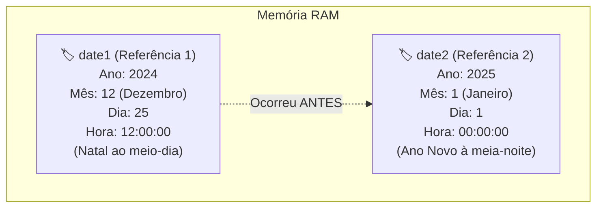

# Curso de Java Completo (Bro Code) — Capítulo 62: `dates & times 📆` (Parte 5)
## Criando Dois Objetos de Data (`date1` e `date2`) com `LocalDateTime.of()` e Preparando Comparações

> **Contexto no Vídeo**: No tempo **`10:18:13 / 12:00:00`**, o instrutor **Bro Code** dá o passo preparatório para um dos tópicos mais cobrados em entrevistas e no dia a dia do desenvolvimento: **como comparar datas cronologicamente**.  
> Para poder comparar se uma data veio antes ou depois de outra, precisamos de **dois objetos de data** coexistindo na memória RAM. O autor fabrica duas datas marcantes do calendário:
> 1. **`date1`**: O dia de **Natal de 2024 ao meio-dia** (`2024-12-25T12:00`).
> 2. **`date2`**: O dia de **Ano Novo de 2025 à meia-noite** (`2025-01-01T00:00`).

---

## 📸 Reconstituição Visual Completa das 4 Imagens (Para Google Docs)

Como você copiará este guia diretamente para o seu **Google Docs** e não terá as imagens anexadas lá, abaixo está a reprodução textual e estrutural idêntica de cada uma das 4 telas do IntelliJ IDEA e do YouTube.

```
====================================================================================================
IMAGEM 1: Execução do 'LocalDateTime.of()' de Data Única
====================================================================================================
Editor de Código (Main.java):
13:         LocalDateTime date = LocalDateTime.of(2024, 12, 25, 12, 0, 0);
14: 
15:         System.out.println(date);
16: 
17:     }

Terminal / Run Console (Inferior):
  C:\Users\HP\.jdks\openjdk-23\bin\java.exe "-javaagent:C:\Program Files\JetBrains\IntelliJ..."
  2024-12-25T12:00

  Process finished with exit code 0

Análise Visual da Imagem 1:
- A variável única 'date' foi impressa com sucesso no console.
- Saída: "2024-12-25T12:00". Note que, como os segundos são '0', o Java omite os ':00' dos segundos.
====================================================================================================
```

```
====================================================================================================
IMAGEM 2: Criação de 'date2' e o Erro Temporário na Linha 16
====================================================================================================
Editor de Código (Main.java):
 7: public class Main {
 8:     public static void main(String[] args) {
 9: 
10:         // How to work with DATES & TIMES using Java
11:         // (LocalDate, LocalTime, LocalDateTime, UTC timestamp)
12: 
13:         LocalDateTime date1 = LocalDateTime.of(2024, 12, 25, 12, 0, 0);
14:         LocalDateTime date2 = LocalDateTime.of(2024, 12, 25, 12, 0, 0);  <-- [O '4' selecionado]
15: 
16:         System.out.println(date);   <-- ⚠️ Ondulação vermelha embaixo de 'date'!
17: 
18:     }
19: }

Análise Visual da Imagem 2:
- O autor renomeou a linha 13 de 'date' para 'date1'.
- Ele duplicou a linha na 14 e chamou de 'date2'. O cursor está selecionando o dígito '4' de '2024'
  para transformá-lo em '2025' e mudar os meses/dias para Ano Novo.
- Na linha 16, a palavra 'date' ficou com ondulação vermelha (erro de compilação: "Cannot resolve
  symbol 'date'"), pois a variável 'date' não existe mais (agora existem 'date1' e 'date2').
====================================================================================================
```

```
====================================================================================================
IMAGEM 3: Código Corrigido e Execução com Duas Datas no Console (Tempo: 10:18:13)
====================================================================================================
Barra de Vídeo do YouTube (Rodapé):
  [ ⏸ Pausa K ]  10:18:13 / 12:00:00    62.dates & times >

Editor de Código (Linhas 16 a 18):
16:         System.out.println(date1);
17:         System.out.println(date2);
18:     }

Terminal / Run Console (Inferior):
  C:\Users\HP\.jdks\openjdk-23\bin\java.exe "-javaagent:C:\Program Files\JetBrains\IntelliJ..."
  2024-12-25T12:00
  2025-01-01T00:00

  Process finished with exit code 0

Análise Visual da Imagem 3:
- O autor corrigiu a linha 16 para 'System.out.println(date1);' e adicionou a linha 17
  'System.out.println(date2);'.
- O console imprimiu as duas datas perfeitamente, uma em cada linha:
  Linha 1: 2024-12-25T12:00 (Natal)
  Linha 2: 2025-01-01T00:00 (Ano Novo)
====================================================================================================
```

```
====================================================================================================
IMAGEM 4: Visão Limpa do Console de Execução
====================================================================================================
Terminal / Run Console (Inferior):
  C:\Users\HP\.jdks\openjdk-23\bin\java.exe "-javaagent:C:\Program Files\JetBrains\IntelliJ..."
  2024-12-25T12:00
  2025-01-01T00:00

  Process finished with exit code 0
  █ (Cursor piscando pronto para a próxima instrução)

Análise Visual da Imagem 4:
- Confirmação visual límpida das duas saídas cronológicas.
- Ambas as datas usam a notação ISO-8601 com o separador 'T' entre dia e hora.
====================================================================================================
```

---

## 🧠 Por Que Criar Duas Datas? A Preparação para Comparação

Na vida real, softwares lidam constantemente com pares de datas:
- **Vencimento de faturas**: A data de pagamento veio *antes* ou *depois* da data de vencimento?
- **Agendamentos de consultas / viagens**: A data de retorno é *posterior* à data de ida?
- **Idade / Aposentadoria**: Qual data é mais antiga?

Para que o Java possa fazer perguntas lógicas do tipo:
- *"A data 1 é anterior à data 2?"* (`date1.isBefore(date2)`)
- *"A data 1 é posterior à data 2?"* (`date1.isAfter(date2)`)
- *"As duas datas são no mesmo segundo?"* (`date1.isEqual(date2)`)

Precisamos primeiro ter duas instâncias distintas de `LocalDateTime` criadas e armazenadas em variáveis separadas (`date1` e `date2`).



---

## 🔬 O Código-Fonte Consolidado do `Main.java`

```java
1: import java.time.Instant;
2: import java.time.LocalDate;
3: import java.time.LocalDateTime;
4: import java.time.LocalTime;
5: import java.time.format.DateTimeFormatter;
6: 
7: public class Main {
8:     public static void main(String[] args) {
9: 
10:         // How to work with DATES & TIMES using Java
11:         // (LocalDate, LocalTime, LocalDateTime, UTC timestamp)
12: 
13:         LocalDateTime date1 = LocalDateTime.of(2024, 12, 25, 12, 0, 0);
14:         LocalDateTime date2 = LocalDateTime.of(2025, 1, 1, 0, 0, 0);
15: 
16:         System.out.println(date1);
17:         System.out.println(date2);
18:     }
19: }
```

---

## 🔍 Explicação Linha por Linha ("Como se Fosse um Iniciante Amador")

### Linhas 1 a 5: Os `imports`
- Traz as ferramentas do pacote `java.time`.
- Aqui, a classe que brilha é `java.time.LocalDateTime` (Linha 3).
- *Console*: Nenhuma saída.

### Linha 7: `public class Main {`
- Declara a classe `Main`.

### Linha 8: `public static void main(String[] args) {`
- O ponto de partida de execução da JVM.

### Linhas 10 e 11: Comentários
- Descrição dos assuntos do capítulo.

### Linha 12: Linha em branco

---

### Linha 13: `LocalDateTime date1 = LocalDateTime.of(2024, 12, 25, 12, 0, 0);`
- **O que faz**:
  - Cria o primeiro objeto de data e hora na memória Heap.
  - Guarda o endereço desse objeto na variável de referência `date1`.
- **Os 6 Parâmetros passados**:
  1. `2024`: O Ano (*Year*).
  2. `12`: O Mês (*Month* = Dezembro).
  3. `25`: O Dia do Mês (*Day* = dia 25 de Natal).
  4. `12`: A Hora (*Hour* = 12 horas / meio-dia).
  5. `0`: Minutos (*Minute* = 0 minutos).
  6. `0`: Segundos (*Second* = 0 segundos).
- *Console*: Nenhuma saída.

---

### Linha 14: `LocalDateTime date2 = LocalDateTime.of(2025, 1, 1, 0, 0, 0);`
- **O que faz**:
  - Cria um **segundo objeto completamente independente** na memória Heap.
  - Guarda a referência na variável `date2`.
- **Os 6 Parâmetros passados**:
  1. `2025`: O Ano (*Year* = virada para 2025!).
  2. `1`: O Mês (*Month* = Janeiro).
  3. `1`: O Dia do Mês (*Day* = dia primeiro).
  4. `0`: A Hora (*Hour* = 0 horas / meia-noite).
  5. `0`: Minutos (*Minute* = 0 minutos).
  6. `0`: Segundos (*Second* = 0 segundos).
- *Console*: Nenhuma saída.

---

### ⚠️ A Armadilha da Imagem 2: Por Que Deu Erro na Linha 16?

Na Imagem 2, vemos:
```java
// Linha 16 com ondulação vermelha:
System.out.println(date); // ❌ ERRO DE COMPILAÇÃO!
```

**Por que o IntelliJ reclamou?**
- Originalmente, na Imagem 1, a variável se chamava apenas `date`.
- Na Imagem 2, o autor mudou o nome da variável na declaração para `date1`:
  `LocalDateTime date1 = ...`
- Só que ele esqueceu de atualizar o `println` da linha 16, que continuava procurando por uma variável chamada `date`!
- **Mensagem do Compilador Java**: `Cannot resolve symbol 'date'` (*Não consigo encontrar o símbolo/variável 'date'*).
- **Como o autor resolveu na Imagem 3?**  
  Ele alterou para `System.out.println(date1);` e adicionou a linha seguinte `System.out.println(date2);`.

---

### Linha 16: `System.out.println(date1);`
- Imprime o conteúdo de `date1`.
- O Java chama automaticamente o `.toString()` do objeto.
- **Saída no Console**:
  ```text
  2024-12-25T12:00
  ```

### Linha 17: `System.out.println(date2);`
- Imprime o conteúdo de `date2`.
- **Saída no Console**:
  ```text
  2025-01-01T00:00
  ```

### Linha 18: `}`
- Fecha o método `main`.

### Linha 19: `}`
- Fecha a classe `Main`.

---

## 🧐 Curiosidade: Por Que o Java Omitiu os Segundos (`:00`) na Impressão?

Repare atentamente na saída do console:
- Nós escrevemos: `(2024, 12, 25, 12, 0, 0)` com 0 segundos.
- Mas o console imprimiu: `2024-12-25T12:00` (e **não** `12:00:00`).

### Por que isso acontece?
O método padrão `.toString()` da classe `LocalDateTime` foi programado para ser **inteligente e conciso**:
- Se os **segundos forem iguais a zero**, o Java entende que você não precisa vê-los e corta os `:00` para não poluir a tela.
- Se os segundos fossem diferentes de zero (ex: `12, 0, 45`), o Java imprimiria: `2024-12-25T12:00:45`.
- Se você quiser forçar os segundos a sempre aparecerem mesmo quando zerados, basta usar o `DateTimeFormatter` que aprendemos na aula anterior!

---

## 🖥️ Saída Exata no Console do IntelliJ IDEA (Imagens 3 e 4)

Ao rodar o código final da Imagem 3, o console exibirá rigorosamente:

```text
2024-12-25T12:00
2025-01-01T00:00

Process finished with exit code 0
```

---

## 🚀 Próximo Passo: O Que o Bro Code Fará com `date1` e `date2`?

Agora que as duas variáveis estão vivas na memória, na próxima etapa do vídeo o autor adicionará as estruturas condicionais:
```java
if (date1.isBefore(date2)) {
    System.out.println(date1 + " is earlier than " + date2);
}
else if (date1.isAfter(date2)) {
    System.out.println(date1 + " is later than " + date2);
}
else if (date1.isEqual(date2)) {
    System.out.println(date1 + " is equal to " + date2);
}
```
Como o Natal de 2024 ocorreu **antes** do Ano Novo de 2025, o método `.isBefore()` retornará `true`!
