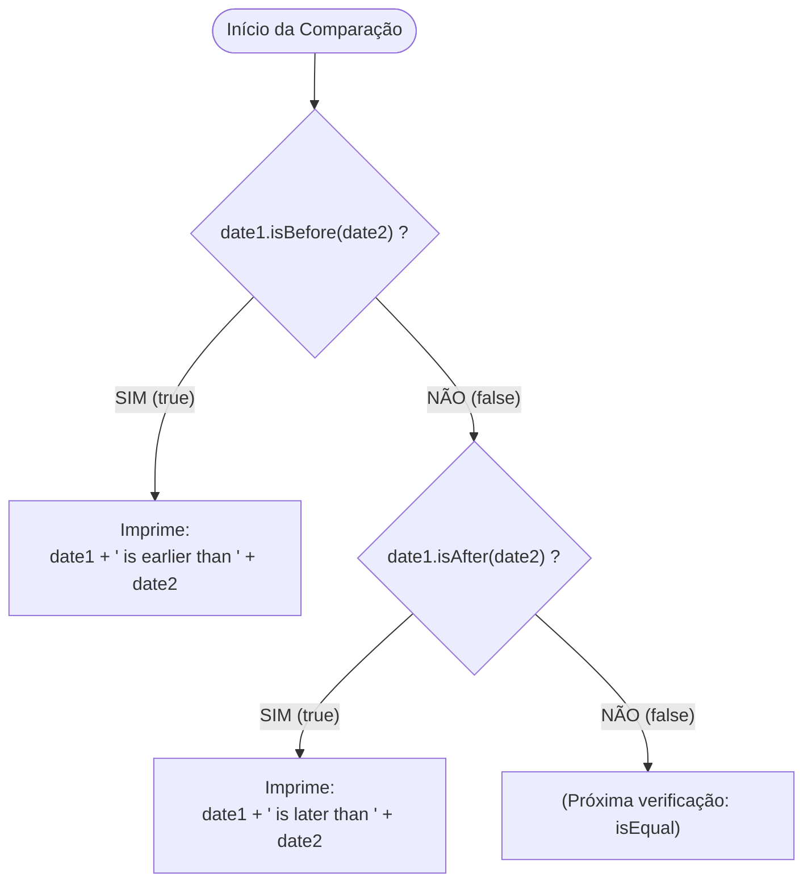

# Curso de Java Completo (Bro Code) — Capítulo 62: `dates & times 📆` (Parte 6)
## Comparação Cronológica de Datas com `.isBefore()` e `.isAfter()`

> **Contexto no Vídeo**: Entre os tempos **`10:18:53`** e **`10:19:30`**, o instrutor **Bro Code** ensina como comparar objetos de data e hora no Java moderno.  
> Ele demonstra que no Java **não podemos usar operadores matemáticos como `<` ou `>`** para objetos. Em vez disso, a API `java.time` nos fornece métodos legíveis em inglês: **`.isBefore()`** (*é antes de?*) e **`.isAfter()`** (*é depois de?*). Ele testa primeiro com o Natal de 2024 sendo anterior ao Ano Novo de 2025, e em seguida altera as datas para testar o ramo posterior!

---

## 📸 Reconstituição Visual Completa das 5 Imagens (Para Google Docs)

Como você copiará este guia diretamente para o seu **Google Docs** e não terá as imagens anexadas lá, abaixo está a reprodução textual e estrutural idêntica de cada uma das 5 telas do IntelliJ IDEA e do YouTube.

```
====================================================================================================
IMAGEM 1: Configuração do Primeiro Teste com '.isBefore()' (Tempo do Vídeo: 10:18:53)
====================================================================================================
Barra de Vídeo do YouTube (Rodapé):
  [ ⏸ Pausa K ]  10:18:53 / 12:00:00    62.dates & times >

Editor de Código (Main.java):
13:         LocalDateTime date1 = LocalDateTime.of(2024, 12, 25, 12, 0, 0);
14:         LocalDateTime date2 = LocalDateTime.of(2025, 1, 1, 0, 0, 0);
15: 
16:         if(date1.isBefore(date2)){
17:             System.out.println(date1 + " is earlier than " + date2);
18:         }
19: 
20:     }

Barra Superior Direita da Janela:
- O cursor do mouse está sobre o botão triangular verde de "Run" (Play).

Análise Visual da Imagem 1:
- date1 representa 25 de Dezembro de 2024 às 12:00 (Natal).
- date2 representa 01 de Janeiro de 2025 às 00:00 (Ano Novo).
- O bloco 'if(date1.isBefore(date2))' verifica se o Natal ocorreu antes do Ano Novo.
====================================================================================================
```

```
====================================================================================================
IMAGEM 2: Execução no Console Confirmando que 'date1' Veio Antes (Tempo: 10:18:56)
====================================================================================================
Barra de Vídeo do YouTube (Rodapé):
  [ ⏸ Pausa K ]  10:18:56 / 12:00:00    62.dates & times >

Terminal / Run Console (Inferior):
  C:\Users\HP\.jdks\openjdk-23\bin\java.exe "-javaagent:C:\Program Files\JetBrains\IntelliJ..."
  2024-12-25T12:00 is earlier than 2025-01-01T00:00  <-- [Parte inicial destacada em azul]

  Process finished with exit code 0

Análise Visual da Imagem 2:
- O console confirmou a avaliação verdadeira:
  "2024-12-25T12:00 is earlier than 2025-01-01T00:00"
  (25/12/2024 12:00 é mais cedo / veio antes de 01/01/2025 00:00).
====================================================================================================
```

```
====================================================================================================
IMAGEM 3: O Autor Escrevendo o Ramo 'else if' para '.isAfter()'
====================================================================================================
Editor de Código (Main.java):
16:         if(date1.isBefore(date2)){
17:             System.out.println(date1 + " is earlier than " + date2);
18:         }
19:         else if(date1.isBefore(date2)){  <-- ['.isBefore' selecionado em azul]
20: 
21:         }
22: 
23:     }

Análise Visual da Imagem 3:
- O autor duplicou a linha 16 para criar a linha 19.
- O IntelliJ mostra ondulações amarelas de aviso porque a condição está duplicada.
- O autor selecionou a palavra 'isBefore' em azul, pronto para substituí-la por 'isAfter'.
====================================================================================================
```

```
====================================================================================================
IMAGEM 4: Alteração de 'date1' para Testar o Ramo 'isAfter'
====================================================================================================
Editor de Código (Main.java):
13:         LocalDateTime date1 = LocalDateTime.of(2024, 1, 2, 12, 0, 0);  <-- [O '4' selecionado]
14:         LocalDateTime date2 = LocalDateTime.of(2025, 1, 1, 0, 0, 0);
15: 
16:         if(date1.isBefore(date2)){
17:             System.out.println(date1 + " is earlier than " + date2);
18:         }
19:         else if(date1.isAfter(date2)){
20:             System.out.println(date1 + " is later than " + date2);
21:         }

Análise Visual da Imagem 4:
- O autor completou o bloco 'else if(date1.isAfter(date2))' na linha 19 e 20.
- Agora, para forçar o código a testar esse segundo ramo, ele está alterando a linha 13:
  Mudou o mês para 1 (Janeiro), o dia para 2 e está selecionando o dígito '4' de 2024 para virar 2025!
====================================================================================================
```

```
====================================================================================================
IMAGEM 5: Código Pronto para o Segundo Teste (02/01/2025 vs 01/01/2025)
====================================================================================================
Editor de Código (Main.java):
13:         LocalDateTime date1 = LocalDateTime.of(2025, 1, 2, 12, 0, 0);
14:         LocalDateTime date2 = LocalDateTime.of(2025, 1, 1, 0, 0, 0);
15: 
16:         if(date1.isBefore(date2)){
17:             System.out.println(date1 + " is earlier than " + date2);
18:         }
19:         else if(date1.isAfter(date2)){
20:             System.out.println(date1 + " is later than " + date2);
21:         }
22: 
23:     }

Barra Superior Direita da Janela:
- O cursor do mouse está sobre o botão verde de "Run" (Play).

Análise Visual da Imagem 5:
- date1 agora vale 02 de Janeiro de 2025 às 12:00.
- date2 agora vale 01 de Janeiro de 2025 às 00:00.
- Como date1 é DEPOIS de date2, a linha 16 dará 'false' e a linha 19 dará 'true'!
====================================================================================================
```

---

## 🚫 Por Que NÃO Usar `<` ou `>` para Comparar Datas em Java?

Em muitas linguagens de script (como Python), você pode escrever:
```python
# Em Python isso funciona:
if date1 < date2:
    print("É antes")
```

Mas em **Java**, se você tentar fazer:
```java
// ❌ ERRO DE COMPILAÇÃO GRAVE EM JAVA!
if (date1 < date2) { ... }
if (date1 > date2) { ... }
```

### Por que isso é estritamente proibido pelo compilador Java?
1. No Java, os operadores relacionais `<`, `>`, `<=`, `>=` foram criados **exclusivamente para tipos primitivos numéricos** (`int`, `long`, `double`, `float`, `char`).
2. `LocalDateTime` **não é um número primitivo**. É um **objeto complexo** que reside na memória Heap, com dezenas de campos internos (ano, mês, dia, hora, fuso, nanossegundos).
3. A linguagem Java **não suporta sobrecarga de operadores** (*operator overloading*) para classes customizadas.
4. Por isso, a equipe de engenharia do Java criou métodos expressivos com nomes em inglês autodidatas:
   - **`.isBefore()`**
   - **`.isAfter()`**
   - **`.isEqual()`**

---

## 🔍 Explicação Linha por Linha ("Como se Fosse um Iniciante Amador")

Vamos analisar as linhas em cada um dos dois cenários de teste:



---

### 🧪 Cenário 1: Testando `.isBefore()` (Imagens 1 e 2)

```java
13: LocalDateTime date1 = LocalDateTime.of(2024, 12, 25, 12, 0, 0);
14: LocalDateTime date2 = LocalDateTime.of(2025, 1, 1, 0, 0, 0);
16: if(date1.isBefore(date2)){
17:     System.out.println(date1 + " is earlier than " + date2);
18: }
```

### Linha 13 e 14:
- `date1` guarda: 25 de Dezembro de 2024 às 12:00:00 (Natal).
- `date2` guarda: 01 de Janeiro de 2025 às 00:00:00 (Ano Novo).

### Linha 16: `if(date1.isBefore(date2))`
- **Como o Java avalia isso?**
  - O método `.isBefore()` compara o instante de tempo de `date1` com o de `date2`.
  - Cronologicamente, o ano de 2024 aconteceu antes do ano de 2025? **SIM!**
  - O método retorna o valor booleano primitivo: **`true`**!
  - Como deu `true`, o Java **entra** no bloco do `if` e executa a linha 17!

### Linha 17: `System.out.println(date1 + " is earlier than " + date2);`
- **Como a concatenação funciona?**
  - O Java chama automaticamente o `.toString()` de cada objeto:
    - `date1.toString()` ➔ `"2024-12-25T12:00"`
    - `date2.toString()` ➔ `"2025-01-01T00:00"`
  - Concatena tudo com o texto intermediário `" is earlier than "` (*é mais cedo do que / veio antes de*).
- **Saída Real no Console (Imagem 2)**:
  ```text
  2024-12-25T12:00 is earlier than 2025-01-01T00:00
  ```

---

### 🧪 Cenário 2: Testando `.isAfter()` (Imagens 4 e 5)

Para demonstrar o segundo ramo, o Bro Code inverte a ordem cronológica nas linhas 13 e 14:

```java
13: LocalDateTime date1 = LocalDateTime.of(2025, 1, 2, 12, 0, 0);
14: LocalDateTime date2 = LocalDateTime.of(2025, 1, 1, 0, 0, 0);
16: if(date1.isBefore(date2)){
17:     System.out.println(date1 + " is earlier than " + date2);
18: }
19: else if(date1.isAfter(date2)){
20:     System.out.println(date1 + " is later than " + date2);
21: }
```

### Linhas 13 e 14:
- `date1` agora guarda: **02 de Janeiro de 2025 às 12:00:00**.
- `date2` agora guarda: **01 de Janeiro de 2025 às 00:00:00**.

### Linha 16: `if(date1.isBefore(date2))`
- O dia 2 veio antes do dia 1? **NÃO!**
- Retorna **`false`**.
- O Java pula a linha 17 e cai no `else if` da linha 19!

### Linha 19: `else if(date1.isAfter(date2))`
- **Como o Java avalia isso?**
  - O método `.isAfter()` pergunta: *"A data em `date1` aconteceu DEPOIS da data em `date2`?"*.
  - O dia 02/01/2025 é posterior a 01/01/2025? **SIM!**
  - Retorna **`true`**!
  - O Java entra neste bloco e executa a linha 20!

### Linha 20: `System.out.println(date1 + " is later than " + date2);`
- "Later than" em inglês significa **mais tarde do que / veio depois de**.
- **Saída no Console ao Rodar**:
  ```text
  2025-01-02T12:00 is later than 2025-01-01T00:00
  ```

---

## 📊 Tabela Comparativa de Métodos de Comparação

| Método Java | Tradução em Português | Tipo de Retorno | Exemplo Prático |
| :--- | :--- | :---: | :--- |
| `date1.isBefore(date2)` | *"date1 ocorreu ANTES de date2?"* | `boolean` (`true`/`false`) | `25/12/2024` antes de `01/01/2025` ➔ `true` |
| `date1.isAfter(date2)` | *"date1 ocorreu DEPOIS de date2?"* | `boolean` (`true`/`false`) | `02/01/2025` depois de `01/01/2025` ➔ `true` |
| `date1.isEqual(date2)` | *"date1 ocorreu NO MESMO SEGUNDO que date2?"* | `boolean` (`true`/`false`) | `01/01/2025` igual a `01/01/2025` ➔ `true` |

---

## 🖥️ Resumo das Saídas do Console Previstas

### 1. Saída do Teste 1 (Imagens 1 e 2 - Natal 2024 vs Ano Novo 2025):
```text
2024-12-25T12:00 is earlier than 2025-01-01T00:00

Process finished with exit code 0
```

### 2. Saída do Teste 2 (Imagem 5 - 02/01/2025 vs 01/01/2025):
```text
2025-01-02T12:00 is later than 2025-01-01T00:00

Process finished with exit code 0
```

---

## 📋 Resumo Didático para Fixação

1. **Nunca use `<` ou `>`** para comparar datas em Java; o código nem sequer compilará.
2. Use **`.isBefore(outraData)`** para testar se uma data veio antes.
3. Use **`.isAfter(outraData)`** para testar se uma data veio depois.
4. Ambos os métodos devolvem um booleano simples (`true` ou `false`), ideais para colocar dentro de estruturas condicionais `if` e `else if`.
5. Ao concatenar o objeto de data em um texto com `+`, o Java chama automaticamente o `.toString()`, gerando a notação ISO-8601 com o `T`.
