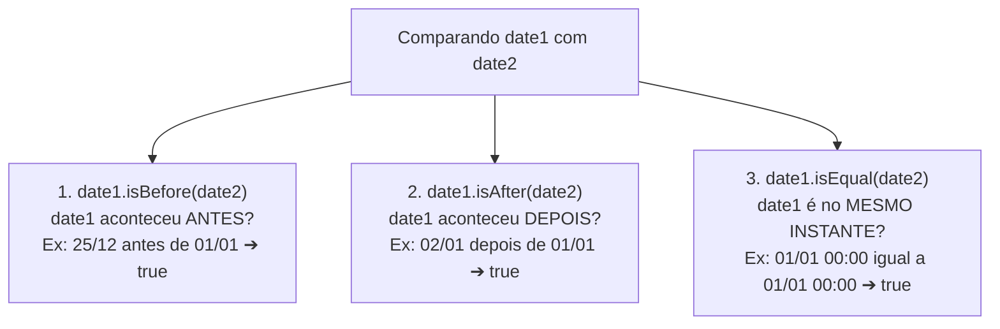

# Curso de Java Completo (Bro Code) — Capítulo 62: `dates & times 📆` (Parte 7)
## Comparação de Igualdade com `.isEqual()`, a Armadilha do `==` e Encerramento do Capítulo

> **Contexto no Vídeo**: No tempo **`10:20:19 / 12:00:00`**, o instrutor **Bro Code** conclui o **Capítulo 62: `dates & times`** fechando a trindade da comparação de tempo:  
> Depois de aprender a testar se uma data veio antes (`.isBefore()`) e se veio depois (`.isAfter()`), ele adiciona o terceiro ramo essencial de decisão: **e se as duas datas forem exatamente iguais?**  
> Ele introduz o método **`.isEqual()`**, altera os valores de `date1` e `date2` para coincidirem no mesmo instante (01/01/2025 às 00:00) e demonstra a execução no console!

---

## 📸 Reconstituição Visual Completa das 5 Imagens (Para Google Docs)

Como você copiará este guia diretamente para o seu **Google Docs** e não terá as imagens anexadas lá, abaixo está a reprodução textual e estrutural idêntica de cada uma das 5 telas do IntelliJ IDEA e do YouTube.

```
====================================================================================================
IMAGEM 1: Testando 'date1' Posterior a 'date2' (Tempo do Vídeo: 10:20:00)
====================================================================================================
Painel Esquerdo de Projetos:
  MyFirstProject C:\Users\HP\...
  ├── .idea
  ├── out
  └── src
      ├── A Caring Friend.wav
      ├── Main
      ├── .gitignore
      └── MyFirstProject.iml

Editor de Código (Main.java):
10:         // How to work with DATES & TIMES using Java
11:         // (LocalDate, LocalTime, LocalDateTime, UTC timestamp)
12: 
13:         LocalDateTime date1 = LocalDateTime.of(2025, 1, 2, 12, 0, 0);
14:         LocalDateTime date2 = LocalDateTime.of(2025, 1, 1, 0, 0, 0);
15: 
16:         if(date1.isBefore(date2)){
17:             System.out.println(date1 + " is earlier than " + date2);
18:         }
19:         else if(date1.isAfter(date2)){
20:             System.out.println(date1 + " is later than " + date2);
21:         }
22: 
23:     }

Barra Superior: Cursor sobre o botão verde de "Run" (Play).
====================================================================================================
```

```
====================================================================================================
IMAGEM 2: Execução no Console Confirmando o Ramo 'isAfter'
====================================================================================================
Terminal / Run Console (Inferior):
  C:\Users\HP\.jdks\openjdk-23\bin\java.exe "-javaagent:C:\Program Files\JetBrains\IntelliJ..."
  2025-01-02T12:00 is later than 2025-01-01T00:00  <-- [Texto inicial destacado em azul]

  Process finished with exit code 0

Análise Visual da Imagem 2:
- date1 (02/01/2025 12:00) é posterior a date2 (01/01/2025 00:00).
- O bloco 'isAfter' foi executado com sucesso no console:
  "2025-01-02T12:00 is later than 2025-01-01T00:00"
====================================================================================================
```

```
====================================================================================================
IMAGEM 3: O Autor Adicionando o Terceiro Ramo: 'else if(date1.isEqual(date2))'
====================================================================================================
Editor de Código (Linhas 16 a 26):
16:         if(date1.isBefore(date2)){
17:             System.out.println(date1 + " is earlier than " + date2);
18:         }
19:         else if(date1.isAfter(date2)){
20:             System.out.println(date1 + " is later than " + date2);
21:         }
22:         else if(date1.isEqual(date2)){   <-- Autor digitando a condição de igualdade
23: 
24:         }
25:     }
26: }

Análise Visual da Imagem 3:
- O autor percebe que uma data pode não ser nem anterior nem posterior: elas podem ser idênticas!
- Ele começa a digitar o ramo 'else if(date1.isEqual(date2)){' na linha 22.
====================================================================================================
```

```
====================================================================================================
IMAGEM 4: Alteração das Datas para Ficar Coincidentes (Ambas em 01/01/2025 às 00:00)
====================================================================================================
Editor de Código (Linhas 7 a 22):
 7: public class Main {
 8:     public static void main(String[] args) {
 9: 
10:         // How to work with DATES & TIMES using Java
11:         // (LocalDate, LocalTime, LocalDateTime, UTC timestamp)
12: 
13:         LocalDateTime date1 = LocalDateTime.of(2025, 1, 1, 0, 0, 0);  <-- [Cursor no zero da hora]
14:         LocalDateTime date2 = LocalDateTime.of(2025, 1, 1, 0, 0, 0);
15: 
16:         if(date1.isBefore(date2)){
17:             System.out.println(date1 + " is earlier than " + date2);
18:         }
19:         else if(date1.isAfter(date2)){
20:             System.out.println(date1 + " is later than " + date2);
21:         }
22:         else if(date1.isEqual(date2)){

Análise Visual da Imagem 4:
- Na linha 13, o autor alterou o dia de '2' para '1' e a hora de '12' para '0'.
- Agora tanto 'date1' quanto 'date2' apontam exatamente para o mesmo instante:
  01 de Janeiro de 2025 à meia-noite (00:00:00).
====================================================================================================
```

```
====================================================================================================
IMAGEM 5: Visão dos Imports no Topo do Arquivo e Linha do Tempo do YouTube
====================================================================================================
Barra de Vídeo do YouTube (Rodapé):
  [ ⏸ Pausa K ]  10:20:19 / 12:00:00    62.dates & times >

Editor de Código (Linhas 1 a 17):
 1: import java.time.Instant;
 2: import java.time.LocalDate;
 3: import java.time.LocalDateTime;
 4: import java.time.LocalTime;
 5: import java.time.format.DateTimeFormatter;
 6: 
 7: public class Main {
 8:     public static void main(String[] args) {
 9: 
10:         // How to work with DATES & TIMES using Java
11:         // (LocalDate, LocalTime, LocalDateTime, UTC timestamp)
12: 
13:         LocalDateTime date1 = LocalDateTime.of(2025, 1, 1, 0, 0, 0);
14:         LocalDateTime date2 = LocalDateTime.of(2025, 1, 1, 0, 0, 0);
15: 
16:         if(date1.isBefore(date2)){
17:             System.out.println(date1 + " is earlier than " + date2);

Análise Visual da Imagem 5:
- O autor rolou o editor até o topo, exibindo todos os 5 imports do pacote java.time.
- O tempo do vídeo marca 10:20:19, indicando a conclusão das explicações fundamentais do capítulo!
====================================================================================================
```

---

## ⚖️ A Trindade da Comparação de Datas no Java

No Java moderno, qualquer comparação entre duas datas cai obrigatoriamente em um destes três métodos:



---

## ⚠️ A Armadilha Mortal: Por Que NÃO Usar `==` para Testar Igualdade de Datas?

Este é o erro mais perigoso cometido por programadores novatos em Java:

```java
// ⚠️ PERIGO GRAVÍSSIMO! NUNCA FAÇA ISSO!
if (date1 == date2) {
    System.out.println("São iguais");
}
```

### O Que Acontece por Baixo dos Panos?
1. Em Java, `date1` e `date2` são **variáveis de referência**. Elas guardam o **endereço de memória física** (ponteiro) de onde os objetos foram alocados na memória Heap.
2. Quando você escreve `date1 == date2`, o Java **NÃO** olha para o ano, nem para o mês, nem para o dia!
3. Ele apenas compara: *"Essas duas variáveis apontam para a mesmíssima gaveta de memória física?"*.
4. Como criamos `date1` chamando `LocalDateTime.of(...)` e criamos `date2` chamando `LocalDateTime.of(...)` separadamente, o Java alocou **duas gavetas de memória diferentes**!
5. Resultado: Mesmo que ambas guardem `01/01/2025 às 00:00:00`, a expressão `date1 == date2` retornará **`false`**!

> [!IMPORTANT]
> **A Regra de Ouro**:  
> Para comparar se duas datas representam o mesmo momento no tempo, use **sempre** o método:
> ```java
> if (date1.isEqual(date2)) { ... }
> ```

---

## 🧐 Qual a Diferença Entre `.isEqual()` e `.equals()`?

Você provavelmente já viu o método `.equals()` ao comparar Strings (`texto1.equals(texto2)`). No pacote `java.time`, ambos existem, mas com uma diferença sutil e genial:

| Método | O que ele compara? | Como se comporta com fusos diferentes? |
| :--- | :--- | :--- |
| **`.isEqual()`** | **Apenas a linha do tempo cronológica** | Considera iguais duas datas se caírem no **mesmo instante universal**, mesmo que estejam em fusos horários ou calendários diferentes (ex: calendário japonês vs gregoriano). |
| **`.equals()`** | **Estrutura exata da classe** | Além do momento no tempo, exige que ambos os objetos sejam do **mesmo tipo exato** e usem o **mesmo sistema cronológico**. |

> [!TIP]
> Para o dia a dia comparando `LocalDate` e `LocalDateTime`, **`.isEqual()`** é a escolha mais semântica e expressiva para o seu código!

---

## 🔬 O Código-Fonte Consolidado do `Main.java`

```java
1: import java.time.Instant;
2: import java.time.LocalDate;
3: import java.time.LocalDateTime;
4: import java.time.LocalTime;
5: import java.time.format.DateTimeFormatter;
6: 
7: public class Main {
8:     public static void main(String[] args) {
9: 
10:         // How to work with DATES & TIMES using Java
11:         // (LocalDate, LocalTime, LocalDateTime, UTC timestamp)
12: 
13:         LocalDateTime date1 = LocalDateTime.of(2025, 1, 1, 0, 0, 0);
14:         LocalDateTime date2 = LocalDateTime.of(2025, 1, 1, 0, 0, 0);
15: 
16:         if(date1.isBefore(date2)){
17:             System.out.println(date1 + " is earlier than " + date2);
18:         }
19:         else if(date1.isAfter(date2)){
20:             System.out.println(date1 + " is later than " + date2);
21:         }
22:         else if(date1.isEqual(date2)){
23:             System.out.println(date1 + " is equal to " + date2);
24:         }
25:     }
26: }
```

---

## 🔍 Explicação Linha por Linha ("Como se Fosse um Iniciante Amador")

### Linhas 1 a 5: Os 5 Pilares do `java.time`
- `Instant`: Timestamp global UTC (Greenwich).
- `LocalDate`: Apenas dia, mês e ano.
- `LocalDateTime`: Data e hora juntos (nosso foco aqui).
- `LocalTime`: Apenas horário (horas, minutos, segundos e nanossegundos).
- `DateTimeFormatter`: Máscaras visuais de formatação.

### Linhas 7 e 8: Classe e Método `main`
- A estrutura padrão de inicialização de qualquer programa executável em Java.

### Linhas 13 e 14: Os Dois Objetos de Teste (Imagem 4)
- `LocalDateTime date1 = LocalDateTime.of(2025, 1, 1, 0, 0, 0);`
- `LocalDateTime date2 = LocalDateTime.of(2025, 1, 1, 0, 0, 0);`
- Ambas as variáveis recebem: Ano 2025, Mês 1 (Janeiro), Dia 1, Hora 0 (meia-noite), Minuto 0, Segundo 0.

### Linha 16: `if(date1.isBefore(date2))`
- Avaliação: O dia 01/01/2025 às 00:00 veio antes de 01/01/2025 às 00:00?
- **Não!** É o mesmo instante. Retorna **`false`**.
- O Java pula a linha 17 e testa a próxima condição.

### Linha 19: `else if(date1.isAfter(date2))`
- Avaliação: O dia 01/01/2025 às 00:00 veio depois de 01/01/2025 às 00:00?
- **Não!** Retorna **`false`**.
- O Java pula a linha 20 e desce para o terceiro ramo.

### Linha 22: `else if(date1.isEqual(date2))` ⭐ (O Ponto Alto da Aula!)
- Avaliação: As duas datas representam exatamente o mesmo segundo no tempo?
- **SIM! Com certeza!**
- O método retorna **`true`**!
- O Java entra no bloco e executa a linha 23!

### Linha 23: `System.out.println(date1 + " is equal to " + date2);`
- "Is equal to" em inglês significa **é igual a**.
- O Java converte os objetos chamando `.toString()`.
- **Saída Real no Console**:
  ```text
  2025-01-01T00:00 is equal to 2025-01-01T00:00
  ```

### Linhas 24, 25 e 26: Fechamento dos Blocos
- Fecha o `else if`, o método `main` e a classe `Main`.

---

## 🖥️ Comparativo de Saídas no Console

### 1. Teste da Imagem 2 (`date1` = 02/01/2025 e `date2` = 01/01/2025):
```text
2025-01-02T12:00 is later than 2025-01-01T00:00

Process finished with exit code 0
```

### 2. Teste da Imagem 4 (Ambas as datas em 01/01/2025 às 00:00):
```text
2025-01-01T00:00 is equal to 2025-01-01T00:00

Process finished with exit code 0
```

---

## 🏆 O Que Você Dominou no Capítulo 62 (`dates & times 📆`)?

Ao finalizar este capítulo, você aprendeu todas as ferramentas modernas essenciais para manipular tempo em Java:
1. **Captura em Tempo Real**: `LocalDate.now()`, `LocalTime.now()`, `LocalDateTime.now()` e `Instant.now()`.
2. **Fabricação Customizada**: `LocalDate.of(ano, mes, dia)` e `LocalDateTime.of(ano, mes, dia, hora, min, seg)`.
3. **Formatação Elegante**: `DateTimeFormatter.ofPattern("dd/MM/yyyy HH:mm:ss")` e método `.format()`.
4. **Comparações Cronológicas Precisas**: `.isBefore()`, `.isAfter()` e `.isEqual()`.
5. **Conhecimento das Armadilhas**: Evitou o operador `==` em objetos de data e conheceu o significado do separador `T` e do sufixo `Z` (Zulu/UTC).
