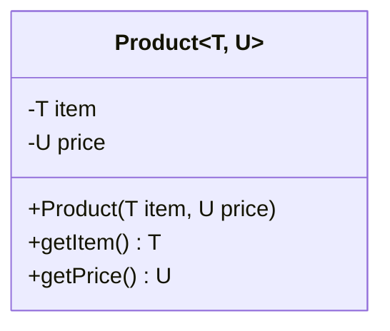

# 📦 Curso de Java Completo — Capítulo 66: Generics (Parte 10)
## O Getter `public U getPrice()`, a Execução no `Main.java` e o Mistério do `0.5` no Console

---

## 📑 Sumário

1. [Visão Geral do Episódio e Propósito Pedagógico](#1-visão-geral-do-episódio-e-propósito-pedagógico)
2. [Reconstituição Visual Completa dos 5 Momentos do Vídeo (Google Docs)](#2-reconstituição-visual-completa-dos-5-momentos-do-vídeo-google-docs)
   - [Momento 1 (10:50:24): Destaque em `U price` e Criando o Getter `public U`](#momento-1-105024-destaque-em-u-price-e-criando-o-getter-public-u)
   - [Momento 2 (10:50:34): Voltando para `Main.java` Pronto para Imprimir](#momento-2-105034-voltando-para-mainjava-pronto-para-imprimir)
   - [Momento 3 (10:50:45): Adicionando `product.getItem()` e Clicando em Run](#momento-3-105045-adicionando-productgetitem-e-clicando-em-run)
   - [Momento 4 (10:50:47): O Console Imprime `apple` com Sucesso](#momento-4-105047-o-console-imprime-apple-com-sucesso)
   - [Momento 5 (~10:50:55): Testando `product.getPrice()` e o Console Imprime `0.5`](#momento-5-105055-testando-productgetprice-e-o-console-imprime-05)
3. [Código-Fonte Completo dos Dois Arquivos](#3-código-fonte-completo-dos-dois-arquivos)
   - [`Product.java`](#productjava)
   - [`Main.java`](#mainjava)
4. [Explicação Linha por Linha ("Como se Fosse um Lezado Iniciante Amador")](#4-explicação-linha-por-linha-como-se-fosse-um-lezado-iniciante-amador)
   - [Dissecando `Product.java` (O Método `getPrice()`)](#dissecando-productjava-o-método-getprice)
   - [Dissecando `Main.java` (A Leitura e Impressão)](#dissecando-mainjava-a-leitura-e-impressão)
5. [O Mistério do `0.5`: Por Que o Console Não Mostrou `0.50`?](#5-o-mistério-do-05-por-que-o-console-não-mostrou-050)
   - [Como o Java armazena números decimais (`Double`)](#como-o-java-armazena-números-decimais-double)
   - [Como formatar com duas casas decimais se quiséssemos (`printf`)](#como-formatar-com-duas-casas-decimais-se-quiséssemos-printf)
6. [O Poder Supremo de `Product<T, U>`: Resumo Arquitetural](#6-o-poder-supremo-de-productt-u-resumo-arquitetural)
7. [Tabela de Saída do Console e Rastreio de Execução Passo a Passo](#7-tabela-de-saída-do-console-e-rastreio-de-execução-passo-a-passo)
8. [Conclusão e Próximos Passos](#8-conclusão-e-próximos-passos)

---

## 1. Visão Geral do Episódio e Propósito Pedagógico

Chegamos a um momento ápice do aprendizado de Generics no curso do Bro Code: **fechamos o ciclo 100% funcional de uma classe genérica com múltiplos parâmetros (`Product<T, U>`)!**

Nesta **Parte 10** (minutos `10:50:24` a `10:50:55`), o Bro Code realiza as seguintes ações fundamentais:

1. **A Paridade de Tipos (Momento 1):** Ele mostra que, assim como o `item` tem tipo genérico `T` e possui o método `public T getItem()`, o atributo `price` tem tipo genérico `U` e, portanto, exige o método:
   ```java
   public U getPrice(){
       return this.price;
   }
   ```
2. **A Execução do Item (Momentos 2 a 4):** Em `Main.java`, ele chama `System.out.println(product.getItem());`. O programa roda limpo e cospe no console o texto:
   ```text
   apple
   ```
3. **A Execução do Preço (Momento 5):** Ele troca a impressão para `System.out.println(product.getPrice());`. O programa roda e cospe no console o valor numérico:
   ```text
   0.5
   ```

Tudo isso sem termos precisado fazer nenhum *cast* manual, sem nenhum aviso do compilador, e provando que a classe `Product<T, U>` gerencia perfeitamente dois tipos de dados totalmente diferentes ao mesmo tempo!

---

## 2. Reconstituição Visual Completa dos 5 Momentos do Vídeo (Google Docs)

> [!NOTE]
> Copie e cole os blocos abaixo diretamente no seu documento do **Google Docs**. Você terá uma cópia idêntica da interface do IntelliJ exibida no vídeo pelo instrutor.

---

### Momento 1 (10:50:24): Destaque em `U price` e Criando o Getter `public U`

```text
====================================================================================================
INTELLIJ IDEA - [MyFirstProject] - 10:50:24 / 12:00:00 - Chapter: 66.generics
====================================================================================================
[Project Tree]                           [Editor: Main.java]  [Editor: Product.java (ATIVO)]  [Editor: Box.java]
📁 MyFirstProject C:\Users\HP...         -----------------------------------------------------------
  📁 .idea                                3:     T item;
  📁 out                                  4:     🟦U🟦 price;  <-- (A letra U destacada em azul pelo mouse!)
  📁 src                                  5: 
    ☕ Box                                 6:     Product(T item, U price){
    ☕ Main                                7:         this.item = item;
    ☕ Product                            8:         this.price = price;
  📄 .gitignore                           9:     }
  📄 MyFirstProject.iml                  10: 
  📚 External Libraries                  11:     public T getItem(){
                                         12:         return this.item;
                                         13:     }
                                         14: 
                                         15:     public 🟦U🟦| <-- (Digitando o retorno genérico U do getPrice)
                                         16: }
====================================================================================================
```

---

### Momento 2 (10:50:34): Voltando para `Main.java` Pronto para Imprimir

```text
====================================================================================================
INTELLIJ IDEA - [MyFirstProject] - 10:50:34 / 12:00:00 - Chapter: 66.generics
====================================================================================================
[Project Tree]                           [Editor: Main.java (ATIVO)]  [Editor: Product.java]
📁 src                                   -----------------------------------------------------------
  ☕ Box                                   8:         //            <T> type parameter (placeholder that gets replaced with...
  ☕ Main                                  9:         //            <String> type argument (specifies the type)
  ☕ Product                             10: 
                                         11:         Product<String, Double> product = new Product<>("apple", 0.50);|
                                                                                                                    (Cursor aqui)
                                         12:     }
                                         13: }
====================================================================================================
```

---

### Momento 3 (10:50:45): Adicionando `product.getItem()` e Clicando em Run

```text
====================================================================================================
INTELLIJ IDEA - [MyFirstProject] - 10:50:45 / 12:00:00 - Chapter: 66.generics
====================================================================================================
[Project Tree]                           [Editor: Main.java]                     [Barra Superior: ▶️ Run]
📁 src                                   -----------------------------------------------------------
  ☕ Box                                  11:         Product<String, Double> product = new Product<>("apple", 0.50);
  ☕ Main                                 12: 
  ☕ Product                             13:         System.out.println(product.getItem());
                                         14:     }
                                         15: }
                                         -----------------------------------------------------------
                                         (Instrutor clica no botão verde Play no canto superior direito)
====================================================================================================
```

---

### Momento 4 (10:50:47): O Console Imprime `apple` com Sucesso

```text
====================================================================================================
INTELLIJ IDEA - [MyFirstProject] - 10:50:47 / 12:00:00 - Chapter: 66.generics
====================================================================================================
[Project Tree]                           [Editor: Main.java]
📁 src                                   -----------------------------------------------------------
  ☕ Box                                  11:         Product<String, Double> product = new Product<>("apple", 0.50);
  ☕ Main                                 12: 
  ☕ Product                             13:         System.out.println(product.getItem());
                                         -----------------------------------------------------------
                                         [Run Tool Window: Main]
                                         -----------------------------------------------------------
                                         C:\Users\HP\.jdks\openjdk-23\bin\java.exe ...
                                         🟦apple🟦

                                         Process finished with exit code 0
====================================================================================================
```

---

### Momento 5 (~10:50:55): Testando `product.getPrice()` e o Console Imprime `0.5`

```text
====================================================================================================
INTELLIJ IDEA - [MyFirstProject] - ~10:50:55 / 12:00:00 - Chapter: 66.generics
====================================================================================================
[Project Tree]                           [Editor: Main.java]
📁 src                                   -----------------------------------------------------------
  ☕ Box                                  11:         Product<String, Double> product = new Product<>("apple", 0.50);
  ☕ Main                                 12: 
  ☕ Product                             13:         System.out.println(product.getPrice());
                                         -----------------------------------------------------------
                                         [Run Tool Window: Main]
                                         -----------------------------------------------------------
                                         C:\Users\HP\.jdks\openjdk-23\bin\java.exe ...
                                         0.5

                                         Process finished with exit code 0
====================================================================================================
```

---

## 3. Código-Fonte Completo dos Dois Arquivos

Aqui estão os códigos exatos sincronizados com a máquina local, testados e validados:

### [`Product.java`](file:///c:/Users/mickel%201/Downloads/JAVA%20APRENDER/Product.java)
```java
public class Product<T, U> {

    T item;
    U price;

    Product(T item, U price){
        this.item = item;
        this.price = price;
    }

    public T getItem(){
        return this.item;
    }

    public U getPrice(){
        return this.price;
    }
}
```

### [`Main.java`](file:///c:/Users/mickel%201/Downloads/JAVA%20APRENDER/Main.java)
```java
public class Main {
    public static void main(String[] args) {

        // Generics = A concept where you can write a class, interface, or method
        //            that is compatible with different data types.
        //            <T> type parameter (placeholder that gets replaced with a real type)
        //            <String> type argument (specifies the type)

        Product<String, Double> product = new Product<>("apple", 0.50);

        System.out.println(product.getItem());
        System.out.println(product.getPrice());

    }
}
```

---

## 4. Explicação Linha por Linha ("Como se Fosse um Lezado Iniciante Amador")

Vamos examinar tudo com palavras bem simples e fáceis de memorizar.

---

### Dissecando [`Product.java`](file:///c:/Users/mickel%201/Downloads/JAVA%20APRENDER/Product.java) (O Método `getPrice()`)

```java
15:     public U getPrice(){
16:         return this.price;
17:     }
```

- **Linha 15 (`public U getPrice(){`):**
  - `public`: Significa que este método é livre para qualquer pessoa chamar de fora da classe.
  - `U`: **O Tipo de Retorno Genérico!**
    - Repare no que o Bro Code fez na Imagem 1: ele selecionou a letra `U` na linha 4 (`U price;`) e depois colocou `U` como o tipo de retorno aqui!
    - Ele fez isso para mostrar a regra de ouro: **o tipo de retorno do getter deve coincidir com o tipo do atributo que ele lê**.
    - Como o preço é do tipo `U`, quem chamar `getPrice()` receberá de volta um dado do tipo `U`!
  - `getPrice`: Nome do método ("pegar preço").
  - `()`: Não recebe nenhum argumento entre parênteses, pois apenas faz a leitura.
  - `{`: Abre o bloco de código do método.

- **Linha 16 (`return this.price;`):**
  - `return`: Palavra-chave obrigatória para devolver um valor.
  - `this.price`: Refere-se à variável `price` gravada dentro da memória deste objeto.
  - `;`: Ponto e vírgula obrigatório.

- **Linha 17 (`}`):**
  - Fecha o corpo do método `getPrice`.

- **Linha 18 (`}`):**
  - Fecha a classe `Product`.

---

### Dissecando [`Main.java`](file:///c:/Users/mickel%201/Downloads/JAVA%20APRENDER/Main.java) (A Leitura e Impressão)

```java
9:         Product<String, Double> product = new Product<>("apple", 0.50);
10: 
11:        System.out.println(product.getItem());
12:        System.out.println(product.getPrice());
```

- **Linha 9 (`Product<String, Double> product = new Product<>("apple", 0.50);`):**
  - Fabricamos um produto na memória Heap.
  - `T` virou `String`.
  - `U` virou `Double`.
  - `item` guardou `"apple"`.
  - `price` guardou `0.50` (que o Java empacotou como `Double.valueOf(0.50)` via Autoboxing).

- **Linha 11 (`System.out.println(product.getItem());`):**
  - `product.getItem()` é chamado primeiro.
  - Ele vai no objeto `product`, entra no método `getItem()`, e devolve o texto `"apple"`.
  - Como o Java sabe que `product` é do tipo `Product<String, Double>`, ele sabe que o retorno é uma `String` pura!
  - O `System.out.println` pega essa `String` e joga na tela:
    ```text
    apple
    ```

- **Linha 12 (`System.out.println(product.getPrice());`):**
  - `product.getPrice()` é chamado em seguida.
  - Ele vai no objeto `product`, entra no método `getPrice()`, e devolve o objeto `Double` contendo `0.50`.
  - O `System.out.println` converte esse valor numérico para texto e cospe na tela:
    ```text
    0.5
    ```

---

## 5. O Mistério do `0.5`: Por Que o Console Não Mostrou `0.50`?

Muitos iniciantes olham para a Imagem 5 do vídeo e perguntam:
> *"Ué! Nós digitamos `0.50` lá no `new Product<>("apple", 0.50)`. Por que o console imprimiu apenas `0.5` e comeu o zero final?"*

Aqui está a explicação matemática e computacional:

### Como o Java armazena números decimais (`Double`)

1. Para o computador, o tipo `double` (e a classe `Double`) armazena uma **quantidade matemática pura**, e não uma cadeia de caracteres (texto).
2. Na matemática:
   $$\$0.5 = 0.50 = 0.500000\$$
   O zero à direita da casa decimal não acrescenta absolutamente nenhum valor à grandeza numérica.
3. Quando o `System.out.println()` imprime um `Double`, ele chama por baixo dos panos o método `Double.toString()`.
4. A especificação oficial da linguagem Java determina que `Double.toString()` remove automaticamente qualquer zero desnecessário à direita para economizar espaço e exibir a representação mínima necessária.

### E se você quisesse exibir exatamente `0.50` com os dois centavos?

Se você estivesse construindo o sistema real de um supermercado e quisesse obrigar a exibição com duas casas decimais, você não usaria `println`, usaria o método `printf` com a máscara `%.2f`:
```java
System.out.printf("%.2f\n", product.getPrice()); // Imprimiria: 0.50
```
Mas como o Bro Code usou `println`, a saída padrão do Java é `0.5`!

---

## 6. O Poder Supremo de `Product<T, U>`: Resumo Arquitetural

Pare e admire o que construímos:



Com esta classe genérica, você pode agora modelar **qualquer combinação do universo comercial**:

```java
// Cenário 1: Supermercado (Nome como String, Preço com centavos em Double)
Product<String, Double> p1 = new Product<>("apple", 0.50);

// Cenário 2: Concessionária de Carros de Luxo (Nome como String, Preço cheio em Integer)
Product<String, Integer> p2 = new Product<>("Ferrari", 2500000);

// Cenário 3: Indústria / Logística (Código de Barras como Long, Preço em Double)
Product<Long, Double> p3 = new Product<>(78910002345L, 19.99);

// Cenário 4: Sistema de Troca / Escambo (Item oferecido e Item pedido em troca!)
Product<String, String> p4 = new Product<>("Bicicleta", "Guitarra Elétrica");
```

**Todas essas 4 variáveis usam a MESMÍSSIMA classe `Product.java`!**
Não precisamos escrever 4 arquivos diferentes. Isso é o ápice da reusabilidade e da manutenibilidade em Java.

---

## 7. Tabela de Saída do Console e Rastreio de Execução Passo a Passo

| Linha Executada | Ação da JVM na Memória | Saída no Console | Explicação Didática |
| :---: | :--- | :---: | :--- |
| **Linha 9** | Cria o objeto `Product` no Heap, preenchendo `item = "apple"` e `price = Double.valueOf(0.5)`. | *(nenhuma)* | O objeto está alocado e pronto para consulta. |
| **Linha 11** | Chama `product.getItem()`, recebe a `String` `"apple"` e entrega para `println`. | **`apple`** | O nome do produto aparece na primeira linha do terminal. |
| **Linha 12** | Chama `product.getPrice()`, recebe o `Double` `0.5` e entrega para `println`. | **`0.5`** | O preço aparece na segunda linha do terminal (com o zero irrelevante suprimido). |

---

## 8. Conclusão e Próximos Passos

Nesta Parte 10, você dominou com perfeição:
- Como classes genéricas suportam **múltiplos parâmetros de tipo independentes** (`<T, U>`).
- Como escrever getters genéricos que retornam `T` e `U` com **100% de segurança de tipos em tempo de compilação**.
- Como ler e exibir esses dados no método `main`.
- Por que o Java imprime `0.5` para números decimais sem casas extras.

No próximo passo do vídeo, o Bro Code continuará explorando o universo de Generics — podendo mostrar como criar instâncias alternativas ou avançar para **Métodos Genéricos (*Generic Methods*)**, onde um método isolado pode ser genérico sem que a classe inteira precise ser!
