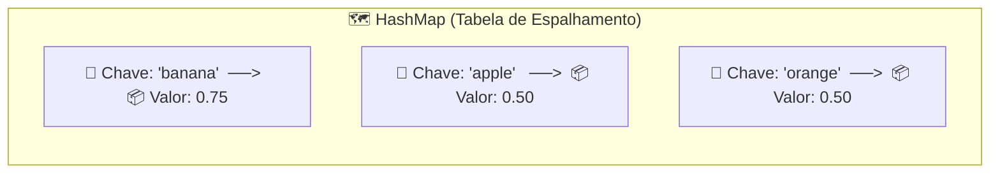

# 🗺️ Curso de Java Completo — Capítulo 67: HashMaps (Parte 1)
## Introdução aos HashMaps: Pares Chave-Valor, Chaves Únicas, Ausência de Ordem e o Alerta de Raw Type

---

## 📑 Sumário

1. [Visão Geral do Novo Capítulo (Capítulo 67: `hashmaps 🗺️`)](#1-visão-geral-do-novo-capítulo-capítulo-67-hashmaps-️)
2. [Reconstituição Visual Completa dos 5 Momentos do Vídeo (Google Docs)](#2-reconstituição-visual-completa-dos-5-momentos-do-vídeo-google-docs)
   - [Momento 1 (~10:52:30): A Definição de HashMap nos Comentários](#momento-1-105230-a-definição-de-hashmap-nos-comentários)
   - [Momento 2 (~10:52:45): Destacando `<Key, Value>` (A Conexão com Generics)](#momento-2-105245-destacando-key-value-a-conexão-com-generics)
   - [Momento 3 (10:52:55): A Declaração sem Generics — `HashMap map = new HashMap();`](#momento-3-105255-a-declaração-sem-generics--hashmap-map--new-hashmap)
   - [Momento 4 (10:52:59): O Tooltip do IntelliJ e do OpenJDK 23 (`Raw use of HashMap<K, V>`)](#momento-4-105259-o-tooltip-do-intellij-e-do-openjdk-23-raw-use-of-hashmapk-v)
   - [Momento 5 (10:53:24): Preparando os Diamantes — `HashMap<> map`](#momento-5-105324-preparando-os-diamantes--hashmap-map)
3. [Código-Fonte Completo de `Main.java`](#3-código-fonte-completo-de-mainjava)
4. [Explicação Linha por Linha ("Como se Fosse um Lezado Iniciante Amador")](#4-explicação-linha-por-linha-como-se-fosse-um-lezado-iniciante-amador)
   - [Dissecando as Importações e Estrutura Principal](#dissecando-as-importações-e-estrutura-principal)
   - [Dissecando as 4 Regras de Ouro nos Comentários do Bro Code](#dissecando-as-4-regras-de-ouro-nos-comentários-do-bro-code)
   - [Dissecando a Linha 11 e o Aviso de Tipo Cru (Raw Type)](#dissecando-a-linha-11-e-o-aviso-de-tipo-cru-raw-type)
5. [Os 4 Pilares Invioláveis de um HashMap Explicados com Metáforas Simples](#5-os-4-pilares-invioláveis-de-um-hashmap-explicados-com-metáforas-simples)
   - [Pilar 1: Pares Chave-Valor (*Key-Value Pairs*)](#pilar-1-pares-chave-valor-key-value-pairs)
   - [Pilar 2: Chaves são ÚNICAS, Valores podem se repetir](#pilar-2-chaves-são-únicas-valores-podem-se-repetir)
   - [Pilar 3: Não mantém nenhuma ordem (*Unordered*), mas é ultra eficiente](#pilar-3-não-mantém-nenhuma-ordem-unordered-mas-é-ultra-eficiente)
   - [Pilar 4: Genérico por Natureza (`<K, V>`)](#pilar-4-genérico-por-natureza-k-v)
6. [Tabela Comparativa Fundamental: `ArrayList` vs `HashMap`](#6-tabela-comparativa-fundamental-arraylist-vs-hashmap)
7. [Tabela de Saída do Console e Rastreio de Compilação](#7-tabela-de-saída-do-console-e-rastreio-de-compilação)
8. [Conclusão e Próximos Passos](#8-conclusão-e-próximos-passos)

---

## 1. Visão Geral do Novo Capítulo (Capítulo 67: `hashmaps 🗺️`)

Seja muito bem-vindo ao **Capítulo 67**!
Observe a transição genial e fluida que o Bro Code planejou na grade curricular deste curso:
- No **Capítulo 66**, nós estudamos **Generics** e construímos uma classe chamada `Product<T, U>`, onde usamos duas letras coringas para guardar duas informações diferentes (`item` e `price`).
- Agora, no **Capítulo 67**, o Bro Code nos apresenta a estrutura de dados mais importante, rápida e utilizada de todo o ecossistema corporativo do Java: o **`java.util.HashMap<K, V>`**!

O `HashMap` é exatamente a aplicação prática do conceito de múltiplos tipos genéricos da biblioteca oficial do Java. Ele armazena dados em **pares de Chave (`Key` ou `K`) e Valor (`Value` ou `V`)**.

Nesta **Parte 1** (minutos `10:52:30` a `10:53:24`), o Bro Code estabelece a fundação teórica e técnica:
1. Escreve a definição precisa nos comentários do código.
2. Faz o import de `java.util.HashMap`.
3. Declara uma instância crua propositalmente (`HashMap map = new HashMap();`) para demonstrar o aviso de *Raw Type* da IDE e do OpenJDK.
4. Começa a adicionar os diamantes `<>` para preencher a Chave e o Valor com tipos concretos.

---

## 2. Reconstituição Visual Completa dos 5 Momentos do Vídeo (Google Docs)

> [!NOTE]
> Copie e cole os blocos abaixo diretamente no seu documento do **Google Docs**. Você terá o registro textual exato de tudo o que apareceu na tela do IntelliJ IDEA durante a introdução ao capítulo.

---

### Momento 1 (~10:52:30): A Definição de HashMap nos Comentários

```text
====================================================================================================
INTELLIJ IDEA - [MyFirstProject] - ~10:52:30 / 12:00:00 - Chapter: 67.hashmaps 🗺️
====================================================================================================
[Project Tree]                           [Editor: Main.java (ATIVO)]
📁 MyFirstProject C:\Users\HP...         -----------------------------------------------------------
  📁 .idea                                1: 
  📁 out                                  2: public class Main {
  📁 src                                  3:     public static void main(String[] args) {
    ☕ Main                               4: 
  📄 .gitignore                           5:         // 🟦HashMap🟦 = A data structure that stores key-value pairs
  📄 MyFirstProject.iml                                 ^^^^^^^
  📚 External Libraries                               (Palavra HashMap destacada em azul pelo mouse)
                                          6:         //           Keys are unique, but Values can be duplicated
                                          7:         //           Does not maintain any order, but is memory efficient
                                          8:         //           HashMap<Key, Value>
                                          9: 
                                         10: 
                                         11: 
                                         12:     }
                                         13: }
====================================================================================================
```

---

### Momento 2 (~10:52:45): Destacando `<Key, Value>` (A Conexão com Generics)

```text
====================================================================================================
INTELLIJ IDEA - [MyFirstProject] - ~10:52:45 / 12:00:00 - Chapter: 67.hashmaps 🗺️
====================================================================================================
[Project Tree]                           [Editor: Main.java (ATIVO)]
📁 src                                   -----------------------------------------------------------
  ☕ Main                                 5:         // HashMap = A data structure that stores key-value pairs
                                          6:         //           Keys are unique, but Values can be duplicated
                                          7:         //           Does not maintain any order, but is memory efficient
                                          8:         //           HashMap<Key, 🟦Value🟦>
                                                                               ^^^^^
                                                                       (Destacado pelo instrutor)
                                          9: 
====================================================================================================
```

---

### Momento 3 (10:52:55): A Declaração sem Generics — `HashMap map = new HashMap();`

```text
====================================================================================================
INTELLIJ IDEA - [MyFirstProject] - 10:52:55 / 12:00:00 - Chapter: 67.hashmaps 🗺️
====================================================================================================
[Project Tree]                           [Editor: Main.java (ATIVO)]
📁 src                                   -----------------------------------------------------------
  ☕ Main                                 1: import java.util.HashMap;
                                          2: 
                                          3: public class Main {
                                          4:     public static void main(String[] args) {
                                          5: 
                                          6:         // HashMap = A data structure that stores key-value pairs
                                          7:         //           Keys are unique, but Values can be duplicated
                                          8:         //           Does not maintain any order, but is memory efficient
                                          9:         //           HashMap<Key, Value>
                                         10: 
                                         11:         HashMap map = new HashMap();
                                                     ~~~~~~~           ~~~~~~~
                                                     (Sublinhado ondulado amarelo de Raw Type Warning!)
                                         12:     }
                                         13: }
====================================================================================================
```

---

### Momento 4 (10:52:59): O Tooltip do IntelliJ e do OpenJDK 23 (`Raw use of HashMap<K, V>`)

```text
====================================================================================================
INTELLIJ IDEA - [MyFirstProject] - 10:52:59 / 12:00:00 - Chapter: 67.hashmaps 🗺️ (INSPEÇÃO DE TIPO)
====================================================================================================
[Project Tree]                           [Editor: Main.java]
📁 src                                   -----------------------------------------------------------
  ☕ Main                                11:         HashMap map = new HashMap();
                                                     👆(Mouse sobrevoando aqui)
                                                     ┌────────────────────────────────────────────────────────┐
                                                     │ Raw use of parameterized class 'HashMap'               │
                                                     │ ------------------------------------------------------ │
                                                     │ (c) java.util.HashMap<K, V>                            │
                                                     │ @Contract(pure = true)                                 │
                                                     │ public HashMap()                                       │
                                                     │                                                        │
                                                     │ Constructs an empty HashMap with the default initial   │
                                                     │ capacity (16) and the default load factor (0.75).      │
                                                     │ 📁 < openjdk-23 >                                      │
                                                     └────────────────────────────────────────────────────────┘
====================================================================================================
```

---

### Momento 5 (10:53:24): Preparando os Diamantes — `HashMap<> map`

```text
====================================================================================================
INTELLIJ IDEA - [MyFirstProject] - 10:53:24 / 12:00:00 - Chapter: 67.hashmaps 🗺️
====================================================================================================
[Project Tree]                           [Editor: Main.java (ATIVO)]
📁 src                                   -----------------------------------------------------------
  ☕ Main                                 1: import java.util.HashMap;
                                          2: 
                                          3: public class Main {
                                          4:     public static void main(String[] args) {
                                          5: 
                                          6:         // HashMap = A data structure that stores key-value pairs
                                          7:         //           Keys are unique, but Values can be duplicated
                                          8:         //           Does not maintain any order, but is memory efficient
                                          9:         //           HashMap<Key, Value>
                                         10: 
                                         11: 💡      HashMap<|> map = new HashMap();
                                                             ^
                                                    (Cursor posicionado entre os diamantes para digitar tipos!)
                                         12:     }
                                         13: }
====================================================================================================
```

---

## 3. Código-Fonte Completo de `Main.java`

Aqui está o código exato em execução no seu projeto local:

### [`Main.java`](file:///c:/Users/mickel%201/Downloads/JAVA%20APRENDER/Main.java)
```java
import java.util.HashMap;

public class Main {
    public static void main(String[] args) {

        // HashMap = A data structure that stores key-value pairs
        //           Keys are unique, but Values can be duplicated
        //           Does not maintain any order, but is memory efficient
        //           HashMap<Key, Value>

        HashMap map = new HashMap();

    }
}
```

---

## 4. Explicação Linha por Linha ("Como se Fosse um Lezado Iniciante Amador")

Vamos explicar cada caractere deste novo capítulo como se você estivesse começando do absoluto zero.

---

### Dissecando as Importações e Estrutura Principal

- **Linha 1 (`import java.util.HashMap;`):**
  - `import`: Avisa ao Java que vamos usar uma ferramenta pronta que mora em outra pasta da biblioteca padrão.
  - `java.util`: É o pacote de utilidades do Java (onde moram coleções como `ArrayList`, `Scanner`, etc.).
  - `HashMap`: O nome da classe que implementa tabelas de dispersão de chave-valor.
  - `;`: Ponto e vírgula obrigatório.

- **Linha 3 (`public class Main {`):**
  - Declaração da classe principal do projeto.

- **Linha 4 (`public static void main(String[] args) {`):**
  - O ponto de partida onde a máquina virtual Java (JVM) começa a rodar as instruções.

---

### Dissecando as 4 Regras de Ouro nos Comentários do Bro Code

O Bro Code escreveu 4 linhas de comentários fundamentais que definem toda a teoria de HashMaps:

- **Linha 5 (`// HashMap = A data structure that stores key-value pairs`):**
  - Em português: *"HashMap é uma estrutura de dados que armazena pares de chave-valor"*.
  - Em vez de guardar apenas uma lista de coisas soltas (como no `ArrayList`), o HashMap sempre guarda as coisas em **duplas**: para cada valor armazenado, você precisa associar uma **chave de acesso única**.

- **Linha 6 (`//           Keys are unique, but Values can be duplicated`):**
  - Em português: *"As chaves são únicas, mas os valores podem ser duplicados"*.
  - Pense no seu CPF e no seu Nome:
    - O CPF é a **Chave (`Key`)**: nunca podem existir dois cidadãos com o mesmo CPF no Brasil. A chave é estritamente única.
    - O Nome é o **Valor (`Value`)**: podem existir 10.000 pessoas chamadas "João Silva". Valores repetidos são perfeitamente aceitos!

- **Linha 7 (`//           Does not maintain any order, but is memory efficient`):**
  - Em português: *"Não mantém nenhuma ordem, mas tem alta eficiência de memória e busca"*.
  - Ao contrário de um `ArrayList`, onde o primeiro elemento fica no índice 0, o segundo no 1 e o terceiro no 2, o `HashMap` **NÃO garante que as coisas fiquem na ordem em que você as inseriu**. Ele espalha as coisas na memória usando uma fórmula matemática chamada *Hash Function* para que você consiga encontrar qualquer dado na velocidade da luz (tempo constante $\mathcal{O}(1)$).

- **Linha 8 (`//           HashMap<Key, Value>`):**
  - Em português: *"Sintaxe: `HashMap<Chave, Valor>`"*.
  - Demonstra que a classe `HashMap` utiliza **Generics** com dois parâmetros de tipo: o primeiro tipo define a Chave e o segundo tipo define o Valor.

---

### Dissecando a Linha 11 e o Aviso de Tipo Cru (Raw Type)

```java
11:         HashMap map = new HashMap();
```

- **Por que a linha ficou com um sublinhado ondulado amarelo?**
  - Conforme vimos na **Imagem 4**, o tooltip do IntelliJ avisou:
    ```text
    Raw use of parameterized class 'HashMap'
    (c) java.util.HashMap<K, V>
    ```
  - Isso significa: *"Atenção desenvolvedor! A classe `HashMap` foi projetada desde o Java 5 para receber dois tipos nos diamantes `<K, V>`. Se você instanciar sem os diamantes, o Java tratará tanto a chave quanto o valor como `Object` genérico, perdendo toda a proteção de tipos!"*.
  - É por isso que na **Imagem 5**, o Bro Code imediatamente colocou os diamantes:
    ```java
    HashMap<> map = new HashMap();
    ```
    para em seguida digitar os tipos concretos!

---

## 5. Os 4 Pilares Invioláveis de um HashMap Explicados com Metáforas Simples

Para quem é iniciante, estruturas de dados podem parecer assustadoras. Vamos usar analogias do dia a dia:



### Pilar 1: Pares Chave-Valor (*Key-Value Pairs*)
Imagine uma agenda telefônica antiga:
- Você não procura seu amigo perguntando: *"Quem é o contato número 37?"* (isso seria um `ArrayList` baseado em índice numérico).
- Você procura pelo **Nome do seu amigo** (a **Chave**) para descobrir o **Número do telefone** dele (o **Valor**).
- No HashMap, a busca é feita diretamente pelo nome da chave!

---

### Pilar 2: Chaves são ÚNICAS, Valores podem se repetir
Veja o diagrama acima:
- A fruta `"apple"` custa `0.50`.
- A fruta `"orange"` também custa `0.50`! O valor `0.50` está repetido, e o HashMap não liga a mínima para isso.
- **MAS**, você não pode ter duas chaves `"apple"`. Se você tentar inserir outra `"apple"` com o preço `1.20`, o HashMap simplesmente **atualizará o valor da maçã antiga para 1.20**, sem criar uma maçã nova!

---

### Pilar 3: Não mantém nenhuma ordem (*Unordered*), mas é ultra eficiente
- No `ArrayList`, para achar um elemento no meio de 1 milhão de itens, o Java às vezes precisa passar de um por um (1 milhão de comparações).
- No `HashMap`, o Java aplica uma função matemática chamada *Hash Code* na palavra da chave. Essa conta matemática aponta diretamente para o endereço de memória exato onde o dado está guardado.
- Você acha a informação instantaneamente, quer o mapa tenha 10 itens ou 10 milhões de itens!
- O "preço" dessa velocidade absurda é que ele não liga para a ordem cronológica em que você adicionou os dados.

---

### Pilar 4: Genérico por Natureza (`<K, V>`)
Na assinatura oficial do OpenJDK:
```java
public class HashMap<K, V> implements Map<K, V>
```
- A letra **`K`** significa **Key** (Chave).
- A letra **`V`** significa **Value** (Valor).
- As regras de Generics que aprendemos no Capítulo 66 valem 100% aqui: **só aceita Classes Wrapper / Objetos**, nunca primitivos puros (`<int, double>` é proibido, devemos usar `<Integer, Double>`).

---

## 6. Tabela Comparativa Fundamental: `ArrayList` vs `HashMap`

| Característica | `ArrayList<E>` (Capítulo 56) | `HashMap<K, V>` (Capítulo 67) |
| :--- | :--- | :--- |
| **Como organiza os dados?** | Lista sequencial indexada por números inteiros (`0, 1, 2...`) | Pares de Chave e Valor (`Key -> Value`) |
| **Como você busca um dado?** | Pela posição numérica (`list.get(0)`) | Pela chave personalizada (`map.get("apple")`) |
| **Aceita elementos repetidos?** | Sim, pode repetir tudo à vontade | Chaves são **únicas**; apenas Valores podem repetir |
| **Mantém a ordem de inserção?** | **Sim**, preserva exatamente a ordem em que você adicionou | **Não**, a ordem é imprevisível |
| **Velocidade de busca** | Mais lenta em listas grandes ($\mathcal{O}(n)$) | Extremamente rápida em qualquer tamanho ($\mathcal{O}(1)$) |
| **Quantos tipos genéricos usa?** | 1 tipo: `<E>` (Element) | 2 tipos: `<K, V>` (Key e Value) |

---

## 7. Tabela de Saída do Console e Rastreio de Compilação

| Instrução em `Main.java` | Efeito na Compilação / JVM | Saída no Console |
| :--- | :--- | :---: |
| `import java.util.HashMap;` | Carrega a definição do HashMap do JDK. | *(nenhuma)* |
| `HashMap map = new HashMap();` | Compila com sucesso, emitindo aviso de *warning [rawtypes]* pelo compilador. Cria um mapa vazio na memória Heap com capacidade inicial padrão para 16 elementos. | *(nenhuma)* |

---

## 8. Conclusão e Próximos Passos

Você acabou de presenciar a fundação teórica do **Capítulo 67 (HashMaps)**. 

No próximo passo do vídeo, o Bro Code irá:
1. Definir os tipos nos diamantes: muito provavelmente `HashMap<String, Double> map = new HashMap<>();` (para representar um cardápio ou lista de compras com nomes e preços).
2. Ensinar os métodos vitais do HashMap:
   - `map.put(chave, valor)`: para guardar pares.
   - `map.get(chave)`: para buscar um valor pela chave.
   - `map.remove(chave)`: para deletar.
   - `map.size()`: para saber quantos pares existem.
   - `map.containsKey(chave)`: para verificar se uma chave já existe.
