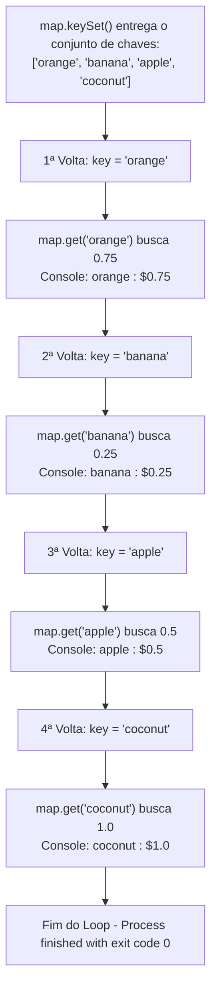

# Curso de Java — Bro Code (12 Horas)
## Capítulo 67: `hashmaps 🗺️` (Parte 3 — Métodos Principais, Iteração com `keySet()` e Comprovação das Regras de Ouro)

---

> [!NOTE]
> **Contexto para o Google Docs**: Este documento contém a reconstituição textual completa das 4 telas exibidas pelo instrutor Bro Code no vídeo (entre os minutos **11:01:59** e **11:02:36** de 12:00:00). Você não precisa das imagens originais: todos os painéis do IntelliJ IDEA, códigos, linhas selecionadas, métodos comentados e saídas do console foram reconstituídos em blocos de texto fiéis para o seu documento.

---

## 1. Reconstituição Textual das Telas do Vídeo (Google Docs Ready)

### Tela 1: O Loop For-Each com `map.keySet()` e os Métodos Comentados (Timestamp: 11:01:59)
```text
+--------------------------------------------------------------------------------------------------+
|  IntelliJ IDEA - MyFirstProject [Main.java]                                   Timestamp 11:01:59 |
+--------------------------------------------------------------------------------------------------+
| Project Tree      |  Main.java                                                                   |
| > .idea           |  18    //map.remove("apple");                                                |
| > out             |  19    //System.out.println(map.get("coconut"));                             |
| v src             |  20    //System.out.println(map.containsKey("pineapple"));                   |
|   (c) Main        |  21    //System.out.println(map.containsValue(1.00));                       |
|   .gitignore      |  22    //System.out.println(map.size());                                     |
|                   |  23                                                                          |
|                   | [24    for(String key : map.keySet()){                             ]         |
|                   | [25        System.out.println(key + " : $" + map.get(key));         ] <SELEÇÃO|
|                   | [26    }                                                           ]  AZUL   |
|                   |  27    }                                                                     |
|                   |  28 }                                                                        |
+--------------------------------------------------------------------------------------------------+
| O autor acabou de demonstrar os 5 métodos principais nas linhas 18-22, comentou todos com //     |
| e escreveu um loop for-each para percorrer todas as chaves do dicionário e exibir seus preços.   |
+--------------------------------------------------------------------------------------------------+
```

---

### Tela 2: O Console de Execução do Loop `for-each` (Timestamp: 11:02:03)
```text
+--------------------------------------------------------------------------------------------------+
|  Run / Execution Window (Console do IntelliJ)                                 Timestamp 11:02:03 |
+--------------------------------------------------------------------------------------------------+
|  C:\Users\HP\.jdks\openjdk-23\bin\java.exe ... Main                                              |
|                                                                                                  |
|  orange : $0.75                                                                                  |
|  banana : $0.25                                                                                  |
|  apple : $0.5                                                                                    |
|  coconut : $1.0                                                                                  |
|                                                                                                  |
|  Process finished with exit code 0                                                               |
+--------------------------------------------------------------------------------------------------+
| OBSERVAÇÃO CRUCIAL: A ordem no console (orange -> banana -> apple -> coconut) NÃO É A MESMA       |
| em que foram inseridos (apple -> orange -> banana -> coconut). Isso comprova a Regra 3!          |
+--------------------------------------------------------------------------------------------------+
```

---

### Tela 3: Alterando o Valor para Comprovar "Valores Duplicados" (Timestamp: 11:02:20)
```text
+--------------------------------------------------------------------------------------------------+
|  IntelliJ IDEA - MyFirstProject [Main.java]                                                      |
+--------------------------------------------------------------------------------------------------+
|  11    HashMap<String, Double> map = new HashMap<>();                                            |
|  12                                                                                              |
|  13    map.put("apple", 0.50);                                                                   |
|  14    map.put("orange", 0.50);   <-- O Bro Code mudou o preço de 0.75 para 0.50!                |
|  15    map.put("banana", 0.25);                                                                  |
|  16    map.put("coconut", 1.00);                                                                 |
|  17                                                                                              |
|  18    System.out.println(map);                                                                  |
+--------------------------------------------------------------------------------------------------+
| NOTA: "apple" custa 0.50 e "orange" custa 0.50. Duas chaves DIFERENTES com o MESMO VALOR!       |
| O Java aceitou perfeitamente sem nenhum erro ou aviso amarelo.                                   |
+--------------------------------------------------------------------------------------------------+
```

---

### Tela 4: O Bro Code Destacando a Regra de Ouro (Timestamp: 11:02:36)
```text
+--------------------------------------------------------------------------------------------------+
|  IntelliJ IDEA - O Autor Seleciona e Revisa as Regras                         Timestamp 11:02:36 |
+--------------------------------------------------------------------------------------------------+
|  6  *  // HashMap = A data structure that stores key-value pairs  <-- TEXTO SELECIONADO PELO    |
|  7     //           Keys are unique, but Values can be duplicated     CURSOR DO AUTOR            |
|  8     //           Does not maintain any order, but is memory efficient                         |
|  9     //           HashMap<Key, Value>                                                          |
|  10                                                                                              |
|  11    HashMap<String, Double> map = new HashMap<>();                                            |
+--------------------------------------------------------------------------------------------------+
| O autor conclui a lição apontando como cada linha de código comprovou cada uma dessas frases!     |
+--------------------------------------------------------------------------------------------------+
```

---

## 2. O Código Completo do Arquivo `Main.java`

Aqui está o código exato presente no arquivo [`Main.java`](file:///c:/Users/mickel%201/Downloads/JAVA%20APRENDER/Main.java):

```java
import java.util.HashMap;

public class Main {
    public static void main(String[] args) {

        // HashMap = A data structure that stores key-value pairs
        //           Keys are unique, but Values can be duplicated
        //           Does not maintain any order, but is memory efficient
        //           HashMap<Key, Value>

        HashMap<String, Double> map = new HashMap<>();

        map.put("apple", 0.50);
        map.put("orange", 0.75);
        map.put("banana", 0.25);
        map.put("coconut", 1.00);

        //map.remove("apple");
        //System.out.println(map.get("coconut"));
        //System.out.println(map.containsKey("pineapple"));
        //System.out.println(map.containsValue(1.00));
        //System.out.println(map.size());

        for(String key : map.keySet()){
            System.out.println(key + " : $" + map.get(key));
        }

    }
}
```

---

## 3. Explicação Linha por Linha ("Como se fosse um iniciante amador leigo")

Abaixo, cada linha de código é destrinchada nos mínimos detalhes:

### Linha 1: `import java.util.HashMap;`
- **O que faz**: Avisa ao compilador Java: *"Ei, por favor, traga a ferramenta chamada `HashMap` que mora dentro do pacote de utilitários (`java.util`)"*.
- **Analogia do Leigo**: O Java não carrega todas as ferramentas do universo na memória por padrão para não ficar pesado. O `import` é como ir até o armário de ferramentas e pegar a gaveta de "Dicionários / Tabelas de Consulta".
- **O que sai no console**: Nada (instrução silenciosa).

### Linha 2: Linha em branco
- **O que faz**: Organização visual.

### Linha 3: `public class Main {`
- **O que faz**: Cria a nossa classe principal, chamada [`Main`](file:///c:/Users/mickel%201/Downloads/JAVA%20APRENDER/Main.java#L3).
- **Analogia do Leigo**: É a casca do nosso programa. Todo código em Java precisa morar dentro de uma classe.
- **O que sai no console**: Nada.

### Linha 4: `public static void main(String[] args) {`
- **O que faz**: É a porta de entrada obrigatória do programa Java.
- **Analogia do Leigo**: Quando você clica no botão verde de Play ▶️, o computador procura exatamente essa linha para saber por onde começar a ler as ordens.
- **O que sai no console**: Nada.

### Linha 5: Linha em branco

### Linhas 6 a 9: O Comentário Teórico de Resumo
```java
// HashMap = A data structure that stores key-value pairs
//           Keys are unique, but Values can be duplicated
//           Does not maintain any order, but is memory efficient
//           HashMap<Key, Value>
```
- **O que faz**: As barras duplas `//` indicam que são anotações para humanos. O Java ignora completamente essas linhas.
- **Tradução para o Português Claro**:
  1. *HashMap é uma estrutura de dados que armazena pares de chave-valor.*
  2. *Chaves são únicas (não pode ter repetida), mas Valores podem ser duplicados.*
  3. *Não mantém nenhuma ordem, mas é extremamente eficiente no uso de memória e velocidade.*
  4. *A sintaxe de criação é `HashMap<TipoDaChave, TipoDoValor>`.*
- **O que sai no console**: Nada.

### Linha 10: Linha em branco

### Linha 11: `HashMap<String, Double> map = new HashMap<>();`
- **O que faz**: Cria efetivamente a tabela na memória do computador.
  - A chave é do tipo `String` (texto entre aspas, como o nome da fruta).
  - O valor é do tipo `Double` (número com casas decimais, como o preço).
  - O nome da nossa tabela é `map`.
  - `new HashMap<>()` constrói o objeto vazio na memória.
- **Analogia do Leigo**: Você comprou um caderno em branco onde cada linha terá duas colunas: na coluna da esquerda você escreve o nome da fruta à caneta (`String`), e na coluna da direita você anota o preço (`Double`).
- **O que sai no console**: Nada.

### Linha 12: Linha em branco

### Linhas 13 a 16: Povoando o Mapa com `map.put(...)`
```java
map.put("apple", 0.50);
map.put("orange", 0.75);
map.put("banana", 0.25);
map.put("coconut", 1.00);
```
- **O que faz**:
  - `map.put("apple", 0.50);` ➔ Registra a chave `"apple"` associada ao preço `0.50`.
  - `map.put("orange", 0.75);` ➔ Registra `"orange"` associada a `0.75`.
  - `map.put("banana", 0.25);` ➔ Registra `"banana"` associada a `0.25`.
  - `map.put("coconut", 1.00);` ➔ Registra `"coconut"` associada a `1.00`.
- **Analogia do Leigo**: O verbo inglês *put* significa "colocar". Você acabou de colar 4 etiquetas na sua tabela de preços.
- **O que sai no console**: Nada.

---

## 4. O Arsenal Secreto: Os 5 Métodos que o Bro Code Demonstrou (Linhas 18 a 22)

Nas imagens do vídeo, as linhas 18 a 22 aparecem comentadas com `//`. Por que o instrutor comentou? Porque ele testou cada uma delas ao vivo, mostrou o resultado na tela para os alunos e depois comentou para que o console ficasse limpo para o loop `for`!

Vamos entender exatamente o que cada uma faz se você descomentar:

### Linha 18: `//map.remove("apple");`
- **O que faz**: O método `.remove(chave)` localiza a chave especificada e arranca ela da tabela junto com o seu valor!
- **Como funciona**: Se você rodar `map.remove("apple")`, a maçã deixa de existir no mapa. Se o mapa tinha 4 frutas, agora terá apenas 3 (`orange`, `banana`, `coconut`).
- **Se você imprimir o mapa após essa linha**:
  ```text
  {orange=0.75, banana=0.25, coconut=1.0}
  ```
  *(A maçã sumiu completamente!)*

### Linha 19: `//System.out.println(map.get("coconut"));`
- **O que faz**: O método `.get(chave)` é o buscador! Você passa o nome da etiqueta ("coconut"), e ele devolve o valor guardado lá dentro.
- **Analogia do Leigo**: Você chega para o caixa do supermercado e pergunta: *"Quanto custa o coco?"*. Ele olha na tabela e responde: `1.0`.
- **Se descomentar, o que sai no console**:
  ```text
  1.0
  ```
  *(Nota: Se você pedir uma chave que NÃO existe, como `map.get("morango")`, o Java devolverá `null`, que significa "vazio / não encontrado").*

### Linha 20: `//System.out.println(map.containsKey("pineapple"));`
- **O que faz**: O método `.containsKey(chave)` faz uma pergunta de "Sim ou Não" (retorna `boolean`: `true` ou `false`). Ele verifica: *"O mapa possui alguma fruta chamada pineapple (abacaxi)?"*.
- **Como funciona**: Como nós nunca demos um `map.put("pineapple", ...)`, o mapa vasculha as chaves e responde: `false` (falso).
- **Se descomentar, o que sai no console**:
  ```text
  false
  ```
  *(Se você testasse `map.containsKey("apple")`, a resposta seria `true`).*

### Linha 21: `//System.out.println(map.containsValue(1.00));`
- **O que faz**: O método `.containsValue(valor)` faz uma busca reversa! Ele pergunta: *"Existe algum item nesta loja que custe exatamente 1.00 dólar?"*.
- **Como funciona**: O mapa olha na coluna dos preços (valores). Ele acha o `coconut` que custa `1.00`. Portanto, ele responde `true` (verdadeiro)!
- **Se descomentar, o que sai no console**:
  ```text
  true
  ```

### Linha 22: `//System.out.println(map.size());`
- **O que faz**: O método `.size()` conta quantos pares de chave-valor estão cadastrados no mapa.
- **Como funciona**: Cadastramos maçã, laranja, banana e coco. São 4 pares no total.
- **Se descomentar, o que sai no console**:
  ```text
  4
  ```

---

## 5. O Loop de Iteração: Linhas 24 a 26

```java
for(String key : map.keySet()){
    System.out.println(key + " : $" + map.get(key));
}
```

Essa é uma das partes mais importantes do capítulo! Vamos dissecar cada pedacinho:

### Linha 24: `for(String key : map.keySet()){`
- **O que é `map.keySet()`?**
  - O método `.keySet()` extrai uma lista especial (um `Set`) contendo **apenas as chaves** do mapa.
  - No nosso caso, `map.keySet()` entrega: `["orange", "banana", "apple", "coconut"]`.
- **O que é o loop `for(String key : ...)`?**
  - É o loop estilo *for-each* ("para cada").
  - Lê-se assim em português: *"Para cada `String` (que vou chamar de `key`) de dentro do conjunto `map.keySet()` faça:"*
  - Na 1ª volta do loop: `key` vale `"orange"`.
  - Na 2ª volta do loop: `key` vale `"banana"`.
  - Na 3ª volta do loop: `key` vale `"apple"`.
  - Na 4ª volta do loop: `key` vale `"coconut"`.

### Linha 25: `System.out.println(key + " : $" + map.get(key));`
- **O que faz**: Monta uma frase formatada para exibir na tela.
  - `key` ➔ Imprime o nome da fruta atual daquela volta (ex: `"orange"`).
  - `+ " : $"` ➔ Gruda o texto `" : $"`.
  - `+ map.get(key)` ➔ Chama o mapa passando a chave atual para pegar o preço correspondente! Na volta da laranja, `map.get("orange")` busca `0.75`.
- **Resultado impresso na volta 1**: `orange : $0.75`
- **Resultado impresso na volta 2**: `banana : $0.25`
- **Resultado impresso na volta 3**: `apple : $0.5` *(o Java suprime o zero final em números double, mostrando 0.5 em vez de 0.50)*
- **Resultado impresso na volta 4**: `coconut : $1.0` *(1.00 vira 1.0)*

### Linhas 26 a 28: As chaves de fechamento `}`
- Linha 26 fecha o bloco do loop `for`.
- Linha 27 fecha o método `main`.
- Linha 28 fecha a classe `Main`.

---

## 6. A Saída Real e Exata no Console

Ao executar o código com as linhas 18-22 comentadas (como na Tela 2 do vídeo), o console do IntelliJ exibe exatamente:

```text
orange : $0.75
banana : $0.25
apple : $0.5
coconut : $1.0
```

---

## 7. O Grande Mistério Desvendado: Por que a Ordem Ficou Misturada?

Observe com muita atenção:

| Ordem que digitamos no código | Ordem que saiu no console |
| :--- | :--- |
| 1º: `apple` | 1º: `orange` |
| 2º: `orange` | 2º: `banana` |
| 3º: `banana` | 3º: `apple` |
| 4º: `coconut` | 4º: `coconut` |

### Por que a Maçã não foi a primeira?
Porque o `HashMap` segue à risca a **Regra 3**:
> **"Does not maintain any order" (Não mantém nenhuma ordem de inserção)**.

### Como o HashMap funciona por baixo dos panos? (Para leigos)
O HashMap não é uma fila de banco onde quem chega primeiro fica na frente.
Ele funciona como um armário cheio de gavetas numeradas chamadas **Buckets** (baldes/escaninhos):
1. Quando você entrega `"apple"`, ele roda uma fórmula matemática rápida chamada **função de hash** (`hashCode()`).
2. Essa fórmula gera um número mágico para `"apple"`, por exemplo, gaveta nº 7. O Java guarda a maçã na gaveta 7.
3. Quando você entrega `"orange"`, a fórmula matemática diz: *"Guarde na gaveta nº 2"*.
4. Quando você pede para o loop listar tudo com `map.keySet()`, o Java abre a gaveta 1, depois a gaveta 2, depois a gaveta 3... Como `"orange"` caiu numa gaveta anterior à de `"apple"`, a laranja sai primeiro!

> [!TIP]
> Se você um dia precisar de um mapa que **lembre a ordem em que você digitou os itens**, o Java possui uma classe irmã chamada `LinkedHashMap`. Mas o `HashMap` puro sacrifica a ordem para ganhar **velocidade máxima de busca**!

---

## 8. As Comprovações das Regras de Ouro (Telas 3 e 4)

Nas Telas 3 e 4, o Bro Code volta ao topo do código e faz dois testes cruciais para provar a linha 7:

```java
// Keys are unique, but Values can be duplicated
```

### Prova 1: "Values can be duplicated" (Valores podem ser duplicados)
Na **Tela 3**, o Bro Code alterou a linha 14:
```java
map.put("apple", 0.50);
map.put("orange", 0.50); // <-- Preço igual ao da maçã!
```
- **O que acontece?** O Java aceita numa boa!
- **Por quê?** Duas coisas diferentes na vida real podem custar o mesmo preço! Uma maçã pode custar R$ 0,50 e uma laranja também pode custar R$ 0,50. Ter valores idênticos não causa conflito nenhum no mapa.

### Prova 2: "Keys are unique" (Chaves DEVEM ser únicas)
O que aconteceu quando ele colocou duas vezes a mesma chave `"orange"` no vídeo anterior?
```java
map.put("orange", 0.75);
map.put("orange", 1000000.00); // <-- Chave repetida!
```
- O Java não cria uma segunda laranja!
- Em vez disso, ele vai até a gaveta da `"orange"` e **sobrescreve** o preço antigo (0.75) pelo novo preço (1000000.00). A chave antiga ganha o valor novo, mantendo a chave como única!

---

## 9. Tabela de Resumo dos Métodos do `HashMap`

| Método | Para que serve? | Exemplo | Retorno |
| :--- | :--- | :--- | :--- |
| `.put(K, V)` | Adiciona ou atualiza um par chave-valor | `map.put("apple", 0.50);` | Adiciona/Sobrescreve |
| `.get(K)` | Busca o valor associado à chave | `map.get("coconut");` | `1.0` (ou `null` se não existir) |
| `.remove(K)` | Apaga a chave e o valor do mapa | `map.remove("apple");` | Remove o item |
| `.containsKey(K)` | Verifica se uma chave existe na tabela | `map.containsKey("pineapple");`| `true` ou `false` |
| `.containsValue(V)`| Verifica se algum item tem aquele valor | `map.containsValue(1.00);` | `true` ou `false` |
| `.size()` | Retorna o total de pares guardados | `map.size();` | Número inteiro (`4`) |
| `.keySet()` | Devolve todas as chaves para percorrer no `for` | `for(String k : map.keySet())` | Conjunto (`Set`) de chaves |
| `.clear()` | Limpa e esvazia todo o mapa | `map.clear();` | Mapa fica vazio `{}` |

---

## 10. Diagrama de Fluxo: Como o `for` com `keySet()` Trabalha



---

## 11. Checklist de Fixação Mental para Iniciantes

1. **Como guardo algo no HashMap?** Usando `.put(chave, valor)`.
2. **Como pego algo de volta?** Usando `.get(chave)`.
3. **Como sei quantos itens tem?** Usando `.size()`.
4. **Como sei se um produto existe?** Usando `.containsKey("nome")`.
5. **Como percorro tudo com um loop?** Usando `for (String key : map.keySet())` e pegando o valor com `map.get(key)`.
6. **Por que a ordem mudou?** Porque o HashMap usa cálculo de gavetas (*hashing*) para ser ultrarrápido, sem se preocupar com quem foi digitado primeiro.
7. **Posso ter dois produtos com o mesmo preço?** SIM! Valores podem ser duplicados.
8. **Posso ter duas chaves com o mesmo nome?** NÃO! Chaves são únicas; se você tentar, a segunda sobrescreverá a primeira.
