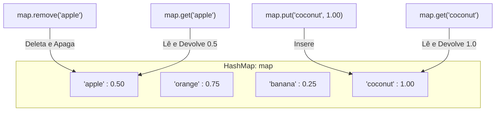

# Curso de Java — Bro Code (12 Horas)
## Capítulo 67: `hashmaps 🗺️` (Parte 4 — Adição do `"coconut"`, Exclusão com `.remove()` e Consulta Pontual com `.get()`)

---

> [!NOTE]
> **Contexto para o Google Docs**: Este documento contém a reconstituição textual completa das 4 telas exibidas pelo instrutor Bro Code no vídeo (entre os minutos **10:56:39** e **10:57:39** de 12:00:00). Você não precisa das imagens originais: todos os painéis do IntelliJ IDEA, códigos, linhas comentadas, edições ao vivo e saídas do console foram reconstituídos em blocos de texto fiéis para o seu documento.

---

## 1. Reconstituição Textual das Telas do Vídeo (Google Docs Ready)

### Tela 1: Adicionando o Coco e Imprimindo o Mapa Completo (Timestamp: 10:56:39)
```text
+--------------------------------------------------------------------------------------------------+
|  IntelliJ IDEA - MyFirstProject [Main.java]                                   Timestamp 10:56:39 |
+--------------------------------------------------------------------------------------------------+
| Project Tree      |  Main.java                                                                   |
| > .idea           |  14        map.put("orange", 0.75);                                          |
| > out             |  15        map.put("banana", 0.25);                                          |
| v src             |  16 💡     map.put("coconut", 1.00);                                         |
|   (c) Main        |  17                                                                          |
|   .gitignore      |  18        System.out.println(map);                                          |
+--------------------------------------------------------------------------------------------------+
| Console / Run Output:                                                                            |
|  C:\Users\HP\.jdks\openjdk-23\bin\java.exe ... Main                                              |
|                                                                                                  |
|  {orange=0.75, banana=0.25, apple=0.5, coconut=1.0}                                              |
|                                                                                                  |
|  Process finished with exit code 0                                                               |
+--------------------------------------------------------------------------------------------------+
| O autor adicionou o quarto item (coconut por 1.00) e rodou o programa.                           |
| Observe que 1.00 é exibido como 1.0 e 0.50 é exibido como 0.5.                                  |
+--------------------------------------------------------------------------------------------------+
```

---

### Tela 2: O Método `.remove("apple")` Apaga a Maçã da Tabela (Timestamp: 10:56:59)
```text
+--------------------------------------------------------------------------------------------------+
|  IntelliJ IDEA - MyFirstProject [Main.java]                                   Timestamp 10:56:59 |
+--------------------------------------------------------------------------------------------------+
| Project Tree      |  Main.java                                                                   |
| > .idea           |  16        map.put("coconut", 1.00);                                         |
| > out             |  17                                                                          |
| v src             |  18 💡     map.remove("apple");                                              |
|   (c) Main        |  19                                                                          |
|   .gitignore      |  20        System.out.println(map);                                          |
+--------------------------------------------------------------------------------------------------+
| Console / Run Output:                                                                            |
|  C:\Users\HP\.jdks\openjdk-23\bin\java.exe ... Main                                              |
|                                                                                                  |
|  {orange=0.75, banana=0.25, coconut=1.0}                                                         |
|                                                                                                  |
|  Process finished with exit code 0                                                               |
+--------------------------------------------------------------------------------------------------+
| O autor inseriu a linha 18: map.remove("apple"); e rodou novamente.                              |
| Veja o resultado no console: a chave "apple" e seu valor 0.5 SUMIRAM completamente!             |
+--------------------------------------------------------------------------------------------------+
```

---

### Tela 3: Comentando o `.remove()` e Consultando com `.get("apple")` (Timestamp ~10:57:15)
```text
+--------------------------------------------------------------------------------------------------+
|  IntelliJ IDEA - MyFirstProject [Main.java]                                   Timestamp ~10:57:15|
+--------------------------------------------------------------------------------------------------+
| Project Tree      |  Main.java                                                                   |
| > .idea           |  18        //map.remove("apple");                                            |
| > out             |  19                                                                          |
| v src             |  20        System.out.println(map.get("apple"));                             |
|   (c) Main        |  21    }                                                                     |
|   .gitignore      |  22 }                                                                        |
+--------------------------------------------------------------------------------------------------+
| Console / Run Output:                                                                            |
|  C:\Users\HP\.jdks\openjdk-23\bin\java.exe ... Main                                              |
|                                                                                                  |
|  0.5                                                                                             |
|                                                                                                  |
|  Process finished with exit code 0                                                               |
+--------------------------------------------------------------------------------------------------+
| O autor comentou a remoção (//map.remove) para que a maçã continue existindo no mapa.           |
| Em seguida, na linha 20, ele chamou map.get("apple") para buscar APENAS o preço da maçã!        |
| O console imprimiu exatamente o preço: 0.5!                                                      |
+--------------------------------------------------------------------------------------------------+
```

---

### Tela 4: Consultando o Preço do Coco com `.get("coconut")` (Timestamp: 10:57:39)
```text
+--------------------------------------------------------------------------------------------------+
|  IntelliJ IDEA - MyFirstProject [Main.java]                                   Timestamp 10:57:39 |
+--------------------------------------------------------------------------------------------------+
| Project Tree      |  Main.java                                                                   |
| > .idea           |  18        //map.remove("apple");                                            |
| > out             |  19                                                                          |
| v src             |  20 💡     System.out.println(map.get("coconut"));                           |
|   (c) Main        |  21    }                                                                     |
|   .gitignore      |  22 }                                                                        |
+--------------------------------------------------------------------------------------------------+
| Console / Run Output:                                                                            |
|  C:\Users\HP\.jdks\openjdk-23\bin\java.exe ... Main                                              |
|                                                                                                  |
|  1.0                                                                                             |
|                                                                                                  |
|  Process finished with exit code 0                                                               |
+--------------------------------------------------------------------------------------------------+
| O autor alterou a chave dentro do get() para "coconut".                                          |
| O programa buscou o valor associado à chave "coconut" e imprimiu na tela: 1.0!                   |
+--------------------------------------------------------------------------------------------------+
```

---

## 2. O Código em Cada Etapa da Demonstração

Para entender sem nenhuma confusão, veja o código do arquivo [`Main.java`](file:///c:/Users/mickel%201/Downloads/JAVA%20APRENDER/Main.java) exatamente como ele evoluiu nas 4 telas:

### Estado A (Tela 1): 4 Frutas Cadastradas e Impressão Geral
```java
import java.util.HashMap;

public class Main {
    public static void main(String[] args) {

        // HashMap = A data structure that stores key-value pairs
        //           Keys are unique, but Values can be duplicated
        //           Does not maintain any order, but is memory efficient
        //           HashMap<Key, Value>

        HashMap<String, Double> map = new HashMap<>();

        map.put("apple", 0.50);
        map.put("orange", 0.75);
        map.put("banana", 0.25);
        map.put("coconut", 1.00);

        System.out.println(map);
    }
}
```

### Estado B (Tela 2): Exclusão da Maçã com `map.remove("apple")`
```java
        map.put("apple", 0.50);
        map.put("orange", 0.75);
        map.put("banana", 0.25);
        map.put("coconut", 1.00);

        map.remove("apple"); // <-- Apaga a maçã do mapa!

        System.out.println(map);
```

### Estado C (Telas 3 e 4): Linha Comentada e Consulta com `.get(...)`
```java
        map.put("apple", 0.50);
        map.put("orange", 0.75);
        map.put("banana", 0.25);
        map.put("coconut", 1.00);

        //map.remove("apple"); // <-- Comentada para a maçã NÃO ser apagada!

        System.out.println(map.get("apple"));   // Tela 3 imprime: 0.5
        // ou:
        System.out.println(map.get("coconut")); // Tela 4 imprime: 1.0
```

---

## 3. Explicação Linha por Linha ("Como se fosse um iniciante amador leigo")

Abaixo está a explicação cirúrgica de cada linha do programa:

### Linha 1: `import java.util.HashMap;`
- **O que faz**: Importa a classe `HashMap` da biblioteca padrão do Java (`java.util`).
- **Linguagem de Leigo**: É como pedir a caixa de ferramentas de "tabelas de etiquetas" que fica guardada no depósito do Java. Sem essa linha, o Java não sabe o que é um `HashMap`.
- **Saída no Console**: Nenhuma (execução interna).

### Linhas 2 e 5: Linhas em branco
- **O que faz**: Espaçamento visual para deixar o código legível e limpo.
- **Saída no Console**: Nenhuma.

### Linha 3: `public class Main {`
- **O que faz**: Declara a classe pública chamada [`Main`](file:///c:/Users/mickel%201/Downloads/JAVA%20APRENDER/Main.java#L3).
- **Linguagem de Leigo**: É o casulo ou a pasta principal onde todo o código deste arquivo precisa ficar dentro.
- **Saída no Console**: Nenhuma.

### Linha 4: `public static void main(String[] args) {`
- **O que faz**: O método de execução principal (*main*).
- **Linguagem de Leigo**: É o botão de partida (a chave da ignição). Quando você clica no triângulo verde ▶️ do IntelliJ, é aqui que o computador começa a trabalhar.
- **Saída no Console**: Nenhuma.

### Linhas 6 a 9: O Bloco de Comentários Conceituais
```java
// HashMap = A data structure that stores key-value pairs
//           Keys are unique, but Values can be duplicated
//           Does not maintain any order, but is memory efficient
//           HashMap<Key, Value>
```
- **O que faz**: Anotações teóricas do instrutor. As duas barras `//` fazem o Java ignorar essas frases.
- **Saída no Console**: Nenhuma.

### Linha 11: `HashMap<String, Double> map = new HashMap<>();`
- **O que faz**: Cria e inicializa na memória do computador uma tabela chamada `map`.
  - `<String, Double>`: Define que a etiqueta/chave é texto (`String`) e o dado guardado/valor é um número com vírgula (`Double`).
  - `new HashMap<>()`: Instancia o objeto vazio na memória.
- **Linguagem de Leigo**: Você colocou uma lousa em branco na parede do seu mercadinho com duas colunas: "Nome do Produto" e "Preço".
- **Saída no Console**: Nenhuma.

### Linhas 13 a 16: Povoando a Lousa com os 4 Produtos
```java
map.put("apple", 0.50);
map.put("orange", 0.75);
map.put("banana", 0.25);
map.put("coconut", 1.00);
```
- **O que faz**:
  - `map.put("apple", 0.50);` ➔ Registra a maçã custando 0.50.
  - `map.put("orange", 0.75);` ➔ Registra a laranja custando 0.75.
  - `map.put("banana", 0.25);` ➔ Registra a banana custando 0.25.
  - `map.put("coconut", 1.00);` ➔ Registra o coco custando 1.00 (a novidade adicionada na Tela 1!).
- **Linguagem de Leigo**: Você pegou o giz e escreveu as 4 frutas e seus preços na lousa.
- **Saída no Console**: Nenhuma.

---

### Linha 18 na Tela 1: `System.out.println(map);`
- **O que faz**: Imprime a lousa inteira de uma vez só no console.
- **O que sai no console**:
  ```text
  {orange=0.75, banana=0.25, apple=0.5, coconut=1.0}
  ```
- **Detalhes Importantes para o Leigo**:
  1. **As chaves `{ }`**: O Java usa chaves para representar uma estrutura de mapa.
  2. **O sinal de igual `=`**: Conecta a chave ao seu valor (`chave=valor`).
  3. **O corte dos zeros**: Por que apareceu `apple=0.5` em vez de `0.50` e `coconut=1.0` em vez de `1.00`? Porque o tipo `Double` do Java não guarda zeros decorativos no final; matematicamente, $0.5$ é idêntico a $0.50$, então o Java exibe a forma mais enxuta!
  4. **A ordem misturada**: Digitei maçã primeiro, mas quem apareceu primeiro foi a laranja! Como aprendemos, o `HashMap` guarda os dados em gavetas (*hash buckets*) calculadas por matemática rápida, e não pela ordem de chegada.

---

### Linha 18 na Tela 2: `map.remove("apple");`
- **O que faz**: O método `.remove("chave")` apaga definitivamente aquele par da memória!
- **Como funciona**: O Java vai até o mapa, procura a gaveta da `"apple"`, destrói a chave `"apple"` e deleta o valor `0.50`.
- **Linguagem de Leigo**: É como passar o apagador na linha da maçã na lousa. Ela não existe mais.
- **Saída no Console imediata da linha 18**: Nenhuma.
- **Mas quando a linha 20 executa `System.out.println(map);`, o que sai no console?**:
  ```text
  {orange=0.75, banana=0.25, coconut=1.0}
  ```
  *(A maçã sumiu! Restaram apenas 3 frutas).*

---

### Linha 18 nas Telas 3 e 4: `//map.remove("apple");`
- **Por que o Bro Code comentou essa linha com `//`?**
  - **Atenção total aqui!** Se o Bro Code deixasse o `map.remove("apple")` ativo, a maçã teria sido destruída.
  - Como ele queria demonstrar o método `.get("apple")` na linha seguinte, se a maçã estivesse apagada, a busca retornaria `null` (vazio)!
  - Então ele colocou `//` na frente para desativar temporariamente a remoção. Agora a maçã continua viva dentro do mapa!

---

### Linha 20 na Tela 3: `System.out.println(map.get("apple"));`
- **O que faz**: O método `.get("chave")` realiza uma consulta cirúrgica!
- **Como funciona**: Você passa o nome exato da fruta entre aspas (`"apple"`), e o mapa responde **apenas o valor** guardado nela (ou seja, o preço).
- **Linguagem de Leigo**: Você pergunta para o balconista: *"Qual é o preço da maçã?"*. Ele não lista o supermercado inteiro; ele responde só: `0.5`.
- **O que sai no console**:
  ```text
  0.5
  ```

---

### Linha 20 na Tela 4: `System.out.println(map.get("coconut"));`
- **O que faz**: A mesma consulta pontual, mas agora pedindo o preço do `"coconut"`.
- **Como funciona**: O mapa localiza `"coconut"` e devolve seu valor: `1.0`.
- **Linguagem de Leigo**: *"Qual é o preço do coco?"* ➔ Balconista: `1.0`.
- **O que sai no console**:
  ```text
  1.0
  ```

---

## 4. O que Acontece se Você Buscar Algo que NÃO Existe?

Essa é uma pergunta clássica de iniciantes e de entrevistas de emprego de Java!

Se você escrever no código:
```java
System.out.println(map.get("pineapple")); // Abacaxi nunca foi adicionado!
```
- **Dá erro? O programa trava?** NÃO!
- **O que o Java responde?** Ele devolve a palavra especial:
  ```text
  null
  ```
- **O que significa `null`?** Significa "nulo", "vazio" ou "não encontrado". O Java está dizendo educadamente: *"Vasculhei o mapa inteiro e não encontrei nenhuma chave chamada pineapple"*.

E se você tentar remover algo que não existe?
```java
map.remove("pineapple");
```
- Também NÃO dá erro! O Java simplesmente procura, não encontra nada para apagar e continua executando o programa normalmente.

---

## 5. Tabela Comparativa de Estados e Saídas no Console

| Tela do Vídeo | Linha 18 | Linha 20 | O que sai no Console? | Significado Didático |
| :---: | :--- | :--- | :--- | :--- |
| **Tela 1** (10:56:39) | *(vazio)* | `System.out.println(map);` | `{orange=0.75, banana=0.25, apple=0.5, coconut=1.0}` | Mapa completo com as 4 frutas inseridas pelo `.put()`. |
| **Tela 2** (10:56:59) | `map.remove("apple");` | `System.out.println(map);` | `{orange=0.75, banana=0.25, coconut=1.0}` | A maçã foi deletada pelo `.remove()`. Sobraram 3 frutas. |
| **Tela 3** (~10:57:15) | `//map.remove("apple");` | `System.out.println(map.get("apple"));` | `0.5` | Remoção cancelada. Busca pontual do preço da maçã. |
| **Tela 4** (10:57:39) | `//map.remove("apple");` | `System.out.println(map.get("coconut"));`| `1.0` | Busca pontual do preço do coco recém-adicionado. |

---

## 6. Diagrama Conceitual: O que Cada Método Faz no Mapa



---

## 7. Resumo Rápido de Fixação para o Aluno Iniciante

1. **Para adicionar um produto**: Use `.put(chave, valor)`.
   - Exemplo: `map.put("coconut", 1.00);`
2. **Para ver o mapa inteiro de uma vez**: Passe o nome do mapa no `println`.
   - Exemplo: `System.out.println(map);` ➔ `{chave=valor, ...}`
3. **Para apagar um produto da memória**: Use `.remove(chave)`.
   - Exemplo: `map.remove("apple");`
4. **Para consultar o preço de apenas UM produto**: Use `.get(chave)`.
   - Exemplo: `map.get("coconut")` ➔ Devolve `1.0`.
5. **Por que 1.00 vira 1.0 e 0.50 vira 0.5?**: Porque o tipo numérico `Double` do Java descarta zeros desnecessários à direita ao converter o número para texto.
6. **Por que o autor usou `//` antes do `.remove()`?**: Porque se ele não desativasse a remoção, a maçã não estaria mais lá quando ele tentasse dar `.get("apple")`!
