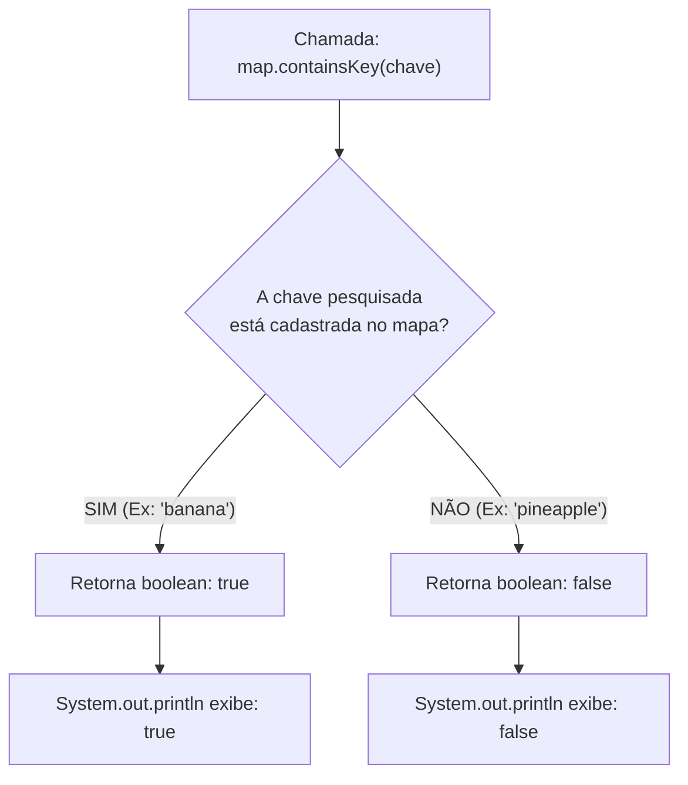

# Curso de Java — Bro Code (12 Horas)
## Capítulo 67: `hashmaps 🗺️` (Parte 5 — O Método `.containsKey()`: Verificando se uma Chave Existe)

---

> [!NOTE]
> **Contexto para o Google Docs**: Este documento contém a reconstituição textual completa das 4 telas exibidas pelo instrutor Bro Code no vídeo (entre os minutos **10:57:45** e **10:58:13** de 12:00:00). Você não precisa das imagens originais: todos os painéis do IntelliJ IDEA, códigos, comentários acumulados, seleções de cursor e saídas do console foram reconstituídos em blocos de texto fiéis para o seu documento.

---

## 1. Reconstituição Textual das Telas do Vídeo (Google Docs Ready)

### Tela 1: Conclusão da Consulta do Coco (Timestamp ~10:57:45)
```text
+--------------------------------------------------------------------------------------------------+
|  IntelliJ IDEA - MyFirstProject [Main.java]                                   Timestamp ~10:57:45|
+--------------------------------------------------------------------------------------------------+
| Project Tree      |  Main.java                                                                   |
| > .idea           |  18    //map.remove("apple");                                                |
| > out             |  19                                                                          |
| v src             |  20 💡 System.out.println(map.get("coconut"));                               |
|   (c) Main        |  21    }                                                                     |
|   .gitignore      |  22 }                                                                        |
+--------------------------------------------------------------------------------------------------+
| Console / Run Output:                                                                            |
|  C:\Users\HP\.jdks\openjdk-23\bin\java.exe ... Main                                              |
|                                                                                                  |
| [1.0] <-- O número 1.0 selecionado em azul no console pelo cursor do autor                       |
|                                                                                                  |
|  Process finished with exit code 0                                                               |
+--------------------------------------------------------------------------------------------------+
| O autor destaca no console o valor 1.0 devolvido pelo método .get("coconut"), confirmando o fim |
| da explicação do método de busca por valor.                                                     |
+--------------------------------------------------------------------------------------------------+
```

---

### Tela 2: Comentando a Linha Anterior e Escrevendo `.containsKey("banana")` (Timestamp: 10:58:01)
```text
+--------------------------------------------------------------------------------------------------+
|  IntelliJ IDEA - MyFirstProject [Main.java]                                   Timestamp 10:58:01 |
+--------------------------------------------------------------------------------------------------+
| Project Tree      |  Main.java                                                                   |
| > .idea           |  11    HashMap<String, Double> map = new HashMap<>();                        |
| > out             |  12                                                                          |
| v src             |  13    map.put("apple", 0.50);                                               |
|   (c) Main        |  14    map.put("orange", 0.75);                                              |
|   .gitignore      |  15    map.put("banana", 0.25);                                              |
|                   |  16    map.put("coconut", 1.00);                                             |
|                   |  17                                                                          |
|                   |  18    //map.remove("apple");                                                |
|                   |  19    //System.out.println(map.get("coconut"));  <-- AGORA COMENTADO!       |
|                   |  20                                                                          |
|                   |  21 💡 System.out.println(map.containsKey("banana"));                        |
|                   |  22    }                                                                     |
|                   |  23 }                                                                        |
+--------------------------------------------------------------------------------------------------+
| O autor comenta a linha 19 com barras duplas // para não poluir o console e digita na linha 21  |
| o novo método: map.containsKey("banana"). Ele vai checar se "banana" existe nas chaves do mapa. |
+--------------------------------------------------------------------------------------------------+
```

---

### Tela 3: O Console Retorna `true` para a Banana (Timestamp: 10:58:04)
```text
+--------------------------------------------------------------------------------------------------+
|  Run / Execution Window (Console do IntelliJ)                                 Timestamp 10:58:04 |
+--------------------------------------------------------------------------------------------------+
|  C:\Users\HP\.jdks\openjdk-23\bin\java.exe ... Main                                              |
|                                                                                                  |
| [true] <-- Saída exibida em verde e selecionada em azul pelo autor!                              |
|                                                                                                  |
|  Process finished with exit code 0                                                               |
+--------------------------------------------------------------------------------------------------+
| O autor clicou em Run ▶️. Como "banana" foi devidamente inserida no mapa na linha 15,          |
| o método map.containsKey("banana") respondeu exatamente: true (verdadeiro)!                      |
+--------------------------------------------------------------------------------------------------+
```

---

### Tela 4: Testando uma Fruta que NÃO Existe: `"pineapple"` ➔ `false` (Timestamp: 10:58:13)
```text
+--------------------------------------------------------------------------------------------------+
|  IntelliJ IDEA - MyFirstProject [Main.java] e Console                         Timestamp 10:58:13 |
+--------------------------------------------------------------------------------------------------+
| Editor:                                                                                          |
|  21 💡 System.out.println(map.containsKey("pineapple"));                                         |
+--------------------------------------------------------------------------------------------------+
| Console / Run Output:                                                                            |
|  C:\Users\HP\.jdks\openjdk-23\bin\java.exe ... Main                                              |
|                                                                                                  |
|  false                                                                                           |
|                                                                                                  |
|  Process finished with exit code 0                                                               |
+--------------------------------------------------------------------------------------------------+
| O autor substituiu "banana" por "pineapple" (abacaxi).                                           |
| Como nunca inserimos abacaxi na nossa tabela, o método responde: false (falso)!                  |
+--------------------------------------------------------------------------------------------------+
```

---

## 2. O Código Completo do Arquivo `Main.java`

Aqui está o código exato presente no arquivo [`Main.java`](file:///c:/Users/mickel%201/Downloads/JAVA%20APRENDER/Main.java) neste momento do vídeo:

```java
import java.util.HashMap;

public class Main {
    public static void main(String[] args) {

        // HashMap = A data structure that stores key-value pairs
        //           Keys are unique, but Values can be duplicated
        //           Does not maintain any order, but is memory efficient
        //           HashMap<Key, Value>

        HashMap<String, Double> map = new HashMap<>();

        map.put("apple", 0.50);
        map.put("orange", 0.75);
        map.put("banana", 0.25);
        map.put("coconut", 1.00);

        //map.remove("apple");
        //System.out.println(map.get("coconut"));

        System.out.println(map.containsKey("pineapple"));

    }
}
```

---

## 3. Explicação Linha por Linha ("Como se fosse um iniciante amador leigo")

Abaixo, cada linha é explicada com foco no que mudou e no porquê de cada decisão:

### Linha 1: `import java.util.HashMap;`
- **O que faz**: Traz a classe `HashMap` do pacote utilitário do Java para dentro do nosso arquivo.
- **Linguagem de Leigo**: Abre a maleta de ferramentas do Java e pega a ferramenta de "tabela de etiquetas".
- **Saída no Console**: Nenhuma.

### Linha 3: `public class Main {`
- **O que faz**: Define a classe principal chamada [`Main`](file:///c:/Users/mickel%201/Downloads/JAVA%20APRENDER/Main.java#L3).
- **Linguagem de Leigo**: A casa de tijolos do nosso código.
- **Saída no Console**: Nenhuma.

### Linha 4: `public static void main(String[] args) {`
- **O que faz**: O ponto de entrada obrigatório da aplicação.
- **Linguagem de Leigo**: Onde a mágica começa quando apertamos o botão verde de Play ▶️.
- **Saída no Console**: Nenhuma.

### Linhas 6 a 9: O Bloco de Comentários Conceituais
```java
// HashMap = A data structure that stores key-value pairs
//           Keys are unique, but Values can be duplicated
//           Does not maintain any order, but is memory efficient
//           HashMap<Key, Value>
```
- **O que faz**: Regras teóricas anotadas pelo instrutor. O computador passa batido por elas sem fazer nada.
- **Saída no Console**: Nenhuma.

### Linha 11: `HashMap<String, Double> map = new HashMap<>();`
- **O que faz**: Cria o nosso dicionário na memória.
  - A chave é `String` (o nome do item).
  - O valor é `Double` (o preço com casas decimais).
  - O nome da variável é `map`.
- **Linguagem de Leigo**: Pegamos uma folha de papel nova com duas colunas ("Produto" e "Preço").
- **Saída no Console**: Nenhuma.

### Linhas 13 a 16: Povoando o Mapa com `map.put(...)`
```java
map.put("apple", 0.50);
map.put("orange", 0.75);
map.put("banana", 0.25);
map.put("coconut", 1.00);
```
- **O que faz**:
  - Registra a maçã por 0.50.
  - Registra a laranja por 0.75.
  - Registra a banana por 0.25.
  - Registra o coco por 1.00.
- **Linguagem de Leigo**: Escrevemos os 4 produtos na folha de papel.
- **Saída no Console**: Nenhuma.

---

### Linha 18: `//map.remove("apple");`
- **O que faz**: Está comentada com `//`.
- **Por que está comentada?**: O autor já explicou o `.remove()` anteriormente. Ele não quer que a maçã seja apagada, então ele "desligou" essa instrução adicionando barras duplas na frente.
- **Saída no Console**: Nenhuma.

---

### Linha 19: `//System.out.println(map.get("coconut"));`
- **O que faz**: Está recém-comentada com `//` (na Tela 1 ela ainda estava ativa!).
- **Por que o autor comentou agora?**: Na Tela 1, ela imprimia `1.0` no console. Para que o console fique limpo e exiba apenas o resultado do próximo teste (`containsKey`), o Bro Code comentou essa linha!
- **Linguagem de Leigo**: É como passar uma fita crepe por cima de uma anotação na lousa para a turma prestar atenção apenas na novidade que vem logo abaixo.
- **Saída no Console**: Nenhuma.

---

### Linha 21 (Primeiro Teste - Telas 2 e 3): `System.out.println(map.containsKey("banana"));`
- **O que faz**: Chama o método `.containsKey(...)` passando `"banana"` como argumento e imprime o resultado na tela.
- **Como o método funciona**:
  - Ele pergunta ao mapa: *"Ei `map`, existe alguma etiqueta/chave cadastrada com o nome exato `"banana"`?"*
  - O mapa procura nas suas chaves. Ele encontra a `"banana"` que foi adicionada na linha 15.
  - O método responde um valor do tipo **`boolean`**: **`true`** (verdadeiro)!
- **Linguagem de Leigo**: Você liga para o feirante e pergunta: *"Você tem banana hoje?"*. O feirante olha para a banca e responde: *"Sim!"* (`true`).
- **O que sai no console**:
  ```text
  true
  ```

---

### Linha 21 (Segundo Teste - Tela 4): `System.out.println(map.containsKey("pineapple"));`
- **O que faz**: O autor trocou o texto entre aspas de `"banana"` para `"pineapple"` (abacaxi).
- **Como o método funciona**:
  - Ele pergunta ao mapa: *"Ei `map`, você tem alguma chave chamada `"pineapple"`?"*
  - O mapa vasculha as 4 frutas cadastradas (`apple`, `orange`, `banana`, `coconut`). Nenhuma delas é abacaxi!
  - O método responde: **`false`** (falso)!
- **Linguagem de Leigo**: Você pergunta para o feirante: *"Você tem abacaxi?"*. O feirante olha para a banca e responde: *"Não tenho!"* (`false`).
- **O que sai no console**:
  ```text
  false
  ```

---

### Linhas 22 e 23: `}`
- Linha 22 fecha o método `main`.
- Linha 23 fecha a classe `Main`.
- **Saída no Console**: `Process finished with exit code 0` (o programa terminou com sucesso).

---

## 4. Por que esse Método é Tão Importante no Dia a Dia de um Programador?

Imagine que você está criando o sistema de um supermercado real. O cliente passa o código de barras ou digita o nome de um produto.

### O Risco sem o `containsKey`:
Se você tentar pegar um produto que não existe com `.get("abacaxi")`, o Java vai te devolver `null`. Se depois você tentar fazer um cálculo com esse `null` (por exemplo, somar imposto ou dar desconto), o programa **trava com um erro fatal** chamado `NullPointerException`!

### A Solução Segura com `containsKey`:
Os programadores profissionais usam o `containsKey` junto com uma estrutura de decisão `if / else`:

```java
if (map.containsKey("pineapple")) {
    System.out.println("O preço é: $" + map.get("pineapple"));
} else {
    System.out.println("Desculpe, esse produto não está cadastrado no sistema!");
}
```
Isso torna o seu sistema à prova de falhas!

---

## 5. Cuidado: O Java é Case-Sensitive (Diferencia Maiúsculas e Minúsculas!)

Um detalhe importantíssimo que pega muitos iniciantes de surpresa:

```java
map.put("banana", 0.25);

System.out.println(map.containsKey("banana")); // Imprime: true
System.out.println(map.containsKey("Banana")); // Imprime: FALSE! (com 'B' maiúsculo)
System.out.println(map.containsKey("BANANA")); // Imprime: FALSE!
```

Para o Java, `"banana"` com "b" minúsculo e `"Banana"` com "B" maiúsculo são textos completamente diferentes!

---

## 6. Tabela Comparativa de Testes com `.containsKey()`

| Chave Testada | Está no `map.put()`? | O que sai no Console? | Explicação Didática |
| :--- | :---: | :---: | :--- |
| `map.containsKey("apple")` | Sim (linha 13) | `true` | A chave existe no mapa. |
| `map.containsKey("orange")` | Sim (linha 14) | `true` | A chave existe no mapa. |
| `map.containsKey("banana")` | Sim (linha 15) | `true` | Teste exibido na **Tela 3**. |
| `map.containsKey("coconut")`| Sim (linha 16) | `true` | A chave existe no mapa. |
| `map.containsKey("pineapple")`| **Não** | `false` | Teste exibido na **Tela 4** (abacaxi não existe). |
| `map.containsKey("watermelon")`| **Não** | `false` | Melancia nunca foi adicionada. |

---

## 7. Diagrama de Decisão: Como o Java Processa o `.containsKey()`



---

## 8. Resumo de Fixação para o Aluno Amador

1. **O que faz o `.containsKey(chave)`?** Verifica se uma chave/etiqueta existe dentro do mapa.
2. **Qual é o tipo de retorno?** Retorna sempre um `boolean` (`true` ou `false`).
3. **Por que o autor comentou a linha 19 (`//System.out...`)?** Para manter o console limpo, exibindo apenas a saída do método que ele está demonstrando no momento.
4. **Qual foi o resultado de `"banana"`?** Saiu `true`, porque a banana foi cadastrada com `map.put("banana", 0.25)`.
5. **Qual foi o resultado de `"pineapple"`?** Saiu `false`, porque `"pineapple"` nunca foi inserido no mapa.
6. **O que vem a seguir no vídeo?** Logo após verificar as chaves com `containsKey`, o autor vai demonstrar como verificar os valores (preços) com `containsValue` e o tamanho do mapa com `size()`!
