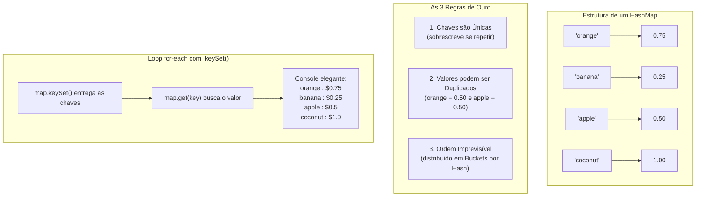

# Curso de Java — Bro Code (12 Horas)
## Capítulo 67: `hashmaps 🗺️` (Parte 9 / Conclusão — O Loop `for-each` em Ação, a Saída Formatada e a Revisão Mestra das Regras de Ouro)

---

> [!NOTE]
> **Contexto para o Google Docs**: Este documento contém a reconstituição textual completa das **4 telas finais** do Capítulo 67 exibidas pelo instrutor Bro Code no vídeo (entre os minutos **11:01:59** e **11:02:36** de 12:00:00). Você não precisa das imagens originais: todos os painéis do IntelliJ IDEA, códigos, linhas selecionadas em azul, menus do console e a revisão teórica final foram reconstituídos em blocos de texto fiéis para o seu documento.

---

## 1. Reconstituição Textual das Telas do Vídeo (Google Docs Ready)

### Tela 1: O Loop For-Each Completo e Selecionado em Azul (Timestamp: 11:01:59)
```text
+--------------------------------------------------------------------------------------------------+
|  IntelliJ IDEA - MyFirstProject [Main.java]                                   Timestamp 11:01:59 |
+--------------------------------------------------------------------------------------------------+
| Project Tree      |  Main.java                                                                   |
| > .idea           |  18    //map.remove("apple");                                                |
| > out             |  19    //System.out.println(map.get("coconut"));                             |
| v src             |  20    //System.out.println(map.containsKey("pineapple"));                   |
|   (c) Main        |  21    //System.out.println(map.containsValue(1.00));                       |
|   .gitignore      |  22    //System.out.println(map.size());                                     |
|                   |  23                                                                          |
|                   | [24    for(String key : map.keySet()){                             ]         |
|                   | [25        System.out.println(key + " : $" + map.get(key));         ] <SELEÇÃO|
|                   | [26    }                                                           ]  AZUL   |
|                   |  27    }                                                                     |
|                   |  28 }                                                                        |
+--------------------------------------------------------------------------------------------------+
| O autor terminou de digitar o laço for-each. Ele selecionou todo o bloco (linhas 24 a 26)        |
| para chamar a atenção dos alunos para como a chave (key) e o valor (map.get(key)) se combinam.  |
+--------------------------------------------------------------------------------------------------+
```

---

### Tela 2: O Console de Execução: Um Cardápio Profissional (Timestamp: 11:02:03)
```text
+--------------------------------------------------------------------------------------------------+
|  Run / Execution Window (Console do IntelliJ)                                 Timestamp 11:02:03 |
+--------------------------------------------------------------------------------------------------+
|  C:\Users\HP\.jdks\openjdk-23\bin\java.exe ... Main                                              |
|                                                                                                  |
|  orange : $0.75                                                                                  |
|  banana : $0.25                                                                                  |
|  apple : $0.5                                                                                    |
|  coconut : $1.0                                                                                  |
|                                                                                                  |
|  Process finished with exit code 0                                                               |
+--------------------------------------------------------------------------------------------------+
| O console imprimiu cada fruta em uma linha separada, acompanhada de ": $" e do seu preço real!   |
| OBSERVAÇÃO CRUCIAL DO AUTOR: Veja que a ordem de saída (orange -> banana -> apple -> coconut)   |
| NÃO SEGUE a ordem em que digitamos (apple -> orange -> banana -> coconut).                      |
+--------------------------------------------------------------------------------------------------+
```

---

### Tela 3: Provando que Valores Podem ser Duplicados (Timestamp ~11:02:20)
```text
+--------------------------------------------------------------------------------------------------+
|  IntelliJ IDEA - MyFirstProject [Main.java]                                   Timestamp ~11:02:20|
+--------------------------------------------------------------------------------------------------+
|  11    HashMap<String, Double> map = new HashMap<>();                                            |
|  12                                                                                              |
|  13    map.put("apple", 0.50);                                                                   |
|  14 💡 map.put("orange", 0.50);   <-- O AUTOR MUDOU O PREÇO DA LARANJA PARA 0.50!                |
|  15    map.put("banana", 0.25);                                                                  |
|  16    map.put("coconut", 1.00);                                                                 |
|  17                                                                                              |
|  18    System.out.println(map);                                                                  |
+--------------------------------------------------------------------------------------------------+
| O autor subiu o cursor e mudou a laranja para 0.50 (o mesmo preço da maçã!).                     |
| O Java aceitou perfeitamente sem erros! "apple" e "orange" agora compartilham o mesmo valor.     |
+--------------------------------------------------------------------------------------------------+
```

---

### Tela 4: A Revisão Mestra das Regras de Ouro (Timestamp: 11:02:36)
```text
+--------------------------------------------------------------------------------------------------+
|  IntelliJ IDEA - O Autor Seleciona e Revisa as Regras                         Timestamp 11:02:36 |
+--------------------------------------------------------------------------------------------------+
|  6  *  // HashMap = A data structure that stores key-value pairs  <-- SELEÇÃO AZUL DO AUTOR     |
|  7     //           Keys are unique, but Values can be duplicated                                |
|  8     //           Does not maintain any order, but is memory efficient                         |
|  9     //           HashMap<Key, Value>                                                          |
|  10                                                                                              |
|  11    HashMap<String, Double> map = new HashMap<>();                                            |
+--------------------------------------------------------------------------------------------------+
| O autor encerra a aula apontando como cada experimento prático que fizemos no código comprovou  |
| com 100% de clareza cada uma dessas frases teóricas do início!                                  |
+--------------------------------------------------------------------------------------------------+
```

---

## 2. O Código Completo do Arquivo `Main.java`

Aqui está o código exato em seu estado final com o laço `for-each` ativo:

```java
import java.util.HashMap;

public class Main {
    public static void main(String[] args) {

        // HashMap = A data structure that stores key-value pairs
        //           Keys are unique, but Values can be duplicated
        //           Does not maintain any order, but is memory efficient
        //           HashMap<Key, Value>

        HashMap<String, Double> map = new HashMap<>();

        map.put("apple", 0.50);
        map.put("orange", 0.75);
        map.put("banana", 0.25);
        map.put("coconut", 1.00);

        //map.remove("apple");
        //System.out.println(map.get("coconut"));
        //System.out.println(map.containsKey("pineapple"));
        //System.out.println(map.containsValue(1.00));
        //System.out.println(map.size());

        for(String key : map.keySet()){
            System.out.println(key + " : $" + map.get(key));
        }

    }
}
```

---

## 3. Explicação Linha por Linha ("Como se fosse um iniciante amador leigo")

Abaixo, cada linha é explicada no detalhe mais simples possível:

### Linha 1: `import java.util.HashMap;`
- **O que faz**: Carrega a ferramenta `HashMap` da biblioteca padrão do Java.
- **Analogia de Leigo**: Pega a caixa de ferramentas de "tabelas de etiquetas" no armário.
- **Saída no Console**: Nenhuma.

### Linha 3: `public class Main {`
- **O que faz**: Declara a nossa classe principal [`Main`](file:///c:/Users/mickel%201/Downloads/JAVA%20APRENDER/Main.java#L3).
- **Saída no Console**: Nenhuma.

### Linha 4: `public static void main(String[] args) {`
- **O que faz**: O ponto de partida onde o Java começa a ler e rodar as instruções.
- **Saída no Console**: Nenhuma.

### Linhas 6 a 9: Os Comentários das Regras Teóricas
```java
// HashMap = A data structure that stores key-value pairs
//           Keys are unique, but Values can be duplicated
//           Does not maintain any order, but is memory efficient
//           HashMap<Key, Value>
```
- **O que faz**: Anotações em inglês que o computador ignora por causa das barras duplas `//`.
- **Saída no Console**: Nenhuma.

### Linha 11: `HashMap<String, Double> map = new HashMap<>();`
- **O que faz**: Cria o nosso mapa vazio na memória do computador.
  - Chave (`String`): Nome do produto.
  - Valor (`Double`): Preço em dinheiro com casas decimais.
- **Saída no Console**: Nenhuma.

### Linhas 13 a 16: Povoando a Tabela com os 4 Produtos
```java
map.put("apple", 0.50);
map.put("orange", 0.75); // (na Tela 3 o autor testa mudar para 0.50)
map.put("banana", 0.25);
map.put("coconut", 1.00);
```
- **O que faz**: O comando `.put(chave, valor)` cadastra cada fruta com seu preço.
- **Saída no Console**: Nenhuma.

---

### Linhas 18 a 22: O Arquivo Morto das Ferramentas Demonstradas
```java
//map.remove("apple");
//System.out.println(map.get("coconut"));
//System.out.println(map.containsKey("pineapple"));
//System.out.println(map.containsValue(1.00));
//System.out.println(map.size());
```
- **O que faz**: Todas essas linhas têm `//` na frente. Elas estão "desligadas" para não poluir o console.
- **Por que mantê-las aqui?**: Servem como resumo rápido de todos os métodos que o aluno aprendeu nesta aula!
- **Saída no Console**: Nenhuma.

---

### Linha 24: `for(String key : map.keySet()){`
- **O que faz**: Abre o carrossel do loop *for-each*.
- **Como funciona por dentro (Passo a Passo)**:
  1. `map.keySet()` vai até a tabela e pega **apenas as etiquetas** (os nomes das frutas), entregando o conjunto: `["orange", "banana", "apple", "coconut"]`.
  2. A cada volta, a variável temporária `String key` recebe uma dessas frutas:
     - **Na 1ª volta**: `key` vale `"orange"`
     - **Na 2ª volta**: `key` vale `"banana"`
     - **Na 3ª volta**: `key` vale `"apple"`
     - **Na 4ª volta**: `key` vale `"coconut"`
- **Saída no Console**: Nenhuma imediata (quem imprime é a linha 25).

---

### Linha 25: `System.out.println(key + " : $" + map.get(key));`
- **O que faz**: Monta e imprime uma linha formatada e elegante para cada fruta.
- **Como a frase é montada com os sinais de `+` (Concatenação)**:
  - `key` ➔ O nome da fruta da volta atual.
  - `+ " : $"` ➔ Gruda o separador visual bonito com o cifrão.
  - `+ map.get(key)` ➔ Chama o mapa perguntando: *"Quanto custa essa fruta `key`?"*. O mapa responde o preço exato!
- **O que sai no console em cada uma das 4 voltas**:
  - **Volta 1**: `orange : $0.75`
  - **Volta 2**: `banana : $0.25`
  - **Volta 3**: `apple : $0.5` *(lembre-se: `Double` descarta o zero final, então `0.50` vira `0.5`)*
  - **Volta 4**: `coconut : $1.0` *(1.00 vira 1.0)*

---

### Linhas 26 a 28: As Chaves de Fechamento `}`
- Linha 26 fecha o loop `for`.
- Linha 27 fecha o método `main`.
- Linha 28 fecha a classe `Main`.
- **Saída no Console**: `Process finished with exit code 0` (o programa terminou com perfeição).

---

## 4. O Fechamento Mestre: Como o Código Comprovou as 3 Regras de Ouro (Tela 4)

Na **Tela 4**, o autor seleciona as linhas 6 a 9 e faz o resumo de ouro. Vamos ver como cada regra foi comprovada na prática durante toda a aula:

```java
// Keys are unique, but Values can be duplicated
// Does not maintain any order, but is memory efficient
```

### Regra 1: "Keys are unique" (Chaves são ÚNICAS)
- **O Teste que fizemos**: Quando colocamos `orange` por 0.75 e depois tentamos colocar `orange` por 1.000.000,00 dólares:
  ```java
  map.put("orange", 0.75);
  map.put("orange", 1000000.00);
  ```
- **O que o Java fez?**: Ele **NÃO** criou duas laranjas. Ele foi até a única laranja existente e **sobrescreveu** o preço antigo pelo novo!
- **Conclusão**: É impossível ter duas chaves com o mesmo nome em um HashMap.

---

### Regra 2: "Values can be duplicated" (Valores PODEM ser Duplicados) — Tela 3
- **O Teste que fizemos na Tela 3**: O autor mudou a linha 14:
  ```java
  map.put("apple", 0.50);
  map.put("orange", 0.50); // <-- Preço IDÊNTICO ao da maçã!
  ```
- **O que o Java fez?**: Aceitou sem nenhum erro! O mapa guardou as duas frutas com o preço de `0.50` cada.
- **Analogia do Leigo**: No supermercado, um sabonete pode custar R$ 2,50 e uma esponja também pode custar R$ 2,50. São produtos diferentes (chaves únicas) com o mesmo preço (valores duplicados).

---

### Regra 3: "Does not maintain any order" (NÃO mantém Ordem) — Tela 2
- **A Ordem de Digitação**: 1º `apple`, 2º `orange`, 3º `banana`, 4º `coconut`.
- **A Ordem de Saída no Console**: `orange`, `banana`, `apple`, `coconut`.
- **Por quê?**: O HashMap calcula um número matemático (*hash code*) para cada palavra e distribui em gavetas de memória (*buckets*). Ele não se importa com quem chegou primeiro; ele só se importa em organizar as gavetas para que a busca seja instantânea ($O(1)$)!

---

## 5. Tabela Geral de Resumo: A Caixa de Ferramentas Completa do `HashMap`

| Ferramenta / Método | Para que serve? | Exemplo Real | Resultado Prático |
| :--- | :--- | :--- | :--- |
| **`new HashMap<K, V>()`**| Cria a tabela na memória | `HashMap<String, Double> map = new HashMap<>();` | Tabela pronta para uso |
| **`.put(K, V)`** | Insere um novo par ou atualiza | `map.put("apple", 0.50);` | Produto cadastrado |
| **`.get(K)`** | Busca o valor pela chave | `map.get("coconut")` | Devolve `1.0` (ou `null`) |
| **`.remove(K)`** | Deleta a chave e o valor | `map.remove("apple");` | Apaga o item da tabela |
| **`.containsKey(K)`** | Pergunta se uma chave existe | `map.containsKey("banana")` | Devolve `true` ou `false` |
| **`.containsValue(V)`**| Pergunta se um valor existe | `map.containsValue(1.00)` | Devolve `true` ou `false` |
| **`.size()`** | Conta quantos pares existem | `map.size()` | Devolve `4` |
| **`.keySet()`** | Pega todas as chaves em conjunto | `for(String k : map.keySet())` | Permite rodar o loop `for` |
| **`println(map)`** | Impressão técnica bruta | `System.out.println(map);` | `{orange=0.75, ...}` |

---

## 6. Diagrama de Conclusão do Capítulo



---

## 7. Checklist Final de Domínio do Capítulo 67

- [x] Sei criar um `HashMap` com tipos genéricos `<String, Double>`.
- [x] Sei cadastrar e atualizar dados usando `.put()`.
- [x] Sei consultar itens com `.get()` e sei que itens inexistentes retornam `null`.
- [x] Sei remover itens com `.remove()`.
- [x] Sei verificar a existência de chaves com `.containsKey()` e valores com `.containsValue()`.
- [x] Sei proteger meu código contra travamentos usando `if(map.containsKey(...))`.
- [x] Sei verificar o total de itens com `.size()`.
- [x] Sei iterar pelo mapa usando `for(String key : map.keySet())` e imprimir um relatório limpo.
- [x] Entendi perfeitamente por que a ordem é desordenada e por que chaves são únicas mas valores podem ser duplicados!
