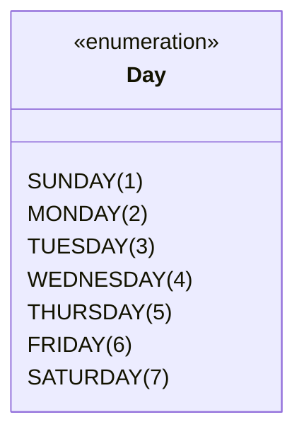

# Curso de Java — Bro Code (12 Horas)
## Capítulo 68: `enums 📅` (Parte 1 — Conceito, Criação do Arquivo `Day.java` e o Erro "Expected 0 arguments but found 1")

---

> [!NOTE]
> **Contexto para o Google Docs**: Este documento contém a reconstituição textual completa das **5 telas** exibidas pelo instrutor Bro Code no início do Capítulo 68 (entre os minutos **11:02:39** e **11:04:22** de 12:00:00). Você não precisa das imagens originais: todos os painéis do IntelliJ IDEA, janelas de criação de classe, árvores de arquivos, códigos, erros em tempo real (onduinhas vermelhas) e balões de aviso do compilador foram reconstituídos em blocos de texto fiéis para o seu documento.

---

## 1. Reconstituição Textual das Telas do Vídeo (Google Docs Ready)

### Tela 1: Apresentação Teórica no `Main.java` (Timestamp: 11:02:39)
```text
+--------------------------------------------------------------------------------------------------+
|  IntelliJ IDEA - MyFirstProject [Main.java]                                   Timestamp 11:02:39 |
+--------------------------------------------------------------------------------------------------+
| Project Tree      |  Main.java                                                                   |
| > .idea           |  1    public class Main {                                                    |
| > out             |  2        public static void main(String[] args) {                           |
| v src             |  3                                                                           |
|   (c) Main        |  4                                                                           |
|   .gitignore      |  5 💡         // Enums = (Enumerations) A special kind of class that         |
|                   |  6            //         represents a fixed set of constants.                |
|                   |  7            //         They improve code readability and are easy to       |
|                   |  8            //         maintain.                                           |
|                   |  9            //         More efficient with switches when comparing         |
|                   | 10            //         Strings.                                            |
|                   | 11                                                                           |
|                   | 12        }                                                                  |
|                   | 13    }                                                                      |
+--------------------------------------------------------------------------------------------------+
| O autor abre o novo capítulo (68.enums) apagando o código antigo e escrevendo 4 linhas           |
| de anotações essenciais sobre o que é um Enum e quais são suas 3 grandes vantagens!              |
+--------------------------------------------------------------------------------------------------+
```

---

### Tela 2: Menu do IntelliJ: Criando um Arquivo do Tipo "Enum" (Timestamp ~11:02:50)
```text
+--------------------------------------------------------------------------------------------------+
|  Pop-up Window: New Java Class (IntelliJ IDEA)                                Timestamp ~11:02:50|
+--------------------------------------------------------------------------------------------------+
|                                    New Java Class                                                |
|                                                                                                  |
|        (E) Name: [ Day                                         ]                                 |
|                                                                                                  |
|        (C) Class                                                                                 |
|        (I) Interface                                                                             |
|        (R) Record                                                                                |
|       >(E) Enum <------------------- [ O AUTOR CLICA NA OPÇÃO ENUM! ]                            |
|        (@) Annotation                                                                            |
|        (!) Exception                                                                             |
+--------------------------------------------------------------------------------------------------+
| O autor clica com o botão direito na pasta src -> New -> Java Class.                             |
| Em vez de criar uma Class comum (azul), ele seleciona especificamente a opção Enum (roxa)!       |
+--------------------------------------------------------------------------------------------------+
```

---

### Tela 3: O Arquivo `Day.java` Recém-Criado (Timestamp ~11:03:00)
```text
+--------------------------------------------------------------------------------------------------+
|  IntelliJ IDEA - Estrutura de Arquivos e Código do Day.java                   Timestamp ~11:03:00|
+--------------------------------------------------------------------------------------------------+
| Project Tree      |  Day.java                                                                    |
| > .idea           |  1 💡 public enum Day {                                                      |
| > out             |  2                                                                           |
| v src             |  3    }                                                                      |
|   (E) Day  <------+-- Veja o ícone roxo com a letra (E) de Enum!                                 |
|   (c) Main        |                                                                              |
|   .gitignore      |                                                                              |
+--------------------------------------------------------------------------------------------------+
| Agora o projeto tem dois arquivos: Main.java e Day.java.                                         |
| Note que na linha 1 NÃO está escrito "public class Day", e sim "public enum Day"!                |
+--------------------------------------------------------------------------------------------------+
```

---

### Tela 4: Digitando os Dias com Números: Surgem 7 Erros Vermelhos! (Timestamp ~11:04:00)
```text
+--------------------------------------------------------------------------------------------------+
|  IntelliJ IDEA - Day.java com 7 Erros de Compilação                           Timestamp ~11:04:00|
+--------------------------------------------------------------------------------------------------+
| Abas: Main.java | Day.java                                          Alerta no topo: [ 07 ^ 1 v ] |
|--------------------------------------------------------------------------------------------------|
|  1    public enum Day {                                                                          |
|  2                                                                                               |
|  3 💡     SUNDAY(1), MONDAY(2), TUESDAY(3), WEDNESDAY(4), THURSDAY(5), FRIDAY(6), SATURDAY(7);   |
|                 ~~          ~~           ~~             ~~            ~~          ~~          ~~ |
|  4                                                                                               |
|  5    }                                                                                          |
+--------------------------------------------------------------------------------------------------+
| O autor digitou os 7 dias da semana e tentou colocar o número do dia entre parênteses (1 a 7).   |
| O IntelliJ sublinhou TODOS os 7 números em vermelho (~~), indicando 7 erros de compilação!      |
+--------------------------------------------------------------------------------------------------+
```

---

### Tela 5: O Balão de Erro: "Expected 0 arguments but found 1" (Timestamp: 11:04:22)
```text
+--------------------------------------------------------------------------------------------------+
|  IntelliJ IDEA - Detalhe do Erro ao Passar o Mouse sobre SUNDAY(1)            Timestamp 11:04:22 |
+--------------------------------------------------------------------------------------------------+
|  3     [SUNDAY(1)], MONDAY(2)...                                                                 |
|        +---------------------------------------------------------------------------------+       |
|        | Expected 0 arguments but found 1                                            :   |       |
|        | Create constructor  Alt+Shift+Enter    More actions...  Alt+Enter               |       |
|        |---------------------------------------------------------------------------------|       |
|        | (C) Day                                                                         |       |
|        | Day SUNDAY(1)                                                                   |       |
|        | // Enum constant ordinal: 0                                                     |       |
|        | [box] MyFirstProject                                                            |       |
|        +---------------------------------------------------------------------------------+       |
+--------------------------------------------------------------------------------------------------+
| O autor passa o mouse sobre SUNDAY(1). O IntelliJ explica com todas as letras:                   |
| "Expected 0 arguments but found 1" (Eu esperava ZERO argumentos, mas você colocou 1!).          |
| O IntelliJ sugere a solução: "Create constructor" (Criar um construtor!).                        |
+--------------------------------------------------------------------------------------------------+
```

---

## 2. O que é um `Enum`? ("Explicado para um leigo/iniciante amador")

A palavra **Enum** vem de **Enumeration** (Enumeração).

### A Analogia do Leigo:
Imagine que você está criando um formulário na internet onde a pessoa precisa escolher o dia da semana:
- Se você deixar um **campo de texto livre (`String`)**, as pessoas vão digitar coisas malucas:
  - Uma digita: `"segunda"`
  - Outra digita: `"Segunda"` (com S maiúsculo)
  - Outra digita: `"SEGUNDA-FEIRA"`
  - Outra digita: `"segunda feira"` (sem hífen)
  - E outra digita com erro de digitação: `"seguda"`!
- Para o computador, cada uma dessas palavras é completamente diferente! O seu código vira um pesadelo cheio de testes para tentar adivinhar o que a pessoa quis dizer.

### A Solução Mágica do Enum:
O Enum é como um **Menu Suspenso Fechado** (*combobox / dropdown*). A pessoa **NÃO PODE DIGITAR TEXTO LIVRE**. Ela só pode escolher uma das opções pré-definidas que você programou na lista!

> [!IMPORTANT]
> **Definição de Ouro**:
> Um `Enum` é uma classe especial do Java que representa um **conjunto fixo e imutável de constantes**.
> Use sempre que você souber previamente todos os valores possíveis de uma coisa:
> - Dias da semana (7 dias)
> - Meses do ano (12 meses)
> - Naipes do baralho (Espadas, Paus, Copas, Ouros)
> - Pontos cardeais (Norte, Sul, Leste, Oeste)
> - Status de entrega (PENDENTE, EM_TRANSITO, ENTREGUE, CANCELADO)

---

## 3. As 3 Grandes Vantagens Explicadas pelo Autor (Tela 1)

Nas linhas 5 a 10 de [`Main.java`](file:///c:/Users/mickel%201/Downloads/JAVA%20APRENDER/Main.java#L5-L10), o Bro Code listou 3 motivos para usar enums:

1. **"Fixed set of constants" (Conjunto fixo de constantes)**:
   - Os valores nunca mudam enquanto o programa roda. Segunda é sempre segunda; Domingo é sempre domingo.
2. **"Improve code readability and are easy to maintain" (Melhora a leitura e é fácil de manter)**:
   - Qualquer pessoa que ler seu código vai entender imediatamente o que aquilo significa. Se você precisar adicionar um novo status no futuro, basta mexer em um único arquivo.
3. **"More efficient with switches when comparing Strings" (Mais eficiente com o comando `switch` do que comparar textos)**:
   - Comparar duas palavras de texto (`String.equals()`) é lento, porque o computador precisa comparar letra por letra.
   - Comparar duas constantes de Enum é quase instantâneo, porque o computador compara apenas o endereço de memória ou um número interno (*ordinal*)!

---

## 4. O Código dos Arquivos

### Arquivo 1: [`Main.java`](file:///c:/Users/mickel%201/Downloads/JAVA%20APRENDER/Main.java)
```java
public class Main {
    public static void main(String[] args) {

        // Enums = (Enumerations) A special kind of class that
        //         represents a fixed set of constants.
        //         They improve code readability and are easy to maintain.
        //         More efficient with switches when comparing Strings.

    }
}
```

### Arquivo 2: [`Day.java`](file:///c:/Users/mickel%201/Downloads/JAVA%20APRENDER/Day.java) (O Código com os 7 Erros da Tela 4)
```java
public enum Day {

    SUNDAY(1), MONDAY(2), TUESDAY(3), WEDNESDAY(4), THURSDAY(5), FRIDAY(6), SATURDAY(7);

}
```

---

## 5. Explicação Linha por Linha ("Como se fosse um iniciante amador leigo")

### No arquivo [`Main.java`](file:///c:/Users/mickel%201/Downloads/JAVA%20APRENDER/Main.java):
- **Linha 1 (`public class Main {`)**: Declara a classe principal onde fica o programa de teste.
- **Linha 2 (`public static void main(String[] args) {`)**: O ponto de entrada. O autor apagou todo o código do capítulo anterior de `HashMap` para começar a nova lição com a tela limpa.
- **Linhas 5 a 10**: As anotações conceituais com `//`.
- **O que sai no console ao rodar o `Main.java` agora**: Absolutamente nada (saída limpa), pois o método `main` está vazio.

---

### No arquivo [`Day.java`](file:///c:/Users/mickel%201/Downloads/JAVA%20APRENDER/Day.java):

#### Linha 1: `public enum Day {`
- **`public`**: Significa que qualquer outro arquivo do nosso projeto (como o `Main.java`) tem permissão de enxergar e usar esse Enum.
- **`enum`**: É a palavra-chave mágica do Java! Ela avisa ao compilador: *"Atenção! Isso aqui NÃO é uma classe comum; é uma enumeração de constantes fixas!"*.
- **`Day`**: É o nome do nosso Enum (em inglês significa "Dia"). Por convenção de Java, nomes de classes e enums sempre começam com letra MAIÚSCULA (*PascalCase*).

#### Linha 2: Linha em branco para organização visual.

#### Linha 3: `SUNDAY(1), MONDAY(2), TUESDAY(3), WEDNESDAY(4), THURSDAY(5), FRIDAY(6), SATURDAY(7);`
- **Por que os nomes estão em CAIXA ALTA (MAIÚSCULAS)?**
  - No Java, existe uma regra universal: **Toda constante deve ser escrita em letras maiúsculas** (ex: `SUNDAY`, `MONDAY`, `PI`, `MAX_SPEED`).
- **As vírgulas `,`**: Separam cada constante da lista.
- **O ponto e vírgula `;` no final**: Avisa ao compilador que a lista de constantes acabou.

---

## 6. O Grande Enigma: Por que o Java Deu 7 Erros Vermelhos? (Telas 4 e 5)

Ao digitar a linha 3, o IntelliJ colocou uma ondinha vermelha embaixo de cada número: `(1)`, `(2)`, `(3)`, etc. E no canto superior direito apareceu: **`07 ^ 1 v`** (7 erros de compilação!).

Quando o autor passou o mouse em cima de `SUNDAY(1)`, surgiu o aviso:
> **"Expected 0 arguments but found 1"**
> *(Esperava 0 argumentos, mas encontrou 1!)*

### Por que isso aconteceu? (Explicado para Leigos)

1. **Se você tivesse escrito apenas os nomes sem parênteses:**
   ```java
   public enum Day {
       SUNDAY, MONDAY, TUESDAY, WEDNESDAY, THURSDAY, FRIDAY, SATURDAY;
   }
   ```
   **Não daria NENHUM erro!** O Java aceitaria numa boa!
   Porque quando você não coloca parênteses, o Java usa um construtor padrão invisível que não recebe nada nos parênteses: `Day()`.

2. **Mas o que o Bro Code fez?**
   Ele colocou um número dentro dos parênteses: `SUNDAY(1)`.
   Ele queria dizer: *"Quero que o Domingo seja associado ao número 1, a Segunda-feira ao número 2..."*.

3. **O problema:**
   No Java, enums são classes de verdade!
   Se você passa um número `(1)` para o objeto `SUNDAY`, você está tentando chamar um **Construtor Especial** que aceita um número inteiro:
   ```java
   Day(int dayNumber) // Esse construtor AINDA NÃO EXISTE!
   ```
   Como o arquivo [`Day.java`](file:///c:/Users/mickel%201/Downloads/JAVA%20APRENDER/Day.java) ainda não possui esse construtor nem a variável para guardar o número, o compilador entra em pânico e diz:
   > *"Ei! Você está me passando o número 1, mas eu não tenho nenhum construtor preparado para receber esse número!"*

### A Dica que o IntelliJ deu no Balão (Tela 5):
O IntelliJ deu a dica de ouro:
```text
Create constructor Alt+Shift+Enter
```
Isso significa: *"Para esse número 1 funcionar, você precisa criar um construtor dentro deste Enum!"*. E é exatamente isso que o Bro Code vai ensinar a fazer nas próximas cenas do vídeo!

---

## 7. O que é o tal de "Ordinal" que apareceu no balão? (Tela 5)

No balão da Tela 5, havia uma linha cinza curiosa:
```text
// Enum constant ordinal: 0
```
- **O que significa `ordinal`?**
  - Todo Enum em Java já vem de fábrica com um número de posição invisível chamado **ordinal**.
  - O primeiro item da lista (`SUNDAY`) tem ordinal `0`.
  - O segundo item (`MONDAY`) tem ordinal `1`.
  - O terceiro item (`TUESDAY`) tem ordinal `2`.
- O computador conta a partir do zero. Mas na vida real dos humanos, o domingo é o dia 1 da semana, segunda é o dia 2, etc. É por isso que o autor quis criar um número próprio `(1)` em vez de depender do ordinal automático do Java!

---

## 8. Tabela Comparativa: String Comum vs Enum

| Critério | Usando `String` Comum | Usando `Enum Day` |
| :--- | :--- | :--- |
| **Exemplo de Código** | `String dia = "segunda";` | `Day dia = Day.MONDAY;` |
| **Aceita erros de digitação?** | **SIM** (pode digitar `"seguda"` e o código aceita sem reclamar) | **NÃO** (se digitar errado, o código nem compila!) |
| **Restrição de Valores** | Infinitos textos possíveis | Apenas as 7 opções definidas no arquivo |
| **Performance em `switch`** | Mais lenta (compara caracteres) | Ultrarrápida (compara ponteiros inteiros) |
| **Facilidade de Manutenção** | Baixa (textos espalhados pelo projeto) | Altíssima (mudanças feitas num único arquivo) |

---

## 9. Diagrama Visual: A Estrutura do Enum `Day`



---

## 10. Checklist de Fixação Mental para Iniciantes

1. **O que significa `Enum`?** *Enumeration* (um conjunto fixo e imutável de constantes).
2. **Como crio um Enum no IntelliJ?** Botão direito em `src` ➔ `New` ➔ `Java Class` ➔ Escolher a opção roxa `Enum`.
3. **Por que constantes de Enum são escritas em MAIÚSCULAS?** Por convenção padrão mundial da linguagem Java para constantes.
4. **Por que deu o erro "Expected 0 arguments but found 1"?** Porque passamos números entre parênteses como `SUNDAY(1)`, mas ainda não criamos o construtor dentro do Enum para receber esse número.
5. **O que sai no console se rodarmos agora?** Dá erro de compilação! O programa nem roda até que o construtor seja criado.
