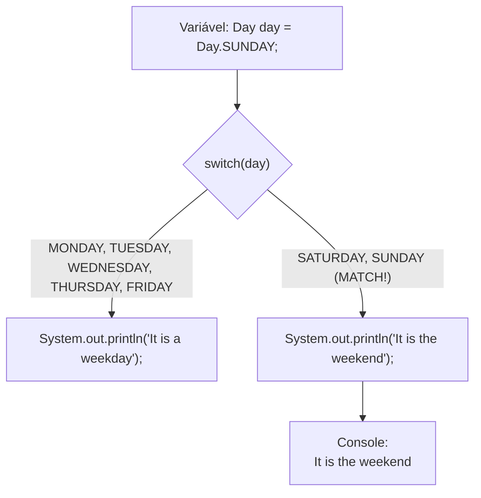

# Curso de Java — Bro Code (12 Horas)
## Capítulo 68: `enums 📅` (Parte 2 — Construtor e Campo em `Day.java`, e o `switch` Moderno com Seta `->` em `Main.java`)

---

> [!NOTE]
> **Contexto para o Google Docs**: Este documento contém a reconstituição textual completa das **4 telas** exibidas pelo instrutor Bro Code no vídeo (entre os minutos **11:04:22** e **11:08:24** de 12:00:00). Você não precisa das imagens originais: todos os painéis do IntelliJ IDEA, códigos de ambos os arquivos (`Day.java` e `Main.java`), a eliminação dos erros vermelhos, a estrutura do `switch` moderno e a saída do console foram reconstituídos em blocos de texto fiéis para o seu documento.

---

## 1. Reconstituição Textual das Telas do Vídeo (Google Docs Ready)

### Tela 1: O Arquivo `Day.java` Completo e Sem Nenhum Erro! (Timestamp ~11:05:00)
```text
+--------------------------------------------------------------------------------------------------+
|  IntelliJ IDEA - Day.java com Construtor e Métodos                            Timestamp ~11:05:00|
+--------------------------------------------------------------------------------------------------+
| Abas: Main.java | Day.java                                            (Zero erros de compilação!)|
|--------------------------------------------------------------------------------------------------|
|  1    public enum Day {                                                                          |
|  2                                                                                               |
|  3 [SUNDAY(1), MONDAY(2), TUESDAY(3), WEDNESDAY(4), THURSDAY(5), FRIDAY(6), SATURDAY(7);] <AZUL  |
|  4                                                                                               |
|  5        private final int dayNumber;                                                           |
|  6                                                                                               |
|  7        Day(int dayNumber) {                                                                   |
|  8            this.dayNumber = dayNumber;                                                        |
|  9        }                                                                                      |
| 10                                                                                               |
| 11        public int getDayNumber(){                                                             |
| 12            return this.dayNumber;                                                             |
| 13        }                                                                                      |
| 14    }                                                                                          |
+--------------------------------------------------------------------------------------------------+
| O autor adicionou o campo dayNumber, o construtor Day(int dayNumber) e o getter getDayNumber(). |
| As onduinhas vermelhas da linha 3 SUMIRAM COMPLETAMENTE! O arquivo compila com 100% de sucesso!  |
+--------------------------------------------------------------------------------------------------+
```

---

### Tela 2: A Transição para o `Main.java` e o Início do `switch` (Timestamp ~11:06:30)
```text
+--------------------------------------------------------------------------------------------------+
|  IntelliJ IDEA - Main.java: Construindo o switch Moderno                      Timestamp ~11:06:30|
+--------------------------------------------------------------------------------------------------+
|  1    public class Main {                                                                        |
|  2        public static void main(String[] args) {                                               |
|  3                                                                                               |
|  4            Day day = Day.SUNDAY;                                                              |
|  5                                                                                               |
|  6            switch(day){                                                                       |
|  7                case MONDAY, TUESDAY -> System.out.println("It is a weekday");                 |
|  8 [              case TUESDAY -> System.out.println("It is a weekday");               ] <AZUL   |
|  9            }                                                                                  |
| 10        }                                                                                      |
| 11    }                                                                                          |
+--------------------------------------------------------------------------------------------------+
| O autor cria a variável Day day = Day.SUNDAY; e começa a montar um comando switch com a sintaxe |
| moderna de seta (->). Ele está no meio da digitação e refatoração dos dias da semana.          |
+--------------------------------------------------------------------------------------------------+
```

---

### Tela 3: O `switch` Completo Agrupando Dias Úteis e Fim de Semana (Timestamp: 11:08:24)
```text
+--------------------------------------------------------------------------------------------------+
|  IntelliJ IDEA - Main.java: O switch com Agrupamento por Vírgula              Timestamp 11:08:24 |
+--------------------------------------------------------------------------------------------------+
|  4            Day day = Day.SUNDAY;                                                              |
|  5                                                                                               |
|  6            switch(day){                                                                       |
|  7                case MONDAY,                                                                   |
|  8                     TUESDAY,                                                                  |
|  9                     WEDNESDAY,                                                                |
| 10                     THURSDAY,                                                                 |
| 11                     FRIDAY -> System.out.println("It is a weekday");                          |
| 12                case SATURDAY, SUNDAY -> System.out.println("It is the weekend");              |
| 13            }                                                                                  |
+--------------------------------------------------------------------------------------------------+
| O autor agrupou de Segunda a Sexta em uma única regra com seta (->) dizendo "It is a weekday",   |
| e Sábado e Domingo na linha 12 dizendo "It is the weekend"!                                      |
+--------------------------------------------------------------------------------------------------+
```

---

### Tela 4: Execução no Console: "It is the weekend" (Timestamp ~11:08:35)
```text
+--------------------------------------------------------------------------------------------------+
|  Run / Execution Window (Console do IntelliJ)                                 Timestamp ~11:08:35|
+--------------------------------------------------------------------------------------------------+
|  C:\Users\HP\.jdks\openjdk-23\bin\java.exe ... Main                                              |
|                                                                                                  |
|  It is the weekend                                                                               |
|                                                                                                  |
|  Process finished with exit code 0                                                               |
+--------------------------------------------------------------------------------------------------+
| O autor clicou em Play ▶️. Como a variável day era Day.SUNDAY (Domingo), o switch caiu na       |
| segunda regra (case SATURDAY, SUNDAY) e imprimiu em verde no console: "It is the weekend"!       |
+--------------------------------------------------------------------------------------------------+
```

---

## 2. Os Códigos Completos dos Dois Arquivos do Projeto

### Arquivo 1: [`Day.java`](file:///c:/Users/mickel%201/Downloads/JAVA%20APRENDER/Day.java)
```java
public enum Day {

    SUNDAY(1), MONDAY(2), TUESDAY(3), WEDNESDAY(4), THURSDAY(5), FRIDAY(6), SATURDAY(7);

    private final int dayNumber;

    Day(int dayNumber) {
        this.dayNumber = dayNumber;
    }

    public int getDayNumber(){
        return this.dayNumber;
    }
}
```

### Arquivo 2: [`Main.java`](file:///c:/Users/mickel%201/Downloads/JAVA%20APRENDER/Main.java)
```java
public class Main {
    public static void main(String[] args) {

        Day day = Day.SUNDAY;

        switch(day){
            case MONDAY,
                 TUESDAY,
                 WEDNESDAY,
                 THURSDAY,
                 FRIDAY -> System.out.println("It is a weekday");
            case SATURDAY, SUNDAY -> System.out.println("It is the weekend");
        }

    }
}
```

---

## 3. Explicação Linha por Linha do Arquivo `Day.java`

Vamos entender como o Bro Code resolveu os 7 erros vermelhos da aula passada:

### Linha 1: `public enum Day {`
- **O que faz**: Declara a nossa enumeração pública chamada `Day`.
- **Linguagem de Leigo**: Abre a lista sagrada dos dias da semana que ninguém no programa pode inventar nomes fora daqui.

### Linha 3: `SUNDAY(1), MONDAY(2), TUESDAY(3), WEDNESDAY(4), THURSDAY(5), FRIDAY(6), SATURDAY(7);`
- **O que faz**: Cria as 7 constantes do nosso Enum, associando cada uma a um número inteiro (1 para domingo, 2 para segunda, etc.).
- **Por que agora NÃO dá erro?**: Porque agora temos a linha 7 (o construtor) que sabe exatamente o que fazer com esse número entre parênteses!
- **O ponto e vírgula `;` no final**: É OBRIGATÓRIO! Quando um Enum tem apenas os nomes, o ponto e vírgula é opcional. Mas **se você adicionar campos, construtores ou métodos logo abaixo, o ponto e vírgula após a última constante é estritamente obrigatório**!

### Linha 5: `private final int dayNumber;`
- **O que faz**: Cria a variável interna que vai guardar o número do dia.
- **O que significa `private`?**: Significa "privado". Ninguém de outros arquivos pode acessar diretamente essa variável para alterá-la de forma indevida.
- **O que significa `final`?**: Significa "constante / definitivo". Uma vez que o Domingo recebeu o número 1, esse número NUNCA mais poderá ser modificado enquanto o programa estiver rodando!
- **O que significa `int dayNumber`**: O tipo é número inteiro (`int`) e o nome da gaveta é `dayNumber` (número do dia).

### Linha 7: `Day(int dayNumber) {`
- **O que faz**: É o **Construtor** do Enum!
- **Como funciona**: Toda vez que o Java lê `SUNDAY(1)`, ele pega esse número `1` e entrega aqui dentro do parâmetro `int dayNumber`.
- **Atenção Máxima para Iniciantes**: Por que não tem a palavra `public` antes de `Day`?
  > **Regra Sagrada do Java**: Construtores de Enum **NUNCA PODEM SER PÚBLICOS (`public`)**! Eles são sempre privados (ou padrão de pacote), porque ninguém no mundo exterior pode dar um `new Day(8)` para inventar um oitavo dia na semana!

### Linha 8: `this.dayNumber = dayNumber;`
- **O que faz**: Pega o número recebido pelo construtor e guarda na gaveta definitiva do objeto (`this.dayNumber`).

### Linha 9: `}`
- Fecha o construtor.

### Linha 11: `public int getDayNumber(){`
- **O que faz**: É o método *Getter* (método de leitura).
- **Para que serve**: Como a variável `dayNumber` foi protegida como `private` na linha 5, criamos esse método público para que quem estiver em outro arquivo (como o `Main.java`) possa perguntar educadamente: *"Qual é o número desse dia?"*.

### Linha 12: `return this.dayNumber;`
- **O que faz**: Devolve o número guardado (ex: devolve `1` para o Domingo).

### Linhas 13 e 14: `}`
- Linha 13 fecha o método `getDayNumber`.
- Linha 14 fecha o `enum Day`.

---

## 4. Explicação Linha por Linha do Arquivo `Main.java`

Agora vamos dissecar o programa principal que testa o nosso Enum:

### Linha 1: `public class Main {`
- Abertura da classe de testes.

### Linha 2: `public static void main(String[] args) {`
- Ponto de partida do programa.

### Linha 4: `Day day = Day.SUNDAY;`
- **O que faz**: Cria uma variável chamada `day` cujo tipo é o nosso próprio Enum: `Day`.
- **O valor atribuído**: `Day.SUNDAY` (Domingo).
- **Linguagem de Leigo**: Nós selecionamos a opção "DOMINGO" no nosso menu fechado e guardamos na mão.
- **Saída no Console**: Nenhuma.

---

### Linha 6: `switch(day){`
- **O que é o `switch`?**: É uma central de desvio ferroviário (uma chave seletora).
- **O que ele faz**: Ele olha para o conteúdo da variável `day` e pergunta: *"Qual dia está selecionado aí dentro?"*.
- Dependendo do dia, ele aciona o trilho correspondente!

---

### Linhas 7 a 11: A Regra dos Dias Úteis
```java
case MONDAY,
     TUESDAY,
     WEDNESDAY,
     THURSDAY,
     FRIDAY -> System.out.println("It is a weekday");
```
- **A Sintaxe Revolucionária com Vírgula `,`**:
  No Java moderno, você não precisa repetir `case MONDAY: case TUESDAY:...`. Você pode simplesmente listar todos separados por vírgula na mesma regra!
- **A Seta `->` (Arrow Switch)**:
  - Significa: *"Se for qualquer um desses, execute imediatamente o que está à direita da seta!"*.
  - **A maior vantagem da seta `->`**: Ela **elimina a necessidade do comando `break;`**! No switch antigo, se você esquecesse o `break;`, o código caía no caso de baixo por acidente (*fall-through*). Com a seta `->`, isso é impossível: ele executa apenas a linha da seta e vai embora!
- **O texto impresso**: *"It is a weekday"* (É um dia útil / dia de semana).

---

### Linha 12: A Regra do Fim de Semana
```java
case SATURDAY, SUNDAY -> System.out.println("It is the weekend");
```
- **O que faz**: Se a variável for Sábado (`SATURDAY`) OU Domingo (`SUNDAY`), ele segue a seta e imprime:
  ```text
  It is the weekend
  ```
  *(É o fim de semana!)*

---

### Linhas 13 a 17: Chaves de Fechamento `}`
- Linha 13 fecha o bloco do `switch`.
- Linha 15 fecha o método `main`.
- Linha 17 fecha a classe `Main`.

---

## 5. A Saída Real no Console (Tela 4)

Como definimos na linha 4:
```java
Day day = Day.SUNDAY;
```
O `switch` ignorou toda a lista de segunda a sexta e caiu direto na linha 12, imprimindo no console:

```text
It is the weekend
```

---

## 6. O Teste Mental: E se Mudássemos para Segunda-Feira?

Se alterarmos a linha 4 para:
```java
Day day = Day.MONDAY;
```
Ao executar o programa, o console imprimiria instantaneamente:
```text
It is a weekday
```

E se você tentasse digitar uma palavra que não existe no Enum?
```java
Day day = Day.CARNAVAL; // ERRO DE COMPILAÇÃO!
```
O Java nem deixa o programa rodar! O código fica vermelho no mesmo segundo porque `CARNAVAL` não faz parte da lista sagrada de constantes do `Day`! Essa é a **segurança absoluta de tipos** que o Enum nos dá.

---

## 7. Comparativo: O Switch Antigo vs O Switch Moderno (com Seta `->`)

Veja a economia brutal de código que o Java moderno nos proporciona:

### No Java Antigo (Verborrágico e Perigoso):
```java
// O JEITO ANTIGO (Cheio de repetições e precisa de break):
switch(day){
    case MONDAY:
    case TUESDAY:
    case WEDNESDAY:
    case THURSDAY:
    case FRIDAY:
        System.out.println("It is a weekday");
        break; // SE ESQUECER ESSE BREAK, O CÓDIGO CAI NO FIM DE SEMANA!
    case SATURDAY:
    case SUNDAY:
        System.out.println("It is the weekend");
        break;
}
```

### No Java Moderno do Bro Code (Limpo e Seguro):
```java
// O JEITO NOVO (Usado pelo Bro Code):
switch(day){
    case MONDAY, TUESDAY, WEDNESDAY, THURSDAY, FRIDAY -> System.out.println("It is a weekday");
    case SATURDAY, SUNDAY -> System.out.println("It is the weekend");
}
```

---

## 8. Diagrama de Fluxo Visual da Decisão do `switch`



---

## 9. Checklist de Fixação Mental para Iniciantes

1. **Como resolvemos o erro "Expected 0 arguments but found 1"?** Criamos o construtor `Day(int dayNumber)` dentro do Enum.
2. **Por que o construtor de Enum não pode ser `public`?** Porque ninguém fora do Enum pode dar `new` para inventar novas constantes.
3. **Por que usamos `private final int dayNumber`?** Para proteger o valor do dia e garantir que ele nunca possa ser modificado após criado.
4. **O que faz o método `getDayNumber()`?** Permite que códigos de fora leiam o número do dia (ex: 1 para Domingo).
5. **O que significa a seta `->` no `switch`?** É o novo formato do Java que executa o comando e sai do switch sem precisar da palavra `break;`.
6. **Por que agrupamos os dias com vírgula?** Porque todos os dias de segunda a sexta têm o mesmo comportamento (dia útil), economizando linhas e repetição.
7. **Qual foi a saída no console?** Saiu `It is the weekend`, porque a variável foi configurada com `Day.SUNDAY`.
