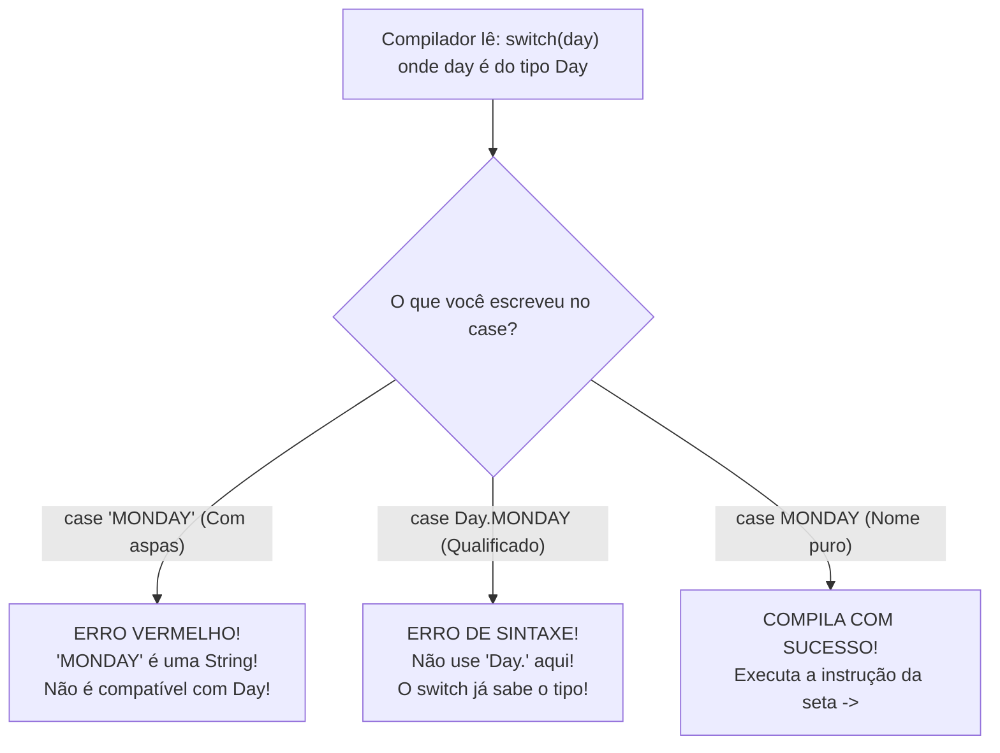

# Curso de Java — Bro Code (12 Horas)
## Capítulo 68: `enums 📅` (Parte 3 — Teste com `WEDNESDAY` e a Armadilha Mortal das Aspas `""` no `switch`)

---

> [!NOTE]
> **Contexto para o Google Docs**: Este documento contém a reconstituição textual completa das **2 telas** exibidas pelo instrutor Bro Code no vídeo (entre os minutos **11:08:41** e **11:08:52** de 12:00:00). Você não precisa das imagens originais: todos os painéis do IntelliJ IDEA, códigos, linhas com erros vermelhos (7 erros de compilação), lâmpadas de aviso e saídas do console foram reconstituídos em blocos de texto fiéis para o seu documento.

---

## 1. Reconstituição Textual das Telas do Vídeo (Google Docs Ready)

### Tela 1: Testando um Dia Útil com `Day.WEDNESDAY` (Timestamp: 11:08:41)
```text
+--------------------------------------------------------------------------------------------------+
|  IntelliJ IDEA - MyFirstProject [Main.java] e Console                         Timestamp 11:08:41 |
+--------------------------------------------------------------------------------------------------+
| Editor:                                                                                          |
|  1    public class Main {                                                                        |
|  2        public static void main(String[] args) {                                               |
|  3                                                                                               |
|  4                                                                                               |
|  5 💡         Day day = Day.[WEDNESDAY]; <-- WEDNESDAY SELECIONADO EM ROXO                      |
|  6                                                                                               |
|  7            switch(day){                                                                       |
|  8                case MONDAY, TUESDAY, WEDNESDAY, THURSDAY, FRIDAY                              |
|  9                     -> System.out.println("It is a weekday");                                 |
| 10                case SATURDAY, SUNDAY -> System.out.println("It is the weekend");              |
| 11            }                                                                                  |
| 12        }                                                                                      |
| 13    }                                                                                          |
+--------------------------------------------------------------------------------------------------+
| Console / Run Output:                                                                            |
|  C:\Users\HP\.jdks\openjdk-23\bin\java.exe ... Main                                              |
|                                                                                                  |
|  It is a weekday                                                                                 |
|                                                                                                  |
|  Process finished with exit code 0                                                               |
+--------------------------------------------------------------------------------------------------+
| O autor alterou a variável day de SUNDAY para WEDNESDAY (Quarta-feira) e rodou o código.         |
| Como quarta-feira é dia de semana, o switch caiu na primeira regra e imprimiu: "It is a weekday"|
+--------------------------------------------------------------------------------------------------+
```

---

### Tela 2: A Grande Armadilha: Colocando Aspas Duplas `""` nos Casos (Timestamp: 11:08:52)
```text
+--------------------------------------------------------------------------------------------------+
|  IntelliJ IDEA - Main.java com 7 Erros de Compilação                          Timestamp 11:08:52 |
+--------------------------------------------------------------------------------------------------+
| Abas: Main.java | Day.java                                          Alerta no topo: [ 07 ^ v ]   |
|--------------------------------------------------------------------------------------------------|
|  5            Day day = Day.WEDNESDAY;                                                           |
|  6                                                                                               |
|  7            switch(day){                                                                       |
|  8                case ["MONDAY"],                                                               |
|  9                     ["TUESDAY"],                                                              |
| 10                     ["WEDNESDAY"],                                                            |
| 11                     ["THURSDAY"],                                                             |
| 12                     ["FRIDAY"] -> System.out.println("It is a weekday");                      |
| 13 🚨             case ["SATURDAY"], ["SUNDAY"] -> System.out.println("It is the weekend");      |
|                        ~~~~~~~~~~~~  ~~~~~~~~~~ <--- ONDINHAS VERMELHAS EM TODAS AS ASPAS!       |
| 14            }                                                                                  |
+--------------------------------------------------------------------------------------------------+
| O autor colocou aspas duplas "" em volta dos nomes dos dias dentro do switch.                    |
| O IntelliJ entrou em pânico com 7 ERROS VERMELHOS (07 ^ v) e uma lâmpada vermelha de erro!       |
| O compilador avisa: "an enum switch case label must be the unqualified name of a constant"!      |
+--------------------------------------------------------------------------------------------------+
```

---

## 2. A Dissecação da Tela 1: O Teste de Dia Útil

Na Tela 1, o Bro Code comprovou a flexibilidade do `switch` trocando a variável de teste:

```java
Day day = Day.WEDNESDAY;
```

### O que o computador fez:
1. Ele olhou para a variável `day` e viu o valor `Day.WEDNESDAY` (Quarta-feira).
2. Ele entrou no `switch(day)`.
3. Na primeira verificação:
   ```java
   case MONDAY, TUESDAY, WEDNESDAY, THURSDAY, FRIDAY ->
   ```
   Ele encontrou `WEDNESDAY` na lista!
4. Imediatamente seguiu a seta `->` e executou o comando da linha 9:
   ```java
   System.out.println("It is a weekday");
   ```
5. **Saída no Console**:
   ```text
   It is a weekday
   ```
   *(É um dia útil / dia de semana).*

---

## 3. A Grande Armadilha da Tela 2: Por que Colocar Aspas Duplas `""` Destruiu o Código?

Na Tela 2, o instrutor faz uma provocação clássica que 99% dos iniciantes cometem quando estão aprendendo Java.
Ele foi até o `switch` e colocou aspas duplas em cada dia:

```java
// O CÓDIGO QUE CAUSOU 7 ERROS VERMELHOS:
switch(day){
    case "MONDAY",
         "TUESDAY",
         "WEDNESDAY",
         "THURSDAY",
         "FRIDAY" -> System.out.println("It is a weekday");
    case "SATURDAY", "SUNDAY" -> System.out.println("It is the weekend");
}
```

Instantaneamente, o IntelliJ acendeu **7 erros vermelhos** e se você tentar rodar no terminal com `javac Main.java`, o compilador dispara:

```text
Main.java:8: error: an enum switch case label must be the unqualified name of an enumeration constant
            case "MONDAY",
                 ^
Main.java:9: error: an enum switch case label must be the unqualified name of an enumeration constant
                 "TUESDAY",
                 ^
...
7 errors
```

---

## 4. Traduzindo o Erro do Compilador para Linguagem de Leigo

Vamos ler a mensagem de erro com calma:
> **"An enum switch case label must be the unqualified name of an enumeration constant"**

### O que essa frase em inglês significa?
1. **`an enum switch`**: Você está fazendo um switch baseado em um Enum (`Day`).
2. **`case label`**: O rótulo que vem depois da palavra `case`.
3. **`must be`**: DEVE SER.
4. **`the unqualified name of an enumeration constant`**: O nome **PURO** (não qualificado) da constante, ou seja, **SEM ASPAS** e **SEM O NOME DA CLASSE NA FRENTE**!

---

## 5. Os 2 Grandes Erros que os Alunos Cometem no `switch` de Enum

Existem duas formas erradas e apenas UMA forma certa de escrever:

### Erro 1: Colocar Aspas Duplas `""` (O teste do autor na Tela 2)
```java
case "MONDAY" -> // ERRO FATAL DE COMPILAÇÃO!
```
- **Por que está errado?**
  Ao colocar aspas duplas, `"MONDAY"` vira um texto comum do tipo **`String`**.
  Mas a nossa variável `day` é do tipo **`Day`** (um Enum)!
  Em Java, uma banana não é uma maçã. O tipo `String` é totalmente incompatível com o tipo `Day`. O Java não permite misturar os dois no mesmo `switch`!

---

### Erro 2: Colocar o Nome do Arquivo na Frente (`Day.MONDAY`)
```java
case Day.MONDAY -> // ERRO DE SINTAXE NO JAVA!
```
- **Por que está errado?**
  Muitos programadores pensam: *"Se para criar a variável eu escrevo `Day.WEDNESDAY`, então no case eu tenho que escrever `case Day.MONDAY`"*.
  **NÃO!**
  Como o Java já leu a linha `switch(day)`, ele já sabe com 100% de certeza que qualquer opção ali dentro pertence ao Enum `Day`.
  Portanto, colocar `Day.` é considerado um erro de redundância. O Java proíbe expressamente!

---

### A ÚNICA FORMA CORRETA: O Nome Puro da Constante!
```java
case MONDAY -> // CORRETO! LIMPO E PERFEITO!
```
- Sem aspas `""`.
- Sem `Day.`.
- Apenas a palavra pura em letras maiúsculas: `MONDAY`.

---

## 6. Por que o Enum é Infinitamente Mais Rápido que Strings no `switch`?

Lembre-se da linha 9 do comentário teórico que o Bro Code escreveu no início do capítulo:
```java
// More efficient with switches when comparing Strings.
```

### Como o computador compara `String`s no `switch`:
Se o switch usasse textos comuns:
```java
String day = "WEDNESDAY";
```
O computador tem que comparar letra por letra:
- Compara `"W"` com `"M"` da segunda-feira... Não bateu.
- Compara com a terça-feira... Não bateu.
- Compara com a quarta-feira... Bateu o `"W"`, depois checa o `"E"`, o `"D"`, o `"N"`, o `"E"`, o `"S"`, o `"D"`, o `"A"`, o `"Y"`.
Isso gasta tempo de processamento e memória!

### Como o computador compara `Enum` no `switch`:
No Enum, o Java não compara letras!
Cada constante de Enum possui um número interno exclusivo (*hash code / ordinal*).
O Java simplesmente compara:
- O número da Quarta-feira é igual ao número da Segunda? Não.
- É igual ao da Terça? Não.
- É igual ao da Quarta? SIM!
É uma comparação numérica direta em nível de processador, executada em **nanossegundos**!

---

## 7. Tabela Resumo: O que Pode e o que NÃO Pode no `switch` de Enum

| Sintaxe no `case` | É Permitido? | O que o Java diz? |
| :--- | :---: | :--- |
| `case MONDAY ->` | **SIM (Correto)** | Perfeito! Sintaxe limpa de Enum. |
| `case "MONDAY" ->` | **NÃO (Erro)** | `Incompatible types`: String não é Enum (Tela 2). |
| `case Day.MONDAY ->` | **NÃO (Erro)** | O rótulo deve ser o nome não qualificado (sem `Day.`). |
| `case monday ->` | **NÃO (Erro)** | Java é sensível a maiúsculas; a constante é `MONDAY`. |

---

## 8. Diagrama Mental do Compilador Java na Linha do `case`



---

## 9. Checklist de Fixação Mental para Iniciantes

1. **O que saiu no console ao testar `Day.WEDNESDAY`?** Saiu `It is a weekday`, pois quarta-feira faz parte do grupo dos dias úteis.
2. **Por que o autor colocou aspas nos dias na Tela 2?** Para demonstrar aos alunos o erro mais comum cometido por iniciantes.
3. **Por que colocar aspas gera 7 erros de compilação?** Porque aspas transformam as constantes em textos (`String`), e o switch espera valores do tipo `Day`.
4. **Posso escrever `case Day.MONDAY`?** Não! No Java, o nome deve ser não qualificado (`MONDAY`).
5. **Como consertar os 7 erros da Tela 2?** Basta remover todas as aspas duplas `""` dos dias da semana!
