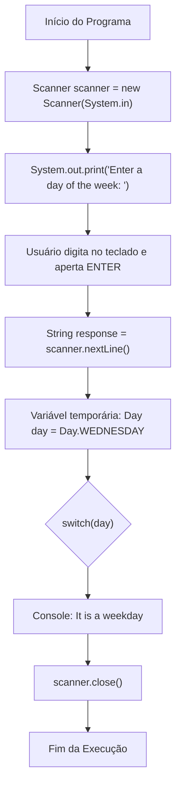

# Curso de Java — Bro Code (12 Horas)
## Capítulo 68: `enums 📅` (Parte 4 — Interatividade com `Scanner`, o Erro de Importação e a Leitura de Resposta do Usuário)

---

> [!NOTE]
> **Contexto para o Google Docs**: Este documento contém a reconstituição textual completa das **3 telas** exibidas pelo instrutor Bro Code no vídeo (entre os minutos **11:08:52** e **11:09:40** de 12:00:00). Você não precisa das imagens originais: todos os painéis do IntelliJ IDEA, códigos, erros em tempo real (onduinhas vermelhas), balões de sugestão de correção automática (`Alt+Shift+Enter`) e a preparação da leitura via teclado foram reconstituídos em blocos de texto fiéis para o seu documento.

---

## 1. Reconstituição Textual das Telas do Vídeo (Google Docs Ready)

### Tela 1: Digitando `Scanner` e o Erro Vermelho "Cannot resolve symbol" (Timestamp ~11:09:05)
```text
+--------------------------------------------------------------------------------------------------+
|  IntelliJ IDEA - MyFirstProject [Main.java]                                   Timestamp ~11:09:05|
+--------------------------------------------------------------------------------------------------+
| Project Tree      |  Main.java                                                                   |
| > .idea           |  1    public class Main {                                                    |
| > out             |  2        public static void main(String[] args) {                           |
| v src             |  3                                                                           |
|   (c) Main        |  4                                                                           |
|   (E) Day         |  5 💡         [Scanner] scanner = new [Scanner](System.in);                  |
|   .gitignore      |               ~~~~~~~                 ~~~~~~~ <--- PALAVRA EM VERMELHO!      |
|                   |  6                                                                           |
|                   |  7            Day day = Day.WEDNESDAY;                                       |
|                   |  8                                                                           |
|                   |  9            switch(day){ ... }                                             |
+--------------------------------------------------------------------------------------------------+
| O autor começa a tornar o programa interativo criando um Scanner. Como ele ainda não importou    |
| a classe, a palavra Scanner fica sublinhada em vermelho e o IntelliJ abre um balão de ajuda!     |
+--------------------------------------------------------------------------------------------------+
```

---

### Tela 2: Close-up do Balão de Ajuda do IntelliJ IDEA (Timestamp ~11:09:10)
```text
+--------------------------------------------------------------------------------------------------+
|  IntelliJ IDEA - Balão de Sugestão e Autocorreção                             Timestamp ~11:09:10|
+--------------------------------------------------------------------------------------------------+
|  5     [Scanner] scanner = new Scanner(System.in);                                               |
|        +---------------------------------------------------------------------------------+       |
|        | Cannot resolve symbol 'Scanner'                                             :   |       |
|        | Import class  Alt+Shift+Enter    More actions...  Alt+Enter                     |       |
|        +---------------------------------------------------------------------------------+       |
+--------------------------------------------------------------------------------------------------+
| O IntelliJ explica com clareza: "Cannot resolve symbol 'Scanner'" (Não conheço quem é Scanner!). |
| Ele oferece o atalho para importar a classe da biblioteca utilitária: Alt+Shift+Enter.           |
+--------------------------------------------------------------------------------------------------+
```

---

### Tela 3: O Código Completo com a Pergunta e a Leitura do Teclado (Timestamp ~11:09:40)
```text
+--------------------------------------------------------------------------------------------------+
|  IntelliJ IDEA - Main.java Pronto para Receber a Entrada                      Timestamp ~11:09:40|
+--------------------------------------------------------------------------------------------------+
|  1    import java.util.Scanner;                                                                  |
|  2                                                                                               |
|  3    public class Main {                                                                        |
|  4        public static void main(String[] args) {                                               |
|  5                                                                                               |
|  6            Scanner scanner = new Scanner(System.in);                                          |
|  7            System.out.print("Enter a day of the week: ");                                     |
|  8 💡         String response = scanner.nextLine();                                              |
|  9                                                                                               |
| 10            Day day = Day.WEDNESDAY;                                                           |
| 11                                                                                               |
| 12            switch(day){                                                                       |
| 13                case MONDAY,                                                                   |
| 14                     TUESDAY,                                                                  |
| 15                     WEDNESDAY,                                                                |
| 16                     THURSDAY,                                                                 |
| 17                     FRIDAY -> System.out.println("It is a weekday");                          |
| 18                case SATURDAY, SUNDAY -> System.out.println("It is the weekend");              |
| 19            }                                                                                  |
| 20                                                                                               |
| 21            scanner.close();                                                                   |
| 22        }                                                                                      |
| 23    }                                                                                          |
+--------------------------------------------------------------------------------------------------+
| O autor fez 4 adições magistrais:                                                                |
| 1. Linha 1: importou java.util.Scanner.                                                          |
| 2. Linha 7: fez a pergunta sem quebrar a linha (System.out.print).                                |
| 3. Linha 8: capturou o que o usuário digitou na variável String response.                       |
| 4. Linha 21: fechou o scanner (scanner.close()) para liberar a memória do sistema!              |
+--------------------------------------------------------------------------------------------------+
```

---

## 2. A Evolução do Programa: Saindo do Código "Fixo" para o Dinâmico

Até agora, o nosso programa estava **"chumbado no código"** (*hardcoded*).
Se queríamos testar domingo, tínhamos que digitar manualmente no código: `Day.SUNDAY`.
Se queríamos quarta, tínhamos que abrir o arquivo e mudar para: `Day.WEDNESDAY`.

### O Objetivo do Bro Code Nesta Etapa:
Criar um programa real onde **qualquer pessoa** possa sentar na frente do computador, ver a pergunta na tela:
```text
Enter a day of the week: 
```
Digitar pelo teclado (ex: `"FRIDAY"` ou `"sunday"`) e o programa responder sozinho se é dia de semana ou fim de semana!

---

## 3. Dissecação Linha por Linha do Arquivo `Main.java`

Aqui está a explicação detalhada de cada instrução, focando em quem está aprendendo a programar:

### Linha 1: `import java.util.Scanner;`
- **O que faz**: Importa a classe `Scanner` que mora dentro do pacote de utilitários (`java.util`).
- **Linguagem de Leigo**: Vai no depósito do Java e pega a "antena do teclado". O Java não carrega o leitor de teclado por padrão para não gastar memória à toa.
- **Saída no Console**: Nenhuma.

### Linha 3: `public class Main {`
- Abertura da classe principal.

### Linha 4: `public static void main(String[] args) {`
- Ponto de partida da execução do Java.

---

### Linha 6: `Scanner scanner = new Scanner(System.in);`
- **O que faz**: Constrói o objeto leitor na memória.
  - `Scanner`: É o tipo da ferramenta.
  - `scanner`: É o apelido/variável que demos para ela.
  - `new Scanner(...)`: Constrói a ferramenta do zero.
  - `System.in`: Significa *"System Input"* (Entrada do Sistema). Avisa que a antena do Scanner deve capturar o que for digitado no **teclado físico** do usuário.
- **Linguagem de Leigo**: Ligamos o gravador e apontamos o microfone para a boca do usuário.
- **Saída no Console**: Nenhuma.

---

### Linha 7: `System.out.print("Enter a day of the week: ");`
- **O que faz**: Imprime a mensagem em inglês: *"Digite um dia da semana: "*.
- **ATENÇÃO VITAL AO DETALHE**:
  - Veja que o autor escreveu `System.out.print` e **NÃO** `System.out.println`!
  - **Qual é a diferença?**
    - `println` ➔ Imprime o texto e pula para a linha de baixo (*Line Feed*).
    - `print` ➔ Imprime o texto e **MANTÉM O CURSOR PISCANDO NA MESMA LINHA**, logo após o espaço depois dos dois pontos (`: `)!
  - Isso deixa a experiência visual do usuário muito mais elegante e profissional!
- **O que sai no console**:
  ```text
  Enter a day of the week: _
  ```
  *(com o cursor piscando logo ali!)*

---

### Linha 8: `String response = scanner.nextLine();`
- **O que faz**: Pausa a execução do programa e fica esperando pacientemente até que o usuário digite algo e aperte a tecla **ENTER**.
- **Como funciona**:
  - O método `.nextLine()` pega toda a linha de texto que o usuário digitou.
  - Guarda esse texto dentro de uma nova variável chamada `response` (resposta), cujo tipo é texto comum: **`String`**.
- **Linguagem de Leigo**: O programa congela e diz: *"Só continuo depois que você digitar uma palavra e der Enter"*.
- **Saída no Console**: O texto que você próprio digitar.

---

### Linha 10: `Day day = Day.WEDNESDAY;`
- **Por que essa linha ainda está aqui?**
  - **Atenção Máxima!** O autor acabou de ler o texto na variável `response` na linha 8.
  - Mas o `switch(day)` na linha 12 ainda está avaliando a variável `day` do tipo `Day`!
  - O autor manteve essa linha temporariamente enquanto constrói a lógica. Na próxima cena, ele vai transformar o texto `response` no Enum `Day`!

---

### Linhas 12 a 19: O `switch(day)` com Seta (`->`)
```java
switch(day){
    case MONDAY,
         TUESDAY,
         WEDNESDAY,
         THURSDAY,
         FRIDAY -> System.out.println("It is a weekday");
    case SATURDAY, SUNDAY -> System.out.println("It is the weekend");
}
```
- Continua fazendo a separação entre dias úteis e finais de semana que aprendemos na aula passada.

---

### Linha 21: `scanner.close();`
- **O que faz**: Fecha e desliga o objeto Scanner.
- **Por que isso é fundamental? (Boas Práticas de Programador Profissional)**:
  - O Scanner fica conectado a um canal de comunicação do sistema operacional (`System.in`).
  - Se você abrir o Scanner e nunca fechar, o sistema operacional mantém essa porta aberta na memória, causando o que chamamos de **Vazamento de Recursos** (*Resource Leak*).
  - Fechar o Scanner ao final do método é o sinal de respeito e limpeza que todo bom engenheiro de software segue!

---

## 4. O Grande Enigma que Vem Aí: O Choque entre `String` e `Enum`

Olhe com muita atenção para as variáveis que temos agora no código:

1. Na **Linha 8**:
   ```java
   String response = scanner.nextLine();
   ```
   A variável `response` é do tipo **`String`** (um texto livre que o usuário digitou, ex: `"friday"`).

2. Na **Linha 12**:
   ```java
   switch(day){
   ```
   O switch **NÃO aceita textos livres**! Ele só aceita o tipo estrito **`Day`** (`Day.FRIDAY`, `Day.MONDAY`...)!

### A Pergunta de 1 Milhão de Dólares:
Como vamos converter um texto digitado pelo usuário (`String response`) em uma constante sagrada do nosso Enum (`Day day`)?

- Se o usuário digitar `"monday"` com letras minúsculas?
- Se o usuário digitar `"banana"`?
- Como o Java vai fazer essa ponte?
Esse é o grande clímax que o Bro Code vai resolver na próxima cena através do método mágico `Day.valueOf()`!

---

## 5. Tabela de Rastreamento de Execução Passo a Passo

| Linha | Código | O que o Computador Faz? | O que Aparece no Console? |
| :---: | :--- | :--- | :--- |
| **Linha 6** | `Scanner scanner = ...;` | Liga o receptor do teclado. | *(nada)* |
| **Linha 7** | `System.out.print("Enter...");` | Exibe a pergunta na tela sem pular linha. | `Enter a day of the week: ` |
| **Linha 8** | `scanner.nextLine();` | Pausa e aguarda o usuário digitar e dar Enter. | O texto que você digitar |
| **Linha 10**| `Day day = Day.WEDNESDAY;` | Carrega a quarta-feira temporária. | *(nada)* |
| **Linha 12**| `switch(day)` | Direciona o fluxo para dia útil. | `It is a weekday` |
| **Linha 21**| `scanner.close();` | Desliga o receptor do teclado. | *(nada)* |

---

## 6. Diagrama de Fluxo Visual da Interatividade



---

## 7. Checklist de Fixação Mental para Iniciantes

1. **Por que a palavra `Scanner` ficou vermelha no início?** Porque o Java não importa ferramentas automaticamente; era necessário adicionar `import java.util.Scanner;`.
2. **Qual é o atalho do teclado no IntelliJ para importar automaticamente?** `Alt + Shift + Enter` ou `Alt + Enter`.
3. **Por que usamos `System.out.print` em vez de `println` na pergunta?** Para que o usuário digite a resposta na mesma linha da pergunta, ao lado dos dois pontos `: `.
4. **O que faz o método `scanner.nextLine()`?** Lê todo o texto digitado pelo usuário até ele apertar a tecla Enter.
5. **Para que serve `scanner.close()`?** Fecha a conexão com o teclado e evita vazamento de memória (*resource leak*).
6. **Qual é o próximo desafio do código?** Pegar o texto digitado (`String response`) e transformá-lo no Enum correspondente (`Day day`).
