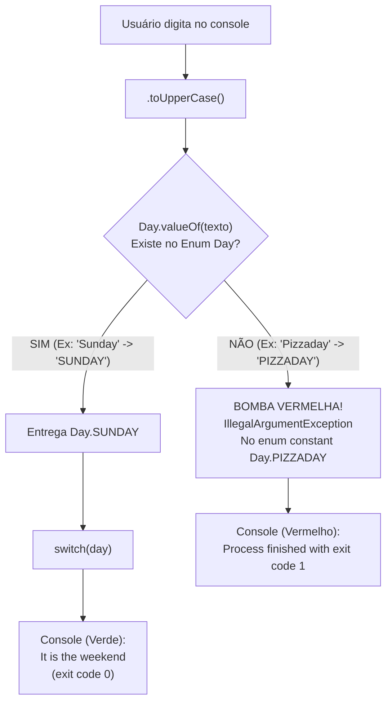

# Curso de Java — Bro Code (12 Horas)
## Capítulo 68: `enums 📅` (Parte 6 — Teste de Fim de Semana com `Sunday` e a Exceção Fatal com `Pizzaday`)

---

> [!NOTE]
> **Contexto para o Google Docs**: Este documento contém a reconstituição textual completa das **2 telas** exibidas pelo instrutor Bro Code no vídeo (entre os minutos **11:10:15** e **11:10:21** de 12:00:00). Você não precisa das imagens originais: todos os painéis do IntelliJ IDEA, códigos, digitações no console, a saída de sucesso verde e a tela vermelha de erro fatal (*Stack Trace*) foram reconstituídos em blocos de texto fiéis para o seu documento.

---

## 1. Reconstituição Textual das Telas do Vídeo (Google Docs Ready)

### Tela 1: Testando o Fim de Semana com Entrada Válida (`Sunday`) (Timestamp ~11:10:15)
```text
+--------------------------------------------------------------------------------------------------+
|  Run / Execution Window (Console do IntelliJ)                                 Timestamp ~11:10:15|
+--------------------------------------------------------------------------------------------------+
|  C:\Users\HP\.jdks\openjdk-23\bin\java.exe ... Main                                              |
|                                                                                                  |
|  Enter a day of the week: Sunday                                                                 |
|  It is the weekend                                                                               |
|                                                                                                  |
|  Process finished with exit code 0                                                               |
+--------------------------------------------------------------------------------------------------+
| O autor roda o programa novamente para testar a segunda rota do switch.                          |
| Digita "Sunday" (com S maiúsculo). O programa converte para "SUNDAY", encontra Day.SUNDAY        |
| e imprime no console em verde: "It is the weekend" (exit code 0 = sucesso total!).               |
+--------------------------------------------------------------------------------------------------+
```

---

### Tela 2: O Teste da Palavra Inexistente (`Pizzaday`) e a Explosão Vermelha! (Timestamp: 11:10:21)
```text
+--------------------------------------------------------------------------------------------------+
|  Run / Execution Window - Erro Fatal no Console                               Timestamp 11:10:21 |
+--------------------------------------------------------------------------------------------------+
|  C:\Users\HP\.jdks\openjdk-23\bin\java.exe ... Main                                              |
|                                                                                                  |
|  Enter a day of the week: Pizzaday                                                               |
|  Exception in thread "main" java.lang.IllegalArgumentException: No enum constant Day.PIZZADAY   |
|      at java.base/java.lang.Enum.valueOf(Enum.java:293)                                          |
|      at Day.valueOf(Day.java:1)                                                                  |
|      at Main.main(Main.java:10)                                                                  |
|                                                                                                  |
|  Process finished with exit code 1                                                               |
+--------------------------------------------------------------------------------------------------+
| O autor testa o que acontece quando alguém digita uma fruta ou comida em vez de um dia válido:   |
| Digitou "Pizzaday" (Dia da Pizza).                                                               |
| O programa EXPLODE com uma mensagem vermelha: java.lang.IllegalArgumentException!                |
| O programa foi abortado com código de erro 1 (exit code 1).                                      |
+--------------------------------------------------------------------------------------------------+
```

---

## 2. O Código do Arquivo [`Main.java`](../../../src/main/java/com/mickaelgeronimo/mastery/core/concurrency/Main.java)

Aqui está o código exato que executou ambos os testes:

```java
import java.util.Scanner;

public class Main {
    public static void main(String[] args) {

        Scanner scanner = new Scanner(System.in);
        System.out.print("Enter a day of the week: ");
        String response = scanner.nextLine().toUpperCase();

        Day day = Day.valueOf(response);

        switch(day){
            case MONDAY,
                 TUESDAY,
                 WEDNESDAY,
                 THURSDAY,
                 FRIDAY -> System.out.println("It is a weekday");
            case SATURDAY, SUNDAY -> System.out.println("It is the weekend");
        }

        scanner.close();

    }
}
```

---

## 3. Explicação Linha por Linha ("Como se fosse um iniciante amador leigo")

Abaixo, cada linha é explicada com base no que acontece nos bastidores em cada um dos dois testes:

### Linha 1: `import java.util.Scanner;`
- **O que faz**: Traz o leitor de teclado para o arquivo.
- **Saída no Console**: Nenhuma.

### Linha 6: `Scanner scanner = new Scanner(System.in);`
- **O que faz**: Prepara a captura do teclado.
- **Saída no Console**: Nenhuma.

### Linha 7: `System.out.print("Enter a day of the week: ");`
- **O que faz**: Imprime a frase na tela e mantém o cursor piscando ao lado do espaço.
- **O que sai no console**:
  ```text
  Enter a day of the week: _
  ```

---

### Linha 8: `String response = scanner.nextLine().toUpperCase();`

#### No Teste 1 (Tela 1):
- O usuário digita: `Sunday`
- O método `.toUpperCase()` converte para: `"SUNDAY"`
- A variável `response` recebe: `"SUNDAY"`

#### No Teste 2 (Tela 2):
- O usuário digita com deboche: `Pizzaday`
- O método `.toUpperCase()` converte para: `"PIZZADAY"`
- A variável `response` recebe: `"PIZZADAY"`

---

### Linha 10: `Day day = Day.valueOf(response);`
**AQUI ACONTECE A DIFERENÇA ENTRE O CÉU E O INFERNO!**

#### O que aconteceu no Teste 1 (`"SUNDAY"`):
1. O método `Day.valueOf("SUNDAY")` vai até o arquivo `Day.java`.
2. Procura pela constante `SUNDAY`.
3. **Achou!** Devolve o objeto `Day.SUNDAY`.
4. A variável `day` recebe `Day.SUNDAY` e o programa continua normalmente para o `switch`!

#### O que aconteceu no Teste 2 (`"PIZZADAY"`):
1. O método `Day.valueOf("PIZZADAY")` vai até o arquivo `Day.java`.
2. A lista de constantes cadastradas é:
   `[SUNDAY, MONDAY, TUESDAY, WEDNESDAY, THURSDAY, FRIDAY, SATURDAY]`
3. Ele procura por `PIZZADAY`.
4. **NÃO EXISTE!**
5. O Java não inventa um dia novo e não devolve `null`. Ele **para a execução imediatamente** e joga uma bomba vermelha chamada **`IllegalArgumentException`**!
6. O programa morre na hora! A linha 12 (o `switch`) nem chega a ser executada!

---

### Linhas 12 a 19: O `switch(day)` (Apenas no Teste 1)
```java
switch(day){
    case MONDAY, TUESDAY, WEDNESDAY, THURSDAY, FRIDAY -> System.out.println("It is a weekday");
    case SATURDAY, SUNDAY -> System.out.println("It is the weekend");
}
```
- No Teste 1, como `day` era `Day.SUNDAY`, caiu no segundo caso e imprimiu:
  ```text
  It is the weekend
  ```

---

### Linha 21: `scanner.close();`
- Fecha o scanner. No Teste 1 ela foi executada; no Teste 2 ela nunca foi atingida porque o programa quebrou na linha 10.

---

## 4. Como Ler o Erro Vermelho do Java (*Stack Trace*) Sem Medo

Quando os iniciantes veem letras vermelhas no console, muitos entram em pânico. Mas o Java está apenas sendo o seu melhor amigo e te dizendo exatamente o que deu errado e onde consertar:

```text
Exception in thread "main" java.lang.IllegalArgumentException: No enum constant Day.PIZZADAY
    at java.base/java.lang.Enum.valueOf(Enum.java:293)
    at Day.valueOf(Day.java:1)
    at Main.main(Main.java:10)
```

Vamos dissecar frase por frase:

1. **`Exception in thread "main"`**:
   - Significa: *"Aconteceu uma falha inesperada na linha principal do seu programa!"*.
2. **`java.lang.IllegalArgumentException`**:
   - É o nome científico do erro. Significa **"Exceção de Argumento Ilegal"**.
   - Em português claro: *"Você passou um dado que não faz sentido nenhum para este método!"*.
3. **`No enum constant Day.PIZZADAY`**:
   - É a explicação exata: *"Não existe nenhuma constante no Enum Day chamada PIZZADAY!"*.
4. **`at Main.main(Main.java:10)`**:
   - **Aqui está o endereço do culpado!** O Java está dizendo: *"O erro explodiu exatamente na Linha 10 do seu arquivo `Main.java`"*.
   - Se você clicar no texto azul `Main.java:10` no IntelliJ, ele te leva direto para a linha do `Day.valueOf(response)`!

---

## 5. A Grande Lição: Por que o Java Quebrou em Vez de Ignorar?

Você pode se perguntar:
> *"Poxa, por que o Java não simplesmente ignorou o `Pizzaday` e seguiu a vida?"*

### A Resposta de Engenharia de Software:
**Isso é uma funcionalidade de segurança, e não um defeito!**
Imagine que você está programando o sistema de um banco ou de um hospital. Se um usuário digitar um dado falso ou corrompido, o pior erro que um sistema pode cometer é fingir que entendeu e continuar fazendo cálculos com dados falsos!

O `Enum` garante que **SE NÃO FOR UM DOS 7 DIAS VÁLIDOS, NADA CONTINUA**.

---

## 6. Como os Programadores Profissionais Blindam Esse Código? (Dica Extra: `try / catch`)

No mundo real, quando sabemos que o usuário pode digitar qualquer bobagem no teclado, nós usamos um bloco de proteção chamado **`try / catch`** (Tente / Capture):

```java
try {
    Day day = Day.valueOf(response);
    
    switch(day){
        case MONDAY, TUESDAY, WEDNESDAY, THURSDAY, FRIDAY -> System.out.println("It is a weekday");
        case SATURDAY, SUNDAY -> System.out.println("It is the weekend");
    }
} 
catch (IllegalArgumentException e) {
    System.out.println("Ops! '" + response + "' não é um dia da semana válido!");
}
```

Se o usuário digitar `Pizzaday`:
- O Java não explode em vermelho!
- O bloco `catch` captura o erro e imprime educadamente:
  `Ops! 'PIZZADAY' não é um dia da semana válido!`
- O programa termina com código 0 (sucesso)!

---

## 7. Tabela Comparativa dos Dois Testes

| Item de Comparação | Teste 1 (Tela 1) | Teste 2 (Tela 2) |
| :--- | :--- | :--- |
| **O que o usuário digitou** | `Sunday` | `Pizzaday` |
| **Após `.toUpperCase()`** | `"SUNDAY"` | `"PIZZADAY"` |
| **Existe no Enum `Day`?** | **SIM** | **NÃO** |
| **Comportamento da Linha 10** | Retorna `Day.SUNDAY` com sucesso | Dispara `IllegalArgumentException` |
| **O `switch` executou?** | Sim, caiu no fim de semana | Não, o programa abortou antes |
| **O que saiu no Console?** | `It is the weekend` | Mensagem de erro vermelha (*Stack Trace*) |
| **Código de Saída (*Exit Code*)**| `Process finished with exit code 0` | `Process finished with exit code 1` |

---

## 8. Diagrama Visual: Os Dois Destinos de uma Entrada de Usuário



---

## 9. Checklist de Fixação Mental para Iniciantes

1. **O que saiu no console ao digitar `Sunday`?** Saiu `It is the weekend`, confirmando que domingo cai na regra do fim de semana.
2. **O que significa `exit code 0`?** Significa que o programa rodou do início ao fim com zero erros.
3. **O que saiu no console ao digitar `Pizzaday`?** Saiu a exceção vermelha `java.lang.IllegalArgumentException`.
4. **O que significa `exit code 1`?** Significa que o programa quebrou e encerrou forçadamente antes de terminar.
5. **Por que o método `valueOf()` quebrou com `Pizzaday`?** Porque o Enum só aceita as 7 constantes pré-definidas no arquivo `Day.java`.
6. **Onde o programa morreu?** Na linha 10 (`Day.valueOf(response)`).
