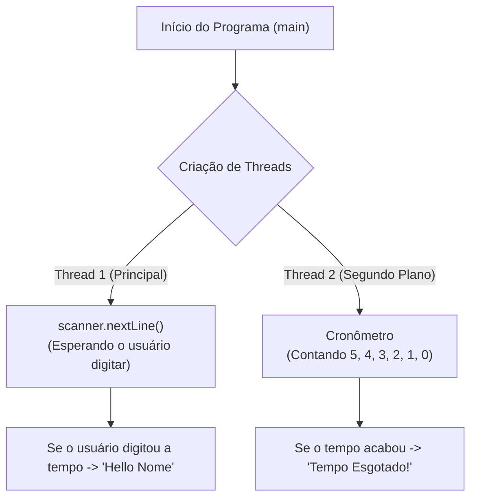

# Curso de Java — Bro Code (12 Horas)
## Capítulo 69: `threading 🧵` (Parte 1 — O Conceito de Threads, os 2 Modos de Criação e o Desafio do Cronômetro)

---

> [!NOTE]
> **Contexto para o seu Google Docs**: Este documento contém a reconstituição textual completa das **4 telas** exibidas pelo instrutor Bro Code no início do **Capítulo 69** (entre os minutos **11:12:46** e **11:15:13** de 12:00:00).
> Você pode copiar e colar este material diretamente no seu **Google Docs**: os comentários de teoria, o código motivador no IntelliJ IDEA, os cliques do instrutor e as mensagens no console foram desenhados em formato de texto para que seu estudo seja 100% autônomo sem precisar das imagens originais.

---

## 1. O Que é uma Thread? (História e Analogia para Iniciantes)

Imagine que você está em casa preparando o almoço:

### Cenário 1: O Cozinheiro Solitário (Single-Thread / Linha Única)
* Você coloca uma panela com água no fogão para ferver o macarrão.
* Como você só consegue fazer **uma única tarefa por vez**, você cruza os braços e fica 10 minutos olhando fixamente para a água até ela ferver.
* Enquanto você espera, você **não corta a cebola**, **não faz o molho**, **não atende a campainha** e **não põe a mesa**.
* Toda a sua cozinha fica **completamente congelada** esperando uma única coisa terminar!
* **Isso é o que fizemos em Java até hoje!** Todos os nossos programas tinham apenas um "cozinheiro" chamado `main`. Se o programa encontrava uma linha que demorava (como esperar o usuário digitar algo no teclado), ele travava tudo e ficava congelado até a linha terminar.

---

### Cenário 2: A Cozinha com Vários Cozinheiros (Multi-Threading / Múltiplas Linhas)
* Agora você tem ajudantes na cozinha!
* Enquanto a panela de água ferve no fogão, outro ajudante corta o tomate, outro tempera o molho e outro arruma a mesa ao mesmo tempo!
* Várias tarefas acontecem **simultaneamente** (*em paralelo*). A cozinha rende muito mais, ninguém fica parado à toa e a comida fica pronta na metade do tempo!
* **Isso é Threading em Java!**

### De Onde Vem a Palavra "Thread"?
* Em inglês, a palavra *thread* (pronuncia-se *"thred"*) significa **"fio"** (como um fio de linha de costura).
* No computador, uma *thread* é um **"fio de execução"**: um caminho contínuo por onde as ordens do programa vão sendo costuradas e executadas, uma após a outra.
* Um programa comum tem apenas **um fio**. Um programa com *Multi-threading* tem **vários fios correndo juntos lado a lado**!

---

## 2. Reconstituição Textual das 4 Telas do Vídeo (Google Docs Ready)

---

### Tela 1: Os Comentários de Teoria no Editor (Timestamp: 11:12:46)

O autor abre o novo capítulo `69.threading` e digita a definição oficial e os dois jeitos de criar Threads em Java:

```text
+--------------------------------------------------------------------------------------------------+
|  IntelliJ IDEA - MyFirstProject [Main.java]                                   Timestamp 11:12:46 |
+--------------------------------------------------------------------------------------------------+
|  1  public class Main {                                                                          |
|  2      public static void main(String[] args) {                                                 |
|  3                                                                                               |
|  4                                                                                               |
|  5 👉       //| Threading = Allows a program to run multiple tasks simultaneously                |
|  6          //              Helps improve performance with time-consuming operations             |
|  7          //              (File I/O, network communications, or any background tasks)          |
|  8                                                                                               |
|  9          // How to create a Thread                                                            |
| 10          // Option 1. Extend the Thread class (simpler)                                       |
| 11          // Option 2. Implement the Runnable interface (better)                               |
| 12                                                                                               |
| 13      }                                                                                        |
| 14  }                                                                                            |
+--------------------------------------------------------------------------------------------------+
| CURSOR DO AUTOR: Piscando na linha 5 logo após as barras de comentário '//'.                     |
| O autor prepara a mente dos alunos com as duas grandes opções da indústria Java.                 |
+--------------------------------------------------------------------------------------------------+
```

---

### Tela 2: A Visão Geral do Início do Capítulo 69 (Timestamp: 11:12:46)

O player do YouTube marca o início exato da nova seção na barra de progresso:

```text
+--------------------------------------------------------------------------------------------------+
|  YouTube Player - Java Full Course (Bro Code)                                 Timestamp 11:12:46 |
+--------------------------------------------------------------------------------------------------+
|  [▶] 11:12:46 / 12:00:00   |   Capítulo Atual: 69.threading >                                    |
+--------------------------------------------------------------------------------------------------+
| O autor inicia a explicação de concorrência e tarefas em segundo plano em Java.                  |
+--------------------------------------------------------------------------------------------------+
```

---

### Tela 3: O Código Motivador com o Desafio do Nome (Timestamp: 11:15:03)

O autor apaga os comentários e escreve um pequeno programa interativo com `Scanner`. O ponteiro do mouse clica no botão verde Play no topo:

```text
+--------------------------------------------------------------------------------------------------+
|  IntelliJ IDEA - MyFirstProject [Main.java]                                   Timestamp 11:15:03 |
+--------------------------------------------------------------------------------------------------+
|  1  import java.util.Scanner;                                                                    |
|  2                                                                                               |
|  3  public class Main {                                                                          |
|  4      public static void main(String[] args) {                                                 |
|  5                                                                                               |
|  6          Scanner scanner = new Scanner(System.in);                                            |
|  7                                                                                               |
|  8          System.out.println("You have 5 seconds to enter your name");                         |
|  9          System.out.print("Enter your name: ");                                               |
| 10          String name = scanner.nextLine();                                                    |
| 11          System.out.println("Hello " + name);                                                 |
| 12                                                                                               |
| 13          scanner.close();                                                                     |
| 14      }                                                                                        |
| 15  }                                                                                            |
+--------------------------------------------------------------------------------------------------+
| BOTÃO PLAY: No canto superior direito, o mouse clica no ícone verde ▶ para rodar o programa!      |
+--------------------------------------------------------------------------------------------------+
```

---

### Tela 4: A Execução no Console e a Descoberta da Falha (Timestamp: 11:15:13)

O programa roda no terminal, o autor digita `"Bro"` e o programa responde:

```text
+--------------------------------------------------------------------------------------------------+
|  IntelliJ IDEA - Console de Execução (Run > Main)                             Timestamp 11:15:13 |
+--------------------------------------------------------------------------------------------------+
|  C:\Users\HP\.jdks\openjdk-23\bin\java.exe "-javaagent:C:\Program Files\JetBrains\IntelliJ...   |
|                                                                                                  |
|  You have 5 seconds to enter your name                                                           |
|  Enter your name: Bro                                                                            |
|  Hello Bro                                                                                       |
|                                                                                                  |
|  Process finished with exit code 0                                                               |
+--------------------------------------------------------------------------------------------------+
| A GRANDE CHARADA DO BRO CODE:                                                                    |
| O programa disse: "Você tem 5 segundos para digitar seu nome".                                   |
| Mas o que acontece se o usuário demorar 10 minutos para digitar? NADA! O programa fica parado     |
| esperando para sempre! Não há nenhum cronômetro de verdade rodando! Por que?                     |
| Porque o programa só tem UMA ÚNICA THREAD! Precisamos de Threading para criar o timer real!     |
+--------------------------------------------------------------------------------------------------+
```

---

## 3. Dissecando a Teoria do Bro Code (Os Comentários das Linhas 5 a 11)

Vamos ler cada frase que o autor escreveu e entender profundamente o significado técnico de cada uma:

```text
// Threading = Allows a program to run multiple tasks simultaneously
//             Helps improve performance with time-consuming operations
//             (File I/O, network communications, or any background tasks)
```

### 1. "Allows a program to run multiple tasks simultaneously"
* **Tradução**: *Permite que um programa execute múltiplas tarefas simultaneamente.*
* **O que significa**: O computador moderno tem vários núcleos de processamento (Quad-Core, Octa-Core). Usar threads permite que você dê trabalho para diferentes núcleos ao mesmo tempo, fazendo duas ou mais coisas acontecerem no exato mesmo segundo.

---

### 2. "Helps improve performance with time-consuming operations"
* **Tradução**: *Ajuda a melhorar o desempenho com operações que consomem muito tempo.*
* **O que são essas operações lentas?**
  1. **File I/O (Entrada e Saída de Arquivos)**: Ler um arquivo de 5 Gigabytes do disco rígido é lento. Se você fizer isso na thread principal, o aplicativo inteiro congela e aparece a mensagem *"O aplicativo não está respondendo"*. Se você fizer isso em uma thread separada, a barra de progresso continua se mexendo lisinha!
  2. **Network communications (Comunicação de Rede / Internet)**: Baixar uma foto de um servidor, consultar uma API ou carregar um vídeo na web. A internet pode oscilar ou demorar segundos. Uma thread secundária cuida do download enquanto o usuário continua navegando na tela sem travamento.
  3. **Background tasks (Tarefas em Segundo Plano)**: Salvar automaticamente o documento a cada 1 minuto (como o Google Docs faz), tocar música de fundo em um jogo ou verificar se há notificações novas.

---

### 3. As 2 Opções de Criar uma Thread em Java

O autor anotou:
```text
// How to create a Thread
// Option 1. Extend the Thread class (simpler)
// Option 2. Implement the Runnable interface (better)
```

| Opção | Como Funciona | Vantagens | Desvantagens | Por Que a Opção 2 é Melhor? |
| :--- | :--- | :--- | :--- | :--- |
| **Opção 1:<br>`Extend Thread`** | `class MeuTimer extends Thread` | É mais simples e direto de escrever para iniciantes. | O Java **não permite herança múltipla**! Se sua classe já herda de `Thread`, ela nunca mais poderá herdar de nenhuma outra classe (`extends Animal`, `extends Janela`...). | Fica "presa" na herança de `Thread`. |
| **Opção 2:<br>`Implement Runnable`** | `class MeuTimer implements Runnable` | **É o padrão profissional da indústria!** Muito mais flexível. Uma classe pode implementar `Runnable` e continuar livre para herdar qualquer outra classe que precisar! | Exige um passo a mais: criar um objeto `new Thread(meuRunnable)` para dar a partida. | **Altamente recomendada**, pois separa a tarefa (*Runnable*) do motor que a executa (*Thread*). |

---

## 4. O Código Atual do Nosso Projeto (`Main.java`)

```java
import java.util.Scanner;

public class Main {
    public static void main(String[] args) {

        Scanner scanner = new Scanner(System.in);

        System.out.println("You have 5 seconds to enter your name");
        System.out.print("Enter your name: ");
        String name = scanner.nextLine();
        System.out.println("Hello " + name);

        scanner.close();
    }
}
```

---

## 5. Explicação Linha por Linha de `Main.java` (com Numeração e Saída do Console)

Vamos passear por cada linha do código que o autor executou no console:

### Linha 1: `import java.util.Scanner;`
* **O que faz**: Traz a classe `Scanner` do pacote utilitário do Java para podermos ler o teclado.
* **O que sai no console**: Nada.

### Linha 3: `public class Main {`
* **O que faz**: Abre a nossa classe principal `Main`.
* **O que sai no console**: Nada.

### Linha 4: `public static void main(String[] args) {`
* **O que faz**: É a porta de entrada. É aqui que o Java cria a **Thread Principal** (conhecida como **`main thread`**). Todas as linhas de código que escrevemos aqui dentro serão executadas sequencialmente por essa única thread.
* **O que sai no console**: Nada.

### Linha 6: `Scanner scanner = new Scanner(System.in);`
* **O que faz**: Cria o objeto `scanner` apontado para o teclado (`System.in`).
* **O que sai no console**: Nada.

### Linha 8: `System.out.println("You have 5 seconds to enter your name");`
* **O que faz**: Imprime uma linha avisando ao usuário que ele tem 5 segundos para digitar o nome.
* **O que sai no console**:
  ```text
  You have 5 seconds to enter your name
  ```

### Linha 9: `System.out.print("Enter your name: ");`
* **O que faz**: Imprime o pedido `"Enter your name: "` na mesma linha (sem pular linha), deixando o cursor piscando ao lado do texto.
* **O que sai no console**:
  ```text
  Enter your name: 
  ```

### Linha 10: `String name = scanner.nextLine();` (A Linha do Congelamento!)
* **O que faz**: Esta linha chama o método `scanner.nextLine()`.
  * **O que acontece por trás dos panos?** Esse método é conhecido tecnicamente como um **método bloqueante** (*blocking operation*).
  * A thread `main` é colocada para **dormir** pelo sistema operacional até que o usuário pressione a tecla `[Enter]`.
  * **O Grande Problema**: Enquanto o usuário não aperta Enter, a thread principal NÃO PODE avançar nem fazer nenhuma outra tarefa! Ela não tem como rodar um relógio nem contar 5, 4, 3, 2, 1!
* **O que sai no console**: Mostra as letras que o usuário digita (no teste do vídeo: `Bro`).

### Linha 11: `System.out.println("Hello " + name);`
* **O que faz**: Pega o nome guardado e imprime uma saudação na tela.
* **O que sai no console**:
  ```text
  Hello Bro
  ```

### Linha 13: `scanner.close();`
* **O que faz**: Fecha o leitor de teclado e devolve a posse dele ao sistema operacional.
* **O que sai no console**: Nada.

### Linhas 14 e 15: `}` e `}`
* **O que fazem**: Fecham o método `main` e a classe `Main`. O programa termina de forma limpa.
* **O que sai no console**: `Process finished with exit code 0`.

---

## 6. Por Que Esse Código Revela a Necessidade de Threads?

Observe com muita atenção o que aconteceu:

```text
====================================================================================================
O QUE O PROGRAMA PROMETEU                      | O QUE O PROGRAMA REALMENTE FEZ
====================================================================================================
"You have 5 seconds to enter your name"        | O programa ficou congelado na linha scanner.nextLine()
(Você tem 5 segundos para digitar o nome)      | esperando o usuário pelo tempo que ele quisesse!
                                               |
                                               | Se você for almoçar e voltar daqui a 2 horas,
                                               | o programa continuará lá, parado na mesma linha!
====================================================================================================
```

### O Desafio que Vamos Resolver nas Próximas Aulas:
Para que o aviso dos 5 segundos funcione de verdade, nós precisamos de **DUAS THREADS trabalhando ao mesmo tempo**:



1. **Thread 1 (A Esperançosa)**: Fica aguardando o usuário digitar o nome no `scanner.nextLine()`.
2. **Thread 2 (O Cronômetro Implacável)**: Roda em segundo plano contando `5, 4, 3, 2, 1, 0`. Se o tempo acabar antes de o usuário apertar Enter, ela cancela tudo e avisa que o tempo esgotou!

---

## 7. Resumo Prático para o Aluno Iniciante

1. **Thread única é linear**: Uma instrução só roda depois que a anterior terminar completamente.
2. **Métodos bloqueantes congelam a thread**: `scanner.nextLine()`, ler arquivos grandes ou esperar a internet travam a thread até receberem os dados.
3. **Multi-threading é a solução**: Permite que uma thread continue cuidando do usuário enquanto outra faz o trabalho pesado ou cronometra o tempo em segundo plano.
4. **Duas formas no horizonte**:
   - `class MinhaThread extends Thread` (Opção 1 - mais simples).
   - `class MinhaThread implements Runnable` (Opção 2 - a preferida dos profissionais).
