# Java Full Course — Bro Code
## Capítulo 69: `threading 🧵` (Parte 5: Daemon Threads com `thread.setDaemon(true)` e Timer de 10 Segundos)

---

### Metadados da Aula
- **Curso:** Java Full Course (Bro Code)
- **Capítulo:** 69 — `threading 🧵`
- **Parte:** 5 de 5 (Daemon Threads, Encerramento Limpo da JVM e Timer de 10s)
- **Timestamp de Referência:** `11:20:06` até `11:21:20`
- **Arquivos do Projeto:**
  - [`MyRunnable.java`](../../../src/main/java/com/mickaelgeronimo/mastery/core/concurrency/MyRunnable.java)
  - [`Main.java`](../../../src/main/java/com/mickaelgeronimo/mastery/core/concurrency/Main.java)

---

### 1. Reconstituição Textual Completa das Telas do Vídeo (Para o Google Docs)

Como você irá copiar este material para o Google Docs sem as capturas visuais, abaixo está a descrição exata de cada tela apresentada pelo Bro Code no vídeo:

```text
========================================================================================
TELA 1 (11:20:06) — O PROBLEMA DA PARTE ANTERIOR RELEMBRADO PELO BRO CODE
========================================================================================
Bro Code mostra a execução anterior no terminal:
    You have 5 seconds to enter your name
    Enter your name: Bro
    Hello Bro
    Time's up!

Bro Code explica a falha de lógica na experiência do usuário:
"O usuário digitou o nome em 2 segundos e recebeu 'Hello Bro'. Porém, 3 segundos depois,
o console imprimiu 'Time's up!'. Por quê? Porque criamos uma Thread de Usuário comum!
A JVM (Java Virtual Machine) é teimosa: enquanto existir UMA thread de usuário viva,
o programa NÃO FECHA, esperando o loop do timer terminar até o fim."

========================================================================================
TELA 2 — MODIFICANDO MyRunnable.java PARA 10 SEGUNDOS
========================================================================================
Bro Code abre MyRunnable.java e altera o loop de contagem de 5 para 10 segundos:
- Troca: for(int i = 1; i <= 5; i++)  --->  for(int i = 1; i <= 10; i++)
- Troca: if(i == 5)                   --->  if(i == 10)

Código visível em MyRunnable.java:
    public class MyRunnable implements Runnable{
        @Override
        public void run(){
            for(int i = 1; i <= 10; i++){
                try{
                    Thread.sleep(1000);
                }
                catch(InterruptedException e){
                    System.out.println("Thread was interrupted");
                }
                if(i == 10){
                    System.out.println("Time's up!");
                }
            }
        }
    }

========================================================================================
TELA 3 (11:20:06) — RETORNO AO ARQUIVO Main.java
========================================================================================
Bro Code volta para a aba Main.java para configurar a nova propriedade da Thread.
Ele identifica a linha onde a Thread é criada e onde ela é iniciada.

========================================================================================
TELA 4 (11:21:06) — ADIÇÃO DE thread.setDaemon(true) E AJUSTE DA MENSAGEM
========================================================================================
Bro Code adiciona exatamente uma linha antes de `thread.start()`:
    thread.setDaemon(true);

E atualiza a mensagem exibida na tela:
    System.out.println("You have 10 seconds to enter your name");

Código em Main.java:
    Scanner scanner = new Scanner(System.in);

    MyRunnable myRunnable = new MyRunnable();
    Thread thread = new Thread(myRunnable);
    thread.setDaemon(true);
    thread.start();

    System.out.println("You have 10 seconds to enter your name");
    System.out.print("Enter your name: ");
    String name = scanner.nextLine();
    System.out.println("Hello " + name);

    scanner.close();

========================================================================================
TELA 5 (11:21:20) — TESTE NO TERMINAL COM A DAEMON THREAD
========================================================================================
Bro Code roda o programa:
Terminal exibe:
    You have 10 seconds to enter your name
    Enter your name: B...

Ele digita o nome rapidamente e pressiona Enter.
Resultado no console:
    You have 10 seconds to enter your name
    Enter your name: Bro
    Hello Bro

E o programa TERMINA IMEDIATAMENTE! A mensagem "Time's up!" NUNCA APARECE!
O problema foi solucionado com sucesso absoluto!
========================================================================================
```

---

### 2. O Grande Conceito: O Que é uma Daemon Thread?

Para entender perfeitamente sem decoreba, imagine a seguinte analogia da vida real:

#### A Analogia da Boate / Balada:
- **Thread Normal (User Thread - VIP):** Pense na thread `main` como o cliente VIP da festa. Enquanto houver um cliente na balada, a casa noturna precisa ficar aberta, as luzes acesas e a música tocando. A JVM é o gerente que diz: *"Não fecho as portas enquanto houver clientes aqui dentro!"*
- **Daemon Thread (O Faxineiro / DJ de Fundo):** Uma Daemon Thread é uma funcionária de suporte da casa. Ela só trabalha enquanto houver clientes lá dentro. No segundo exato em que o último cliente VIP (a thread `main`) vai embora e passa pela porta de saída, o gerente desliga o disjuntor geral imediatamente. Ninguém espera o faxineiro terminar de varrer! Ele é mandado embora na hora.

> [!IMPORTANT]
> **Diferença Crucial no Java:**
> 1. **User Thread (Padrão):** Mantém a JVM viva. A JVM só desliga quando **todas** as User Threads terminarem seu trabalho.
> 2. **Daemon Thread (`setDaemon(true)`):** Thread de segundo plano / suporte. A JVM **não** espera por ela! Se todas as User Threads acabarem, a JVM é finalizada imediatamente e destrói todas as Daemons que ainda estiverem rodando.
>
> Exemplos nativos do Java de Daemon Threads: o **Garbage Collector** (coletor de lixo da memória). Quando seu programa termina, o Java não fica rodando para sempre limpando lixo; ele encerra tudo.

#### A Regra de Ouro do `setDaemon()`:
> [!CAUTION]
> Você **DEVE** chamar `thread.setDaemon(true)` **ANTES** de chamar `thread.start()`.
> Se você tentar chamar `setDaemon(true)` depois que a thread já iniciou com `start()`, o Java lançará a exceção fatal:
> `java.lang.IllegalThreadStateException`.

---

### 3. Códigos-Fonte Completos e Atualizados

#### Arquivo: `MyRunnable.java`
```java
public class MyRunnable implements Runnable{

    @Override
    public void run(){
        for(int i = 1; i <= 10; i++){

            try{
                Thread.sleep(1000);
            }
            catch(InterruptedException e){
                System.out.println("Thread was interrupted");
            }

            if(i == 10){
                System.out.println("Time's up!");
            }
        }
    }
}
```

#### Arquivo: `Main.java`
```java
import java.util.Scanner;

public class Main {
    public static void main(String[] args) {

        Scanner scanner = new Scanner(System.in);

        MyRunnable myRunnable = new MyRunnable();
        Thread thread = new Thread(myRunnable);
        thread.setDaemon(true);
        thread.start();

        System.out.println("You have 10 seconds to enter your name");
        System.out.print("Enter your name: ");
        String name = scanner.nextLine();
        System.out.println("Hello " + name);

        scanner.close();
    }
}
```

---

### 4. Análise Linha por Linha Numerada — `MyRunnable.java`

```java
1: public class MyRunnable implements Runnable{
2: 
3:     @Override
4:     public void run(){
5:         for(int i = 1; i <= 10; i++){
6: 
7:             try{
8:                 Thread.sleep(1000);
9:             }
10:             catch(InterruptedException e){
11:                 System.out.println("Thread was interrupted");
12:             }
13: 
14:             if(i == 10){
15:                 System.out.println("Time's up!");
16:             }
17:         }
18:     }
19: }
```

- **Linha 1 (`public class MyRunnable implements Runnable{`):** Declara a classe pública `MyRunnable` que assina o contrato da interface `Runnable`. Isso diz ao Java: *"Esta classe possui uma missão que pode ser executada por uma thread paralela"*. Não imprime nada no console.
- **Linha 2 (` `):** Linha em branco para clareza visual.
- **Linha 3 (`@Override`):** Anotação que avisa o compilador que estamos substituindo obrigatoriamente o método `run()` previsto na interface `Runnable`.
- **Linha 4 (`public void run(){`):** Início do método que contém as instruções que a thread secundária irá rodar.
- **Linha 5 (`for(int i = 1; i <= 10; i++){`):** Loop `for` configurado para contar de 1 até 10 (10 ciclos de 1 segundo cada). Antes eram 5 segundos, agora o Bro Code aumentou a margem para 10 segundos.
- **Linha 6 (` `):** Espaço em branco.
- **Linha 7 (`try{`):** Abre o bloco de proteção contra imprevistos durante o repouso da thread.
- **Linha 8 (`Thread.sleep(1000);`):** Faz a thread adormecer por 1000 milissegundos (exatamente 1 segundo) a cada volta do loop.
- **Linha 9 (`}`):** Fecha o bloco `try`.
- **Linha 10 (`catch(InterruptedException e){`):** Captura uma eventual interrupção caso outra parte do programa force a thread a acordar antes da hora.
- **Linha 11 (`System.out.println("Thread was interrupted");`):** Mensagem de segurança caso o sono seja interrompido (não é disparada em condições normais).
- **Linha 12 (`}`):** Fecha o bloco `catch`.
- **Linha 13 (` `):** Espaço em branco.
- **Linha 14 (`if(i == 10){`):** Condicional: verifica se o contador atingiu o décimo segundo (fim do tempo limite concedido).
- **Linha 15 (`System.out.println("Time's up!");`):** Se atingiu 10 segundos e o programa ainda estiver vivo, imprime a notificação `"Time's up!"` na tela.
- **Linha 16 (`}`):** Fecha a condicional `if`.
- **Linha 17 (`}`):** Fecha o laço `for`.
- **Linha 18 (`}`):** Fecha o método `run()`.
- **Linha 19 (`}`):** Fecha a classe `MyRunnable`.

---

### 5. Análise Linha por Linha Numerada — `Main.java`

```java
1: import java.util.Scanner;
2: 
3: public class Main {
4:     public static void main(String[] args) {
5: 
6:         Scanner scanner = new Scanner(System.in);
7: 
8:         MyRunnable myRunnable = new MyRunnable();
9:         Thread thread = new Thread(myRunnable);
10:         thread.setDaemon(true);
11:         thread.start();
12: 
13:         System.out.println("You have 10 seconds to enter your name");
14:         System.out.print("Enter your name: ");
15:         String name = scanner.nextLine();
16:         System.out.println("Hello " + name);
17: 
18:         scanner.close();
19:     }
20: }
```

- **Linha 1 (`import java.util.Scanner;`):** Importa o leitor de teclado do pacote utilitário do Java.
- **Linha 2 (` `):** Linha em branco.
- **Linha 3 (`public class Main {`):** Declara a classe principal onde o programa inicia.
- **Linha 4 (`public static void main(String[] args) {`):** O ponto de entrada padrão da aplicação executado pela thread principal (`main`).
- **Linha 5 (` `):** Linha em branco.
- **Linha 6 (`Scanner scanner = new Scanner(System.in);`):** Cria o objeto `scanner` vinculado à entrada padrão (`System.in`).
- **Linha 7 (` `):** Linha em branco.
- **Linha 8 (`MyRunnable myRunnable = new MyRunnable();`):** Instancia a tarefa de contagem (o "plano de trabalho").
- **Linha 9 (`Thread thread = new Thread(myRunnable);`):** Instancia o trabalhador (`Thread`) e entrega a tarefa `myRunnable` a ele.
- **Linha 10 (`thread.setDaemon(true);`):** **A LINHA CHAVE DA AULA!** Converte esta thread de trabalhadora principal para trabalhadora de suporte (Daemon). Isso dá uma ordem formal para a JVM: *"Não espere por essa thread! Quando o método `main` acabar, encerre a JVM e descarte essa thread imediatamente!"*.
- **Linha 11 (`thread.start();`):** Dispara a thread em paralelo. Ela começa a contar de 1 a 10 no plano de fundo.
- **Linha 12 (` `):** Linha em branco.
- **Linha 13 (`System.out.println("You have 10 seconds to enter your name");`):** Imprime no console a advertência de tempo com quebra de linha.
- **Linha 14 (`System.out.print("Enter your name: ");`):** Imprime o prompt solicitando a digitação, sem pular de linha para o cursor ficar ao lado.
- **Linha 15 (`String name = scanner.nextLine();`):** Pausa bloqueante da thread principal aguardando o usuário digitar o nome e teclar Enter. Enquanto o usuário digita, a daemon thread avança em paralelo.
- **Linha 16 (`System.out.println("Hello " + name);`):** Imprime a saudação com o nome fornecido.
- **Linha 17 (` `):** Linha em branco.
- **Linha 18 (`scanner.close();`):** Fecha o recurso do scanner liberando os fluxos do sistema.
- **Linha 19 (`}`):** Fecha o método `main`. Como `main` era a única User Thread ativa no programa, a JVM se encerra **na hora**, matando a thread daemon no meio do caminho!
- **Linha 20 (`}`):** Fecha a classe `Main`.

---

### 6. Comparativo Antes vs Depois de `thread.setDaemon(true)`

```mermaid
flowchart TD
    subgraph SemDaemon["ANTES: Thread Comum (User Thread)"]
        A1["main() inicia thread.start()"] --> B1["main pede nome e usuário digita rápido (2s)"]
        B1 --> C1["main imprime 'Hello Bro' e termina"]
        C1 --> D1["JVM olha ao redor: 'A thread do timer ainda está viva!'"]
        D1 --> E1["JVM fica presa esperando mais 8 segundos..."]
        E1 --> F1["Timer chega no 10 e imprime: 'Time's up!' (INCOERENTE!)"]
    end

    subgraph ComDaemon["DEPOIS: Daemon Thread (setDaemon(true))"]
        A2["main() define setDaemon(true) e start()"] --> B2["main pede nome e usuário digita rápido (2s)"]
        B2 --> C2["main imprime 'Hello Bro' e termina"]
        C2 --> D2["JVM olha ao redor: 'Não há mais nenhuma User Thread viva!'"]
        D2 --> E2["JVM desliga o disjuntor geral IMEDIATAMENTE!"]
        E2 --> F2["Daemon Thread é eliminada no segundo 2. 'Time's up!' NUNCA sai!"]
    end
```



---

### 7. O que Sai no Console em Cada Cenário de Teste

#### Cenário A: O Usuário é Ágil (Digita o nome em menos de 10 segundos)
Neste caso, a thread `main` finaliza enquanto a daemon thread ainda estava no segundo 2 ou 3. A JVM fecha e o timer é destruído antes de dar 10:

```text
You have 10 seconds to enter your name
Enter your name: Bro
Hello Bro
```
*(Repare: `Time's up!` **não** é impresso! Saída perfeita e profissional!)*

---

#### Cenário B: O Usuário Demora (Passou de 10 segundos sem digitar)
Neste caso, a thread `main` ainda está travada na linha 15 (`scanner.nextLine()`). Passam-se os 10 segundos e a daemon thread conclui seu loop e imprime o aviso na cara do usuário:

```text
You have 10 seconds to enter your name
Enter your name: Time's up!
Bro
Hello Bro
```
*(O usuário foi avisado que o tempo esgotou antes de conseguir digitar!)*

---

### 8. Resumo de Ouro para Fixação (Bro Code Insights)

1. **Por que usar `implements Runnable` em vez de `extends Thread`?**
   - Java suporta apenas herança única (`extends` de apenas uma classe). Ao implementar a interface `Runnable`, sua classe continua livre para herdar qualquer outra superclasse no futuro.
2. **Qual a função de `thread.start()`?**
   - Cria uma nova linha de execução no sistema operacional e chama o método `run()` em paralelo. Chamar `run()` diretamente executaria o código de forma síncrona/sequencial na mesma thread, congelando tudo!
3. **Qual a função de `thread.setDaemon(true)`?**
   - Transforma a thread em um processo de segundo plano descartável. A JVM encerra a aplicação assim que todas as threads não-daemons (as threads principais) finalizarem.
4. **Onde colocar `thread.setDaemon(true)`?**
   - **SEMPRE** antes de `thread.start()`. Chamar depois causará um erro fatal em tempo de execução (`IllegalThreadStateException`).
