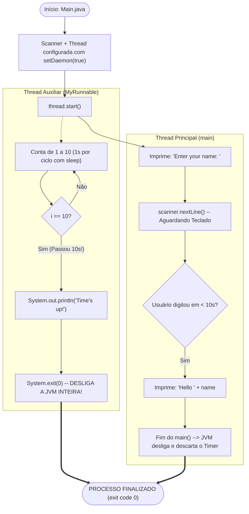

# Java Full Course — Bro Code
## Capítulo 69: `threading 🧵` (Parte 7 Final Definitiva: `System.exit(0)`, Encerramento Forçado da JVM e Resumo Teórico Oficial)

---

### Metadados da Aula
- **Curso:** Java Full Course (Bro Code)
- **Capítulo:** 69 — `threading 🧵`
- **Parte:** 7 de 7 (Conclusão Definitiva do Capítulo 69)
- **Timestamp de Referência:** `11:22:14` até `11:23:00`
- **Arquivos do Projeto:**
  - [`Main.java`](../../../src/main/java/com/mickaelgeronimo/mastery/core/concurrency/Main.java)
  - [`MyRunnable.java`](../../../src/main/java/com/mickaelgeronimo/mastery/core/concurrency/MyRunnable.java)

---

### 1. Reconstituição Textual Completa das Telas do Vídeo (Para o Google Docs)

Como você irá copiar este conteúdo diretamente para o seu Google Docs sem as capturas de tela visuais, aqui está a descrição exata de cada uma das 5 imagens apresentadas pelo Bro Code:

```text
========================================================================================
TELA 1 (11:22:14) — ADICIONANDO System.exit(0) EM MyRunnable.java
========================================================================================
No editor IntelliJ IDEA, o arquivo MyRunnable.java está aberto.
Dentro do método run(), na verificação do tempo limite if(i == 10), o Bro Code adiciona:
    if(i == 10){
        System.out.println("Time's up!");
        System.exit(0);  <-- [NOVA LINHA ADICIONADA AQUI]
    }

Explicação do Bro Code:
"Na aula anterior, o timer avisava 'Time's up!', mas o Scanner ainda deixava o usuário
digitar o nome porque uma thread não cancela a outra sozinha.
Para resolver isso de vez, chamamos System.exit(0)! Isso desliga a máquina virtual inteira
(JVM) no segundo exato em que o relógio bate 10 segundos, puxando a tomada do Scanner!"

========================================================================================
TELA 2 (11:22:17) — CLICANDO NO BOTÃO RUN EM Main.java
========================================================================================
Bro Code clica na aba Main.java.
No canto superior direito da janela do IntelliJ IDEA, ele clica no botão verde triangular
de "Play" (Run 'Main.main()') para rodar o código modificado.

========================================================================================
TELA 3 (~11:22:25) — O TIMER DE 10 SEGUNDOS DISPARA E MATA O PROGRAMA
========================================================================================
O terminal executa o programa. Bro Code NÃO encosta no teclado!
Após 10 segundos exatos de espera, o terminal exibe:
    You have 10 seconds to enter your name
    Enter your name: Time's up!

    Process finished with exit code 0

Repare no cursor: o programa NÃO espera mais pelo usuário!
Assim que "Time's up!" é impresso, o comando System.exit(0) é disparado imediatamente,
matando o processo e exibindo "Process finished with exit code 0".
O usuário perdeu a chance de digitar! O objetivo foi alcançado com perfeição!

========================================================================================
TELA 4 (11:22:34) — BRO CODE MOSTRA O TERMINAL FINALIZADO COM SUCESSO
========================================================================================
Bro Code foca a tela no terminal para que os alunos vejam com clareza:
- A linha de contagem exibiu o aviso de 10 segundos.
- O prompt "Enter your name: " foi interrompido por "Time's up!".
- O processo terminou limpo com exit code 0 sem erros e sem ficar congelado.

========================================================================================
TELA 5 (~11:22:50+) — COMENTÁRIOS DE TEORIA OFICIAL EM Main.java
========================================================================================
Bro Code volta ao topo de Main.java e escreve o resumo teórico oficial do capítulo
diretamente como comentários no início do método main():

    // Threading = Allows a program to run multiple tasks simultaneously
    //             Helps improve performance with time-consuming operations
    //             (File I/O, network communications, or any background tasks)

    // How to create a Thread
    // Option 1. Extend the Thread class (simpler)
    // Option 2. Implement the Runnable interface (better)

    Scanner scanner = new Scanner(System.in);
    ... (restante do código segue abaixo)
========================================================================================
```

---

### 2. O Que Significa `System.exit(0)`?

Para quem é iniciante leigo em Java, essa linha parece misteriosa, mas é simples:

#### A Analogia do Disjuntor Geral da Casa:
Imagine uma casa onde uma pessoa está no quarto lendo um livro (Thread `main` esperando no `scanner`), e outra pessoa está na cozinha cronometrando uma panela no forno (Thread auxiliar `MyRunnable`).
- Na aula passada, quem estava na cozinha apenas gritou: *"Deu o tempo!"*, mas quem estava no quarto continuou lendo o livro normalmente.
- Agora, a pessoa da cozinha não apenas grita *"Time's up!"*, ela vai direto até a caixa de energia da casa e **desliga a chave geral no disjuntor (`System.exit(0)`)**!
- As luzes apagam, a TV desliga, tudo para instantaneamente no quarto, na cozinha e na casa inteira! Ninguém faz mais nada!

> [!IMPORTANT]
> **O Que é `System.exit(status)` no Java:**
> É um comando nativo que **ordena o encerramento imediato da JVM (Java Virtual Machine)**.
> Todas as threads (principais ou de segundo plano) são destruídas no mesmo milissegundo.
> - O número **`0`** significa: *"Encerramento normal com sucesso (sem falhas de sistema)"*.
> - Qualquer número **diferente de 0** (como `1` ou `-1`) significa: *"Encerramento anormal devido a um erro"*.

---

### 3. Análise Detalhada dos Comentários Teóricos do Bro Code

Na Tela 5, o Bro Code adicionou os comentários que resumem tudo o que uma pessoa programadora precisa saber sobre Threads para entrevistas e projetos:

```java
// Threading = Allows a program to run multiple tasks simultaneously
//             Helps improve performance with time-consuming operations
//             (File I/O, network communications, or any background tasks)

// How to create a Thread
// Option 1. Extend the Thread class (simpler)
// Option 2. Implement the Runnable interface (better)
```

#### Tradução e Explicação Mastigada:

1. **`Threading = Allows a program to run multiple tasks simultaneously`**
   - *Tradução:* Threading permite que um programa execute múltiplas tarefas simultaneamente.
   - *Explicação:* Em vez de esperar uma coisa demorada acabar para só depois começar a próxima, você cria várias linhas de execução paralelas (threads) que trabalham juntas.

2. **`Helps improve performance with time-consuming operations (File I/O, network communications, or any background tasks)`**
   - *Tradução:* Ajuda a melhorar o desempenho com operações que consomem muito tempo (leitura/escrita de arquivos em disco, comunicações de rede/internet ou qualquer tarefa em segundo plano).
   - *Explicação:* Se o seu programa precisa baixar um arquivo de 5 GB da internet ou ler um banco de dados gigante, se você fizer isso na thread principal a janela do seu aplicativo vai congelar com a mensagem *"Não está respondendo"*. Usando threads, o download roda em segundo plano e a tela continua ágil e responsiva para o usuário clicar nos botões.

3. **`Option 1. Extend the Thread class (simpler)`**
   - *Tradução:* Opção 1: Estender a classe `Thread` (`class MinhaClasse extends Thread`). Mais simples, porém limita o seu código porque em Java uma classe só pode herdar de UMA classe pai.

4. **`Option 2. Implement the Runnable interface (better)`**
   - *Tradução:* Opção 2: Implementar a interface `Runnable` (`class MinhaClasse implements Runnable`). Muito melhor e mais flexível, pois sua classe pode implementar `Runnable` e continuar livre para herdar qualquer outra superclasse, além de separar o "trabalho a ser feito" do "trabalhador que vai executar".

---

### 4. Códigos-Fonte Completos e Atualizados

#### Arquivo: `MyRunnable.java`
```java
public class MyRunnable implements Runnable{

    @Override
    public void run(){
        for(int i = 1; i <= 10; i++){

            try{
                Thread.sleep(1000);
            }
            catch(InterruptedException e){
                System.out.println("Thread was interrupted");
            }

            if(i == 10){
                System.out.println("Time's up!");
                System.exit(0);
            }
        }
    }
}
```

#### Arquivo: `Main.java`
```java
import java.util.Scanner;

public class Main {
    public static void main(String[] args) {

        // Threading = Allows a program to run multiple tasks simultaneously
        //             Helps improve performance with time-consuming operations
        //             (File I/O, network communications, or any background tasks)

        // How to create a Thread
        // Option 1. Extend the Thread class (simpler)
        // Option 2. Implement the Runnable interface (better)

        Scanner scanner = new Scanner(System.in);

        MyRunnable myRunnable = new MyRunnable();
        Thread thread = new Thread(myRunnable);
        thread.setDaemon(true);
        thread.start();

        System.out.println("You have 10 seconds to enter your name");
        System.out.print("Enter your name: ");
        String name = scanner.nextLine();
        System.out.println("Hello " + name);

        scanner.close();
    }
}
```

---

### 5. Análise Linha por Linha Numerada — `MyRunnable.java`

```java
1: public class MyRunnable implements Runnable{
2: 
3:     @Override
4:     public void run(){
5:         for(int i = 1; i <= 10; i++){
6: 
7:             try{
8:                 Thread.sleep(1000);
9:             }
10:             catch(InterruptedException e){
11:                 System.out.println("Thread was interrupted");
12:             }
13: 
14:             if(i == 10){
15:                 System.out.println("Time's up!");
16:                 System.exit(0);
17:             }
18:         }
19:     }
20: }
```

- **Linha 1 (`public class MyRunnable implements Runnable{`):** Declara a classe pública `MyRunnable` que implementa a interface `Runnable`. Indica que ela contém uma receita de tarefa para threads. Não produz saída no console.
- **Linha 2 (` `):** Espaço em branco.
- **Linha 3 (`@Override`):** Garante a sobrescrita do método `run()`.
- **Linha 4 (`public void run(){`):** Método executado em paralelo quando a thread for iniciada.
- **Linha 5 (`for(int i = 1; i <= 10; i++){`):** Laço que executa 10 iterações (de 1 a 10).
- **Linha 6 (` `):** Linha em branco.
- **Linha 7 (`try{`):** Início do bloco de proteção para pausas controladas.
- **Linha 8 (`Thread.sleep(1000);`):** Faz a thread adormecer por 1000 milissegundos (1 segundo exato) em cada ciclo.
- **Linha 9 (`}`):** Fim do bloco `try`.
- **Linha 10 (`catch(InterruptedException e){`):** Captura interrupções caso a thread seja acordada bruscamente.
- **Linha 11 (`System.out.println("Thread was interrupted");`):** Mensagem de emergência caso haja interrupção (não ocorre normalmente).
- **Linha 12 (`}`):** Fim do bloco `catch`.
- **Linha 13 (` `):** Linha em branco.
- **Linha 14 (`if(i == 10){`):** Verifica se o contador atingiu 10 segundos.
- **Linha 15 (`System.out.println("Time's up!");`):** Imprime no console a mensagem de tempo esgotado.
- **Linha 16 (`System.exit(0);`):** **A GRANDE NOVIDADE!** Força o encerramento imediato de toda a Máquina Virtual Java (JVM) com status 0 (sucesso). Mata na hora a thread `main` que estava esperando o teclado e encerra o processo no sistema operacional!
- **Linha 17 (`}`):** Fim do bloco condicional `if`.
- **Linha 18 (`}`):** Fim do laço `for`.
- **Linha 19 (`}`):** Fim do método `run()`.
- **Linha 20 (`}`):** Fim da classe `MyRunnable`.

---

### 6. Análise Linha por Linha Numerada — `Main.java`

```java
1: import java.util.Scanner;
2: 
3: public class Main {
4:     public static void main(String[] args) {
5: 
6:         // Threading = Allows a program to run multiple tasks simultaneously
7:         //             Helps improve performance with time-consuming operations
8:         //             (File I/O, network communications, or any background tasks)
9: 
10:         // How to create a Thread
11:         // Option 1. Extend the Thread class (simpler)
12:         // Option 2. Implement the Runnable interface (better)
13: 
14:         Scanner scanner = new Scanner(System.in);
15: 
16:         MyRunnable myRunnable = new MyRunnable();
17:         Thread thread = new Thread(myRunnable);
18:         thread.setDaemon(true);
19:         thread.start();
20: 
21:         System.out.println("You have 10 seconds to enter your name");
22:         System.out.print("Enter your name: ");
23:         String name = scanner.nextLine();
24:         System.out.println("Hello " + name);
25: 
26:         scanner.close();
27:     }
28: }
```

- **Linha 1 (`import java.util.Scanner;`):** Importa o leitor de entrada padrão do Java.
- **Linha 2 (` `):** Linha em branco.
- **Linha 3 (`public class Main {`):** Declaração da classe principal `Main`.
- **Linha 4 (`public static void main(String[] args) {`):** Método de entrada executado pela thread principal do Java (`main`).
- **Linha 5 (` `):** Linha em branco.
- **Linhas 6 a 8 (Comentários teóricos):** Explicação conceitual de o que é Threading e suas vantagens de performance. Linhas ignoradas pelo compilador.
- **Linha 9 (` `):** Linha em branco.
- **Linhas 10 a 12 (Comentários teóricos):** As duas opções de criação de Thread em Java. Ignoradas pelo compilador.
- **Linha 13 (` `):** Linha em branco.
- **Linha 14 (`Scanner scanner = new Scanner(System.in);`):** Cria o objeto para ler a entrada do teclado.
- **Linha 15 (` `):** Linha em branco.
- **Linha 16 (`MyRunnable myRunnable = new MyRunnable();`):** Instancia o objeto com a lógica da contagem do tempo.
- **Linha 17 (`Thread thread = new Thread(myRunnable);`):** Cria a thread trabalhadora e associa a ela a tarefa `myRunnable`.
- **Linha 18 (`thread.setDaemon(true);`):** Configura a thread trabalhadora como Daemon (segundo plano).
- **Linha 19 (`thread.start();`):** Dispara a execução concorrente do método `run()`.
- **Linha 20 (` `):** Linha em branco.
- **Linha 21 (`System.out.println("You have 10 seconds to enter your name");`):** Escreve a mensagem de 10 segundos no console e pula linha.
- **Linha 22 (`System.out.print("Enter your name: ");`):** Escreve o prompt no console mantendo o cursor na mesma linha.
- **Linha 23 (`String name = scanner.nextLine();`):** Bloqueia a thread `main` aguardando digitação. Se o usuário digitar antes de 10s, o nome é capturado. Se o usuário passar de 10s, o `System.exit(0)` na outra thread mata o programa e esta linha é abortada!
- **Linha 24 (`System.out.println("Hello " + name);`):** Imprime a saudação com o nome caso o usuário tenha sido rápido.
- **Linha 25 (` `):** Linha em branco.
- **Linha 26 (`scanner.close();`):** Encerra os recursos do scanner.
- **Linha 27 (`}`):** Fim do método `main`.
- **Linha 28 (`}`):** Fim da classe `Main`.

---

### 7. A Evolução do Projeto ao Longo do Capítulo 69

| Estágio | Estrutura | Comportamento se o Usuário é Rápido | Comportamento se o Usuário Demora | Veredito |
| :---: | :--- | :--- | :--- | :--- |
| **Parte 2** *(Ingênua)* | 1 Thread (`main`) com loop e `sleep` antes do scanner | O usuário é forçado a esperar 5s antes mesmo de poder digitar | Espera 5s e só depois pede o nome | ❌ **Terrível:** Trava sequencial total. |
| **Parte 4** *(Multithread)* | 2 Threads com `thread.start()` | Usuário digita em 2s, recebe `Hello Bro`, mas 3s depois aparece `Time's up!` | Aparece `Time's up!` aos 5s, mas o scanner continua aberto | ⚠️ **Incoerente:** O timer continuava vivo após o usuário terminar. |
| **Parte 5** *(Daemon)* | Adicionado `thread.setDaemon(true)` | Usuário digita em 2s -> JVM fecha imediatamente e **timer morre** (sucesso!) | Passam-se 10s -> Imprime `Time's up!`, mas scanner continua esperando | 🟡 **Quase lá:** Se demorar, o programa ainda deixava digitar. |
| **Parte 7** *(Final Definitiva)* | Daemon + `System.exit(0)` | Usuário digita em 2s -> JVM fecha limpa, sem mensagens extras | Passam-se 10s -> Imprime `Time's up!` e **desliga o programa na hora** com `System.exit(0)`! |  **Perfeito:** Comportamento 100% profissional e robusto! |

---

### 8. Diagrama Mermaid do Fluxo de Execução Final



---

### 9. Saídas Exatas no Console para Copiar no Google Docs

#### Teste 1: O Usuário Demorou (O Teste Mostrado na Tela 3 do Vídeo)
```text
You have 10 seconds to enter your name
Enter your name: Time's up!

Process finished with exit code 0
```
*(O programa não permite digitar mais nada e encerra sozinho!)*

---

#### Teste 2: O Usuário Respondeu Rápido (Digitou "Bro" em 2 segundos)
```text
You have 10 seconds to enter your name
Enter your name: Bro
Hello Bro

Process finished with exit code 0
```
*(O programa encerra educadamente, e o timer é destruído sem imprimir "Time's up!")*
