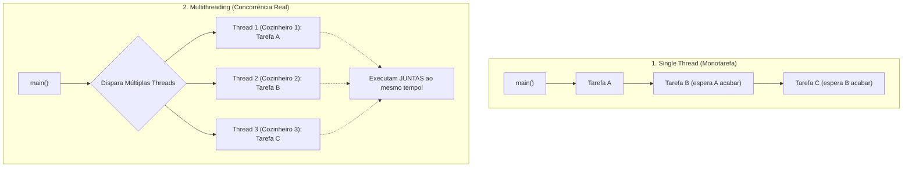

# Java Full Course — Bro Code
## Capítulo 70: `multithreading 🧶` (Parte 1: Introdução, Definição Oficial e Estrutura Inicial)

---

### Metadados da Aula
- **Curso:** Java Full Course (Bro Code)
- **Capítulo:** 70 — `multithreading 🧶`
- **Parte:** 1 (Abertura do Novo Capítulo, Conceito Teórico e Início de `MyRunnable`)
- **Timestamp de Referência:** `11:23:44` até `11:24:25`
- **Arquivos do Projeto:**
  - [`Main.java`](file:///c:/Users/mickel%201/Downloads/JAVA%20APRENDER/Main.java)
  - [`MyRunnable.java`](file:///c:/Users/mickel%201/Downloads/JAVA%20APRENDER/MyRunnable.java)

---

### 1. Reconstituição Textual Completa das Telas do Vídeo (Para o Google Docs)

Como você irá copiar este conteúdo diretamente para o seu Google Docs sem as capturas de tela visuais, aqui está a descrição minuciosa de cada uma das 4 imagens apresentadas pelo Bro Code:

```text
========================================================================================
TELA 1 (11:23:44) — A DEFINIÇÃO OFICIAL DE MULTITHREADING EM Main.java
========================================================================================
Bro Code inicia o novo capítulo 70 limpando o código anterior de Main.java.
Ele digita a definição oficial em forma de comentários no método main:

public class Main {
    public static void main(String[] args) {

        // Multithreading = Enables a program to run multiple threads concurrently
        //                  (Thread = A set of instructions that run independently)
        //                  Useful for background tasks or time-consuming operations

    }
}

Bro Code seleciona a palavra "Multithreading" com o mouse e explica:
"No capítulo anterior, vimos o que é UMA thread (🧵).
Agora entraremos em MULTITHREADING (🧶): a capacidade de um programa executar
VÁRIAS threads de trabalho de forma simultânea e concorrente!"

========================================================================================
TELA 2 (11:23:44) — MENU DE CONTEXTO PARA CRIAR A CLASSE MyRunnable
========================================================================================
Bro Code clica com o botão direito na pasta 'src' do projeto no painel lateral esquerdo
do IntelliJ IDEA e seleciona:
    New -> Java Class

Aparece o pop-up escuro central com as opções:
    [c] Class  <-- (selecionado)
    (i) Interface
    (R) Record
    (e) Enum
    (@) Annotation
    (x) Exception

Ele digita o nome "MyRunnable" e aperta Enter para criar a classe de tarefas.

========================================================================================
TELA 3 (11:24:22) — IMPLEMENTANDO A INTERFACE Runnable EM MyRunnable.java
========================================================================================
O arquivo MyRunnable.java abre no editor.
Bro Code adiciona 'implements Runnable', anota '@Override', cria o método 'public void run()'
e começa a digitar o laço de repetição:

public class MyRunnable implements Runnable{

    @Override
    public void run(){
        for(){
        }
    }
}

O cursor está piscando dentro dos parênteses do 'for()', onde ele vai configurar a contagem.

========================================================================================
TELA 4 (11:24:25) — CONFIGURANDO O LOOP for DE 1 A 5
========================================================================================
Bro Code preenche o cabeçalho do laço 'for' para contar de 1 até 5:

public class MyRunnable implements Runnable{

    @Override
    public void run(){
        for(int i = 1; i <= 5; i++){

        }
    }
}

Ele prepara o terreno para simular uma tarefa demorada que será executada por várias
threads concorrentes ao mesmo tempo!
========================================================================================
```

---

### 2. O Grande Salto Conceitual: Threading (🧵) vs Multithreading (🧶)

Observe os emojis geniais que o Bro Code escolheu para os capítulos:
- **Capítulo 69:** `threading 🧵` (Um único carretel de linha com um fio só).
- **Capítulo 70:** `multithreading 🧶` (Um novelo de lã inteiro com múltiplos fios se cruzando).

Para entender isso sem nenhuma complicação técnica, veja as analogias:

#### A Analogia dos Cozinheiros no Restaurante:
1. **Programa de Thread Única (Single Thread):**
   - Há apenas **1 cozinheiro** na cozinha.
   - Ele corta a cebola, depois para e frita a carne, depois para e lava a louça.
   - Se a carne demora 20 minutos para assar, ele fica parado olhando para o forno sem fazer nada. O cliente na mesa fica esperando horas.
2. **Programa com Threading Básico (Capítulo 69):**
   - O cozinheiro principal atende o balcão (`main`) e coloca um **pequeno relógio despertador** ao lado (`timer thread`).
   - São apenas dois processos: o atendimento e o alarme.
3. **Programa com Multithreading Real (Capítulo 70):**
   - Agora temos uma **equipe inteira de cozinheiros** trabalhando ao mesmo tempo no mesmo restaurante!
   - Cozinheiro A prepara a massa.
   - Cozinheiro B grelha a carne.
   - Cozinheiro C monta as sobremesas.
   - Cozinheiro D lava os pratos no fundo.
   - **Resultado:** A comida sai 10 vezes mais rápido, e se um cozinheiro estiver esperando a água ferver, os outros continuam trabalhando a todo vapor!

---

### 3. Análise Detalhada da Definição Oficial do Bro Code

Na Tela 1, o Bro Code escreveu três linhas de ouro:

```java
// Multithreading = Enables a program to run multiple threads concurrently
//                  (Thread = A set of instructions that run independently)
//                  Useful for background tasks or time-consuming operations
```

Vamos dissecar cada termo como um verdadeiro profissional de Java:

1. **`Enables a program to run multiple threads concurrently`**
   - *Concorrente/Simultâneo:* Significa que seu computador moderno (que tem vários núcleos de CPU, como Core i5, i7, Ryzen) pode colocar cada thread para rodar em um núcleo físico diferente ao mesmo tempo.
2. **`(Thread = A set of instructions that run independently)`**
   - *Conjunto independente de instruções:* Cada thread tem seu próprio ponteiro de execução (sabe qual linha de código está lendo no momento) e suas próprias variáveis locais, sem atrapalhar a linha da outra thread.
3. **`Useful for background tasks or time-consuming operations`**
   - *Onde isso é usado no mundo real?*
     - **Jogos (Games):** Uma thread cuida da física e movimentação, outra thread toca a música de fundo, outra thread envia dados para a rede multiplayer.
     - **Navegadores de Internet (Chrome/Edge):** Cada aba que você abre roda em threads/processos separados. Se um site travar, o navegador inteiro não cai junto!
     - **Aplicativos de Celular (Android/iOS):** Se o app vai baixar uma foto da nuvem, ele baixa numa thread de fundo para o botão de "voltar" continuar funcionando liso.

---

### 4. Códigos-Fonte Completos Desta Etapa

#### Arquivo: `Main.java`
```java
public class Main {
    public static void main(String[] args) {

        // Multithreading = Enables a program to run multiple threads concurrently
        //                  (Thread = A set of instructions that run independently)
        //                  Useful for background tasks or time-consuming operations

    }
}
```

#### Arquivo: `MyRunnable.java`
```java
public class MyRunnable implements Runnable{

    @Override
    public void run(){
        for(int i = 1; i <= 5; i++){

        }
    }
}
```

---

### 5. Análise Linha por Linha Numerada — `Main.java`

```java
1: public class Main {
2:     public static void main(String[] args) {
3: 
4:         // Multithreading = Enables a program to run multiple threads concurrently
5:         //                  (Thread = A set of instructions that run independently)
6:         //                  Useful for background tasks or time-consuming operations
7: 
8:     }
9: }
```

- **Linha 1 (`public class Main {`):** Declara a classe pública principal `Main`.
- **Linha 2 (`public static void main(String[] args) {`):** Ponto de entrada padrão da aplicação executado pela thread principal (`main`).
- **Linha 3 (` `):** Linha em branco.
- **Linhas 4 a 6 (Comentários de Definição):**
  - Linha 4: Explica que Multithreading habilita execução simultânea de múltiplas threads.
  - Linha 5: Define que cada Thread é um bloco de instruções independente.
  - Linha 6: Destaca as aplicações reais (processamento em segundo plano e operações pesadas).
- **Linha 7 (` `):** Linha em branco aguardando as novas linhas de código do capítulo.
- **Linha 8 (`}`):** Fecha o método `main`.
- **Linha 9 (`}`):** Fecha a classe `Main`.

---

### 6. Análise Linha por Linha Numerada — `MyRunnable.java`

```java
1: public class MyRunnable implements Runnable{
2: 
3:     @Override
4:     public void run(){
5:         for(int i = 1; i <= 5; i++){
6: 
7:         }
8:     }
9: }
```

- **Linha 1 (`public class MyRunnable implements Runnable{`):** Declara a classe `MyRunnable` implementando a interface funcional `Runnable`. Isso avisa ao compilador Java: *"Esta classe contém a receita de bolo que múltiplos trabalhadores (threads) poderão executar"*.
- **Linha 2 (` `):** Linha em branco.
- **Linha 3 (`@Override`):** Anotação de segurança que confirma a substituição do método `run()` exigido pela interface `Runnable`.
- **Linha 4 (`public void run(){`):** O método sagrado das threads. Tudo o que estiver dentro destas chaves será o trabalho prático executado por cada thread.
- **Linha 5 (`for(int i = 1; i <= 5; i++){`):** Laço `for` configurado para rodar 5 vezes (variável `i` começa em 1 e vai até 5). Será usado para simular etapas de um processo.
- **Linha 6 (` `):** Linha em branco onde o Bro Code adicionará as instruções de cada ciclo.
- **Linha 7 (`}`):** Fecha o laço `for`.
- **Linha 8 (`}`):** Fecha o método `run()`.
- **Linha 9 (`}`):** Fecha a classe `MyRunnable`.

---

### 7. Diagrama Mermaid Conceitual: Threading vs Multithreading



---

### 8. Saída no Console Nesta Etapa

Como esta etapa corresponde ao momento em que o Bro Code está digitando a estrutura básica e os comentários conceituais na IDE, o programa ainda não foi executado.

- **Saída no Console:**
```text
(Nenhuma saída gerada ainda — código em fase de estruturação e definição)
```
*(Nos próximos minutos do vídeo, o Bro Code adicionará o `Thread.sleep`, mensagens identificando cada thread e instanciará múltiplos trabalhadores em `Main.java`!)*
