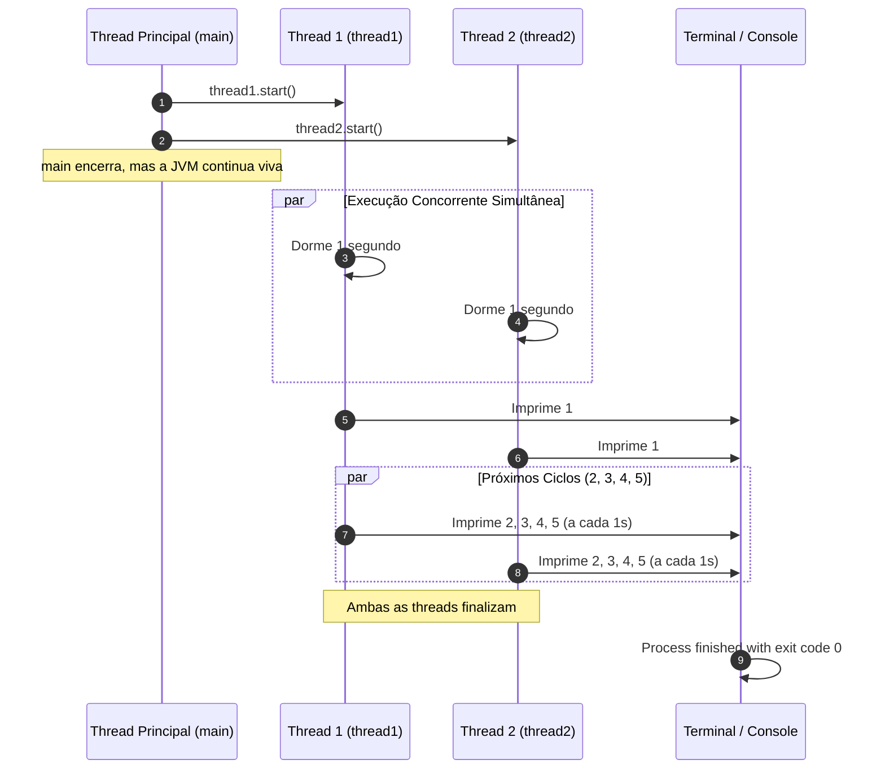

# Java Full Course — Bro Code
## Capítulo 70: `multithreading 🧶` (Parte 3: Objeto Anônimo, Criação de `thread1` e `thread2` e Execução Concorrente Real)

---

### Metadados da Aula
- **Curso:** Java Full Course (Bro Code)
- **Capítulo:** 70 — `multithreading 🧶`
- **Parte:** 3 (Refatoração para Objeto Anônimo, Instanciação de Múltiplas Threads e Paralelismo Real)
- **Timestamp de Referência:** `11:26:19` até `11:26:50`
- **Arquivos do Projeto:**
  - [`Main.java`](../../../src/main/java/com/mickaelgeronimo/mastery/core/concurrency/Main.java)
  - [`MyRunnable.java`](../../../src/main/java/com/mickaelgeronimo/mastery/core/concurrency/MyRunnable.java)

---

### 1. Reconstituição Textual Completa das Telas do Vídeo (Para o Google Docs)

Como você irá copiar este conteúdo diretamente para o seu Google Docs sem as imagens visuais, aqui está a descrição minuciosa de cada uma das 5 telas apresentadas pelo Bro Code:

```text
========================================================================================
TELA 1 — O CÓDIGO ANTERIOR COM DUAS LINHAS SEPARADAS
========================================================================================
No editor IntelliJ IDEA, o arquivo Main.java exibe:
    MyRunnable myRunnable = new MyRunnable();
    Thread thread = new Thread(myRunnable);
    thread.start();

Bro Code explica a oportunidade de refatoração:
"Observe que criamos a variável 'myRunnable' apenas para passá-la de imediato dentro dos
parênteses de 'new Thread(...)'. Se não vamos usar 'myRunnable' para mais nada, podemos
economizar código usando um Objeto Anônimo!"

========================================================================================
TELA 2 (11:26:19) — DIGITANDO O OBJETO ANÔNIMO EM UMA SÓ LINHA
========================================================================================
Bro Code apaga a criação da variável intermediária e junta tudo em uma única instrução:
    Thread thread = new Thread(new MyRunnable());
    thread.start();

Ele passa 'new MyRunnable()' diretamente como argumento para o construtor da Thread.

========================================================================================
TELA 3 — TESTE DA VERSÃO COM OBJETO ANÔNIMO
========================================================================================
Bro Code executa o código simplificado para confirmar aos alunos que a saída é idêntica:
Terminal exibe:
    1
    2
    3
    4
    5
    Process finished with exit code 0

"Viram? Funciona exatamente igual, porém com código mais limpo e profissional!"

========================================================================================
TELA 4 — O MOMENTO CHAVE: DUAS THREADS INDEPENDENTES (thread1 E thread2)
========================================================================================
Bro Code agora cria o verdadeiro MULTITHREADING no código:
Ele renomeia a primeira thread para 'thread1' e cria uma segunda thread chamada 'thread2':

    Thread thread1 = new Thread(new MyRunnable());
    Thread thread2 = new Thread(new MyRunnable());

    thread1.start();
    thread2.start();

Ele seleciona 'thread2' com o mouse e destaca:
"Agora temos DOIS trabalhadores independentes! Cada um com sua própria missão de contar
de 1 a 5! Quando chamamos thread1.start() e thread2.start(), os dois largam juntos!"

========================================================================================
TELA 5 — O RESULTADO FASCINANTE NO TERMINAL: NÚMEROS DUPLICADOS!
========================================================================================
Bro Code clica em Run. O console começa a despejar os números:
    1
    1
    2
    2
    3
    3
    4
    4
    5
    5

    Process finished with exit code 0

(Na imagem 5, a janela do console exibe de 2 a 5 porque os números 1 rolaram para cima).
Bro Code comemora:
"Olhem isso! Cada número saiu DUAS vezes! Uma vez impresso pela thread1 e outra vez impresso
pela thread2! E o melhor: o programa inteiro demorou os mesmos 5 segundos!
Fizemos o dobro do trabalho no mesmo tempo!"
========================================================================================
```

---

### 2. Os Dois Grandes Conceitos Desta Aula

#### Conceito 1: O Que é um Objeto Anônimo em Java?
Quando você escreve:
```java
// Forma Tradicional (Com variável de referência com nome):
MyRunnable myRunnable = new MyRunnable(); // Dá um nome ao objeto
Thread thread = new Thread(myRunnable);   // Usa o nome

// Forma com Objeto Anônimo (Sem nome):
Thread thread = new Thread(new MyRunnable()); // Cria direto dentro do parêntese
```
- **Por que "Anônimo"?** Porque ele não tem um nome de variável associado a ele. Ele é instanciado na hora e entregue diretamente ao construtor de `Thread`.
- **Quando usar?** Sempre que você só precisa usar o objeto uma única vez e nunca mais vai referenciá-lo em nenhuma outra linha de código. Isso economiza memória e deixa o código mais enxuto.

#### Conceito 2: Multithreading Real com Duas Threads Simultâneas
Imagine dois corredores numa pista de atletismo:
- **Corredor 1 (`thread1`):** Tem um cronômetro e grita 1, 2, 3, 4, 5 a cada segundo.
- **Corredor 2 (`thread2`):** Também tem um cronômetro e grita 1, 2, 3, 4, 5 a cada segundo.
- Como o juiz deu a largada quase no mesmo milissegundo (`thread1.start()` e logo em seguida `thread2.start()`):
  - No 1º segundo: Corredor 1 grita `1`, Corredor 2 grita `1`.
  - No 2º segundo: Corredor 1 grita `2`, Corredor 2 grita `2`.
  - No 3º segundo: Corredor 1 grita `3`, Corredor 2 grita `3`.
  - No 4º segundo: Corredor 1 grita `4`, Corredor 2 grita `4`.
  - No 5º segundo: Corredor 1 grita `5`, Corredor 2 grita `5`.

> [!IMPORTANT]
> **Por que o programa não demorou 10 segundos?**
> Se fosse um programa sequencial tradicional (uma coisa depois da outra), 5 segundos da tarefa 1 + 5 segundos da tarefa 2 totalizariam **10 segundos** de espera.
> Graças ao **Multithreading**, as duas tarefas rodaram em paralelo, gastando no total apenas **5 segundos**! É 100% de ganho de eficiência de tempo!

---

### 3. Códigos-Fonte Completos e Atualizados

#### Arquivo: `Main.java`
```java
public class Main {
    public static void main(String[] args) {

        // Multithreading = Enables a program to run multiple threads concurrently
        //                  (Thread = A set of instructions that run independently)
        //                  Useful for background tasks or time-consuming operations

        Thread thread1 = new Thread(new MyRunnable());
        Thread thread2 = new Thread(new MyRunnable());

        thread1.start();
        thread2.start();

    }
}
```

#### Arquivo: `MyRunnable.java`
```java
public class MyRunnable implements Runnable{

    @Override
    public void run(){
        for(int i = 1; i <= 5; i++){

            try {
                Thread.sleep(1000);
            } catch (InterruptedException e) {
                System.out.println("Thread was interrupted");
            }

            System.out.println(i);
        }
    }
}
```

---

### 4. Análise Linha por Linha Numerada — `Main.java`

```java
1: public class Main {
2:     public static void main(String[] args) {
3: 
4:         // Multithreading = Enables a program to run multiple threads concurrently
5:         //                  (Thread = A set of instructions that run independently)
6:         //                  Useful for background tasks or time-consuming operations
7: 
8:         Thread thread1 = new Thread(new MyRunnable());
9:         Thread thread2 = new Thread(new MyRunnable());
10: 
11:         thread1.start();
12:         thread2.start();
13: 
14:     }
15: }
```

- **Linha 1 (`public class Main {`):** Declaração da classe principal `Main`.
- **Linha 2 (`public static void main(String[] args) {`):** Ponto de partida do programa executado pela thread principal (`main`).
- **Linha 3 (` `):** Linha em branco.
- **Linhas 4 a 6 (Comentários Teóricos):** Resumo conceitual de Multithreading do Bro Code.
- **Linha 7 (` `):** Linha em branco.
- **Linha 8 (`Thread thread1 = new Thread(new MyRunnable());`):** Cria a primeira thread trabalhadora (`thread1`) e passa diretamente uma nova instância anônima de `MyRunnable` como sua tarefa.
- **Linha 9 (`Thread thread2 = new Thread(new MyRunnable());`):** Cria a segunda thread trabalhadora (`thread2`) e passa outra instância anônima de `MyRunnable` como sua tarefa. Agora temos dois trabalhadores independentes na memória!
- **Linha 10 (` `):** Linha em branco.
- **Linha 11 (`thread1.start();`):** Dispara a primeira thread. Ela cria seu canal de execução paralelo no processador e começa a rodar o método `run()`.
- **Linha 12 (`thread2.start();`):** Dispara a segunda thread imediatamente a seguir. Ela também cria seu canal paralelo e começa a rodar o método `run()`.
- **Linha 13 (` `):** Linha em branco.
- **Linha 14 (`}`):** Fim do método `main`. A thread `main` se despede aqui, mas a JVM continua ativa até que `thread1` e `thread2` terminem suas contagens de 5 segundos.
- **Linha 15 (`}`):** Fim da classe `Main`.

---

### 5. Análise Linha por Linha Numerada — `MyRunnable.java`

```java
1: public class MyRunnable implements Runnable{
2: 
3:     @Override
4:     public void run(){
5:         for(int i = 1; i <= 5; i++){
6: 
7:             try {
8:                 Thread.sleep(1000);
9:             } catch (InterruptedException e) {
10:                 System.out.println("Thread was interrupted");
11:             }
12: 
13:             System.out.println(i);
14:         }
15:     }
16: }
```

- **Linha 1 (`public class MyRunnable implements Runnable{`):** Declara a classe que implementa a interface `Runnable`, servindo como o molde de instruções a ser executado pelas threads.
- **Linha 2 (` `):** Linha em branco.
- **Linha 3 (`@Override`):** Indica ao compilador que estamos implementando o método obrigatório `run()`.
- **Linha 4 (`public void run(){`):** O corpo do trabalho. Cada uma das duas threads terá sua própria execução isolada deste método.
- **Linha 5 (`for(int i = 1; i <= 5; i++){`):** Cada thread terá sua própria variável `i` local, contando de 1 até 5.
- **Linha 6 (` `):** Linha em branco.
- **Linha 7 (`try {`):** Bloco de proteção contra interrupções.
- **Linha 8 (`Thread.sleep(1000);`):** A thread adormece por 1 segundo a cada volta do laço.
- **Linha 9 (`} catch (InterruptedException e) {`):** Captura uma interrupção inesperada se ocorrer.
- **Linha 10 (`System.out.println("Thread was interrupted");`):** Alerta caso o sono seja quebrado.
- **Linha 11 (`}`):** Fim do bloco `catch`.
- **Linha 12 (` `):** Linha em branco.
- **Linha 13 (`System.out.println(i);`):** Imprime o valor atual de `i` no console compartilhado.
- **Linha 14 (`}`):** Fim do laço `for`.
- **Linha 15 (`}`):** Fim do método `run()`. A thread que chegar aqui encerra sua vida útil.
- **Linha 16 (`}`):** Fim da classe `MyRunnable`.

---

### 6. Cronograma Comparativo Segundo a Segundo

| Segundo | Thread Principal (`main`) | `thread1` | `thread2` | Saída no Console |
| :---: | :--- | :--- | :--- | :--- |
| **0.0s** | Inicia `thread1` e `thread2` | Inicia e dorme 1s | Inicia e dorme 1s | *(Silêncio)* |
| **0.01s** | Encerra sua execução | Dormindo (soneca 1) | Dormindo (soneca 1) | *(Silêncio)* |
| **1.0s** | *(Morta)* | Acorda e imprime `1` | Acorda e imprime `1` | `1`<br>`1` |
| **2.0s** | *(Morta)* | Acorda e imprime `2` | Acorda e imprime `2` | `2`<br>`2` |
| **3.0s** | *(Morta)* | Acorda e imprime `3` | Acorda e imprime `3` | `3`<br>`3` |
| **4.0s** | *(Morta)* | Acorda e imprime `4` | Acorda e imprime `4` | `4`<br>`4` |
| **5.0s** | *(Morta)* | Acorda e imprime `5` | Acorda e imprime `5` | `5`<br>`5` |
| **5.01s** | *(Morta)* | Termina `run()` e morre | Termina `run()` e morre | `Process finished with exit code 0` |

---

### 7. Diagrama Mermaid da Execução Concorrente



---

### 8. Saída Exata no Console para Copiar no Google Docs

```text
1
1
2
2
3
3
4
4
5
5

Process finished with exit code 0
```
*(Observação: a ordem exata entre qual thread imprime primeiro em cada segundo pode variar ligeiramente de milissegundo para milissegundo, pois depende do escalonador de threads do sistema operacional, mas ambas imprimirão seus números de 1 a 5 no intervalo total de 5 segundos).*
