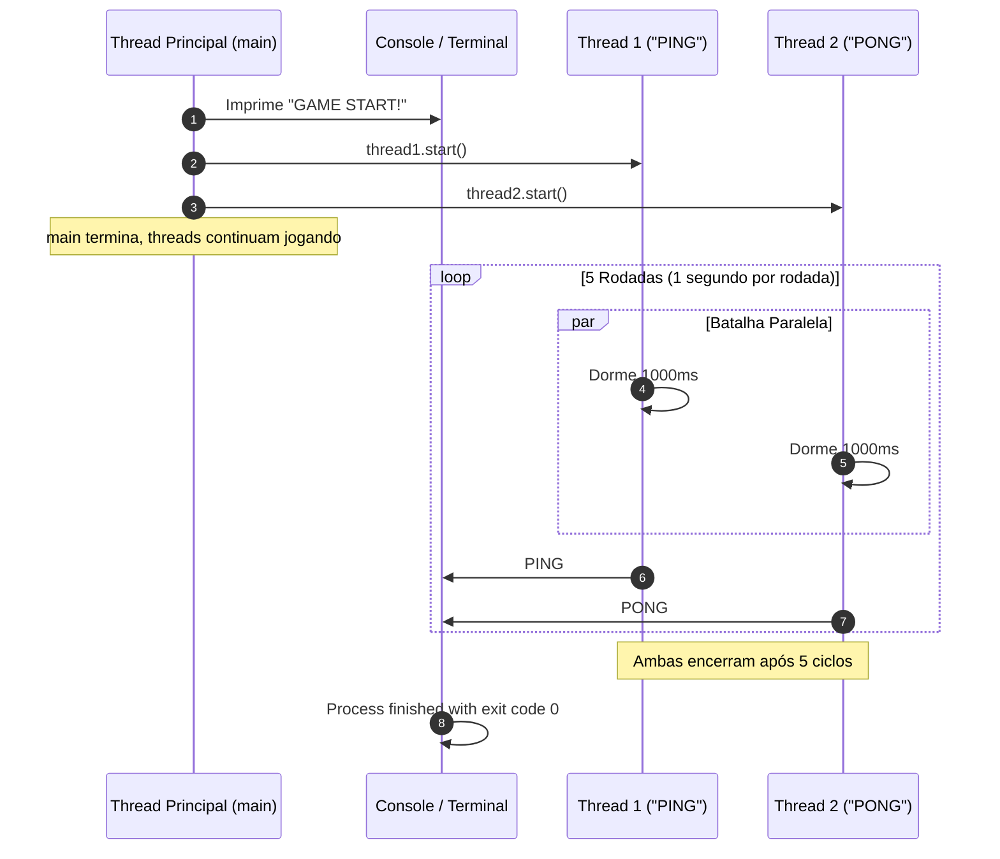

# Java Full Course — Bro Code
## Capítulo 70: `multithreading 🧶` (Parte 5: Construtor Parametrizado, O Jogo PING-PONG e o Anúncio `"GAME START!"`)

---

### Metadados da Aula
- **Curso:** Java Full Course (Bro Code)
- **Capítulo:** 70 — `multithreading 🧶`
- **Parte:** 5 (Parametrização de Tarefas, Construtor com `String text`, O Jogo de Ping-Pong e Concorrência Real)
- **Timestamp de Referência:** `11:28:28` até `11:29:05`
- **Arquivos do Projeto:**
  - [`MyRunnable.java`](file:///c:/Users/mickel%201/Downloads/JAVA%20APRENDER/MyRunnable.java)
  - [`Main.java`](file:///c:/Users/mickel%201/Downloads/JAVA%20APRENDER/Main.java)

---

### 1. Reconstituição Textual Completa das Telas do Vídeo (Para o Google Docs)

Como você irá copiar este conteúdo diretamente para o seu Google Docs sem as imagens visuais, aqui está a descrição minuciosa de cada uma das 5 telas apresentadas pelo Bro Code:

```text
========================================================================================
TELA 1 (11:28:28) — CRIANDO O CAMPO text E O CONSTRUTOR EM MyRunnable.java
========================================================================================
No editor IntelliJ IDEA, o arquivo MyRunnable.java é modificado.
No topo da classe, antes do método run(), Bro Code adiciona:

    private final String text;

    MyRunnable(String text){
        this.text = text;
    }

Bro Code explica a motivação:
"Até agora nossa classe MyRunnable estava fixa contando números. Mas nós queremos que
cada thread possa imprimir uma mensagem personalizada diferente!
Para isso, criamos uma variável 'text' e um construtor que recebe essa String!"

========================================================================================
TELA 2 (11:28:33) — IMPRIMINDO text DENTRO DO LOOP
========================================================================================
Ainda em MyRunnable.java, dentro do método run(), na linha 14:
Bro Code substitui o comando longo anterior por simplesmente:
    System.out.println(text);

Agora, a cada segundo (após Thread.sleep(1000)), a thread imprimirá exatamente o texto
que ela recebeu quando foi criada!

========================================================================================
TELA 3 (11:28:48) — PASSANDO "PING" E "PONG" EM Main.java
========================================================================================
Bro Code clica na aba Main.java e atualiza a criação das duas threads:
    Thread thread1 = new Thread(new MyRunnable("PING"));
    Thread thread2 = new Thread(new MyRunnable("PONG"));

    thread1.start();
    thread2.start();

Ele explica com bom humor:
"A thread1 será responsável por gritar 'PING', e a thread2 será responsável por
gritar 'PONG'! Vamos simular uma partida de ping-pong multithread no terminal!"

========================================================================================
TELA 4 (11:28:54) — A SURPRESA NO CONSOLE: "PONG" VEIO PRIMEIRO!
========================================================================================
Bro Code aperta o Play e o terminal roda a primeira rodada:
    PONG
    PING

Bro Code aponta para o console e dá uma risada:
"Olhem só para isso! O 'PONG' imprimiu ANTES do 'PING'!
Mas espere um momento... no nosso código nós chamamos thread1.start() ('PING') ANTES de
thread2.start() ('PONG')! Por que o PONG veio na frente?
Porque uma vez que você chama start(), quem manda é o processador (CPU)! A CPU decidiu
dar tempo de execução para a thread2 uma fração de milissegundo antes da thread1!"

========================================================================================
TELA 5 (~11:29:00) — ADICIONANDO O ANÚNCIO "GAME START!"
========================================================================================
De volta ao arquivo Main.java, Bro Code insere uma mensagem na linha 12, logo antes de
dar a largada nas threads:

    Thread thread1 = new Thread(new MyRunnable("PING"));
    Thread thread2 = new Thread(new MyRunnable("PONG"));

    System.out.println("GAME START!");

    thread1.start();
    thread2.start();

Ele prepara o anúncio do início do jogo, que roda na thread principal antes de as duas
threads paralelas começarem a batalha de PING e PONG!
========================================================================================
```

---

### 2. Os Três Grandes Conceitos Desta Aula

#### Conceito 1: Por que Usar um Construtor Parametrizado em um `Runnable`?
Uma das dúvidas mais comuns de quem está aprendendo Java é:
*"Como eu passo dados ou configurações para uma Thread?"*
- O método `run()` da interface `Runnable` **não aceita parâmetros** (sua assinatura é sempre `public void run()`). Você não pode escrever `run(String text)`!
- **A Solução Elegante da Orientação a Objetos:** Passar os dados através do **construtor** da classe (`MyRunnable(String text)`).
- O construtor guarda o texto na variável de instância `this.text`, e quando o método `run()` for executado pela thread, ele usa aquele texto armazenado!

#### Conceito 2: O Uso de `private final String text`
- **`private`:** Encapsulamento. Apenas a própria classe tem acesso direto à variável.
- **`final`:** Segurança em concorrência (*Thread Safety*). Uma vez que a thread recebe seu texto (ex: `"PING"`), ninguém mais no programa pode alterar esse valor no meio da execução. Objetos imutáveis são os melhores amigos do Multithreading!

#### Conceito 3: A Dança Maluca do Ping-Pong (Por que "PONG" saiu antes?)
Repare na Tela 4 do vídeo:
```text
PONG
PING
```
Mesmo o código tendo escrito:
```java
thread1.start(); // PING
thread2.start(); // PONG
```
- O método `.start()` não significa *"execute agora e termine agora"*.
- O método `.start()` significa apenas: *"Sr. Sistema Operacional, coloque esse trabalhador na fila de espera dos núcleos da CPU!"*.
- Se o núcleo 2 da CPU estava mais desocupado que o núcleo 1, a `thread2` começou a rodar alguns microssegundos antes. Isso reforça a lição de ouro: **em Multithreading, nunca presuma que a ordem das linhas de `start()` ditará a ordem exata de chegada no console!**

---

### 3. Códigos-Fonte Completos e Atualizados

#### Arquivo: `MyRunnable.java`
```java
public class MyRunnable implements Runnable{

    private final String text;

    MyRunnable(String text){
        this.text = text;
    }

    @Override
    public void run(){
        for(int i = 1; i <= 5; i++){
            try {
                Thread.sleep(1000);
                System.out.println(text);
            }
            catch (InterruptedException e) {
                System.out.println("Thread was interrupted");
            }
        }
    }
}
```

#### Arquivo: `Main.java`
```java
public class Main {
    public static void main(String[] args) {

        // Multithreading = Enables a program to run multiple threads concurrently
        //                  (Thread = A set of instructions that run independently)
        //                  Useful for background tasks or time-consuming operations

        Thread thread1 = new Thread(new MyRunnable("PING"));
        Thread thread2 = new Thread(new MyRunnable("PONG"));

        System.out.println("GAME START!");

        thread1.start();
        thread2.start();

    }
}
```

---

### 4. Análise Linha por Linha Numerada — `MyRunnable.java`

```java
1: public class MyRunnable implements Runnable{
2: 
3:     private final String text;
4: 
5:     MyRunnable(String text){
6:         this.text = text;
7:     }
8: 
9:     @Override
10:    public void run(){
11:        for(int i = 1; i <= 5; i++){
12:            try {
13:                Thread.sleep(1000);
14:                System.out.println(text);
15:            }
16:            catch (InterruptedException e) {
17:                System.out.println("Thread was interrupted");
18:            }
19:        }
20:    }
21: }
```

- **Linha 1 (`public class MyRunnable implements Runnable{`):** Define a classe que implementa `Runnable`.
- **Linha 2 (` `):** Linha em branco.
- **Linha 3 (`private final String text;`):** Atributo de classe privado e imutável que guardará a palavra a ser repetida pela thread.
- **Linha 4 (` `):** Linha em branco.
- **Linha 5 (`MyRunnable(String text){`):** Construtor com visibilidade de pacote que recebe uma String `text` como argumento.
- **Linha 6 (`this.text = text;`):** Atribui o parâmetro recebido ao campo de instância da classe.
- **Linha 7 (`}`):** Fim do construtor.
- **Linha 8 (` `):** Linha em branco.
- **Linha 9 (`@Override`):** Anotação indicando sobrescrita do método `run()`.
- **Linha 10 (`public void run(){`):** Método executado em paralelo quando a thread iniciar.
- **Linha 11 (`for(int i = 1; i <= 5; i++){`):** Laço que executará 5 ciclos.
- **Linha 12 (`try {`):** Bloco de proteção contra interrupções.
- **Linha 13 (`Thread.sleep(1000);`):** Pausa a thread atual por 1000 milissegundos (1 segundo).
- **Linha 14 (`System.out.println(text);`):** Imprime a String armazenada no campo `text` (`"PING"` ou `"PONG"`).
- **Linha 15 (`}`):** Fim do bloco `try`.
- **Linha 16 (`catch (InterruptedException e) {`):** Trata interrupção caso a soneca seja cortada.
- **Linha 17 (`System.out.println("Thread was interrupted");`):** Mensagem de alerta de interrupção.
- **Linha 18 (`}`):** Fim do bloco `catch`.
- **Linha 19 (`}`):** Fim do laço `for`.
- **Linha 20 (`}`):** Fim do método `run()`.
- **Linha 21 (`}`):** Fim da classe `MyRunnable`.

---

### 5. Análise Linha por Linha Numerada — `Main.java`

```java
1: public class Main {
2:     public static void main(String[] args) {
3: 
4:         // Multithreading = Enables a program to run multiple threads concurrently
5:         //                  (Thread = A set of instructions that run independently)
6:         //                  Useful for background tasks or time-consuming operations
7: 
8:         Thread thread1 = new Thread(new MyRunnable("PING"));
9:         Thread thread2 = new Thread(new MyRunnable("PONG"));
10: 
11:        System.out.println("GAME START!");
12: 
13:        thread1.start();
14:        thread2.start();
15: 
16:    }
17: }
```

- **Linha 1 (`public class Main {`):** Declaração da classe `Main`.
- **Linha 2 (`public static void main(String[] args) {`):** Método de entrada executado pela thread principal (`main`).
- **Linha 3 (` `):** Linha em branco.
- **Linhas 4 a 6 (Comentários teóricos):** Conceito oficial de Multithreading.
- **Linha 7 (` `):** Linha em branco.
- **Linha 8 (`Thread thread1 = new Thread(new MyRunnable("PING"));`):** Instancia a `thread1` entregando a ela uma tarefa `MyRunnable` configurada com a palavra `"PING"`.
- **Linha 9 (`Thread thread2 = new Thread(new MyRunnable("PONG"));`):** Instancia a `thread2` entregando a ela uma tarefa `MyRunnable` configurada com a palavra `"PONG"`.
- **Linha 10 (` `):** Linha em branco.
- **Linha 11 (`System.out.println("GAME START!");`):** **NOVA LINHA DA TELA 5!** A thread `main` imprime no console o aviso de início antes de liberar as threads de jogo.
- **Linha 12 (` `):** Linha em branco.
- **Linha 13 (`thread1.start();`):** Dá a largada na thread `"PING"`.
- **Linha 14 (`thread2.start();`):** Dá a largada na thread `"PONG"`.
- **Linha 15 (` `):** Linha em branco.
- **Linha 16 (`}`):** Fim do método `main`.
- **Linha 17 (`}`):** Fim da classe `Main`.

---

### 6. Cronograma e Saída Exata no Console para o Google Docs

Abaixo está o texto exato da saída que você terá no console e poderá colar no Google Docs:

```text
GAME START!
PING
PONG
PING
PONG
PING
PONG
PING
PONG
PING
PONG

Process finished with exit code 0
```

*(Observação: Como vimos na Tela 4 do vídeo, em algumas execuções ou máquinas o primeiro par pode sair como `PONG` e depois `PING`, devido à concorrência entre os núcleos do processador!)*

---

### 7. Diagrama Mermaid do Jogo de Ping-Pong Concorrente


