# Java Full Course — Bro Code
## Capítulo 70: `multithreading 🧶` (Parte 6: A Pegadinha do `"GAME OVER!"` Antes da Hora e a Introdução a `thread.join()`)

---

### Metadados da Aula
- **Curso:** Java Full Course (Bro Code)
- **Capítulo:** 70 — `multithreading 🧶`
- **Parte:** 6 (O Problema da Assincronia, A Falta de Sincronização, O Método `join()` e a Exceção `InterruptedException`)
- **Timestamp de Referência:** `11:29:22` até `11:30:02`
- **Arquivos do Projeto:**
  - [`Main.java`](file:///c:/Users/mickel%201/Downloads/JAVA%20APRENDER/Main.java)
  - [`MyRunnable.java`](file:///c:/Users/mickel%201/Downloads/JAVA%20APRENDER/MyRunnable.java)

---

### 1. Reconstituição Textual Completa das Telas do Vídeo (Para o Google Docs)

Como você irá copiar este conteúdo diretamente para o seu Google Docs sem as imagens visuais, aqui está a descrição minuciosa de cada uma das 5 telas apresentadas pelo Bro Code:

```text
========================================================================================
TELA 1 — TENTATIVA INGÊNUA: ADICIONANDO "GAME OVER!" NA LINHA 17
========================================================================================
No editor IntelliJ IDEA, o arquivo Main.java é modificado.
Bro Code adiciona uma linha no final do método main:

    Thread thread1 = new Thread(new MyRunnable("PING"));
    Thread thread2 = new Thread(new MyRunnable("PONG"));

    System.out.println("GAME START!");

    thread1.start();
    thread2.start();

    System.out.println("GAME OVER!");  <-- [NOVA LINHA ADICIONADA]

Bro Code explica o raciocínio comum de quem está começando:
"Nós imprimimos 'GAME START!', iniciamos as duas threads para jogarem ping-pong,
e no final imprimimos 'GAME OVER!'. Parece lógico, não é? Vamos rodar para ver!"
Ele clica no botão verde de 'Play' (Run).

========================================================================================
TELA 2 (11:29:22) — O ERRO CÔMICO: "GAME OVER!" SAI ANTES DO JOGO COMEÇAR!
========================================================================================
O terminal executa o código. Olhem o que aparece no primeiríssimo segundo:
    GAME START!
    GAME OVER!
    PONG
    PING

Bro Code seleciona as duas primeiras linhas no terminal e cai na risada:
"O que diabos aconteceu aqui?! O jogo começou e DEU GAME OVER IMEDIATAMENTE!
E logo depois do Game Over, os jogadores começaram a jogar: PONG, PING...
Isso faz algum sentido para um jogador? Não! Por que o Java fez isso?"

========================================================================================
TELA 3 — O JOGO INTEIRO CONTINUA ROLANDO APÓS O GAME OVER
========================================================================================
O terminal continua rolando pelos 5 segundos seguintes:
    PONG
    PING
    PING
    PONG
    PONG
    PING
    PING
    PONG

    Process finished with exit code 0

Bro Code explica o mecanismo de concorrência:
"Lembrem-se: o método main roda na SUA PRÓPRIA THREAD (a thread 'main')!
Quando o main chamou thread1.start() e thread2.start(), ele NÃO esperou elas terminarem!
O main simplesmente continuou descendo na velocidade da luz para a linha seguinte
e imprimiu 'GAME OVER!' enquanto as duas threads ainda estavam calçando os sapatos!"

========================================================================================
TELA 4 — A SOLUÇÃO PROFISSIONAL: CHAMANDO thread1.join() E thread2.join()
========================================================================================
Para forçar a thread main a esperar as duas terminarem, Bro Code adiciona:

    thread1.start();
    thread2.start();

    thread1.join();
    thread2.join();

    System.out.println("GAME OVER!");

Ele explica a palavra mágica 'join':
"Em Java, o método .join() significa: 'Espere esta thread terminar antes de prosseguir!'"

========================================================================================
TELA 5 (11:30:02) — O ERRO VERMELHO DE COMPILAÇÃO EM .join()
========================================================================================
Assim que ele termina de digitar 'thread2.join();', aparecem linhas onduladas vermelhas
sob 'join()'.
O IntelliJ exibe o pop-up de aviso:
    Unhandled exception: java.lang.InterruptedException
    Add exception to method signature Alt+Shift+Enter
    More actions...

Bro Code aponta para o erro:
"Aha! O método .join() lança a mesma checked exception que o Thread.sleep():
a temida InterruptedException!
Porque a thread main vai ficar CONGELADA esperando, e se algo interromper ela,
precisamos lidar com essa exceção!"
========================================================================================
```

---

### 2. A Grande Pegadinha do Multithreading Explicada com Analogias

#### A Analogia do Chefe Impaciente na Empresa:
Imagine um escritório onde o **Chefe** (a Thread `main`) tem dois estagiários:
- **Estagiário 1 (`thread1`):** Tarefa de carimbar 5 caixas ("PING").
- **Estagiário 2 (`thread2`):** Tarefa de etiquetar 5 caixas ("PONG").

1. O Chefe chega de manhã e grita: *"COMEÇOU O EXPEDIENTE!"* (`GAME START!`).
2. O Chefe dá a ordem de serviço aos dois: *"Podem começar!"* (`thread1.start()` e `thread2.start()`).
3. **O Que o Chefe Faz Sem o `join()`?**
   Ele nem espera os estagiários pegarem o carimbo! No mesmo segundo ele apaga a luz da sala, fecha a porta na cara deles e grita: *"EXPEDIENTE ENCERRADO, ATÉ AMANHÃ!"* (`GAME OVER!`).
   E os pobres estagiários continuam trabalhando no escuro sozinhos pelos próximos 5 segundos (`PONG`, `PING`, `PONG`...)!

#### O Que Faz o `thread.join()`?
A palavra em inglês **`join`** significa juntar-se / aguardar a união:
- Quando o Chefe (`main`) executa `thread1.join()`, ele diz:
  *"Eu vou sentar na cadeira e ficar quieto até que o Estagiário 1 termine todas as 5 caixas dele!"*.
- Quando executa `thread2.join()`, ele diz:
  *"E também vou esperar o Estagiário 2 terminar todas as 5 caixas dele!"*.
- Somente quando **os dois estagiários tiverem finalizado 100% de seus trabalhos**, o Chefe se levanta e diz com autoridade: *"GAME OVER!"*!

---

### 3. Por Que o `.join()` Deu Erro Vermelho na Tela 5?

Assim como o `Thread.sleep(1000)` da aula anterior:
- O método `.join()` faz uma thread ficar **parada/bloqueada esperando** outra.
- Sempre que uma thread fica bloqueada esperando no Java, ela corre o risco de ser interrompida por outro processo no meio do caminho.
- Por isso, o Java classifica `InterruptedException` como uma **Checked Exception** (verificação obrigatória).
- O compilador não permite rodar o código até que você faça uma das duas coisas:
  1. Adicione `throws InterruptedException` na assinatura do método `public static void main(String[] args)`.
  2. Envolva as chamadas de `.join()` dentro de um bloco `try-catch`.

---

### 4. Códigos-Fonte Desta Etapa

#### Arquivo: `MyRunnable.java`
```java
public class MyRunnable implements Runnable{

    private final String text;

    MyRunnable(String text){
        this.text = text;
    }

    @Override
    public void run(){
        for(int i = 1; i <= 5; i++){
            try {
                Thread.sleep(1000);
                System.out.println(text);
            }
            catch (InterruptedException e) {
                System.out.println("Thread was interrupted");
            }
        }
    }
}
```

#### Arquivo: `Main.java` (Com o `join()` que gerou o erro de compilação)
```java
public class Main {
    public static void main(String[] args) {

        // Multithreading = Enables a program to run multiple threads concurrently
        //                  (Thread = A set of instructions that run independently)
        //                  Useful for background tasks or time-consuming operations

        Thread thread1 = new Thread(new MyRunnable("PING"));
        Thread thread2 = new Thread(new MyRunnable("PONG"));

        System.out.println("GAME START!");

        thread1.start();
        thread2.start();

        thread1.join();
        thread2.join();

        System.out.println("GAME OVER!");

    }
}
```

---

### 5. Análise Linha por Linha Numerada — `Main.java`

```java
1: public class Main {
2:     public static void main(String[] args) {
3: 
4:         // Multithreading = Enables a program to run multiple threads concurrently
5:         //                  (Thread = A set of instructions that run independently)
6:         //                  Useful for background tasks or time-consuming operations
7: 
8:         Thread thread1 = new Thread(new MyRunnable("PING"));
9:         Thread thread2 = new Thread(new MyRunnable("PONG"));
10: 
11:        System.out.println("GAME START!");
12: 
13:        thread1.start();
14:        thread2.start();
15: 
16:        thread1.join();
17:        thread2.join();
18: 
19:        System.out.println("GAME OVER!");
20: 
21:    }
22: }
```

- **Linhas 1 a 7:** Declaração da classe `Main`, método `main` e comentários conceituais.
- **Linha 8 (`Thread thread1 = new Thread(new MyRunnable("PING"));`):** Instancia a thread 1 configurada para imprimir `"PING"`.
- **Linha 9 (`Thread thread2 = new Thread(new MyRunnable("PONG"));`):** Instancia a thread 2 configurada para imprimir `"PONG"`.
- **Linha 10 (` `):** Linha em branco.
- **Linha 11 (`System.out.println("GAME START!");`):** A thread principal imprime no console a mensagem de abertura do jogo.
- **Linha 12 (` `):** Linha em branco.
- **Linha 13 (`thread1.start();`):** Dá a largada na `thread1` em segundo plano.
- **Linha 14 (`thread2.start();`):** Dá a largada na `thread2` em segundo plano.
- **Linha 15 (` `):** Linha em branco.
- **Linha 16 (`thread1.join();`):** **COMANDO SALVADOR (com erro na Tela 5):** Ordena que a thread `main` pause e espere pacientemente até que a `thread1` termine suas 5 repetições.
- **Linha 17 (`thread2.join();`):** Ordena que a thread `main` também espere até que a `thread2` termine suas 5 repetições.
- **Linha 18 (` `):** Linha em branco.
- **Linha 19 (`System.out.println("GAME OVER!");`):** Graças aos dois `join()`, esta linha só será executada quando a partida de Ping-Pong tiver acabado por completo!
- **Linha 20 (` `):** Linha em branco.
- **Linha 21 (`}`):** Fim do método `main`.
- **Linha 22 (`}`):** Fim da classe `Main`.

---

### 6. Comparativo Visual: SEM `join()` vs COM `join()`

```mermaid
flowchart TD
    subgraph SemJoin["SEM join() (O Erro da Tela 2)"]
        S1["main imprime 'GAME START!'"] --> S2["start() nas threads PING e PONG"]
        S2 --> S3["main NÃO ESPERA e imprime 'GAME OVER!' na hora!"]
        S3 --> S4["Threads jogam PING e PONG sozinhas depois do fim! (ERRADO)"]
    end

    subgraph ComJoin["COM join() (A Solução das Telas 4 e 5)"]
        C1["main imprime 'GAME START!'"] --> C2["start() nas threads PING e PONG"]
        C2 --> C3["thread1.join() e thread2.join()"]
        C3 --> C4["main CONGELADA esperando as 5 voltas acabarem"]
        C4 --> C5["Threads terminam de jogar PING e PONG"]
        C5 --> C6["main acorda e imprime 'GAME OVER!' com coerência! (PERFEITO)"]
    end
```



---

### 7. Saída Exata no Console do Erro (Para o Google Docs)

Abaixo está o texto exato do console capturado na Tela 2 e 3 que demonstra o bug de sincronização que o Bro Code mostrou no vídeo:

```text
GAME START!
GAME OVER!
PONG
PING
PING
PONG
PONG
PING
PING
PONG

Process finished with exit code 0
```

---

### 8. O Gancho para o Próximo Passo

No próximo vídeo/passo:
- Bro Code resolverá o erro de compilação da Tela 5 adicionando `throws InterruptedException` ou `try-catch` em `Main.java`.
- E veremos finalmente o console exibindo a partida perfeita:
  1. `"GAME START!"` no início.
  2. Todos os `"PING"` e `"PONG"` no meio.
  3. E `"GAME OVER!"` com justiça apenas no final!
